Every serious ML workflow eventually hits the same wall: the model trains on the GPU, but the data prep before it runs on the CPU. Feature engineering, joins, group-by aggregations, CSV and Parquet parsing — all of it grinds through single-threaded pandas while an expensive accelerator sits idle. cuDF, part of NVIDIA's RAPIDS ecosystem, attacks exactly that gap. It gives you a DataFrame API that mirrors pandas almost one-to-one, but every column lives in GPU device memory and every operation compiles down to CUDA kernels. The result is not a toy: the README points at production consumers ranging from the NVIDIA Spark plugin to Velox-based query engines, which use cuDF's column primitives as their execution substrate.

The repo itself is layered like an onion, and that layering is what makes it interesting to read. At the top sits the `cudf` Python package with its familiar `DataFrame` and `Series`. Beneath it, `pylibcudf` exposes Cython bindings over `libcudf`, a CUDA C++ library with Apache Arrow-compliant data structures. The README also documents `cudf.pandas` for zero-code-change acceleration of existing pandas scripts, `cudf-polars` as a GPU engine for Polars, and `dask-cudf` for scaling across many GPUs. Because the pieces are cleanly separated, you can trace one pandas call from the comfort of Python all the way down to a raw device buffer.

This post walks that path with two maps. The overview shows the vertical story — Python API, Cython bridge, C++ core, IO, GPU memory — and the detail diagram digs into columns, views, null masks, aggregations, joins, and the Parquet reader machinery.

<div style="overflow-x:auto;"></div>

<p><em>The cuDF stack: a pandas-shaped Python surface on top of the pylibcudf Cython bindings, which drive the libcudf C++ core and its GPU-backed readers.</em></p>

Reading the overview from left to right:

- Everything starts at [DataFrame, L991](https://github.com/rapidsai/cudf/blob/main/python/cudf/cudf/core/dataframe.py#L991), the pandas-mirroring class users actually touch. It holds its data through a column accessor and only lowers to pylibcudf when an operation actually needs kernels.
- [GroupBy, L541](https://github.com/rapidsai/cudf/blob/main/python/cudf/cudf/core/groupby/groupby.py#L541) collects pandas-style split/apply/combine requests before shipping them across the bridge as a batch.
- IO entry points like [read_parquet, L944](https://github.com/rapidsai/cudf/blob/main/python/cudf/cudf/io/parquet.py#L944) import pylibcudf directly and hand file paths to the readers below.
- The bridge is built from small Cython classes: [Table, L68](https://github.com/rapidsai/cudf/blob/main/python/pylibcudf/pylibcudf/table.pyx#L68) and [Column, L329](https://github.com/rapidsai/cudf/blob/main/python/pylibcudf/pylibcudf/column.pyx#L329) wrap the C++ containers one-to-one.
- pylibcudf's [GroupBy, L98](https://github.com/rapidsai/cudf/blob/main/python/pylibcudf/pylibcudf/groupby.pyx#L98) and its Parquet bindings in [io/parquet.pyx, L794](https://github.com/rapidsai/cudf/blob/main/python/pylibcudf/pylibcudf/io/parquet.pyx#L794) are thin enough that the C++ signatures stay visible.
- The C++ core types are deliberately boring: [cudf::table, L31](https://github.com/rapidsai/cudf/blob/main/cpp/include/cudf/table/table.hpp#L31) is just an ordered set of columns, and [cudf::column, L37](https://github.com/rapidsai/cudf/blob/main/cpp/include/cudf/column/column.hpp#L37) is device data plus a validity mask.
- [cudf::groupby, L90](https://github.com/rapidsai/cudf/blob/main/cpp/include/cudf/groupby.hpp#L90) does the heavy lifting — grouping keys by hash or sort, then computing requested aggregations.
- On the IO side, [cudf::io::read_parquet, L1027](https://github.com/rapidsai/cudf/blob/main/cpp/include/cudf/io/parquet.hpp#L1027) decodes Parquet column chunks straight into GPU tables.
- Finally, [gpumemoryview, L83](https://github.com/rapidsai/cudf/blob/main/python/pylibcudf/pylibcudf/gpumemoryview.pyx#L83) gives Python zero-copy views over the RMM device allocations that back every column.

<div style="overflow-x:auto;"></div>

<p><em>Internals: how the Python column objects, the Cython layer, the C++ core types, the operation kernels, and the GPU runtime fit together.</em></p>

## Three Libraries, One Column Model

The genius of the design is that there is only one data model, and it is Arrow-flavored. A `cudf::column` owns a device buffer of typed values plus a validity bitmask; a `cudf::table` owns an ordered set of columns. Everything above that is a view or a binding. Python's [ColumnBase, L674](https://github.com/rapidsai/cudf/blob/main/python/cudf/cudf/core/column/column.py#L674) mirrors the C++ column, and the [ColumnAccessor, L113](https://github.com/rapidsai/cudf/blob/main/python/cudf/cudf/core/column_accessor.py#L113) maps column names to those objects so `DataFrame` can behave like a dictionary of columns.

Because C++ algorithms should never mutate inputs they don't own, the library is strict about ownership. [cudf::column_view, L317](https://github.com/rapidsai/cudf/blob/main/cpp/include/cudf/column/column_view.hpp#L317) and [cudf::table_view, L206](https://github.com/rapidsai/cudf/blob/main/cpp/include/cudf/table/table_view.hpp#L206) are non-owning projections that get passed into every kernel-facing API. This zero-copy discipline means a slice, a join probe, or a sort key costs nothing to hand off. Scalars get the same treatment: [cudf::scalar, L45](https://github.com/rapidsai/cudf/blob/main/cpp/include/cudf/scalar/scalar.hpp#L45) is a device-side single value with numeric and string specializations, so fill values and literal operands never round-trip through host memory.

## Groupby, Joins, and Sorting on the GPU

The operation layer reads like a distributed-systems toolkit compressed into one header directory. Grouped aggregation starts from [cudf::groupby, L90](https://github.com/rapidsai/cudf/blob/main/cpp/include/cudf/groupby.hpp#L90), which accepts `aggregation_request` lists pairing keys with operations. The operations themselves are typed by [aggregation::Kind, L76](https://github.com/rapidsai/cudf/blob/main/cpp/include/cudf/aggregation.hpp#L76) — SUM, MEAN, and friends — one vocabulary shared by groupby, reductions, and rolling windows.

Joins come in several flavors, with [cudf::hash_join, L61](https://github.com/rapidsai/cudf/blob/main/cpp/include/cudf/join/hash_join.hpp#L61) as the workhorse: build a hash table on one key table, probe it with the other, all over `table_view` inputs. The hash functions are exposed too — [murmurhash3_x86_32, L58](https://github.com/rapidsai/cudf/blob/main/cpp/include/cudf/hashing.hpp#L58) alongside MD5 and SHA variants — which matters for sharding and fingerprinting. Sorting is expressed as index computation: [sorted_order, L44](https://github.com/rapidsai/cudf/blob/main/cpp/include/cudf/sorting.hpp#L44) returns the gather indices that put rows in order, and the Python [sort_values, L3750](https://github.com/rapidsai/cudf/blob/main/python/cudf/cudf/core/indexed_frame.py#L3750) method simply applies the resulting permutation. Even null handling is a first-class operation set: [bitmask_and, L224](https://github.com/rapidsai/cudf/blob/main/cpp/include/cudf/null_mask.hpp#L224) and its siblings combine validity masks whenever two columns with nulls meet.

## How a Parquet File Becomes a GPU Table

Parquet is the format most ML datasets ship in, so its reader is worth tracing explicitly. The C++ entry point [read_parquet, L1027](https://github.com/rapidsai/cudf/blob/main/cpp/include/cudf/io/parquet.hpp#L1027) accepts a settings object — [parquet_reader_options, L70](https://github.com/rapidsai/cudf/blob/main/cpp/include/cudf/io/parquet.hpp#L70), assembled through a builder that takes a source, column selections, and predicate pushdown filters — and returns a `table_with_metadata`, with columns already resident on the device. The construction of the actual reader is visible in [reader::reader, L12](https://github.com/rapidsai/cudf/blob/main/cpp/src/io/parquet/reader.cpp#L12), where generic data sources become the internal state the decoding implementation consumes. Below that sit the page-decoding kernels under `cpp/src/io/parquet` — RLE streams, delta encodings, and page header parsers — that turn compressed column chunks into typed device buffers without ever staging the bytes on the host. Predicate pushdown happens early: statistics are consulted so entire row groups can be skipped before any GPU work is spent on them.

Streams shape the rest of the runtime contract. Nearly every pylibcudf function takes an optional stream parameter typed as [CudaStreamLike, L15](https://github.com/rapidsai/cudf/blob/main/python/pylibcudf/pylibcudf/typing.py#L15), an alias accepting an RMM Stream, any object exposing the CUDA stream protocol, or a raw `cudaStream_t`. That makes every operation stream-ordered: kernel launches land on the caller's stream, so a training loop can overlap data prep on one stream with model compute on another. Inside libcudf, [cuda_stream_pool, L26](https://github.com/rapidsai/cudf/blob/main/cpp/include/cudf/detail/utilities/stream_pool.hpp#L26) hands out pooled streams to operations that want concurrency without paying stream-creation cost each time. Memory and streams together explain why cuDF feels synchronous while staying asynchronous underneath — the API returns once work is ordered on your stream, not necessarily once the GPU has finished executing it.

## From Install to Your First Model

The README's installation section is refreshingly direct. From PyPI you pick the wheel matching your CUDA major version — the `-cu##` suffix is mandatory matching, not a suggestion:

```bash
pip install cudf-cu12
```

Conda users get the same thing from the RAPIDS channel:

```bash
conda install -c rapidsai cudf
```

Then the API really is pandas-shaped. The README's own example reads Parquet and aggregates in two lines:

```python
import cudf

df = cudf.read_parquet("data.parquet")
df.dropna().groupby(["A", "B"]).mean()
```

If you already have pandas code, you don't change it — you run it through the accelerator: `python -m cudf.pandas script.py`, or in a notebook call `%load_ext cudf.pandas` before importing pandas. The proxy machinery in [_FastSlowProxy, L816](https://github.com/rapidsai/cudf/blob/main/python/cudf/cudf/pandas/fast_slow_proxy.py#L816) dispatches each operation to a fast GPU implementation when possible and falls back to the real pandas otherwise. Polars users get a different door: build a lazy frame and call `collect(engine="gpu")`, which routes execution through cudf-polars.

For ML engineers the payoff shows up right where training starts. A typical flow — load a Parquet dataset, drop nulls, group-and-aggregate to build features, then hand the tensors to your trainer — keeps every step on the device instead of shuttling arrays through host memory. The same trick applies to text preprocessing before tokenization: cuDF ships string kernels built on [strings_column_view, L27](https://github.com/rapidsai/cudf/blob/main/cpp/include/cudf/strings/strings_column_view.hpp#L27), plus tokenizer vocabularies and wordpiece modules in its core package. And because the operation vocabulary covers sorting, dedup, and binary operations like [binary_operation, L172](https://github.com/rapidsai/cudf/blob/main/cpp/include/cudf/binaryop.hpp#L172), most feature-transform code that would have been a dozen pandas calls becomes the same dozen calls, each one executing as a kernel.

## Honest Limits

The README is honest about the contract, and so should you be. The Python API "mirrors" pandas, and the README itself says the APIs are largely similar — not identical. Code that leans on obscure pandas corners or third-party extension types may still need adjustments, and cudf.pandas exists precisely because the two implementations are not interchangeable at every call site.

Version matching is another hard requirement: the PyPI wheels use a `-cu12` or `-cu13` suffix, and you must match the major version of your installed CUDA toolkit. System requirements — operating system, GPU driver, supported CUDA versions — live in NVIDIA's separate install docs rather than being baked into the pip install. Memory is physical, too: columns live in device memory, so dataset size is bounded by your GPU's VRAM unless you scale out with dask-cudf across devices. And while the Parquet, CSV, and JSON readers cover the common formats, exotic sources will still need a conversion step before they become GPU columns. None of these are dealbreakers — they are the edges of a very large, very fast island.

## Where cuDF Fits in the Wider Data Stack

cuDF does not try to replace every system; it plugs into them. The README lists an Apache Spark GPU plugin, a Velox extension that executes query engine plans on the GPU, and integration points with SQL engines. The [Polars](/polars/) connection is the most developer-visible one, since cudf-polars makes a mature query planner run against GPU columns. For multi-GPU or multi-node datasets, [Dask](/dask/) provides the scaling story via dask-cudf. The Arrow-compliant memory layout is what makes these handoffs cheap, echoing the same zero-copy philosophy as [Arrow](/arrow/) itself. And if your feature engineering feeds a training job whose inference path runs through [Spark](/spark/), the same column model appears on both sides of the wall.

<script type="application/ld+json">
{
  "@context": "https://schema.org",
  "@type": "TechArticle",
  "headline": "cuDF: Inside NVIDIA's GPU DataFrame Engine That Speaks Fluent pandas",
  "description": "A guided source tour of rapidsai/cudf — the pandas-like Python API, the pylibcudf Cython bridge, and the libcudf C++/CUDA kernels that turn DataFrames into GPU column operations.",
  "datePublished": "2026-11-06",
  "author": { "@type": "Person", "name": "PyShine" },
  "publisher": { "@type": "Organization", "name": "PyShine" },
  "keywords": "cuDF, GPU DataFrame, RAPIDS, libcudf, pylibcudf, pandas, CUDA, Parquet, Apache Arrow, feature engineering",
  "url": "https://pyshine.com/cudf/"
}
</script>
