Modern AI and ML work is, more often than we admit, query-shaped. Before a model sees a tensor, somebody filters events, joins features, aggregates sessions, and dedupes rows out of a lake of Parquet files. Enter Apache DataFusion: an extensible query engine written in Rust that uses Apache Arrow as its in-memory format. It is not a database you install but a library you link into your own application.

For AI data infrastructure, that design pays off three ways. Feature preparation is Parquet-centric, and DataFusion treats Parquet, CSV, JSON, and Avro as first-class inputs. A DataFrame API means analytics code can feed model training without a detour through a separate warehouse. And because the engine is embeddable, your data app and your query engine are one process - no socket hop, no serialization boundary. Subprojects extend the reach: DataFusion Python adds a Python interface for SQL and DataFrame queries, Comet accelerates Apache Spark, and Ballista scales execution across a cluster.

This post is a source tour, not a marketing page: everything below was read from the repository's `main` branch, and both diagrams were compiled from the real file tree. Figure 1 shows a query's path; Figure 2 digs into sessions, rules, streams, and spills.

<div style="overflow-x:auto;"></div>

<p><em>Figure 1 - A query's end-to-end flow, from SQL text or DataFrame calls to Parquet scans emitting Arrow batches.</em></p>

Reading the overview from left to right:

- You start at [SessionContext, L281](https://github.com/apache/datafusion/blob/main/datafusion/core/src/execution/context/mod.rs#L281), the front door owning shared session state; its [`sql()` method, L612](https://github.com/apache/datafusion/blob/main/datafusion/core/src/execution/context/mod.rs#L612) takes SQL text, while the [DataFrame, L220](https://github.com/apache/datafusion/blob/main/datafusion/core/src/dataframe/mod.rs#L220) wraps the same machinery for programmatic use.
- SQL text first hits [DFParser, L439](https://github.com/apache/datafusion/blob/main/datafusion/sql/src/parser.rs#L439), extending standard SQL with DataFusion DDL such as `CREATE EXTERNAL TABLE`; the entry point is [`parse_sql`, L593](https://github.com/apache/datafusion/blob/main/datafusion/sql/src/parser.rs#L593).
- The AST is lowered by [SqlToRel, L442](https://github.com/apache/datafusion/blob/main/datafusion/sql/src/planner.rs#L442), which resolves tables against a `ContextProvider`; the dispatcher is [`statement_to_plan`, L221](https://github.com/apache/datafusion/blob/main/datafusion/sql/src/statement.rs#L221).
- The result is a [LogicalPlan, L267](https://github.com/apache/datafusion/blob/main/datafusion/expr/src/logical_plan/plan.rs#L267) - an immutable relational-algebra tree. The DataFrame API builds identical trees via [LogicalPlanBuilder, L208](https://github.com/apache/datafusion/blob/main/datafusion/expr/src/logical_plan/builder.rs#L208), and every predicate is a typed [Expr, L314](https://github.com/apache/datafusion/blob/main/datafusion/expr/src/expr.rs#L314).
- Optimization runs inside [SessionState::optimize, L781](https://github.com/apache/datafusion/blob/main/datafusion/core/src/execution/session_state.rs#L781): analyzer first, then logical rules. [SessionState, L133](https://github.com/apache/datafusion/blob/main/datafusion/core/src/execution/session_state.rs#L133) is deliberately scoped to a single query.
- The optimized plan is compiled by [DefaultPhysicalPlanner, L165](https://github.com/apache/datafusion/blob/main/datafusion/core/src/physical_planner.rs#L165) into a tree of [ExecutionPlan, L89](https://github.com/apache/datafusion/blob/main/datafusion/physical-plan/src/execution_plan.rs#L89) operators; [`execute()`, L683](https://github.com/apache/datafusion/blob/main/datafusion/physical-plan/src/execution_plan.rs#L683) returns one Arrow `RecordBatch` stream per partition.
- On the data side, [ParquetSource, L282](https://github.com/apache/datafusion/blob/main/datafusion/datasource-parquet/src/source.rs#L282) performs scans with row-group pruning and predicate pushdown, and [ListingTableFactory, L30](https://github.com/apache/datafusion/blob/main/datafusion/core/src/datasource/listing_table_factory.rs#L30) turns object-store paths into partitioned tables.

<div style="overflow-x:auto;"></div>

<p><em>Figure 2 - The internals: sessions, SQL planning, rule-based rewrites, streaming executors, and the spill machinery.</em></p>

## Why Rust and Arrow Matter for ML Data

The columnar memory model is the quiet hero. Arrow's `RecordBatch` is the engine's currency: scans produce it, executors consume and emit it, nothing in between re-encodes it. If you train on numeric feature tables, that is exactly your layout - columns of primitives ready for vectorized math. We covered the format in our [Arrow](/arrow/) tour; DataFusion is arguably its most complete pure consumer.

Streaming matters too. `execute()` returns an async stream per partition, and [spawn_buffered, L173](https://github.com/apache/datafusion/blob/main/datafusion/physical-plan/src/common.rs#L173) pushes those streams onto tokio tasks with bounded buffers, so a slow consumer cannot force unbounded buffering. Scanning billions of rows to emit one small aggregate keeps memory tracking the working set, not the table size.

## From Install to Your First Model

The quickest poke is the CLI, a small utility that runs SQL on the engine. The official guide gives two commands: `cargo install datafusion-cli`, or on macOS `brew install datafusion`. In the shell, `CREATE EXTERNAL TABLE` points at a Parquet directory and aggregation starts in seconds.

For a real application, take the crate route, verbatim from the project's example-usage guide:

```toml
datafusion = "55.1.0"
tokio = { version = "1.0", features = ["rt-multi-thread"] }
```

A first SQL query over CSV, from the same docs:

```rust
let ctx = SessionContext::new();
ctx.register_csv("example", "tests/data/example.csv", CsvReadOptions::new()).await?;
let df = ctx.sql("SELECT a, MIN(b) FROM example WHERE a <= b GROUP BY a LIMIT 100").await?;
df.show().await?;
```

The identical job with the DataFrame API:

```rust
let df = ctx.read_csv("tests/data/example.csv", CsvReadOptions::new()).await?;
let df = df.filter(col("a").lt_eq(col("b")))?
    .aggregate(vec![col("a")], vec![min(col("b"))])?
    .limit(0, Some(100))?;
df.show().await?;
```

For a feature-preparation job only the last step changes: call [`collect()`, L1734](https://github.com/apache/datafusion/blob/main/datafusion/core/src/dataframe/mod.rs#L1734) and you get `Vec<RecordBatch>` - Arrow memory ready for a training loader or serialization. Prefer Python? The separate DataFusion Python project offers the same SQL and DataFrame interface. The engine will not train your model; it fetches exactly the rows your model deserves, fast.

## Fifty Rules, All in the Open

DataFusion's performance story is mostly a rule story - and the rules are documented inside the source tree. `optimizer_rule_reference.md` pins the catalog: 2 analyzer rules, 27 logical rules, and 21 physical rules, in the same order `EXPLAIN VERBOSE` prints them. The analyzer's [`type_coercion` rule, L21](https://github.com/apache/datafusion/blob/main/datafusion/core/src/optimizer_rule_reference.md#L21) inserts implicit casts so every operator receives valid input types. On the logical side, [`push_down_filter`, L45](https://github.com/apache/datafusion/blob/main/datafusion/core/src/optimizer_rule_reference.md#L45) moves predicates as early as possible, while [`optimize_projections`, L52](https://github.com/apache/datafusion/blob/main/datafusion/core/src/optimizer_rule_reference.md#L52) prunes columns nobody reads.

Physical planning picks shapes and operators. The [`join_selection` rule, L70](https://github.com/apache/datafusion/blob/main/datafusion/core/src/optimizer_rule_reference.md#L70) chooses join implementation, build side, and partition mode from statistics, and [`EnsureRequirements`, L74](https://github.com/apache/datafusion/blob/main/datafusion/core/src/optimizer_rule_reference.md#L74) inserts the repartition and sort nodes each executor requires. A consistency test in [`optimizer_rule_reference.rs`, L41](https://github.com/apache/datafusion/blob/main/datafusion/core/src/optimizer_rule_reference.rs#L41) even fails CI if documented rule order drifts.

## Memory, Sort and Spill When Data Outgrows RAM

Embedded engines cannot reserve a warehouse-sized box, so memory discipline is engineered in. [SortExec, L1306](https://github.com/apache/datafusion/blob/main/datafusion/physical-plan/src/sorts/sort.rs#L1306) states the contract in its header: buffer sorted batches in memory, spill to disk at the limit, merge all runs once input is exhausted. Writing is centralized in [SpillManager, L27](https://github.com/apache/datafusion/blob/main/datafusion/physical-plan/src/spill/spill_manager.rs#L27), which encodes batches as Arrow IPC files and, on replay, wraps the decoded stream in a buffered tokio task.

Aggregation takes the same route: [AggregateExec, L863](https://github.com/apache/datafusion/blob/main/datafusion/physical-plan/src/aggregates/mod.rs#L863) runs in partial and final modes, and its spill module lets intermediate group tables hit disk. There's even a streaming join - [SymmetricHashJoinExec, L163](https://github.com/apache/datafusion/blob/main/datafusion/physical-plan/src/joins/symmetric_hash_join.rs#L163) - which emits matches as both inputs arrive instead of waiting for a full build side. And for bounded asks like "top 100 per group", [TopK, L100](https://github.com/apache/datafusion/blob/main/datafusion/physical-plan/src/topk/mod.rs#L100) keeps a small priority queue instead of sorting the world. This is what lets a laptop-sized process crunch a disk-sized table.

## Next to DuckDB, Polars and Dask

[DuckDB](/duckdb/) is the closest philosophical neighbor - another in-process analytical engine - but C++ with a server-style SQL shell; DataFusion is Rust, streaming-native, and customizable at almost every point: data sources, query languages, functions, operators. [Polars](/polars/) is a DataFrame library first; DataFusion is a planner and executor that also exposes a DataFrame API and full SQL. Versus [Dask](/dask/), which scales pandas across a cluster, DataFusion is single-node alone - clustering is Ballista, Spark acceleration is Comet.

## Honest Limits

- It is a library, not a service: no query endpoint; you embed the engine and build the serving layer, or adopt Ballista for distribution. Freedom, with an invoice attached.
- `datafusion-cli` is explicitly a small utility, not a production shell, and has no official Docker image - the docs say to build one from source.
- Format coverage is broad but not absolute: CSV, Parquet, JSON ship by default; Avro sits behind an optional feature flag in `Cargo.toml`.
- The repo README prints no curated benchmark tables; benchmark questions point at external results, so measure on your own data.
- APIs move: deprecation guidelines exist, and the docs pin `datafusion = "55.1.0"`, so expect version bumps rather than forever-copyable snippets.

None of these limits are hidden: the architecture docs, rule reference, and test suite are unusually candid about the seams - exactly what you want from the layer your features flow through before they reach a model.

<script type="application/ld+json">
{
  "@context": "https://schema.org",
  "@type": "TechArticle",
  "headline": "DataFusion: The Rust and Arrow Query Engine Powering Embeddable Analytics",
  "description": "A source-level tour of Apache DataFusion covering the SQL frontend, logical planning, rule-based optimization, streaming Arrow execution, Parquet pushdown, and disk-backed spills.",
  "datePublished": "2026-11-06",
  "dateModified": "2026-11-06",
  "author": { "@type": "Person", "name": "PyShine" },
  "publisher": { "@type": "Organization", "name": "PyShine" },
  "keywords": "Apache DataFusion, Apache Arrow, Rust, query engine, Parquet, DataFrame",
  "about": "Apache DataFusion source architecture"
}
</script>
