Most machine-learning systems treat streaming data as plumbing: events arrive in [Kafka](/kafka/), a nightly batch job in [Spark](/spark/) rebuilds aggregates, and the model serving tier reads whatever is freshest in [Redis](/redis/). Apache Flink attacks that gap differently. It is a streaming-first compute engine — its own README describes "a runtime that supports very high throughput and low event latency at the same time," event-time and out-of-order processing "based on the Dataflow Model," and "fault-tolerance with exactly-once processing guarantees." Those are not marketing lines; each one maps to a specific subsystem you can read in the source.

That matters for AI infrastructure more than it first appears. Real-time feature computation is a stateful aggregation problem: per-user click counts over the last five minutes, rolling averages per device, session summaries keyed by entity — computed continuously, not rebuilt nightly, so the model at serving time sees features that are seconds old rather than hours old. Anomaly detection on telemetry is the same shape: windowed statistics compared against thresholds, where late and out-of-order events must still land in the right bucket. Continuous-learning data flows benefit too, because a consistent, replayable event flow with exactly-once state means a failed aggregation does not silently double-count training inputs. Flink's windows, watermarks, and keyed state exist precisely for these jobs.

This post is a source tour, not a tutorial: we read the current `master` branch of `apache/flink` and map the path a record takes from your API calls to a running subtask, and the path a checkpoint takes from the coordinator to durable storage. Two diagrams anchor the walk — a system overview first, then a deeper internals map. One note before we start: Flink's master has recently been reorganized, and the classic streaming API now lives inside `flink-runtime` rather than the older `flink-streaming-java` module. Every path and line number below was verified against the actual tree.

<div style="overflow-x:auto;"></div>

<p><em>Overview: user code compiles to a StreamGraph, then a JobGraph; the JobManager schedules it onto TaskManager slots, where operator chains run and checkpoint barriers synchronize with the state backends.</em></p>

Reading the overview from left to right:

- **You start at the environment.** [StreamExecutionEnvironment.getExecutionEnvironment, L2178](https://github.com/apache/flink/blob/master/flink-runtime/src/main/java/org/apache/flink/streaming/api/environment/StreamExecutionEnvironment.java#L2178) hands back the local or cluster environment, and sources are attached with `fromSource` or `socketTextStream`.
- **Transformations are just calls on DataStream.** [DataStream, L111](https://github.com/apache/flink/blob/master/flink-runtime/src/main/java/org/apache/flink/streaming/api/datastream/DataStream.java#L111) exposes [map, L422](https://github.com/apache/flink/blob/master/flink-runtime/src/main/java/org/apache/flink/streaming/api/datastream/DataStream.java#L422), `flatMap`, and [keyBy, L274](https://github.com/apache/flink/blob/master/flink-runtime/src/main/java/org/apache/flink/streaming/api/datastream/DataStream.java#L274) — nothing runs yet; each call records a node in the logical operator graph.
- **The plan becomes executable in two hops.** [StreamGraph.getJobGraph, L1181](https://github.com/apache/flink/blob/master/flink-runtime/src/main/java/org/apache/flink/streaming/api/graph/StreamGraph.java#L1181) turns the logical graph into a [JobGraph, L70](https://github.com/apache/flink/blob/master/flink-runtime/src/main/java/org/apache/flink/runtime/jobgraph/JobGraph.java#L70) of deployable tasks.
- **The JobMaster owns your job.** [JobMaster, L155](https://github.com/apache/flink/blob/master/flink-runtime/src/main/java/org/apache/flink/runtime/jobmaster/JobMaster.java#L155) is the RPC endpoint that builds the [ExecutionGraph, L81](https://github.com/apache/flink/blob/master/flink-runtime/src/main/java/org/apache/flink/runtime/executiongraph/ExecutionGraph.java#L81) — now an interface — and drives it to completion.
- **Workers are TaskExecutors.** [TaskExecutor, L206](https://github.com/apache/flink/blob/master/flink-runtime/src/main/java/org/apache/flink/runtime/taskexecutor/TaskExecutor.java#L206) is the TaskManager-side RPC endpoint that offers slots and spawns subtasks on request.
- **Subtasks run fused operators.** Each deployed task is a [StreamTask, L216](https://github.com/apache/flink/blob/master/flink-runtime/src/main/java/org/apache/flink/streaming/runtime/tasks/StreamTask.java#L216) executing an [OperatorChain, L111](https://github.com/apache/flink/blob/master/flink-runtime/src/main/java/org/apache/flink/streaming/runtime/tasks/OperatorChain.java#L111), so records cross chained operators as method calls, not network hops.
- **Fault tolerance is a separate subsystem.** The [CheckpointCoordinator, L103](https://github.com/apache/flink/blob/master/flink-runtime/src/main/java/org/apache/flink/runtime/checkpoint/CheckpointCoordinator.java#L103) calls [triggerCheckpoint, L575](https://github.com/apache/flink/blob/master/flink-runtime/src/main/java/org/apache/flink/runtime/checkpoint/CheckpointCoordinator.java#L575) periodically and [CheckpointBarrier, L45](https://github.com/apache/flink/blob/master/flink-runtime/src/main/java/org/apache/flink/runtime/io/network/api/CheckpointBarrier.java#L45) events flow with the data to align every operator.
- **State lands in a backend.** For large keyed state, [EmbeddedRocksDBStateBackend, L98](https://github.com/apache/flink/blob/master/flink-state-backends/flink-statebackend-rocksdb/src/main/java/org/apache/flink/state/rocksdb/EmbeddedRocksDBStateBackend.java#L98) keeps working set on disk; heap-sized state uses the HashMap backend.

<div style="overflow-x:auto;"></div>

<p><em>Internals: job submission through the Dispatcher and REST endpoint, slot negotiation, ExecutionGraph scheduling, the network shuffle between ResultPartition and SingleInputGate, and the checkpoint and state layers.</em></p>

## The Life of a Job, From Submission to Slots

Submission is client-side code becoming cluster state. The [Dispatcher, L170](https://github.com/apache/flink/blob/master/flink-runtime/src/main/java/org/apache/flink/runtime/dispatcher/Dispatcher.java#L170) accepts the JobGraph and spawns one JobMaster per job, while the [WebMonitorEndpoint, L229](https://github.com/apache/flink/blob/master/flink-runtime/src/main/java/org/apache/flink/runtime/webmonitor/WebMonitorEndpoint.java#L229) serves the REST API and dashboard you see in a Flink session cluster. The JobMaster then negotiates resources through [DefaultDeclarativeSlotPool, L88](https://github.com/apache/flink/blob/master/flink-runtime/src/main/java/org/apache/flink/runtime/jobmaster/slotpool/DefaultDeclarativeSlotPool.java#L88), which tracks the slots each TaskExecutor has offered and matches them to the job's declared demands.

Scheduling is where the logical graph becomes parallel. [DefaultScheduler, L85](https://github.com/apache/flink/blob/master/flink-runtime/src/main/java/org/apache/flink/runtime/scheduler/DefaultScheduler.java#L85) walks the ExecutionGraph's [ExecutionVertex, L60](https://github.com/apache/flink/blob/master/flink-runtime/src/main/java/org/apache/flink/runtime/executiongraph/ExecutionVertex.java#L60) instances — one per parallel subtask — and deploys them into assigned slots. On the worker side, [TaskManagerRunner, L110](https://github.com/apache/flink/blob/master/flink-runtime/src/main/java/org/apache/flink/runtime/taskexecutor/TaskManagerRunner.java#L110) bootstraps the process. Data movement between subtasks is explicit: a task writes into a [ResultPartition, L78](https://github.com/apache/flink/blob/master/flink-runtime/src/main/java/org/apache/flink/runtime/io/network/partition/ResultPartition.java#L78), and the downstream [SingleInputGate, L128](https://github.com/apache/flink/blob/master/flink-runtime/src/main/java/org/apache/flink/runtime/io/network/partition/consumer/SingleInputGate.java#L128) pulls buffers from it. Because a slow consumer stops pulling, back-pressure propagates upstream as full buffers rather than as dropped or queued records — the README's "natural back-pressure" claim is literally this design.

Chaining deserves a second look because it is the main throughput lever in that design. The graph compiler fuses consecutive operators into a single task whenever parallelism and partitioning allow, and the OperatorChain wraps the fused operators so each record crosses an internal boundary as a plain method call. That removes serialization, thread hand-offs, and network round trips from the hot path — which is why a word-count job with a source, a flatMap, and an aggregate often runs as one chained task, while a keyBy boundary that genuinely requires a network shuffle is exactly where the chain gets cut and a ResultPartition appears.

## Checkpointing: How Exactly-Once Survives Failure

The exactly-once guarantee is not magic; it is a two-party protocol between the job master and every subtask. The CheckpointCoordinator initiates a snapshot and special barrier events are injected into each input stream. When a [StreamTask, L216](https://github.com/apache/flink/blob/master/flink-runtime/src/main/java/org/apache/flink/streaming/runtime/tasks/StreamTask.java#L216) receives barriers on all inputs, it snapshots its operator state and acknowledges — the asynchronous path lives at [triggerCheckpointAsync, L1538](https://github.com/apache/flink/blob/master/flink-runtime/src/main/java/org/apache/flink/streaming/runtime/tasks/StreamTask.java#L1538). The kind of snapshot travels with the trigger: [CheckpointOptions, L40](https://github.com/apache/flink/blob/master/flink-runtime/src/main/java/org/apache/flink/runtime/checkpoint/CheckpointOptions.java#L40) tells each task whether it is taking a regular periodic snapshot or a different flavor, which is how one coordinator serves both routine persistence and savepoint-style requests. Because a barrier is just a [RuntimeEvent, L45](https://github.com/apache/flink/blob/master/flink-runtime/src/main/java/org/apache/flink/runtime/io/network/api/CheckpointBarrier.java#L45) traveling with the records, alignment semantics stay consistent even under back-pressure: the checkpoint divides the event flow into "before" and "after," so state never mixes pre- and post-failure data. If a task fails, the coordinator discards the incomplete snapshot and the job restarts from the last completed one.

For feature-computation workloads this is the property that matters: an aggregation restart does not double-count the events that arrived during the failure. The barrier alignment is also what makes unaligned and incremental checkpointing possible without breaking the guarantee, though the master branch code behind those modes continues to evolve — treat anything beyond the basic aligned path as subject to change.

## Event Time, Watermarks, and the State Layer

Event-time correctness rests on [Watermark, L46](https://github.com/apache/flink/blob/master/flink-core/src/main/java/org/apache/flink/api/common/eventtime/Watermark.java#L46) — a Serializable marker asserting that no earlier events should follow — and on window assigners like [TumblingProcessingTimeWindows, L46](https://github.com/apache/flink/blob/master/flink-runtime/src/main/java/org/apache/flink/streaming/api/windowing/assigners/TumblingProcessingTimeWindows.java#L46) that bucket elements into fixed spans. When you need more control than map or flatMap, [ProcessFunction, L52](https://github.com/apache/flink/blob/master/flink-runtime/src/main/java/org/apache/flink/streaming/api/functions/ProcessFunction.java#L52) gives you timers and direct state access. Watermarks ride the same buffers as records: sources emit them, each downstream task observes them to fire timers and close windows, and that is what keeps a five-minute feature window correct even when the input source delivers events late or out of order.

That state is typed and scoped. [ValueState, L40](https://github.com/apache/flink/blob/master/flink-core-api/src/main/java/org/apache/flink/api/common/state/ValueState.java#L40) is the user-facing handle for one value per key, held inside a [KeyedStateBackend, L36](https://github.com/apache/flink/blob/master/flink-runtime/src/main/java/org/apache/flink/runtime/state/KeyedStateBackend.java#L36). Which backend you pick decides your memory story: the [StateBackend, L81](https://github.com/apache/flink/blob/master/flink-runtime/src/main/java/org/apache/flink/runtime/state/StateBackend.java#L81) interface has a heap implementation in [HashMapStateBackend, L63](https://github.com/apache/flink/blob/master/flink-runtime/src/main/java/org/apache/flink/runtime/state/hashmap/HashMapStateBackend.java#L63) — fast, but snapshots serialize everything — and the RocksDB implementation, which spills to disk and supports incremental snapshots. A feature store aggregating millions of keys almost always wants RocksDB; a small session join may be happier on the heap backend.

## From Install to Your First Model

The README is refreshingly concrete about requirements. Building from source needs a Unix-like environment (Linux, macOS, Cygwin, or WSL), Git, unzip, Maven 3.9.16, and Java 11, 17, or 21. Then:

```bash
git clone https://github.com/apache/flink.git
cd flink
./mvnw clean package -DskipTests -Djdk17 -Pjava17-target
```

That Java 17 profile is the default; the README documents `-Djdk11 -Pjava11-target` and `-Djdk21 -Pjava21-target` for the other JDKs, warns to set `JAVA_HOME` correctly, and estimates roughly ten minutes for the build, landing in `build-target`. From there, the README's streaming example is your first running job: `StreamExecutionEnvironment.getExecutionEnvironment()`, `env.socketTextStream(host, port)`, a `flatMap` that splits lines, `keyBy`, a `TumblingProcessingTimeWindows.of(Duration.ofSeconds(5))` window, `sum("count")`, and `env.execute()`. It is a word count, but its skeleton is exactly a real-time feature job — swap the tokenizer for per-entity aggregations and the socket source for a connector, and you are computing serving features.

One practical note: most connectors are no longer in this repository. The README lists them as externalized Apache repos — `flink-connector-kafka`, `flink-connector-jdbc`, `flink-connector-elasticsearch`, and a dozen more — so a production dataflow graph usually involves adding those dependencies to your project rather than building them here. The SQL layer lives in the `flink-table` module tree if you prefer declarative streaming queries over the DataStream API, and per-key incremental views are also the specialty of engines like [RisingWave](/risingwave/), which make a different trade-off between latency and expressiveness.

## Honest Limits

- **Build friction is real.** A Unix-like environment is required for building, the pinned Maven 3.9.16 is strict, and the README's own estimate is about ten minutes before you have written a line of code.
- **The API surface is mid-migration.** On master, the classic streaming classes now sit in `flink-runtime`, the old `flink-streaming-java` module is largely a husk, and a new DataStream V2 API (`flink-datastream-api`, with `NonKeyedPartitionStream` and `KeyedPartitionStream`) is growing alongside. Code you write today targets a moving tree.
- **Connectors are separate projects.** Kafka, JDBC, Elasticsearch, and friends live in their own repositories with their own release cycles — one more version-matrix to manage.
- **Operational weight.** Exactly-once state buys you a distributed-systems surface: checkpoint storage to configure, savepoint compatibility to preserve across upgrades, and a cluster (or a Kubernetes operator) to run — far heavier than a single-process analytics engine that fits on one node.
- **No free lunch on latency claims.** The README promises throughput and low event latency, but the right numbers depend entirely on your window sizes, state sizes, and backend choice; we deliberately cite no benchmarks here because none appear in the repository.

For an AI stack, the honest summary is this: Flink is the right tool when features or alerts must be stateful, event-time-correct, and continuously consistent with model serving — and it is heavier than you need when a simple consumer writing aggregates into Redis, or a batch reconstruction in Spark, would do. Read the source with the second diagram open; the barrier protocol and the slot economy explain most of what production Flink feels like.

<script type="application/ld+json">
{
  "@context": "https://schema.org",
  "@type": "TechArticle",
  "headline": "Apache Flink Under the Hood: A Source Tour of True Streaming, Event Time, and Exactly-Once State",
  "description": "Source-level walk through Apache Flink's DataStream API, StreamGraph, JobMaster, TaskExecutor, checkpoint barriers, and state backends on the master branch.",
  "datePublished": "2026-11-06",
  "dateModified": "2026-11-06",
  "author": { "@type": "Person", "name": "PyShine" },
  "keywords": "apache flink, stream processing, exactly-once, checkpointing, event time, state backend, rocksdb",
  "about": "Apache Flink stream processing runtime internals",
  "programmingLanguage": "Java"
}
</script>
