Every serious machine learning project eventually hits the same wall: the model is only as fast as the data preparation that feeds it. Feature engineering at petabyte scale is overwhelmingly SQL-shaped work — filters, joins, aggregations, window functions — and most shops run it on [Spark](/spark/). The catch is that Spark's executors are JVM processes, and after a decade of whole-stage codegen tuning, the raw cost of interpreting operator logic through objects and virtual calls is still there. Apache Gluten (incubating) attacks exactly that bottleneck: it is a middle layer that glues Spark SQL execution onto C++ native engines, keeping every DataFrame and SQL query unchanged.

The name is Latin for glue, and the design is refreshingly honest about it. Gluten reuses Spark's control flow — scheduling, shuffle services, fault tolerance — and only offloads the compute-intensive data processing to a native engine such as Velox, Meta's C++ vectorized execution library. The bridge between the two worlds is Substrait, a cross-language specification for data compute operations: Spark's physical plan is serialized into a Substrait protobuf plan, shipped over JNI, and rebuilt as a tree of native operators. Results come back as columnar batches in the Apache Arrow data model, which is the same representation that tools like [Arrow](/arrow/)-based data frames and [Polars](/polars/) use, so the output of an accelerated Spark job drops cleanly into Python-side model training.

For AI infrastructure teams this is a direct compute-cost lever. Training-data ETL is often 80 percent of the wall clock in a feature store refresh, and JVM-native execution is where Gluten claims the wins — vectorized kernels, real columnar memory layout, and no per-row object churn. Because Gluten is a plugin rather than a fork, you can accelerate an existing Spark estate incrementally, one cluster at a time, and fall back to vanilla Spark wherever a query uses an unsupported operator. This post walks the actual source of apache/incubator-gluten to show how that offload decision works end to end.

<div style="overflow-x:auto;"></div>

<p><em>Overview: GlutenPlugin injects columnar rules, the offload decision runs, WholeStageTransformer serializes the plan to Substrait, and the Velox backend executes it natively with results returned as columnar batches.</em></p>

Reading the overview from left to right:

- **Entry into the engine** starts at [GlutenPlugin, L38](https://github.com/apache/incubator-gluten/blob/main/gluten-core/src/main/scala/org/apache/gluten/GlutenPlugin.scala#L38), the SparkPlugin whose driver side appends Gluten's session extension to `SPARK_SESSION_EXTENSIONS` and validates your off-heap memory settings before anything runs.
- The session extension registers [GlutenColumnarRule, L85](https://github.com/apache/incubator-gluten/blob/main/gluten-core/src/main/scala/org/apache/gluten/extension/GlutenColumnarRule.scala#L85), which hooks Spark's `postColumnarTransitions` — the moment the physical plan exists and columnarity has been decided — and applies all of Gluten's physical rules there.
- The heuristic brain is [ExpandFallbackPolicy, L73](https://github.com/apache/incubator-gluten/blob/main/gluten-substrait/src/main/scala/org/apache/gluten/extension/columnar/heuristic/ExpandFallbackPolicy.scala#L73), which weighs the cost of inserting row-to-columnar transitions against the benefit of native execution for each plan segment.
- Supported operators are swapped by rules like [OffloadExchange, L41](https://github.com/apache/incubator-gluten/blob/main/gluten-substrait/src/main/scala/org/apache/gluten/extension/columnar/offload/OffloadSingleNodeRules.scala#L41) — plus its siblings for joins and everything else — replacing Spark's implementations with columnar transformer equivalents.
- Each offloaded stage becomes a [WholeStageTransformer, L158](https://github.com/apache/incubator-gluten/blob/main/gluten-substrait/src/main/scala/org/apache/gluten/execution/WholeStageTransformer.scala#L158), the node that executes one fused chain of operators natively instead of generating JVM bytecode.
- The plan gets serialized by [PlanBuilder, L38](https://github.com/apache/incubator-gluten/blob/main/gluten-substrait/src/main/java/org/apache/gluten/substrait/plan/PlanBuilder.java#L38), which glues child Substrait rel nodes into a single protobuf plan with named outputs.
- On the backend side, [VeloxIteratorApi, L225](https://github.com/apache/incubator-gluten/blob/main/backends-velox/src/main/scala/org/apache/gluten/backendsapi/velox/VeloxIteratorApi.scala#L225) wires split files, config, and the serialized plan together for the first stage of each partition.
- The JNI boundary is crossed at [NativePlanEvaluator, L82](https://github.com/apache/incubator-gluten/blob/main/gluten-arrow/src/main/java/org/apache/gluten/vectorized/NativePlanEvaluator.java#L82), whose `nativeCreateKernelWithIterator` call hands the plan bytes and an input iterator to C++.
- In native land, [VeloxPlanConverter, L285](https://github.com/apache/incubator-gluten/blob/main/cpp/velox/compute/VeloxPlanConverter.cc#L285) rebuilds the plan as Velox `PlanNode`s and the result iterator streams Arrow-style batches back through the same JNI boundary.

<div style="overflow-x:auto;"></div>

<p><em>Detail view: the columnar rule machinery and fallback tags on the JVM side, the Substrait rel and expression builders, the JNI wrappers for batches, and the native runtime that owns memory and per-task state.</em></p>

## Why a Glue Layer Beats a Rewritten Engine

The obvious alternative to Gluten is replacing Spark entirely, and teams that have tried it know the cost: you rebuild a decade of scheduler maturity, storage connectors, and ecosystem integrations. Gluten's design principle, stated in the README, is to reuse Spark's distributed control flow while offloading only the compute-intensive parts. The engine keeps deciding what runs where; the native side just executes faster. That is why the plugin requires no changes to DataFrame code or SQL text — acceleration arrives purely through configuration.

The layering is also what makes multi-backend support tractable. Gluten defines backend API surfaces for iterators, transformers, validators, and metrics, and the Velox implementation in `backends-velox` plugs into the same contracts a ClickHouse backend implements. The Substrait representation in the middle is deliberately engine-neutral, so the JVM side does not know or care that `cpp/velox/compute` is translating its rel nodes into Velox memory-native operators. For a data platform team, that means the acceleration layer can evolve independently of both Spark releases and engine releases — a genuine hedge in a fast-moving ecosystem.

## From Install to Your First Model

The fastest path is the released JAR. Download the tar package from the Gluten website downloads page and extract the JAR, or grab a nightly build from Apache Gluten Nightlies — those are verified on CentOS 8/9 and Ubuntu 20.04/22.04 if you want an early look at main-branch features. To build from source for the Velox backend, the README points at the Velox getting-started guide and the general build guide in the docs tree; the produced JAR lands under the package module's target directory.

With a JAR in hand, enabling Gluten is a single spark-shell invocation, taken verbatim from the README:

```bash
export GLUTEN_JAR=/PATH/TO/GLUTEN_JAR
spark-shell \
  --master yarn --deploy-mode client \
  --conf spark.plugins=org.apache.gluten.GlutenPlugin \
  --conf spark.memory.offHeap.enabled=true \
  --conf spark.memory.offHeap.size=20g \
  --conf spark.driver.extraClassPath=${GLUTEN_JAR} \
  --conf spark.executor.extraClassPath=${GLUTEN_JAR} \
  --conf spark.shuffle.manager=org.apache.spark.shuffle.sort.ColumnarShuffleManager
```

Two settings matter most. The plugin config is the switch that injects the columnar machinery, and off-heap memory is not optional — the driver actually refuses to start without it, as the plugin's config check throws unless `spark.memory.offHeap.enabled` is true and the size is at least 1 MB. The columnar shuffle manager config tells Spark to shuffle Gluten's columnar data instead of row blocks.

Your first accelerated job requires zero code changes, because that is the entire point of the glue layer. Open the shell, read a Parquet dataset, and run the kind of aggregation that feeds a model's feature table — filters, group-bys, joins with a second table, window functions for rolling averages. In the SQL tab of the Spark UI you will see the physical plan decorated with the transformer nodes from this post, and the native plan string appears in explain output when the corresponding config flag is on. If a portion of the plan shows vanilla Spark operators interleaved with row-to-columnar transitions, that is the fallback machinery doing its job on operators the backend does not yet support — the job still completes, just partially accelerated. From there the columnar output flows into the usual writers, or straight into Parquet for downstream [Velox](/velox/)-compatible consumers.

## Inside the Offload Path

The JVM side of the detail diagram is organized around plan rewriting. Gluten's columnar rule runs after Spark has decided columnarity and asks a policy whether offloading a segment pays off; the policy compares transition costs, and unsupported subtrees get fallback tags. The offload rules then substitute Spark's exchange, join, aggregate, and scan operators with transformer counterparts that know how to describe themselves in Substrait. Expression conversion is its own craft: Spark's expression trees become Substrait scalar functions, selections, and literals through dedicated builder classes, with function signatures mapped to each backend's registered functions.

Crossing the JNI boundary is where most of the engineering risk lives, and Gluten is unusually disciplined about it. Columnar batches carry a native handle; loading and offloading between JVM and native heaps goes through explicit static helpers, and the batch JNI wrapper exposes native methods for type checks, column counts, and Arrow export. On the C++ side, a per-task runtime owns the Velox query context and memory pool, so native allocations are tracked per task rather than leaking into a global arena. Validation runs before execution: the serialized plan can be sent to the native validator, which rejects plans with unsupported constructs early, producing a validation failure reason that triggers the fallback path instead of a mid-task crash.

## Fallback, Memory, and Metrics

Fallback is a first-class feature, not an afterthought. Rules tag plans that must stay in Spark — for example when ANSI mode semantics differ, or when multiple codegen stages would make offload pointless — and the transitions between worlds are explicit operators: columnar-to-row for results flowing back, row-to-columnar for inputs flowing in. The Velox backend even has partial fallback rules that offload part of a plan and keep the rest row-based, which is the pragmatic middle ground most early adopters need.

Memory management mirrors the split. On the JVM side, a hierarchical memory target tree tracks native-facing allocations against Spark's unified memory system, honoring the off-heap budget you configured. On the native side, the backend initializes Velox memory managers, an optional SSD cache, and filesystem integrations at startup. Spilling, over-acquisition, and OOM retry policies are layered as decorators around the core target interface, which keeps the accounting comprehensible when a shuffle spills under pressure.

Metrics close the loop. Each native iterator carries a metrics wrapper that fetches output row counts, scan statistics, and wall-clock timings from C++, feeding them into Spark's own metrics system so acceleration shows up in the UI you already use. There is also a fallback reporter that summarizes which parts of a query stayed in Spark — invaluable when you are trying to raise your offload ratio.

## Honest Limits

Gluten is powerful but opinionated, and the README is upfront about the boundaries. Only the Velox and ClickHouse backends are supported today; there is no production path to other engines yet. Supported Spark versions are explicitly enumerated — 3.4, 3.5, 4.0, and 4.1 at the time of writing — so very old clusters need upgrades before they can adopt the plugin. Off-heap memory is mandatory, not tunable away: the driver-side check makes misconfigured clusters fail fast, and you must size that pool correctly or your jobs will trade JVM GC pain for native OOM pain. Not every operator or expression offloads; expect fallback on niche functions and unusual plans, with the transitions overhead that implies. And while the nightly builds are CI-verified on CentOS 8/9 and Ubuntu 20.04/22.04, the C++ toolchain requirements for building from source are substantial — plan for a real build environment rather than a laptop. Treat published performance numbers with the usual skepticism: Gluten's gains depend heavily on workload shape, and the honest move is to benchmark your own feature-preparation jobs before and after enabling the plugin.

<script type="application/ld+json">
{
  "@context": "https://schema.org",
  "@type": "TechArticle",
  "headline": "Apache Gluten: Pushing Spark SQL Down to Native Engines With Substrait",
  "description": "Source-level tour of Apache Gluten's offload path from Spark physical plans through Substrait to native Velox execution.",
  "datePublished": "2026-11-06",
  "author": {"@type": "Person", "name": "PyShine"},
  "keywords": "Apache Gluten, Velox, Substrait, Spark SQL, columnar execution",
  "about": "JVM-native Spark acceleration with native engines"
}
</script>
