Every serious ML and LLM workflow hits the same wall eventually. You prototype a feature workflow on pandas or a local engine, it works beautifully on ten gigabytes, and then someone says "great — now run it over the full corpus on Spark." Overnight you are rewriting queries, chasing dialect quirks, and maintaining two parallel implementations of the same transformations. The compute engine changed; the logic did not. That mismatch is exactly the problem [Ibis](https://github.com/ibis-project/ibis) was built to erase. It calls itself the portable Python dataframe library, and the portability is structural, not cosmetic: you write dataframe expressions once, and Ibis compiles them into the native language of more than twenty backends — DuckDB, Postgres, DataFusion, PySpark, BigQuery, Snowflake, ClickHouse, Trino, and friends.

What makes this genuinely interesting for AI and data infrastructure work is the architecture that makes the trick possible. Ibis is not a wrapper library with a giant `if backend == "duckdb"` switch at every method. Instead, the moment you write `t.filter(...)` or `t.group_by(...).agg(...)`, you are not touching data at all — you are building a typed, immutable expression tree. That tree gets canonicalized by rewrite rules, handed to a backend-specific compiler (SQLGlot for SQL-generating engines, native expression translators for DataFrame-generating engines like polars), executed by the target engine, and streamed back through Arrow into pandas, polars, or Arrow objects you already use. Prototype on DuckDB locally; deploy to Spark at scale by changing a single line. No query rewrite, no logic fork.

This post is a source tour of the repository at the `main` branch (version 12.0.0 at the time of writing). Every symbol, file, and line number below was verified directly in the tree, and two architecture diagrams generated from the source are embedded along the way — a compact overview first, then an internals map for readers who want to go deeper.

<div style="overflow-x:auto;"></div>

<p><em>Overview: user-facing expressions lower into an operations IR, get simplified, then fan out to SQLGlot-based compilers (DuckDB, Postgres, and ~18 more dialects) or native translators (polars), execute on the engine, and return through a shared Arrow result mapping.</em></p>

Reading the overview from left to right:

- **The API surface.** Everything starts in [`api.py`, L271](https://github.com/ibis-project/ibis/blob/main/ibis/expr/api.py#L271), where `table()`, `schema()`, and `memtable()` construct expressions, and the `deferred` placeholder enables lambda-style column logic.
- **Lazy table expressions.** [`Table`, L518](https://github.com/ibis-project/ibis/blob/main/ibis/expr/types/relations.py#L518) is the object you actually program against — [`filter()`, L2919](https://github.com/ibis-project/ibis/blob/main/ibis/expr/types/relations.py#L2919), [`join()`, L3551](https://github.com/ibis-project/ibis/blob/main/ibis/expr/types/relations.py#L3551), and [`aggregate()`, L1388](https://github.com/ibis-project/ibis/blob/main/ibis/expr/types/relations.py#L1388) build more expression, never execute.
- **The operations IR.** [`Node`, L21](https://github.com/ibis-project/ibis/blob/main/ibis/expr/operations/core.py#L21) is the immutable, traversable base of every operation, and [`Relation`, L36](https://github.com/ibis-project/ibis/blob/main/ibis/expr/operations/relations.py#L36) roots the relational algebra: projections, filters, aggregations, joins.
- **Rule-based canonicalization.** [`simplify()`, L401](https://github.com/ibis-project/ibis/blob/main/ibis/expr/rewrites.py#L401) applies rule passes that reorder filter/project chains and collapse redundant projections before any compiler sees the tree.
- **The backend contract.** [`BaseBackend`, L958](https://github.com/ibis-project/ibis/blob/main/ibis/backends/__init__.py#L958) defines `table()`, [`compile()`, L1298](https://github.com/ibis-project/ibis/blob/main/ibis/backends/__init__.py#L1298) and [`execute()`, L1322](https://github.com/ibis-project/ibis/blob/main/ibis/backends/__init__.py#L1322) — the three verbs every engine must answer.
- **SQL and native compilers.** [`SQLGlotCompiler`, L249](https://github.com/ibis-project/ibis/blob/main/ibis/backends/sql/compilers/base.py#L249) is the shared lowering core, specialized per dialect by [`DuckDBCompiler`, L42](https://github.com/ibis-project/ibis/blob/main/ibis/backends/sql/compilers/duckdb.py#L42) and [`PostgresCompiler`, L51](https://github.com/ibis-project/ibis/blob/main/ibis/backends/sql/compilers/postgres.py#L51); polars instead uses a singledispatch [`translate()`, L48](https://github.com/ibis-project/ibis/blob/main/ibis/backends/polars/compiler.py#L48) that emits native expressions.
- **Execution and results.** Engines such as the DuckDB [`Backend`, L82](https://github.com/ibis-project/ibis/blob/main/ibis/backends/duckdb/__init__.py#L82) run the compiled artifacts, and [`PyArrowData`, L269](https://github.com/ibis-project/ibis/blob/main/ibis/formats/pyarrow.py#L269) maps results through Arrow so [`to_pandas()`, L4109](https://github.com/ibis-project/ibis/blob/main/ibis/expr/types/relations.py#L4109), `to_pyarrow()`, and `to_polars()` all share one conversion path.

<div style="overflow-x:auto;"></div>

<p><em>Internals: expression types and IR nodes on the left, the deferred/pattern machinery and type system in the middle, SQL and native compilers on the right, with result mapping and inspection tools below.</em></p>

## The Two Layers: Expressions and Operations

The first thing to internalize is that Ibis deliberately splits into two object graphs. The expression layer is what users see: [`Expr`, L39](https://github.com/ibis-project/ibis/blob/main/ibis/expr/types/core.py#L39) provides `execute()`, `compile()` and `pipe()`, while subclasses like [`Column`, L1575](https://github.com/ibis-project/ibis/blob/main/ibis/expr/types/generic.py#L1575) attach the fluent methods for strings, numbers, and temporal values. The operation layer is what compilers see: a tree of immutable, hashable nodes built on [`Concrete`, L190](https://github.com/ibis-project/ibis/blob/main/ibis/common/grounds.py#L190), which guarantees that two structurally identical operations are identical objects — cheap equality checks, safe caching, and reliable graph rewriting.

Every expression wraps exactly one operation node. That separation lets the type system do real work: each relation carries a [`Schema`, L27](https://github.com/ibis-project/ibis/blob/main/ibis/expr/schema.py#L27) — an ordered mapping of names to datatypes from the hierarchy rooted at [`DataType`, L46](https://github.com/ibis-project/ibis/blob/main/ibis/expr/datatypes/core.py#L46) — and coercion rules live in [`cast()`, L16](https://github.com/ibis-project/ibis/blob/main/ibis/expr/datatypes/cast.py#L16). Because schemas are checked at expression-build time, most mistakes (a typo'd column, a mismatched join key) fail before any engine is contacted.

The deferred machinery deserves a special mention. [`Deferred`, L63](https://github.com/ibis-project/ibis/blob/main/ibis/common/deferred.py#L63) is the implementation behind the underscore idiom: `t.mutate(total=_.x + _.y)` records method calls on a placeholder and resolves them against each column later. Combined with the declarative [`Pattern`, L65](https://github.com/ibis-project/ibis/blob/main/ibis/common/patterns.py#L65) matching in `ibis.common.patterns`, the same infrastructure powers both ergonomic user syntax and the rule-based rewrites that clean up the IR.

## One API, Twenty-Plus SQL Dialects

The compiler stack is where the portability promise is actually paid for. The shared [`SQLGlotCompiler`, L249](https://github.com/ibis-project/ibis/blob/main/ibis/backends/sql/compilers/base.py#L249) lowers operations to SQLGlot ASTs through `visit_` methods — one per operation type — with [`translate()`, L608](https://github.com/ibis-project/ibis/blob/main/ibis/backends/sql/compilers/base.py#L608) as the entry point that turns a whole operation tree into a single SQL expression. Dialect subclasses override only what differs: `DuckDBCompiler` and `PostgresCompiler` tweak function generation, type casting, and identifiers while inheriting the common core. Before lowering, the compiler restates the IR's projects, filters, and sorts into explicit SELECT structure via the rewrites in [`Select`, L49](https://github.com/ibis-project/ibis/blob/main/ibis/backends/sql/rewrites.py#L49).

Not every backend speaks SQL. The README is explicit that Ibis supports two kinds of backends: SQL-generating and DataFrame-generating. For the DataFrame family, the polars backend compiles operations straight into native polars expressions with the singledispatch `translate()` registry, and the DataFusion path shows both worlds — it has its own SQL dialect specialization ([`DataFusionCompiler`, L24](https://github.com/ibis-project/ibis/blob/main/ibis/backends/sql/compilers/datafusion.py#L24)) executed by an in-process engine ([`Backend`, L95](https://github.com/ibis-project/ibis/blob/main/ibis/backends/datafusion/__init__.py#L95)).

Execution results flow through the `ibis.formats` layer, whose [`DataMapper`, L129](https://github.com/ibis-project/ibis/blob/main/ibis/formats/__init__.py#L129) protocol defines how raw engine payloads become pandas, Arrow, or polars objects. DuckDB adds a thin result converter ([`DuckDBPyArrowData`, L29](https://github.com/ibis-project/ibis/blob/main/ibis/backends/duckdb/converter.py#L29)) that tunes Arrow conversion, and memtables accept Arrow payloads through [`PyArrowTableProxy`, L340](https://github.com/ibis-project/ibis/blob/main/ibis/formats/pyarrow.py#L340). There is also a bridge in both directions with SQL: `ibis.to_sql()` prints compiled SQL for inspection, and `Table.sql()` parses a SQL string back into a composable expression via the helpers in [`to_sql`, L464](https://github.com/ibis-project/ibis/blob/main/ibis/expr/sql.py#L464) — the "Python + SQL, better together" story from the README is implemented right here.

## From Install to Your First Model

The README's verified quickstart is a good spine for a first session. Install Ibis with the DuckDB backend and example data included:

```bash
pip install 'ibis-framework[duckdb,examples]'
```

Then build and run your first expression — no connection object required for the examples loader:

```python
import ibis
ibis.options.interactive = True
t = ibis.examples.penguins.fetch()
g = t.group_by("species", "island").agg(count=t.count()).order_by("count")
```

With `interactive = True`, reprs execute eagerly, so `g` prints an actual result table — a deliberate convenience for exploratory analysis. Switch it off and the same code becomes fully lazy until you call `execute()` explicitly. To see what will actually run, print the compiled SQL:

```python
ibis.to_sql(g)
```

That prints a real `SELECT` with `GROUP BY` and `ORDER BY` — the exact statement DuckDB will receive. The portability demo is one line. The same expression `g` runs unchanged after `ibis.set_backend("polars")` or `ibis.set_backend("datafusion")` because compilation, not construction, is where the engine matters. Against your own files or a server, the connection style is `con = ibis.duckdb.connect()` followed by `con.table("penguins")`, `con.read_csv("penguins.csv")`, or `con.read_parquet("penguins.parquet")`. You can also mix SQL into the dataframe flow with `t.sql("SELECT species, island, count(*) AS count FROM penguins GROUP BY 1, 2")` and keep chaining Ibis methods on the result.

## Where Ibis Fits in an AI Stack

For AI/ML infrastructure, the sweet spot is engine-agnostic feature preparation. Training jobs rarely want a database dependency, but they do want SQL-grade performance on local data — that is DuckDB's role as the default engine, and it pairs naturally with the Arrow-based tooling covered in our [/arrow/](/arrow/) overview. Because `memtable()` ingests pandas, Arrow, and polars objects directly (verified constructors `_memtable_from_pandas_dataframe`, `_memtable_from_pyarrow_table`, and `_memtable_from_polars_dataframe` all live in `api.py`), you can materialize model outputs back into Ibis and keep transforming without leaving the API.

The same expression file also becomes your deployment contract. A feature definition written against DuckDB runs on PySpark or Trino when the data outgrows a laptop, and the polars path (see our [/polars/](/polars/) source tour) covers single-node speed without a server at all. For teams standardizing on a specific engine, the DataFusion compiler (compared in depth in our [/datafusion/](/datafusion/) piece) and the DuckDB entry ([/duckdb/](/duckdb/)) make good starting points. The practical pattern: define features once as Ibis expressions, keep them in version control next to the model code, and treat backend selection as an environment decision rather than a code change. Ibis even implements the standard dataframe interchange protocol (`IbisDataFrame` in `ibis/expr/types/dataframe_interchange.py`), so tools that speak it can consume Ibis tables directly.

## Honest Limits

A fair tour needs the fine print, and all of it below is verified in the repo rather than inferred:

- **Ibis compiles; it never computes.** The README's "How it works" section is explicit: Ibis provides the API and translation layer, and execution always happens in the backend. You still need an engine, and the engine's operational characteristics (memory, concurrency, storage) are yours to manage.
- **Backend coverage is not uniform.** An expression that compiles on DuckDB may have no rule elsewhere — the polars translator explicitly raises `OperationNotDefinedError` for operations without a translation rule (visible at `ibis/backends/polars/compiler.py`, L53–55). Budget for occasional per-backend fallbacks.
- **Backends are opt-in installs.** Accessing `ibis.<name>` without the matching extra raises `ImportError` with pip and conda hints (`ibis/__init__.py`, L84–89). The single-line portability demo assumes the extras are installed.
- **Laziness is the default, not a mode.** Outside interactive mode, expressions only build. Nothing touches a database until `execute()` or an exporter runs — great for correctness, occasionally surprising if you forget to materialize.
- **No performance claims are made upstream.** The README documents zero benchmarks. "Fast local dataframes via DuckDB" is a design statement, not a measurement — profile your own workload before standardizing.

None of these limits undermine the core idea. If your team's data logic should outlive any particular engine — and in AI infrastructure it always does — that is precisely the job Ibis was designed for.

<script type="application/ld+json">
{
  "@context": "https://schema.org",
  "@type": "TechArticle",
  "headline": "Ibis: One Python DataFrame API That Compiles to Every Query Engine You Ship",
  "description": "A source tour of ibis-project/ibis: lazy expressions, the operations IR, SQLGlot-based dialect compilers, native polars translation, and Arrow result mapping.",
  "datePublished": "2026-11-06",
  "dateModified": "2026-11-06",
  "author": {"@type": "Person", "name": "PyShine"},
  "publisher": {"@type": "Person", "name": "PyShine"},
  "mainEntityOfPage": "https://pyshine.com/ibis/",
  "keywords": "ibis, python dataframe api, sql compiler, duckdb, polars, datafusion, query engines, ai data infrastructure",
  "codeRepository": "https://github.com/ibis-project/ibis",
  "programmingLanguage": "Python"
}
</script>
