On a data lake, a table is just a folder of files — until you need transactions. The moment two jobs write the same directory, or a query starts while a compaction job finishes, plain folders stop answering "what exactly did the table look like at 3 pm yesterday?" Apache Iceberg answers that question with a small, elegant trick: every change to a table is a **snapshot**, and the whole table state is a tree of JSON and Avro metadata files living next to the data on object storage. It is a high-performance format for huge analytic tables, and it lets engines like Spark, Trino, Flink, Presto, Hive and Impala safely work with the same tables, at the same time.

That property has quietly made Iceberg a default storage layer for AI and ML infrastructure. A training run that can name a snapshot id re-reads exactly the same dataset months later — the difference between reproducible experiments and folklore. Feature tables become versioned artifacts: roll back a bad backfill with one commit instead of re-deriving months of aggregates. Feature stores increasingly sit on a lakehouse because Iceberg provides dataset-level ACID without a heavyweight database underneath — Parquet files on cheap object storage, with atomic pointer swaps as the only coordination primitive.

This post is a source tour of the Java reference implementation in `apache/iceberg` on the `main` branch; every symbol and line number below was verified against the actual code. We walk the overview from engine to bytes on disk, go deeper into commits, scans, and pruning, and close with an honest list of what Iceberg does not do.

<em>The overview: engines reach a catalog, the catalog hands back a <strong>Table</strong>, and the table points into a tree of metadata and manifests that finally resolves to Parquet files on object storage.</em>

Reading the overview from left to right:

- **Engine entry point.** For [Spark, SparkCatalog L123](https://github.com/apache/iceberg/blob/main/spark/v4.1/spark/src/main/java/org/apache/iceberg/spark/SparkCatalog.java#L123) is where Spark SQL meets Iceberg: it resolves names through a configured catalog and exposes tables through the Datasource V2 API. The Flink side mirrors this in the [flink module's FlinkSink](https://github.com/apache/iceberg/blob/main/flink/v2.3/flink/src/main/java/org/apache/iceberg/flink/sink/FlinkSink.java), and streaming engines such as Flink benefit from snapshots for exactly-once ingestion.
- **The catalog contract.** [Catalog, L33](https://github.com/apache/iceberg/blob/main/api/src/main/java/org/apache/iceberg/catalog/Catalog.java#L33) is a deliberately tiny interface: list tables in a namespace, create, load, drop. It knows nothing about storage — that is the whole point.
- **Catalog as a service.** [RESTCatalog, L48](https://github.com/apache/iceberg/blob/main/core/src/main/java/org/apache/iceberg/rest/RESTCatalog.java#L48) implements that contract over the open REST spec, so a hosted service can own table bookkeeping and credentials while the client library stays generic.
- **One interface to rule the table.** [Table, L30](https://github.com/apache/iceberg/blob/main/api/src/main/java/org/apache/iceberg/Table.java#L30) exposes the state machine every engine uses: [currentSnapshot(), L159](https://github.com/apache/iceberg/blob/main/api/src/main/java/org/apache/iceberg/Table.java#L159), [newAppend(), L224](https://github.com/apache/iceberg/blob/main/api/src/main/java/org/apache/iceberg/Table.java#L224), [newTransaction(), L333](https://github.com/apache/iceberg/blob/main/api/src/main/java/org/apache/iceberg/Table.java#L333). Reads flow through [newScan(), L51](https://github.com/apache/iceberg/blob/main/api/src/main/java/org/apache/iceberg/Table.java#L51).
- **The metadata document.** [TableMetadata, L54](https://github.com/apache/iceberg/blob/main/core/src/main/java/org/apache/iceberg/TableMetadata.java#L54) is the in-memory model of that JSON file: schemas, partition specs, sort orders, the snapshot log, and per-branch refs. The format-version constants at [L57–58](https://github.com/apache/iceberg/blob/main/core/src/main/java/org/apache/iceberg/TableMetadata.java#L57) show the spec evolving deliberately (default v2, supported v4).
- **Snapshots are the unit of truth.** [Snapshot, L34](https://github.com/apache/iceberg/blob/main/api/src/main/java/org/apache/iceberg/Snapshot.java#L34) carries a sequence number, a parent id, a timestamp, an operation string, and — crucially — the list of manifests it was produced from, via [allManifests(io), L73](https://github.com/apache/iceberg/blob/main/api/src/main/java/org/apache/iceberg/Snapshot.java#L73). A commit never rewrites old snapshots; it adds a new one and moves a pointer.
- **Manifests bridge metadata and data.** The snapshot's manifest list is written by [ManifestListWriter, L35](https://github.com/apache/iceberg/blob/main/core/src/main/java/org/apache/iceberg/ManifestListWriter.java#L35), and each manifest is read by [ManifestReader, L57](https://github.com/apache/iceberg/blob/main/core/src/main/java/org/apache/iceberg/ManifestReader.java#L57), which streams entries describing individual data or delete files.
- **Planning reads.** [DataTableScan, L26](https://github.com/apache/iceberg/blob/main/core/src/main/java/org/apache/iceberg/DataTableScan.java#L26) turns the current snapshot plus pushed-down filters into file-level tasks in [doPlanFiles(), L64](https://github.com/apache/iceberg/blob/main/core/src/main/java/org/apache/iceberg/DataTableScan.java#L64) — this is where partition and metrics pruning pay off.
- **The data layer.** Files themselves are immutable columnar Parquet, written by [ParquetWriter, L45](https://github.com/apache/iceberg/blob/main/parquet/src/main/java/org/apache/iceberg/parquet/ParquetWriter.java#L45) and described by the [DataFile](https://github.com/apache/iceberg/blob/main/api/src/main/java/org/apache/iceberg/DataFile.java) interface: path, partition, record count, and the min/max metrics used for skipping.

<em>The internals: five catalog implementations behind one SPI, four kinds of commit producers, and the manifest machinery that connects optimistic commits to parallel scan planning.</em>

## From Install to Your First Model

The repository is a large multi-module Gradle build, and the README is explicit about the toolchain: Java 17 or 21, then `./gradlew build` for a build with tests, or `./gradlew build -x test -x integrationTest` to skip them; code style is fixed with `./gradlew spotlessApply`. Two practical notes from the same README: the test suite requires Docker, and `iceberg-core` — which contains the implementations of the Iceberg API — is what processing engines should depend on, while `iceberg-parquet`, `iceberg-orc`, and `iceberg-data` are optional add-ons (the last one lets a plain JVM application read tables directly).

For a first table, the fastest route is an engine, not raw core: the README organizes engine support as `iceberg-spark` (one submodule per Spark version), `iceberg-flink`, and `iceberg-mr` for Hive, and recommends shaded runtime jars to avoid dependency conflicts. With a runtime jar on the classpath, `spark.read.format("iceberg").load(...)` and `CREATE TABLE ... USING iceberg` become ordinary Spark statements against any configured catalog. Python-first teams have PyIceberg (`iceberg-python`), listed in the README alongside Go, Rust, and C++ ports — the format is the contract, not the language.

## Snapshots and the Commit Protocol

All writes funnel through one abstract class. [SnapshotProducer, L88](https://github.com/apache/iceberg/blob/main/core/src/main/java/org/apache/iceberg/SnapshotProducer.java#L88) implements the retry loop that makes optimistic concurrency work: [commit(), L486](https://github.com/apache/iceberg/blob/main/core/src/main/java/org/apache/iceberg/SnapshotProducer.java#L486) re-applies the operation against freshly refreshed metadata and retries with exponential backoff whenever another writer wins a `CommitFailedException`. The actual pointer swap is delegated to the catalog via [TableOperations.commit(base, metadata), L64](https://github.com/apache/iceberg/blob/main/core/src/main/java/org/apache/iceberg/TableOperations.java#L64), whose javadoc requires implementers to report `CommitStateUnknownException` when success cannot be determined — an unusually honest piece of API design for distributed systems.

The cheapest write is [FastAppend, L36](https://github.com/apache/iceberg/blob/main/core/src/main/java/org/apache/iceberg/FastAppend.java#L36), which appends new manifests and never touches old ones — ideal for append-heavy sources such as telemetry or feature-log events. Anything that deletes or replaces rows needs the heavier [MergingSnapshotProducer, L69](https://github.com/apache/iceberg/blob/main/core/src/main/java/org/apache/iceberg/MergingSnapshotProducer.java#L69), which holds a [ManifestFilterManager, L56](https://github.com/apache/iceberg/blob/main/core/src/main/java/org/apache/iceberg/ManifestFilterManager.java#L56) to rewrite manifests that lose entries. Concrete operations layer on top: [BaseOverwriteFiles, L31](https://github.com/apache/iceberg/blob/main/core/src/main/java/org/apache/iceberg/BaseOverwriteFiles.java#L31) swaps files matched by an expression, [BaseReplacePartitions, L26](https://github.com/apache/iceberg/blob/main/core/src/main/java/org/apache/iceberg/BaseReplacePartitions.java#L26) drops whole partitions atomically, and [BaseRewriteManifests, L49](https://github.com/apache/iceberg/blob/main/core/src/main/java/org/apache/iceberg/BaseRewriteManifests.java#L49) compacts fragmented manifests toward a target size. For ML workflows, [BaseTransaction, L55](https://github.com/apache/iceberg/blob/main/core/src/main/java/org/apache/iceberg/BaseTransaction.java#L55) lets you stage several of these producers and land them as one atomic commit — schema change plus backfill in a single visible step — and [SnapshotRef, L26](https://github.com/apache/iceberg/blob/main/api/src/main/java/org/apache/iceberg/SnapshotRef.java#L26) pins branches and tags, which is exactly the mechanism behind time-travel queries and experiment isolation.

## How a Scan Becomes a Job

A query enters at [DataTableScan, L26](https://github.com/apache/iceberg/blob/main/core/src/main/java/org/apache/iceberg/DataTableScan.java#L26), but the real planning happens in [ManifestGroup, L177](https://github.com/apache/iceberg/blob/main/core/src/main/java/org/apache/iceberg/ManifestGroup.java#L177) — its `planFiles()` combines the snapshot's data and delete manifests into `FileScanTask`s, optionally fanning out across an executor service when there are many manifests. Each manifest entry carries the file's partition and column metrics, so [ManifestReader, L57](https://github.com/apache/iceberg/blob/main/core/src/main/java/org/apache/iceberg/ManifestReader.java#L57) evaluates two filters per entry: a partition expression and [InclusiveMetricsEvaluator, L48](https://github.com/apache/iceberg/blob/main/api/src/main/java/org/apache/iceberg/expressions/InclusiveMetricsEvaluator.java#L48), which skips files whose min/max bounds, null counts, or value counts prove the predicate cannot match. That is a whole file eliminated for the cost of reading a few dozen bytes of metadata.

Deletes get special treatment. [DeleteFileIndex, L70](https://github.com/apache/iceberg/blob/main/core/src/main/java/org/apache/iceberg/DeleteFileIndex.java#L70) indexes position and equality delete files by sequence number so a task knows exactly which tombstones apply to which data files — the machinery behind merge-on-read. Engines tune this through their own config layers, for example [SparkReadConf, L52](https://github.com/apache/iceberg/blob/main/spark/v4.1/spark/src/main/java/org/apache/iceberg/spark/SparkReadConf.java#L52). Finally the surviving tasks are opened by the file-format layer: [ParquetReader, L40](https://github.com/apache/iceberg/blob/main/parquet/src/main/java/org/apache/iceberg/parquet/ParquetReader.java#L40) resolves its behavior through [ReadConf, L46](https://github.com/apache/iceberg/blob/main/parquet/src/main/java/org/apache/iceberg/parquet/ReadConf.java#L46) (vectorization, record reuse, projection) and narrows the schema with [PruneColumns, L40](https://github.com/apache/iceberg/blob/main/parquet/src/main/java/org/apache/iceberg/parquet/PruneColumns.java#L40), so only requested columns leave the disk.

## Hidden Partitioning and File-Level Pruning

Hive-style partitioning leaks storage layout into SQL: you write `WHERE dt = '2026-11-01'` only if a `dt` column exists, and hourly data creates a small-directory explosion. Iceberg hides the layout. A [PartitionSpec, L62](https://github.com/apache/iceberg/blob/main/api/src/main/java/org/apache/iceberg/PartitionSpec.java#L62) is a list of transforms (identity, year, month, day, hour, bucket, truncate) applied to ordinary columns; partition values are derived projections of the data, never user-managed columns, so queries stay natural (`WHERE event_time BETWEEN ...`) while the planner still prunes. Because files remember which spec produced them, and metadata keeps a versioned map of specs, you can evolve partitioning over time and old files remain readable — no migration rewrite, no wrong-directory bugs.

The same design powers schema evolution: [SchemaUpdate, L51](https://github.com/apache/iceberg/blob/main/core/src/main/java/org/apache/iceberg/SchemaUpdate.java#L51) applies additive, renamed, or promoted column changes to the schema in metadata while data files keep their original field ids, so old Parquet files and new readers stay compatible. For ML feature tables that accumulate columns over quarters, this removes the classic "rebuild every historical parquet" tax. Snapshot summaries built by [SnapshotSummary, L31](https://github.com/apache/iceberg/blob/main/core/src/main/java/org/apache/iceberg/SnapshotSummary.java#L31) record per-commit counts — added files, records, and per-partition breakdowns — giving observability into dataset growth straight out of metadata.

## Iceberg for AI and ML Data Lakes

Putting the pieces together: a lakehouse for model development usually wants immutable, versioned training sets; append-friendly feature logging; compaction that keeps planning fast as file counts grow; and an audit trail. Iceberg delivers each through a mechanism we toured above — snapshots for versioning, FastAppend for cheap ingestion, manifest rewrites for compaction, and metadata tables (`data_files`, `snapshots`, `manifests`) that expose the internals as queryable tables. Self-hosting the storage tier is common: MinIO gives you S3-compatible object storage on your own hardware, and the catalog can be as small as a JDBC database ([JdbcCatalog, L79](https://github.com/apache/iceberg/blob/main/core/src/main/java/org/apache/iceberg/jdbc/JdbcCatalog.java#L79)) or as operationally hands-off as [HadoopCatalog, L79](https://github.com/apache/iceberg/blob/main/core/src/main/java/org/apache/iceberg/hadoop/HadoopCatalog.java#L79), which derives table locations from a warehouse directory. We have covered the surrounding stack before — batch and SQL work on [/spark/](/spark/) and [/trino/](/trino/), streaming ingestion on [/flink/](/flink/), and the object-storage layer itself on [/minio/](/minio/).

## Honest Limits

First, this repository is JVM-first by design: it is the Java reference implementation, and Python, Go, Rust, and C++ implementations live in separate repos listed in the README. If your training code is Python, PyIceberg covers table reads and writes, but the full feature surface (and most engine integrations) still runs through the JVM. Second, the build's own README warns that tests require Docker, and macOS users need a socket symlink — budget time for that. Third, Iceberg is under active development at the Apache Software Foundation; the format specification is stable, but new features arrive with each format version, so check your runtime jar and target version against the spec before relying on recent additions like Parquet-encoded manifests (gated behind format version 4 in the source). Fourth, the commit protocol is optimistic: a single hot table with many concurrent writers can see commit retries rather than queued locks, which shifts contention handling to your workload design — partition your writes, or route them through a catalog service that arbitrates. Finally, we cite no throughput benchmarks here on purpose: numbers belong to your workload, and the source tour above tells you which knobs to tune when you measure.

