Modern ML systems are hungry for fresh tabular data. Feature tables churn all day: a user's click counts change, an item's embedding ages, a fraud score drifts. Classically you had to choose between a streaming log like [Kafka](/kafka/), which is fast but not queryable, and a data lake table, which is queryable but only as fresh as the last batch job. Apache Paimon collapses that trade-off. It is a lake storage format — born inside the Flink community as "Flink Table Store" — that stores tables on object storage or HDFS while accepting high-frequency streaming writes and serving consistent batch and incremental reads. Its README describes it plainly: "a lake format for streaming and batch workloads with Flink and Spark."

The trick that makes this work is an LSM-tree table format. Instead of rewriting whole Parquet files when a row changes, Paimon writes small sorted files into the newest level of a log-structured merge tree and folds them together in the background. Updates, deletes, and partial updates become just more inserts. Readers see a stable, versioned snapshot of the table while compaction churns underneath. That single design decision is what lets a feature table absorb millions of upserts per minute and still answer a Spark or Trino scan over clean, merged data.

Why does this matter for AI infrastructure specifically? Because the same mechanism gives you three things ML platforms constantly rebuild by hand: continuously updated feature tables, changelog streams that feed incremental training or online learning jobs, and point-in-time training snapshots you can reproduce later. This post is a source tour of the [apache/paimon](https://github.com/apache/paimon) repository on the `master` branch — every class and line number below was verified against the actual tree, and the two diagrams were generated from the code layout.

<div style="overflow-x:auto;"></div>

<p><em>The overview path: engines connect through a catalog to a FileStoreTable, which anchors a metadata tree of snapshots and manifests on top of an LSM data layout, while consumers track their position in the stream.</em></p>

Reading the overview from left to right:

- **Engines land as sinks and catalogs.** Flink writes through the abstract [FlinkSink, L76](https://github.com/apache/paimon/blob/master/paimon-flink/paimon-flink-common/src/main/java/org/apache/paimon/flink/sink/FlinkSink.java#L76), and Spark mounts tables through [SparkCatalog, L128](https://github.com/apache/paimon/blob/master/paimon-spark/paimon-spark-common/src/main/java/org/apache/paimon/spark/SparkCatalog.java#L128). If you already run [Flink](/flink/), the sink integrates with its checkpoint exactly-once machinery.
- **The catalog is the front door.** Everything resolves through the [Catalog, L61](https://github.com/apache/paimon/blob/master/paimon-core/src/main/java/org/apache/paimon/catalog/Catalog.java#L61) interface, which turns database and table names into table objects backed by real files.
- **One table abstraction, two behaviors.** [FileStoreTable, L59](https://github.com/apache/paimon/blob/master/paimon-core/src/main/java/org/apache/paimon/table/FileStoreTable.java#L59) extends DataTable; primary-key tables and append tables share it, differing only in the store and merge behavior behind them.
- **Snapshots are the consistency unit.** Each commit produces a [Snapshot, L44](https://github.com/apache/paimon/blob/master/paimon-api/src/main/java/org/apache/paimon/Snapshot.java#L44) — an immutable pointer to a manifest list. Readers pick a snapshot and see a frozen table version.
- **Snapshot discovery is its own class.** [SnapshotManager, L201](https://github.com/apache/paimon/blob/master/paimon-core/src/main/java/org/apache/paimon/utils/SnapshotManager.java#L201) resolves the latest snapshot, tolerating concurrent commits, and enumerates history for time travel.
- **Manifests describe the file set.** A snapshot references a [ManifestList, L46](https://github.com/apache/paimon/blob/master/paimon-core/src/main/java/org/apache/paimon/manifest/ManifestList.java#L46), whose manifest files carry add/delete entries for every data file — the same idea Iceberg popularized.
- **Primary-key tables run an LSM.** [KeyValueFileStore, L56](https://github.com/apache/paimon/blob/master/paimon-core/src/main/java/org/apache/paimon/KeyValueFileStore.java#L56) organizes data as SST files in levels, merged by configurable merge engines.
- **Compaction keeps reads cheap.** [MergeTreeCompactManager, L54](https://github.com/apache/paimon/blob/master/paimon-core/src/main/java/org/apache/paimon/mergetree/compact/MergeTreeCompactManager.java#L54) picks overlapping sorted runs and rewrites them into fewer, larger files in the background.
- **Consumers pin the stream.** [ConsumerManager, L44](https://github.com/apache/paimon/blob/master/paimon-core/src/main/java/org/apache/paimon/consumer/ConsumerManager.java#L44) persists named positions so a downstream job can resume from the exact snapshot it last processed.

<div style="overflow-x:auto;"></div>

<p><em>The detail view adds the commit protocol, branches and tags, the merge-function family, index files, deletion vectors, and snapshot expiration.</em></p>

## Why a Streaming Lakehouse Table Matters for AI

A feature table in Paimon behaves like a changelog with a queryable present tense. When you write an upsert, the table produces both a new data file and — depending on configuration — a changelog record. The `ChangelogProducer` enum in `CoreOptions` (line 5439) defines the modes: from `none` up to `lookup` and `full-compaction`, trading write cost against downstream completeness. A Flink job can consume that changelog to keep an online feature store warm while Spark training jobs scan the same table as a batch source. One copy of the data, two consumption models, no nightly export glue.

The snapshot mechanism is equally important for ML. Training runs that must be reproducible can read a tagged snapshot instead of whatever happens to be in the table today. Tags extend snapshots ([Tag, L44](https://github.com/apache/paimon/blob/master/paimon-core/src/main/java/org/apache/paimon/tag/Tag.java#L44) literally `extends Snapshot`), and [BranchManager, L31](https://github.com/apache/paimon/blob/master/paimon-core/src/main/java/org/apache/paimon/utils/BranchManager.java#L31) gives you isolated branches of a table — handy for testing a schema change or backfilling features without disturbing production consumers.

## Snapshots, Manifests, and the Commit Protocol

Every write ends in the same place: `FileStoreCommitImpl`, the class at [L146](https://github.com/apache/paimon/blob/master/paimon-core/src/main/java/org/apache/paimon/operation/FileStoreCommitImpl.java#L146) that publishes the next snapshot. It carries a `commitUser` identifier (line 154) and runs an optimistic `tryCommit` loop (line 974): attempt to swap the manifest list, and on conflict re-read, re-merge manifest entries, and retry. This is how dozens of concurrent Flink writer subtasks — or independent [Spark](/spark/) jobs — commit to one table without a central lock server.

The metadata tree is deliberately file-based. A snapshot file names its manifest list; the manifest list names manifests; each [ManifestFile, L57](https://github.com/apache/paimon/blob/master/paimon-core/src/main/java/org/apache/paimon/manifest/ManifestFile.java#L57) holds `ManifestEntry` records (line 42) describing one data file each. Scans prune partitions and buckets from these small metadata files before ever touching data. [Iceberg](/iceberg/) readers will recognize the shape immediately — the Paimon README explicitly credits Iceberg's design, and the repo even ships an Iceberg compatibility module.

## Inside the LSM Tree: Levels and Merge Engines

The write path for a primary-key table is [KeyValueFileStoreWrite, L72](https://github.com/apache/paimon/blob/master/paimon-core/src/main/java/org/apache/paimon/operation/KeyValueFileStoreWrite.java#L72), which manages one merge tree per bucket. Records buffer in [MergeTreeWriter, L60](https://github.com/apache/paimon/blob/master/paimon-core/src/main/java/org/apache/paimon/mergetree/MergeTreeWriter.java#L60), get flushed as sorted runs into [Levels, L39](https://github.com/apache/paimon/blob/master/paimon-core/src/main/java/org/apache/paimon/mergetree/Levels.java#L39), and the compact manager merges runs whose key ranges overlap. Each data file is described by a `DataFileMeta` (line 61): level, key range, statistics.

What makes this interesting for feature engineering is the merge-engine pluggability. [MergeFunctionFactory, L29](https://github.com/apache/paimon/blob/master/paimon-core/src/main/java/org/apache/paimon/mergetree/compact/MergeFunctionFactory.java#L29) manufactures the function that folds same-key records: `deduplicate` keeps the newest, [PartialUpdateMergeFunction, L67](https://github.com/apache/paimon/blob/master/paimon-core/src/main/java/org/apache/paimon/mergetree/compact/PartialUpdateMergeFunction.java#L67) merges non-null fields across rows — ideal when different jobs own different feature columns — and [FirstRowMergeFunction, L32](https://github.com/apache/paimon/blob/master/paimon-core/src/main/java/org/apache/paimon/mergetree/compact/FirstRowMergeFunction.java#L32) keeps only the first record per key, a cheap dedup for click streams. The `MergeEngine` enum in `CoreOptions` (line 5264) exposes these as a table property.

Deletion vectors round out the mutation story. [BucketedDvMaintainer, L35](https://github.com/apache/paimon/blob/master/paimon-core/src/main/java/org/apache/paimon/deletionvectors/BucketedDvMaintainer.java#L35) tracks which rows are deleted per bucket, and [DeletionVectorsIndexFile, L44](https://github.com/apache/paimon/blob/master/paimon-core/src/main/java/org/apache/paimon/deletionvectors/DeletionVectorsIndexFile.java#L44) persists that index so reads can hide rows without immediate rewrites — merge-on-read deletes with merge-on-write options available.

## Bucketing and the Append-Table Path

Before any record reaches an LSM tree, Paimon decides which bucket it belongs to. Bucketing is the table's unit of parallelism: each bucket gets its own writer, its own sorted runs, and its own compaction schedule, so a sensible bucket count keeps Flink writer subtasks evenly loaded. For dynamic-bucket primary-key tables, the [HashIndexFile, L32](https://github.com/apache/paimon/blob/master/paimon-core/src/main/java/org/apache/paimon/index/HashIndexFile.java#L32) persists the mapping from primary key to bucket, letting later writes find an existing key's home without a full scan; the [BucketAssigner, L24](https://github.com/apache/paimon/blob/master/paimon-core/src/main/java/org/apache/paimon/index/BucketAssigner.java#L24) interface abstracts that decision, and a cross-partition variant in the `crosspartition` package handles keys that move between partitions.

Append tables skip all of this machinery. [AppendOnlyFileStore, L45](https://github.com/apache/paimon/blob/master/paimon-core/src/main/java/org/apache/paimon/AppendOnlyFileStore.java#L45) simply writes immutable files — no merge functions, no levels — which makes it the cheapest possible ingestion path for telemetry, event logs, and raw training corpora. Auto-compaction can still merge many small files into fewer large ones in the background, and deletion vectors can even be enabled on append tables for simple deduplication. For AI workloads that mostly append feature rows and occasionally rewrite history, the append variant is often the right default, while the primary-key LSM earns its cost when entities genuinely get updated in place.

## From Install to Your First Model

Here the honest path, straight from the repository README. Building from source requires JDK 8 or 11 and Maven 3.6.3 or newer; then run:

```bash
mvn clean install -DskipTests
```

(Contributors also run `mvn spotless:apply` to keep formatting clean.) That produces the engine JARs you register: the Flink connector for streaming jobs, the Spark connector for SQL analytics. Point a Flink or Spark session's catalog at your object storage path — the [Catalog](https://github.com/apache/paimon/blob/master/paimon-core/src/main/java/org/apache/paimon/catalog/Catalog.java#L61) implementations handle file layout, including the filesystem and REST catalog variants — and declare your first primary-key table with a `CREATE TABLE` statement in the engine's SQL dialect, marking the key `PRIMARY KEY NOT ENFORCED` and choosing a merge engine and changelog producer as table options.

From there your "model" is a discipline rather than a command: start a streaming job writing upserts into the feature table, set a changelog mode your consumers can honor, and let downstream jobs read the same table. The full engine-by-engine quickstarts, DDL examples, and configuration tables live in the official documentation at [paimon.apache.org](https://paimon.apache.org), which the README names as the canonical entry point — worth following rather than paraphrasing, because option defaults move with releases.

## Honest Limits

The README makes no performance claims, and neither should a blog post. The repository contains a benchmark module, but no published numbers you can copy into an architecture decision, so benchmark Paimon against your own workload before committing to it. Second, primary-key tables buy merge-on-read convenience with real costs: compaction consumes background resources, and read latency depends on how many sorted runs a key spans — append tables avoid this but give up upserts. Third, changelog completeness is a spectrum: the cheap modes can produce changelogs only at compaction points, so exactly-once downstream semantics need the pricier modes or careful planning. Fourth, snapshot accumulation is your operational responsibility — [ExpireSnapshotsImpl, L64](https://github.com/apache/paimon/blob/master/paimon-core/src/main/java/org/apache/paimon/table/ExpireSnapshotsImpl.java#L64) implements expiration behind the `ExpireSnapshots` interface, but you must schedule it, respecting pinned consumers. Finally, Paimon is JVM-first: the connectors target Flink and Spark runtimes, and building the project itself pins JDK 8/11, so teams that live purely in Python will still operate some Java.

<script type="application/ld+json">
{
  "@context": "https://schema.org",
  "@type": "TechArticle",
  "headline": "Apache Paimon: Inside the Streaming Lakehouse's LSM-Tree Table Format",
  "description": "A guided source tour of Apache Paimon: snapshots, manifests, LSM merge engines, and streaming upserts for fresh AI feature tables.",
  "datePublished": "2026-11-06",
  "author": { "@type": "Person", "name": "PyShine" },
  "publisher": { "@type": "Organization", "name": "PyShine" },
  "keywords": "Apache Paimon, lakehouse, streaming, LSM tree, Flink, Spark, changelog, snapshots",
  "url": "https://pyshine.com/paimon/"
}
</script>
