Presto describes itself in one line in its own README: "Presto is a distributed SQL query engine for big data." That modest sentence hides one of the most influential architectures in data infrastructure. Born at Facebook to let engineers query petabyte Hive warehouses interactively, Presto evolved into a federation engine: one SQL surface in front of Hive, Iceberg, Delta Lake, Kafka, MySQL, PostgreSQL, Elasticsearch and dozens of other systems, each reached through a clean connector interface. Where [Spark](/spark/)'s SQL engine is fused to Spark's compute model, Presto treats query execution and data access as separate concerns, which is exactly why it spread across the industry and inspired siblings like [Trino](/trino/).

If you work on AI or ML systems, Presto matters to you even if you have never typed its name. Training data rarely lives in one place: features sit in lakehouse tables, labels arrive from event streams like Kafka topics, embeddings and model artifacts rest in object stores such as [MinIO](/minio/), and dashboards over experiment results query the same cluster. Presto is the layer that answers "join this parquet lake with that Postgres feature table and give me a training set" without anyone first copying data into yet another store. It is not a model trainer or a GPU runtime; it is the query muscle that turns scattered artifacts into tabular data ready for PyTorch, scikit-learn or a DuckDB laptop session.

This post is a source tour, not a marketing page. We cloned `prestodb/presto` at commit `e0939e3` on the `master` branch, read the coordinator and worker code paths, and drew two architecture diagrams from what is actually in the repository today. Every code link below points at a real file and line on master.

<div style="overflow-x:auto;"></div>

<p><em>The end-to-end data path: a SQL statement arrives over HTTP, is parsed, analyzed, planned and fragmented on the coordinator, then executed as stages of tasks on workers, each reading through the connector SPI.</em></p>

Reading the overview from left to right:

- A client submits SQL through [`QueuedStatementResource.postStatement, L213`](https://github.com/prestodb/presto/blob/master/presto-main/src/main/java/com/facebook/presto/server/protocol/QueuedStatementResource.java#L213), the JAX-RS endpoint behind `POST /v1/statement`; results later flow back through [`ExecutingStatementResource, L99`](https://github.com/prestodb/presto/blob/master/presto-main/src/main/java/com/facebook/presto/server/protocol/ExecutingStatementResource.java#L99).
- On the coordinator, [`DispatchManager.createQuery, L234`](https://github.com/prestodb/presto/blob/master/presto-main-base/src/main/java/com/facebook/presto/dispatcher/DispatchManager.java#L234) mints a query ID, enqueues the statement into a resource group and hands it off for dispatch.
- Semantic resolution happens in [`Analyzer.analyzeSemantic, L111`](https://github.com/prestodb/presto/blob/master/presto-main-base/src/main/java/com/facebook/presto/sql/analyzer/Analyzer.java#L111), which walks the AST, checks types and enforces access control before any data moves.
- The optimized relational plan is produced by [`LogicalPlanner.plan, L185`](https://github.com/prestodb/presto/blob/master/presto-main-base/src/main/java/com/facebook/presto/sql/planner/LogicalPlanner.java#L185) and its rule-based optimizer chain.
- [`PlanFragmenter.createSubPlans, L74`](https://github.com/prestodb/presto/blob/master/presto-main-base/src/main/java/com/facebook/presto/sql/planner/PlanFragmenter.java#L74) then cuts that plan into stage fragments at exchange boundaries — the unit of distributed work.
- The per-query orchestrator [`SqlQueryExecution.start, L491`](https://github.com/prestodb/presto/blob/master/presto-main-base/src/main/java/com/facebook/presto/execution/SqlQueryExecution.java#L491) ties it all together and kicks off [`SqlQueryScheduler.createSqlQueryScheduler, L158`](https://github.com/prestodb/presto/blob/master/presto-main-base/src/main/java/com/facebook/presto/execution/scheduler/SqlQueryScheduler.java#L158).
- Splits — the per-task chunks of table data — come from [`SplitManager.getSplits, L73`](https://github.com/prestodb/presto/blob/master/presto-main-base/src/main/java/com/facebook/presto/split/SplitManager.java#L73), which delegates into the connector.
- On workers, [`ConnectorPageSourceProvider.createPageSource, L32`](https://github.com/prestodb/presto/blob/master/presto-spi/src/main/java/com/facebook/presto/spi/connector/ConnectorPageSourceProvider.java#L32) opens the actual data stream, and [`ExchangeClient, L71`](https://github.com/prestodb/presto/blob/master/presto-main-base/src/main/java/com/facebook/presto/operator/ExchangeClient.java#L71) shuttles serialized pages between stages over HTTP.

Now let us zoom into the internals.

<div style="overflow-x:auto;"></div>

<p><em>The detailed view: eight subsystems from server bootstrap to connector SPI, with the coordinator-side planning stack on one side and worker-side task execution on the other.</em></p>

## From Install to Your First Model

The README keeps the requirements tight: Mac OS X or Linux, 64-bit Java 17, Maven 3.6.3+ for building, and Python 2.4+ only for the launcher script. Building the engine from the project root is a single Maven command:

```
./mvnw clean install -DskipTests
```

The README warns honestly that the first build downloads all dependencies into your local `~/.m2/repository` and takes a considerable amount of time; later builds are faster. Once it finishes, you can run a coordinator straight from IntelliJ with main class `com.facebook.presto.server.PrestoServer`, the `presto-main` classpath module, and VM options that point at the sample config: `-ea -XX:+UseG1GC -Xmx2G -Dconfig=etc/config.properties -Dlog.levels-file=etc/log.properties`. The Hive plugin expects a metastore address such as `-Dhive.metastore.uri=thrift://localhost:9083`, which you can drop if you have none yet.

Start the CLI from `presto-cli/target/presto-cli-*-executable.jar` and confirm the cluster sees itself:

```
SELECT * FROM system.runtime.nodes;
```

In the sample configuration the Hive connector is mounted as the `hive` catalog, so `SHOW TABLES FROM hive.default;` lists whatever the metastore exposes. For the ML use case, this is the moment it clicks: point a Hive, Iceberg or Delta catalog at your lakehouse, `CREATE TABLE AS SELECT` your engineered features from wherever they live, and the output table is immediately queryable as a training-set source. If you would rather provision the cluster on containers, a Kubernetes deployment pairs well with object storage in the same cluster.

## Inside the Coordinator

Bootstrap starts at [`PrestoServer.run, L122`](https://github.com/prestodb/presto/blob/master/presto-main/src/main/java/com/facebook/presto/server/PrestoServer.java#L122), which assembles a large Guice module graph and then loads catalogs, function namespaces, access control and event listeners before logging `SERVER STARTED`. The server is deliberately a composition root: almost everything interesting — [`DiscoveryNodeManager, L88`](https://github.com/prestodb/presto/blob/master/presto-main/src/main/java/com/facebook/presto/metadata/DiscoveryNodeManager.java#L88) for cluster membership, [`CatalogManager, L29`](https://github.com/prestodb/presto/blob/master/presto-main-base/src/main/java/com/facebook/presto/metadata/CatalogManager.java#L29) for mounted connectors — arrives as injected services.

Query lifecycle state is centralized in [`QueryStateMachine.begin, L225`](https://github.com/prestodb/presto/blob/master/presto-main-base/src/main/java/com/facebook/presto/execution/QueryStateMachine.java#L225), which walks an explicit state machine — [`QueryState, L25`](https://github.com/prestodb/presto/blob/master/presto-main-base/src/main/java/com/facebook/presto/execution/QueryState.java#L25) enumerates `QUEUED`, `PLANNING`, `STARTING`, `RUNNING`, `FINISHING`, `FINISHED` and `FAILED` — with timed transitions like [`transitionToRunning, L851`](https://github.com/prestodb/presto/blob/master/presto-main-base/src/main/java/com/facebook/presto/execution/QueryStateMachine.java#L851). That explicit machine is what makes the web UI and the `system.runtime.queries` table trustworthy: they read the same source of truth.

Even the path into the engine is layered. Statement text is parsed by [`SqlParser.createStatement, L100`](https://github.com/prestodb/presto/blob/master/presto-parser/src/main/java/com/facebook/presto/sql/parser/SqlParser.java#L100) inside the standalone `presto-parser` module, an ANTLR-based grammar with no runtime coupling to the rest of the server — which is why other tools can reuse it to parse Presto-dialect SQL. Submission and waiting are explicit too: [`DispatchManager.waitForDispatched, L362`](https://github.com/prestodb/presto/blob/master/presto-main-base/src/main/java/com/facebook/presto/dispatcher/DispatchManager.java#L362) lets the protocol layer block until the coordinator has actually handed the query to the execution machinery, giving the client a clean QUEUED-to-RUNNING progression instead of a race against internal state.

Protection against runaway queries is not bolted on. [`SqlQueryManager.createQuery, L304`](https://github.com/prestodb/presto/blob/master/presto-main/src/main/java/com/facebook/presto/execution/SqlQueryManager.java#L304) registers each execution in a tracker, and a scheduled enforcement loop checks memory, CPU time, scan bytes, output size and written-intermediate limits every second. For a shared analytics cluster serving both BI dashboards and ad-hoc feature queries, that guardrail layer is the difference between a useful service and a weekend pager.

## How Splits Become Pages

The distributed execution model rests on three vocabulary words: stages, splits and pages. A fragment from the [`PlanFragmenter`](https://github.com/prestodb/presto/blob/master/presto-main-base/src/main/java/com/facebook/presto/sql/planner/PlanFragmenter.java#L74) becomes a stage; a stage is instantiated as tasks on many nodes; each task processes splits. [`NodeScheduler.selectDistributionNodes, L406`](https://github.com/prestodb/presto/blob/master/presto-main-base/src/main/java/com/facebook/presto/execution/scheduler/NodeScheduler.java#L406) decides which node gets which split, balancing load against data locality, while the [`StageScheduler.schedule, L28`](https://github.com/prestodb/presto/blob/master/presto-main-base/src/main/java/com/facebook/presto/execution/scheduler/StageScheduler.java#L28) interface lets the engine swap in different placement strategies.

Delivery of work happens over HTTP: [`HttpRemoteTaskFactory.createRemoteTask, L234`](https://github.com/prestodb/presto/blob/master/presto-main/src/main/java/com/facebook/presto/server/remotetask/HttpRemoteTaskFactory.java#L234) packages a plan fragment plus its split assignments and pushes it to the chosen worker. On the worker, [`LocalExecutionPlanner.plan, L493`](https://github.com/prestodb/presto/blob/master/presto-main-base/src/main/java/com/facebook/presto/sql/planner/LocalExecutionPlanner.java#L493) compiles the fragment into local drivers of operators, and data itself moves as columnar pages — batches of typed vectors, not row objects. Between stages, [`ExchangeClient, L71`](https://github.com/prestodb/presto/blob/master/presto-main-base/src/main/java/com/facebook/presto/operator/ExchangeClient.java#L71) pulls `SerializedPage` batches from upstream task output buffers through the [`PageBufferClient`](https://github.com/prestodb/presto/blob/master/presto-main-base/src/main/java/com/facebook/presto/operator/PageBufferClient.java#L62). This page-exchange design is why Presto can stream results instead of materializing intermediate tables on disk.

Worker-side bookkeeping is centralized in [`SqlTaskManager, L100`](https://github.com/prestodb/presto/blob/master/presto-main-base/src/main/java/com/facebook/presto/execution/SqlTaskManager.java#L100), which owns every task the node is executing and reports status back to the coordinator. Tasks are also the unit of backpressure: when a downstream exchange buffer fills, upstream tasks slow their production rather than spill unboundedly, which keeps large shuffles — the join fan-out behind a big feature-building query, say — predictable instead of explosive.

## The Connector SPI: One Interface, Many Lakes

The reason Presto can front dozens of systems is a deliberately small SPI. [`ConnectorFactory.create, L32`](https://github.com/prestodb/presto/blob/master/presto-spi/src/main/java/com/facebook/presto/spi/connector/ConnectorFactory.java#L32) instantiates one `Connector` per catalog name; [`ConnectorMetadata, L77`](https://github.com/prestodb/presto/blob/master/presto-spi/src/main/java/com/facebook/presto/spi/connector/ConnectorMetadata.java#L77) exposes schemas, tables, statistics and writes; [`ConnectorSplitManager.getSplits, L30`](https://github.com/prestodb/presto/blob/master/presto-spi/src/main/java/com/facebook/presto/spi/connector/ConnectorSplitManager.java#L30) enumerates the physical chunks; and [`ConnectorPageSourceProvider.createPageSource, L32`](https://github.com/prestodb/presto/blob/master/presto-spi/src/main/java/com/facebook/presto/spi/connector/ConnectorPageSourceProvider.java#L32) turns a split into a stream of pages. Splits arrive asynchronously via [`ConnectorSplitSource.getNextBatch, L27`](https://github.com/prestodb/presto/blob/master/presto-spi/src/main/java/com/facebook/presto/spi/ConnectorSplitSource.java#L27), so slow metadata lookups never block the scheduler.

For AI teams this interface is the strategic part of the codebase. A feature store backed by MySQL, a parquet lake under Iceberg, and an event log in Kafka are all "just catalogs" — queryable in one statement with joins across them, no export scripts involved. Every call into a connector carries a [`ConnectorSession, L31`](https://github.com/prestodb/presto/blob/master/presto-spi/src/main/java/com/facebook/presto/spi/ConnectorSession.java#L31), the SPI handle for user identity, timezone and catalog-specific session properties, so the same statement can behave differently per catalog without special cases in the engine. Memory governance wraps all of it: [`ClusterMemoryManager, L106`](https://github.com/prestodb/presto/blob/master/presto-main/src/main/java/com/facebook/presto/memory/ClusterMemoryManager.java#L106) watches cluster-wide usage and assigns queries to bounded pools like [`MemoryPool, L45`](https://github.com/prestodb/presto/blob/master/presto-main-base/src/main/java/com/facebook/presto/memory/MemoryPool.java#L45), so one exploratory 200 GB join cannot starve the feature-refresh queries that feed nightly training.

## Honest Limits

Presto's own README sets expectations correctly, and so should you. The build is heavyweight: the first `./mvnw clean install` pulls the entire dependency tree, and the README notes the test suite takes several minutes even before you reach distributed integration tests. The supported host list is explicit — Mac OS X or Linux — so a native Windows dev box means WSL or containers. The sample configuration leans on a Hive metastore; without one you will be hand-editing catalog properties to get a first query through.

Architecturally, the same federation strength carries a cost. Every connector has its own capabilities: predicate pushdown, statistics and transactional writes vary widely across catalogs, so plans that look identical on two systems can perform very differently. Presto is a query engine, not a training platform — it will not gradient-descent anything, and it is the wrong tool for millisecond lookup serving, which is what caches like Redis are for. For strict wire compatibility with the Trino dialect you will encounter ecosystem differences, as the community fork shows. And for raw compute-heavy scans, the README points to Presto native, a C++ worker rewrite built on Meta's Velox engine — a separate execution story living in the same repository. None of these limits are hidden; they are just real.

<script type="application/ld+json">
{
  "@context": "https://schema.org",
  "@type": "TechArticle",
  "headline": "Presto Under the Hood: A Source Tour of the Distributed SQL Engine That Queries Your Whole Lakehouse",
  "description": "Source-level tour of prestodb/presto: coordinator dispatch, query planning, stage scheduling, page exchange and the connector SPI, with architecture diagrams.",
  "datePublished": "2026-11-06",
  "dateModified": "2026-11-06",
  "author": { "@type": "Person", "name": "PyShine" },
  "keywords": "Presto, PrestoDB, distributed SQL, connector SPI, lakehouse, Trino, big data",
  "about": "Presto distributed SQL query engine source code architecture"
}
</script>
