The best description of this project is the one its authors wrote: the README's first line calls Apache Spark "a unified analytics engine for large-scale data processing." That phrasing undersells what the repository actually holds. Behind that sentence sits a SQL parser, a rule-based and cost-aware query optimizer, a whole-stage code generator, a distributed DAG scheduler, a shuffle machinery, a unified memory manager, and a micro-batch streaming engine — all in Scala, all on the JVM. On top of the core, the same README lists Spark SQL for SQL and DataFrames, a pandas API on Spark for pandas workloads, MLlib for machine learning, GraphX for graph processing, and Structured Streaming for stream processing. One process model, one scheduler, one memory manager, stretched from a laptop to thousands of nodes.

For anyone building AI systems, Spark is the tool you reach for the moment a dataset stops fitting on the machine that runs your notebook. Feature engineering over billions of rows, tokenizing a raw crawl before a training run, deduplicating text before it lands in a vector store, joining click logs with labels to assemble shuffled training batches — these are exactly the "too big for a single process" jobs that single-node engines like Polars and Python-native ones like Dask attack from other directions. Spark attacks the same problem from the JVM side: the engine keeps planning on a driver process, ships serialized tasks to executors, and treats everything — batch SQL, ML training data prep, streaming windows — as DAGs of stages.

The repository rewards reading it. The path from one line of SQL to tasks running on worker nodes crosses a handful of clearly named subsystems, and every one of them is greppable in the tree. The two diagrams in this post were generated directly from the master branch of <code>apache/spark</code>, and every link in the walkthrough below points at a real file and line number you can open on GitHub.

<em>The overview path: the DataFrame and SQL API builds logical plans, Catalyst analyzes and optimizes them, physical planning produces a code-generated plan, and the DAGScheduler turns lineage into stages and tasks that run on executors — with the micro-batch streaming engine feeding the same core.</em>

Reading the overview from left to right:

<ul>
<li><a href="https://github.com/apache/spark/blob/master/sql/api/src/main/scala/org/apache/spark/sql/SparkSession.scala#L63">SparkSession, L63</a> is the entry point every session starts from; its <a href="https://github.com/apache/spark/blob/master/sql/api/src/main/scala/org/apache/spark/sql/SparkSession.scala#L538">def sql, L538</a> turns SQL text into a DataFrame.</li>
<li><a href="https://github.com/apache/spark/blob/master/sql/api/src/main/scala/org/apache/spark/sql/Dataset.scala#L125">Dataset, L125</a> carries an unresolved logical plan; each <a href="https://github.com/apache/spark/blob/master/sql/api/src/main/scala/org/apache/spark/sql/Dataset.scala#L1195">select, L1195</a> or filter just wraps it in another node.</li>
<li><a href="https://github.com/apache/spark/blob/master/sql/core/src/main/scala/org/apache/spark/sql/execution/QueryExecution.scala#L67">QueryExecution, L67</a> is the state machine of one query: <a href="https://github.com/apache/spark/blob/master/sql/core/src/main/scala/org/apache/spark/sql/execution/QueryExecution.scala#L238">analyzed, L238</a>, <a href="https://github.com/apache/spark/blob/master/sql/core/src/main/scala/org/apache/spark/sql/execution/QueryExecution.scala#L361">optimizedPlan, L361</a>, and finally <a href="https://github.com/apache/spark/blob/master/sql/core/src/main/scala/org/apache/spark/sql/execution/QueryExecution.scala#L404">executedPlan, L404</a>.</li>
<li><a href="https://github.com/apache/spark/blob/master/sql/catalyst/src/main/scala/org/apache/spark/sql/catalyst/analysis/Analyzer.scala#L674">Analyzer batches, L674</a> resolve names, functions, and types against the catalog.</li>
<li><a href="https://github.com/apache/spark/blob/master/sql/catalyst/src/main/scala/org/apache/spark/sql/catalyst/optimizer/Optimizer.scala#L564">Optimizer batches, L564</a> rewrite the resolved plan at fixed point until nothing changes.</li>
<li><a href="https://github.com/apache/spark/blob/master/sql/core/src/main/scala/org/apache/spark/sql/execution/adaptive/AdaptiveSparkPlanExec.scala#L71">AdaptiveSparkPlanExec, L71</a> re-plans the physical plan between shuffle stages using runtime statistics.</li>
<li><a href="https://github.com/apache/spark/blob/master/core/src/main/scala/org/apache/spark/SparkContext.scala#L2858">SparkContext.runJob, L2858</a> is where a finished plan becomes a job on the cluster.</li>
<li><a href="https://github.com/apache/spark/blob/master/core/src/main/scala/org/apache/spark/scheduler/DAGScheduler.scala#L1886">DAGScheduler.runJob, L1886</a> splits RDD lineage into stages and <a href="https://github.com/apache/spark/blob/master/core/src/main/scala/org/apache/spark/scheduler/DAGScheduler.scala#L3215">submitMissingTasks, L3215</a> ships them out.</li>
<li><a href="https://github.com/apache/spark/blob/master/core/src/main/scala/org/apache/spark/executor/Executor.scala#L551">Executor.launchTask, L551</a> deserializes each task on a worker and runs it against its partition.</li>
</ul>

<em>The internals view: Catalyst rule batches, physical strategies, code generation, stage splitting into result and shuffle-map tasks, executor-side storage and memory, and the DStream graph that JobGenerator ticks once per batch interval.</em>

<h2>Inside the Optimizer</h2>

Catalyst is the reason you can write sloppy SQL and still get fast jobs. The <a href="https://github.com/apache/spark/blob/master/sql/catalyst/src/main/scala/org/apache/spark/sql/catalyst/analysis/Analyzer.scala#L404">Analyzer, L404</a> first walks your unresolved plan with fixed-point <a href="https://github.com/apache/spark/blob/master/sql/catalyst/src/main/scala/org/apache/spark/sql/catalyst/analysis/Analyzer.scala#L674">Resolution batches, L674</a>, binding table names through the catalog and inferring types along the way. The <a href="https://github.com/apache/spark/blob/master/sql/catalyst/src/main/scala/org/apache/spark/sql/catalyst/optimizer/Optimizer.scala#L51">Optimizer, L51</a> then applies its <a href="https://github.com/apache/spark/blob/master/sql/catalyst/src/main/scala/org/apache/spark/sql/catalyst/optimizer/Optimizer.scala#L564">rule batches, L564</a> repeatedly — predicate pushdown, column pruning, constant folding, join reordering — until the plan stops changing, and a <a href="https://github.com/apache/spark/blob/master/sql/catalyst/src/main/scala/org/apache/spark/sql/catalyst/optimizer/Optimizer.scala#L186">Finish Analysis batch, L186</a> cleans up the rest. Only then does <a href="https://github.com/apache/spark/blob/master/sql/core/src/main/scala/org/apache/spark/sql/execution/SparkStrategies.scala#L200">JoinSelection, L200</a> decide, per join, between broadcast, shuffle-hash, and sort-merge execution; large joins typically land in <a href="https://github.com/apache/spark/blob/master/sql/core/src/main/scala/org/apache/spark/sql/execution/joins/SortMergeJoinExec.scala#L39">SortMergeJoinExec, L39</a>.

The JVM payoff is <a href="https://github.com/apache/spark/blob/master/sql/core/src/main/scala/org/apache/spark/sql/execution/WholeStageCodegenExec.scala#L744">WholeStageCodegenExec, L744</a>: whole chains of operators get fused into a single generated Java function, produced by <a href="https://github.com/apache/spark/blob/master/sql/core/src/main/scala/org/apache/spark/sql/execution/WholeStageCodegenExec.scala#L780">doCodeGen, L780</a>, so a filter and an aggregation over the same rows become one tight loop with no virtual-call overhead between them. The boundaries where fusion cannot happen are the <a href="https://github.com/apache/spark/blob/master/sql/core/src/main/scala/org/apache/spark/sql/execution/exchange/ShuffleExchangeExec.scala#L190">ShuffleExchangeExec, L190</a> nodes — and those are precisely where <a href="https://github.com/apache/spark/blob/master/sql/core/src/main/scala/org/apache/spark/sql/execution/adaptive/AdaptiveSparkPlanExec.scala#L71">AdaptiveSparkPlanExec, L71</a> waits to re-plan once it can count the actual shuffle output.

<h2>Scheduling, Shuffle, and Memory</h2>

Below the SQL layer everything is RDDs. An <a href="https://github.com/apache/spark/blob/master/core/src/main/scala/org/apache/spark/rdd/RDD.scala#L84">RDD, L84</a> is a partitioned lineage with just enough information to recompute any lost partition. An action calls <a href="https://github.com/apache/spark/blob/master/core/src/main/scala/org/apache/spark/SparkContext.scala#L2858">SparkContext.runJob, L2858</a>, which hands the DAG to the scheduler. <a href="https://github.com/apache/spark/blob/master/core/src/main/scala/org/apache/spark/scheduler/DAGScheduler.scala#L2619">handleJobSubmitted, L2619</a> builds the final stage via <a href="https://github.com/apache/spark/blob/master/core/src/main/scala/org/apache/spark/scheduler/DAGScheduler.scala#L988">createResultStage, L988</a>, walking shuffle dependencies backward; each shuffle boundary produces a map stage created by <a href="https://github.com/apache/spark/blob/master/core/src/main/scala/org/apache/spark/scheduler/DAGScheduler.scala#L737">createShuffleMapStage, L737</a>. Two task types do the work: <a href="https://github.com/apache/spark/blob/master/core/src/main/scala/org/apache/spark/scheduler/ShuffleMapTask.scala#L54">ShuffleMapTask, L54</a> writes its partition's output for the next stage, and <a href="https://github.com/apache/spark/blob/master/core/src/main/scala/org/apache/spark/scheduler/ResultTask.scala#L55">ResultTask, L55</a> returns the final answer to the driver.

Placement is the <a href="https://github.com/apache/spark/blob/master/core/src/main/scala/org/apache/spark/scheduler/TaskSchedulerImpl.scala#L573">resourceOffers, L573</a> loop in <a href="https://github.com/apache/spark/blob/master/core/src/main/scala/org/apache/spark/scheduler/TaskSchedulerImpl.scala#L83">TaskSchedulerImpl, L83</a>, which matches pending tasks to the cores that executors have offered. On the worker side, <a href="https://github.com/apache/spark/blob/master/core/src/main/scala/org/apache/spark/executor/Executor.scala#L551">Executor.launchTask, L551</a> runs each task on a thread pool thread. Shuffle files and cached partitions both flow through the <a href="https://github.com/apache/spark/blob/master/core/src/main/scala/org/apache/spark/storage/BlockManager.scala#L183">BlockManager, L183</a>, while <a href="https://github.com/apache/spark/blob/master/core/src/main/scala/org/apache/spark/memory/UnifiedMemoryManager.scala#L58">UnifiedMemoryManager, L58</a> splits the heap between execution and storage pools and lets them borrow from each other — which is why caching a big dataset and running an aggregation rarely deadlock each other's memory.

<h2>Streaming the Micro-batch Way</h2>

The <code>streaming/</code> module is the classic DStream engine, and it is a masterclass in reusing a batch system. A <a href="https://github.com/apache/spark/blob/master/streaming/src/main/scala/org/apache/spark/streaming/dstream/DStream.scala#L64">DStream, L64</a> is just a sequence of RDDs, one per interval. <a href="https://github.com/apache/spark/blob/master/streaming/src/main/scala/org/apache/spark/streaming/StreamingContext.scala#L581">StreamingContext.start, L581</a> activates the scheduler, and a timer in <a href="https://github.com/apache/spark/blob/master/streaming/src/main/scala/org/apache/spark/streaming/scheduler/JobGenerator.scala#L251">JobGenerator.generateJobs, L251</a> walks the DStream graph every interval; terminal nodes like <a href="https://github.com/apache/spark/blob/master/streaming/src/main/scala/org/apache/spark/streaming/dstream/ForEachDStream.scala#L47">ForEachDStream.generateJob, L47</a> produce an ordinary Spark job, which <a href="https://github.com/apache/spark/blob/master/streaming/src/main/scala/org/apache/spark/streaming/scheduler/JobScheduler.scala#L145">JobScheduler.submitJobSet, L145</a> hands to the same DAGScheduler the batch engine uses. The result: your stream processing literally becomes tiny batch jobs on a clock, with fault tolerance borrowed from RDD recomputation.

Worth knowing when you read modern docs: the README names Structured Streaming as the stream-processing story, treating the stream as an unbounded table over the SQL engine, while the DStream engine diagrammed above remains in the tree as the older micro-batch machinery. Same clock idea, different API layer — and the diagrams in this post map the machinery that both of them eventually land on.

<h2>From Install to Your First Model</h2>

The fastest path, straight from the README: download a prebuilt package from <a href="https://spark.apache.org/">spark.apache.org</a> (no build needed), then start the Scala shell with <code>./bin/spark-shell</code>. The README's own smoke test is <code>spark.range(1000 * 1000 * 1000).count()</code>, which should print 1,000,000,000 — that single line exercises session creation, planning, stage scheduling, and execution end to end. Python users get the identical flow with <code>./bin/pyspark</code> and the same one-liner, and it is the natural first cell before pointing a DataFrame at real training data.

Ready-made examples ship in the repo: <code>./bin/run-example SparkPi</code> runs the Pi estimator locally, and prefixing <code>MASTER=spark://host:7077</code> points the same command at a standalone cluster (or <code>yarn</code>). If you want to build from source instead, the README specifies <code>./build/mvn -DskipTests clean package</code> with Apache Maven, and <code>./dev/run-tests</code> once built. MLlib ships in the same distribution, so once the shell runs, the "first model" is a matter of assembling a DataFrame and letting the engine distribute the rest — no extra cluster software to install for a first run.

<h2>Honest Limits</h2>

First, the JVM tax. The engine core is Scala and requires a modern JDK to build and run, and the README's build matrix treats Java 21 as the baseline; a source build also couples you to the Hadoop version your cluster runs, because Spark uses the Hadoop core library to talk to HDFS. Second, language drift: the README marks the R API as deprecated, and the connect-based remote sessions show where the project is heading — the classic JVM-embedded session is no longer the only execution mode, but the mature tooling still assumes it. Third, the driver is a real constraint: planning, stage splitting, and task bookkeeping all live in one driver process, so a pathologically wide query plan is a driver-side problem no amount of executors fixes. Fourth, shuffle is materialized — map tasks write files that downstream tasks fetch through the BlockManager, so an unplanned join explosion shows up as disk and network I/O, which is exactly the class of problem AdaptiveSparkPlanExec exists to mitigate at runtime. Finally, micro-batch means latency floors at the batch interval: sub-second streaming is a Structured Streaming and continuous-processing conversation, not a DStream one. None of these limits is a secret — they are all visible in the README or in the source paths cited above, which is exactly why reading the tree pays off before you commit a workload to it.

<h2>How It Fits an AI Stack</h2>

In a modern ML platform, Spark is the heavy-duty stage between raw storage and anything that trains or serves. It reads from object stores and warehouses, runs the join-and-aggregate grind of feature engineering, and hands off parquet shards or training tables to whatever consumes them. [Kafka](/kafka/) is its natural streaming front door, with the micro-batch engine above picking up where the broker leaves off. For interactive federation over the same lake, [Trino](/trino/) answers the ad-hoc SQL while Spark does the long-running batch; and if your data comfortably fits one machine, the honest comparison points are [Polars](/polars/) and [Dask](/dask/) before you reach for a cluster. The source tree teaches the shape of every large-scale engine that came after it — plan, optimize, schedule, shuffle — which is why it remains worth an afternoon of reading.

