Most engineers meet Velox indirectly. If you have run a query on Presto's C++ worker (Prestissimo) or accelerated Spark through Apache Gluten, Velox is the library that actually executed your plan. Created at Meta and now developed with partners including IBM/Ahana, Intel, Voltron Data, Microsoft and ByteDance, it describes itself precisely: a composable execution engine distributed as an open source C++ library. It is not a database, not a SQL server, and not a query optimizer. It takes a fully optimized plan as input and performs the described computation, fast, on columnar data.

Why does that matter on an AI-focused blog? Because the boring half of machine learning is data movement: feature backfills, training-set assembly, embedding table analytics, batch inference over lakehouse tables. All of those are scans, filters, joins and aggregations over Parquet and ORC files, and the engine layer that executes them increasingly is Velox. When your lakehouse compute gets a 2x scan speedup, that is feature engineering and DataLoader-adjacent batch jobs getting cheaper, not just BI dashboards. The same primitives that serve analysts also serve anyone building [Apache Arrow](/arrow/)-shaped data flows for ML.

In this post we walk the repository on branch `main` with two generated architecture maps: an overview from plan fragment to sink, and a detail map into drivers, operators, vectors, expression evaluation, spill and connectors. Every symbol below was verified against the current tree, with line anchors you can click, because this codebase moves quickly and yesterday's file names rot. The guiding question is the one that matters for AI infrastructure: what does the machine under your lakehouse queries actually look like, and which of its parts earn their keep when the workload is feature prep rather than dashboards.

<div style="overflow-x:auto;"></div>

<p><em>Overview: a plan fragment lands in a Task, LocalPlanner compiles per-driver operator chains, connectors feed columnar vectors through filters, aggregations and exchanges, and results partition out to the next stage.</em></p>

Reading the overview from left to right:

- A [Task, L79](https://github.com/facebookincubator/velox/blob/main/velox/exec/Task.h#L79) runs exactly one plan fragment on one node. It accepts splits (file ranges), spawns the right number of drivers, and owns the memory pool against which every operator is charged.
- [LocalPlanner::plan, L413](https://github.com/facebookincubator/velox/blob/main/velox/exec/LocalPlanner.cpp#L413) translates that fragment into driver factories: the parallelism decision of how many independent chains will execute the same subtree.
- [Driver::run, L864](https://github.com/facebookincubator/velox/blob/main/velox/exec/Driver.cpp#L864) is the beating heart: a pull loop that advances one operator chain batch by batch, suspending on futures when an operator is blocked rather than spinning a thread.
- [Operator, L126](https://github.com/facebookincubator/velox/blob/main/velox/exec/Operator.h#L126) defines the contract every operator implements: `addInput` at L272, `getOutput` at L311, `isBlocked` at L318 and `isFinished` at L325. That tiny surface is what makes the engine composable.
- [RowVector, L37](https://github.com/facebookincubator/velox/blob/main/velox/vector/ComplexVector.h#L37) is the currency between operators: a struct of child columns in Arrow-compatible layouts, steered by [SelectivityVector, L39](https://github.com/facebookincubator/velox/blob/main/velox/vector/SelectivityVector.h#L39), a dense bitmap of which rows are still active.
- On the expression side, [Expr, L133](https://github.com/facebookincubator/velox/blob/main/velox/expression/Expr.h#L133) evaluates whole vectors under [EvalCtx, L219](https://github.com/facebookincubator/velox/blob/main/velox/expression/EvalCtx.h#L219), which carries the memory pool, error policy and per-evaluation state.
- [HashAggregation::addInput, L199](https://github.com/facebookincubator/velox/blob/main/velox/exec/HashAggregation.cpp#L199) shows the grouping path: rows land in a hash table keyed by normalized key, accumulators updated per batch until `noMoreInput` flushes groups.
- At the edges, [HiveConnector::createDataSource, L48](https://github.com/facebookincubator/velox/blob/main/velox/connectors/hive/HiveConnector.cpp#L48) hands each split to a [HiveDataSource, L28](https://github.com/facebookincubator/velox/blob/main/velox/connectors/hive/HiveDataSource.cpp#L28) that emits columnar batches, and [PartitionedOutput::addInput, L343](https://github.com/facebookincubator/velox/blob/main/velox/exec/PartitionedOutput.cpp#L343) routes finished rows toward downstream tasks, closing the loop between fragments.

<div style="overflow-x:auto;"></div>

<p><em>Detail map: the exec core, representative operators, the vector class hierarchy, expression compilation and evaluation, the memory-and-spill machinery, and the connector SPI.</em></p>

## Task, Driver, Operator: How a Fragment Actually Runs

The layering is worth internalizing because it explains Velox's performance profile. A Task is the unit of distributed scheduling: it is created per fragment, and [LocalPlanner](https://github.com/facebookincubator/velox/blob/main/velox/exec/LocalPlanner.cpp#L413) decides how many drivers each operator chain needs. Drivers are deliberately single-threaded. Each owns its chain of operators and runs to a blocking point; if a join build is not ready, `isBlocked` returns a reason and a future, the driver parks, and the thread goes back to the pool. There is no busy-wait and no per-operator thread spawn.

Operators are stateful push-pull components. Source operators (scans, Values, Exchange) produce batches; intermediates (FilterProject, HashProbe) transform them; sinks (PartitionedOutput, ExchangeSink) drain them. Everything is driven by the same `addInput`/`getOutput` rhythm, so adding an operator never requires touching the runtime. This is also why Presto and Spark integrations can map their own plan nodes onto Velox operators without forking the engine: the plan fragment is the only interface between worlds, as our earlier [Presto](/prestodb/) tour showed from the coordinator side.

The runtime also keeps the failure and memory story coherent. Every operator carries runtime statistics the Task aggregates, and the Task's memory pool is what arbitration works against when the machine runs tight. Grouped execution is supported too: [LocalPlanner](https://github.com/facebookincubator/velox/blob/main/velox/exec/LocalPlanner.cpp#L413) inspects whether the fragment groups execution and computes driver counts per split group rather than globally, which lets large joins process their inputs in coordinated waves instead of all-at-once.

## An Operator Catalogue Worth Knowing

The detail map's Operators column is a who's-who of analytical execution, and each is a separate file in [velox/exec](https://github.com/facebookincubator/velox/tree/main/velox/exec). Joins come in three families: [HashBuild](https://github.com/facebookincubator/velox/blob/main/velox/exec/HashBuild.cpp) and [HashProbe](https://github.com/facebookincubator/velox/blob/main/velox/exec/HashProbe.cpp) implement the classic build/probe pair around a shared [hash table](https://github.com/facebookincubator/velox/blob/main/velox/exec/HashTable.h); [MergeJoin](https://github.com/facebookincubator/velox/blob/main/velox/exec/MergeJoin.cpp) consumes sorted inputs; [IndexLookupJoin](https://github.com/facebookincubator/velox/blob/main/velox/exec/IndexLookupJoin.cpp) handles point lookups through a lookup bridge.

Aggregation and ordering are equally decomposed. [HashAggregation](https://github.com/facebookincubator/velox/blob/main/velox/exec/HashAggregation.cpp) groups and accumulates; [OrderBy](https://github.com/facebookincubator/velox/blob/main/velox/exec/OrderBy.cpp) sorts with spill support; [TopN](https://github.com/facebookincubator/velox/blob/main/velox/exec/TopN.cpp) maintains a bounded container of the K best rows. Around them sit the small operators that plans need: [Limit](https://github.com/facebookincubator/velox/blob/main/velox/exec/Limit.cpp), [Unnest](https://github.com/facebookincubator/velox/blob/main/velox/exec/Unnest.cpp) for array expansion, [Expand](https://github.com/facebookincubator/velox/blob/main/velox/exec/Expand.cpp) for grouping sets, and [LocalPartition](https://github.com/facebookincubator/velox/blob/main/velox/exec/LocalPartition.cpp) to redistribute rows among a node's own drivers before a shuffle boundary. [Exchange](https://github.com/facebookincubator/velox/blob/main/velox/exec/Exchange.cpp) then pulls the remote side, deserializing pages in `getOutput` as [its loop shows](https://github.com/facebookincubator/velox/blob/main/velox/exec/Exchange.cpp#L172).

For AI-flavored queries, this catalogue is the toolbox: embedding-similarity prefiltering is FilterProject plus TopN; per-key feature statistics are HashAggregation; sessionization-adjacent transformations lean on Window and Unnest.

## Vectors, Expressions and the Data Path

Velox's vector model is the quiet star. [BaseVector, L67](https://github.com/facebookincubator/velox/blob/main/velox/vector/BaseVector.h#L67) abstracts type, length and encoding; [FlatVector, L34](https://github.com/facebookincubator/velox/blob/main/velox/vector/FlatVector.h#L34) is the contiguous hot path; Dictionary, Constant, Sequence and Lazy encodings avoid materializing data until needed. A [DecodedVector, L76](https://github.com/facebookincubator/velox/blob/main/velox/vector/DecodedVector.h#L76) flattens any encoding into indexable values so kernels do not need per-encoding branches.

Expression evaluation is fully vectorized. [compileExpressions, L538](https://github.com/facebookincubator/velox/blob/main/velox/expression/ExprCompiler.cpp#L538) lowers typed expression trees into [ExprSet](https://github.com/facebookincubator/velox/blob/main/velox/expression/Expr.h#L837) instances, and evaluation happens over whole batches under the SelectivityVector. LazyVector columns only materialize when something reads them, which is how aggressive filter pushdown avoids decoding columns that a `WHERE` clause will discard anyway. For ML data prep this is exactly the shape of win you want: project three of two hundred columns, filter ninety percent of rows, never touch the rest.

## Connectors, Spill and Memory Arbitration

The connector SPI in [Connector.h](https://github.com/facebookincubator/velox/blob/main/velox/connectors/Connector.h#L827) defines DataSource and DataSink interfaces; the Hive connector implements them for HDFS, S3, GCS and ABFS-backed tables reading Parquet, ORC and DWRF. Memory is a first-class citizen: each Task allocates from managed pools, and when the [MemoryReclaimer::create, L26](https://github.com/facebookincubator/velox/blob/main/velox/exec/MemoryReclaimer.cpp#L26) path fires under pressure, operators spill. [SpillState, L581](https://github.com/facebookincubator/velox/blob/main/velox/exec/Spill.h#L581) writes partitioned runs to disk for aggregations, sorts and joins, with [ContainerRowSerde::serialize, L1048](https://github.com/facebookincubator/velox/blob/main/velox/exec/ContainerRowSerde.cpp#L1048) serializing complex-typed rows into accumulators. This is what lets a query engine survive workloads bigger than RAM, which matters when your training-table backfill hits a five-terabyte join.

## From Install to Your First Model

Velox's README is refreshingly direct about the path: clone the repo, install dependencies with the platform script, and build. On Ubuntu 20.04 or later the verified sequence is:

```bash
git clone https://github.com/facebookincubator/velox.git
cd velox
./scripts/setup-ubuntu.sh
make
```

That `make` compiles the engine and its function libraries; `make debug` and `make release` switch optimization levels, and `make unittest` builds and runs the test suites. macOS follows the same shape with `./scripts/setup-macos.sh`, and CentOS 9 Stream supports storage adapters via `./scripts/setup-centos9.sh install_adapters`, which pulls in the extra libraries for AWS S3, Google Cloud Storage and Azure Blob. Dependency downloads and install locations are steered with the `DEPENDENCY_DIR` and `INSTALL_PREFIX` environment variables, and `BUILD_THREADS` caps compile parallelism on memory-constrained boxes.

You need GCC 11+ or Clang 15+; on x86 the default targets AVX (set `CPU_TARGET=sse` for older hardware, `aarch64` for Linux Arm). For the "first model" framing: your first deliverable is not a server, it is green tests, then an integration. The realistic route is wiring Velox under an existing engine, exactly the integration Presto took with Prestissimo and Spark took with Gluten, so your lakehouse feature queries and embedding analytics run on Velox's operators while your training code stays in Python. Think of it as the engine layer beneath the stack our [Spark](/spark/) and Trino write-ups covered from above.

## Honest Limits

- Velox provides no SQL parser, no dataframe layer and no query optimizer. The README says this explicitly: it is meant for developers integrating compute engines, not for end users. There is nothing to `pip install` and point at data.
- It is a large C++ codebase with a heavyweight build (dependencies are compiled from source by the setup scripts). Budget real time for the first build.
- Benchmarks vary wildly by integration and workload; we deliberately quote none. The honest claim is architectural: vectorization, encodings and memory arbitration are there, but realized speed depends on the engine above it.
- Code drifts fast. As of this tour, the once-canonical `velox/exec/Exec.cpp` no longer exists in the tree; `Driver.cpp` and `Operator.cpp` are where the core lives now. Older blog posts referencing Exec.cpp are already stale.
- Streaming and point-lookup workloads are not its home turf; this is an analytics engine, happiest on columnar scans.

{ "@context": "https://schema.org", "@type": "TechArticle", "headline": "Velox: Inside Meta's C++ Vectorized Execution Engine Behind Presto and Spark", "description": "A source-level tour of facebookincubator/velox, the composable C++ execution engine library behind Presto and Spark via Gluten: Task, Driver, Operators, columnar vectors, expression evaluation, connectors, and memory arbitration.", "datePublished": "2026-11-06", "author": { "@type": "Person", "name": "PyShine" }, "keywords": "Velox, Presto, Spark Gluten, vectorized execution, columnar, Apache Arrow, big data", "url": "https://pyshine.com/velox/" }
