Most storage engines we have toured in this series descend from the same C++ lineage: [RocksDB](/rocksdb/) and [LevelDB](/leveldb/) pack keys and values into the same LSM tree and pay for it with compaction write amplification. BadgerDB, maintained by the Dgraph/Hypermode team, makes the opposite bet. It is an embeddable, persistent, pure-Go key-value store — no cgo, no C toolchain — built around the WiscKey paper (FAST '16), which separates keys from values so the LSM only ever carries tiny pointers. Badger is the storage engine underneath the Dgraph graph database, and it also powers Jaeger Tracing, so it is battle-tested on data sets the README describes as worth hundreds of terabytes.

Why should AI/ML infrastructure people care? Because Go increasingly hosts the serving side of ML systems: feature stores, agent state, session memory, and embedding caches live inside Go services where an embedded store beats a networked database by removing a hop. Badger's key-value separation is especially friendly to that workload — large values like embedding vectors or serialized features are appended to an append-only value log, so compaction never rewrites them and reads of big values are fast sequential log reads. The README's own comparison table highlights "high read throughput" and "pure Go (no cgo)" as deliberate design goals. If you want the graph-database connection, it is the same story as [Neo4j](/neo4j/): a purpose-built engine, except here the graph system (Dgraph) is layered on top of a general KV core. And if you want the Go-native LSM contrast from the transactional world, CockroachDB's [Pebble](/cockroach/) re-implements the classic design, while Badger re-thinks it.

In this tour we read the `main` branch of `dgraph-io/badger` (the v4 module line) from `DB.Open` to compaction, with two generated architecture diagrams. Everything cited below was verified against the actual source tree.

<div style="overflow-x:auto;"></div>

<p><em>Overview: the write path flows from a client transaction through the oracle and a single write channel into the value log and memtable; flushing and compaction build SSTs that the read path merges back together.</em></p>

Reading the overview from left to right:

- **Startup and state.** [Open, L195](https://github.com/dgraph-io/badger/blob/main/db.go#L195) replays the manifest, opens memtables and the value log, and starts flush and compaction goroutines. The [DB struct, L82](https://github.com/dgraph-io/badger/blob/main/db.go#L82) holds the active memtable `mt`, immutable `imm`, the `vlog`, and the `writeCh` channel.
- **Transactions.** [NewTransaction, L757](https://github.com/dgraph-io/badger/blob/main/txn.go#L757) pulls a read timestamp from the [oracle, L24](https://github.com/dgraph-io/badger/blob/main/txn.go#L24), the SSI authority that also tracks committed keys for conflict detection.
- **Commit.** [commitAndSend, L521](https://github.com/dgraph-io/badger/blob/main/txn.go#L521) passes [hasConflict, L128](https://github.com/dgraph-io/badger/blob/main/txn.go#L128), gets a commit version from [newCommitTs, L153](https://github.com/dgraph-io/badger/blob/main/txn.go#L153), and hands entries to the write channel.
- **Value log first.** [writeRequests, L868](https://github.com/dgraph-io/badger/blob/main/db.go#L868) sends writes through [vlog.write, L817](https://github.com/dgraph-io/badger/blob/main/value.go#L817); the LSM receives only a 16-byte-ish [valuePointer, L15](https://github.com/dgraph-io/badger/blob/main/structs.go#L15) of `{fid, offset, len}`.
- **Memtable.** [memTable.Put, L170](https://github.com/dgraph-io/badger/blob/main/memtable.go#L170) encodes a WAL record via [logFile.encodeEntry, L283](https://github.com/dgraph-io/badger/blob/main/memtable.go#L283), then inserts into [Skiplist.Put, L273](https://github.com/dgraph-io/badger/blob/main/skl/skl.go#L273), which bump-allocates nodes in an [Arena, L26](https://github.com/dgraph-io/badger/blob/main/skl/arena.go#L26).
- **Flush.** [flushMemtable, L1151](https://github.com/dgraph-io/badger/blob/main/db.go#L1151) drains full memtables into SSTs via [Builder.Add, L332](https://github.com/dgraph-io/badger/blob/main/table/builder.go#L332), then [addLevel0Table, L1656](https://github.com/dgraph-io/badger/blob/main/levels.go#L1656) registers them in L0.
- **Compaction and metadata.** [doCompact, L1604](https://github.com/dgraph-io/badger/blob/main/levels.go#L1604) runs picked priorities through [subcompact, L691](https://github.com/dgraph-io/badger/blob/main/levels.go#L691) and [compactBuildTables, L935](https://github.com/dgraph-io/badger/blob/main/levels.go#L935), journaling results as a [Manifest, L36](https://github.com/dgraph-io/badger/blob/main/manifest.go#L36) change set.
- **Reads.** [Txn.Get, L434](https://github.com/dgraph-io/badger/blob/main/txn.go#L434) resolves to [db.get, L789](https://github.com/dgraph-io/badger/blob/main/db.go#L789), which probes memtables then [levelsController.get, L1721](https://github.com/dgraph-io/badger/blob/main/levels.go#L1721); scans use [NewMergeIterator, L198](https://github.com/dgraph-io/badger/blob/main/table/merge_iterator.go#L198) and missing values are fetched by [valueLog.Read, L965](https://github.com/dgraph-io/badger/blob/main/value.go#L965).

<div style="overflow-x:auto;"></div>

<p><em>Detail: each node is a grep-verified function or type in the badger source tree; follow the edges to see how a write becomes a memtable entry, an SST block, and finally a readable item.</em></p>

## WiscKey: Why the Value Log Exists

Badger's defining idea is the WiscKey split. Classic LSM engines like RocksDB and LevelDB inline values into SSTs, so every compaction rewrites them — expensive when values are large. Badger appends values to append-only log files instead. The [valueLog struct, L462](https://github.com/dgraph-io/badger/blob/main/value.go#L462) keeps a map of files and a head file for writes; [vlog.write, L817](https://github.com/dgraph-io/badger/blob/main/value.go#L817) validates the batch, appends to the head file, and returns value pointers that the LSM stores in place of bytes. Only entries whose value exceeds `ValueThreshold` are spilled this way, and the default threshold is 1 MB (`maxValueThreshold`, [options.go, L201](https://github.com/dgraph-io/badger/blob/main/options.go#L201)), so in practice almost every meaningful value lives in the log. Files roll at roughly 1 GB (`ValueLogFileSize`, [options.go, L165](https://github.com/dgraph-io/badger/blob/main/options.go#L165)).

The cost of the split is garbage. Rewriting a log file to reclaim space is [vlog.rewrite, L162](https://github.com/dgraph-io/badger/blob/main/value.go#L162), which streams live entries back into fresh files; users trigger it explicitly with [RunValueLogGC, L1304](https://github.com/dgraph-io/badger/blob/main/db.go#L1304) passing a discard ratio. There is also an adaptive [`vlogThreshold`, L1138](https://github.com/dgraph-io/badger/blob/main/value.go#L1138) that can tune the spill threshold from observed write sizes.

Durability defaults are tuned for throughput over latency: `SyncWrites` is false by default ([options.go, L143](https://github.com/dgraph-io/badger/blob/main/options.go#L143)), so callers needing a hard durability point call [DB.Sync, L708](https://github.com/dgraph-io/badger/blob/main/db.go#L708), which syncs the memtable's WAL and the value log. Every value-log record carries a CRC anyway, and the replay side ([safeRead, L61](https://github.com/dgraph-io/badger/blob/main/value.go#L61)) re-verifies it when entries are decoded back into memory.

## The Write Path: SSI Transactions to Skiplist

Badger guarantees concurrent ACID transactions with serializable snapshot isolation, and the mechanism is compact enough to read in one sitting. [oracle.readTs, L78](https://github.com/dgraph-io/badger/blob/main/txn.go#L78) snapshots the world for a new transaction; [oracle.hasConflict, L128](https://github.com/dgraph-io/badger/blob/main/txn.go#L128) compares that snapshot against keys committed since; [oracle.newCommitTs, L153](https://github.com/dgraph-io/badger/blob/main/txn.go#L153) assigns the final version. Conflict detection is on by default (`DetectConflicts: true`, [options.go, L175](https://github.com/dgraph-io/badger/blob/main/options.go#L175)) and can be disabled per-database for read-mostly workloads.

Every key is physically versioned: [KeyWithTs, L113](https://github.com/dgraph-io/badger/blob/main/y/y.go#L113) appends an 8-byte timestamp to the user key, [ParseTs, L121](https://github.com/dgraph-io/badger/blob/main/y/y.go#L121) peels it back, and [CompareKeys, L132](https://github.com/dgraph-io/badger/blob/main/y/y.go#L132) orders by key first, version descending. That is why a "3D access (key-value-version)" row appears in the README comparison table — iterators can walk all versions of a key.

Backpressure is explicit. [ensureRoomForWrite, L1044](https://github.com/dgraph-io/badger/blob/main/db.go#L1044) blocks writes when too many memtables or L0 tables pile up: defaults are `NumMemtables: 5`, `NumLevelZeroTables: 5`, and stall at `NumLevelZeroTablesStall: 15` ([options.go, L128-140](https://github.com/dgraph-io/badger/blob/main/options.go#L128)). Progress accounting runs through the generic [WaterMark, L51](https://github.com/dgraph-io/badger/blob/main/y/watermark.go#L51), whose [WaitForMark, L104](https://github.com/dgraph-io/badger/blob/main/y/watermark.go#L104) lets goroutines wait until all earlier work has finished — the same primitive backs transaction and compaction sequencing. The [Throttle, L187](https://github.com/dgraph-io/badger/blob/main/y/y.go#L187) in `y` gates in-flight batches. One detail worth noting: the commit path batches aggressively. [doWrites, L943](https://github.com/dgraph-io/badger/blob/main/db.go#L943) coalesces whatever requests have piled up in the channel and writes them out together, so hundreds of small transactions can share a single value-log append and a single memtable fill — one of the reasons Badger sustains very high write throughput in the benchmarks the README links.

## SST Format: Blocks, Flatbuffer Index, Bloom Filters

The SST builder ([Builder, L68](https://github.com/dgraph-io/badger/blob/main/table/builder.go#L68)) accumulates 4 KB blocks (`BlockSize`, default in [DefaultOptions, L123](https://github.com/dgraph-io/badger/blob/main/options.go#L123)), prefix-compresses keys against their predecessor, and closes a block in [finishBlock, L262](https://github.com/dgraph-io/badger/blob/main/table/builder.go#L262) when [shouldFinishBlock](https://github.com/dgraph-io/badger/blob/main/table/builder.go#L294) says so. Per-block CRCs guard against silent corruption. [buildIndex, L526](https://github.com/dgraph-io/badger/blob/main/table/builder.go#L526) then serializes block offsets, key counts, and max versions as a flatbuffer (the generated Go lives in `fb/`), followed by a bloom filter built with [NewFilter, L45](https://github.com/dgraph-io/badger/blob/main/y/bloom.go#L45) at a false-positive rate of 0.01. On read, [DoesNotHave, L699](https://github.com/dgraph-io/badger/blob/main/table/table.go#L699) rejects tables cheaply before any block is touched.

Reading an SST is mmap-first: [OpenTable, L268](https://github.com/dgraph-io/badger/blob/main/table/table.go#L268) memory-maps the file and parses the index, while [Table.block, L552](https://github.com/dgraph-io/badger/blob/main/table/table.go#L552) fetches cached blocks (a 256 MB block cache is the default) and binary-searches them with the [blockIterator, L18](https://github.com/dgraph-io/badger/blob/main/table/iterator.go#L18). Range scans stack per-level iterators into the heap-based merge iterator, and the DB-level machinery that stitches memtables plus levels together lives in [appendIterators, L1768](https://github.com/dgraph-io/badger/blob/main/levels.go#L1768). Because tables inside levels below L0 do not overlap, scans fold each level's tables into one [ConcatIterator, L426](https://github.com/dgraph-io/badger/blob/main/table/iterator.go#L426) that steps through them in key order (the L1+ branch of [appendIterators, L365](https://github.com/dgraph-io/badger/blob/main/level_handler.go#L365)). Point lookups take a cheaper route: bloom check first, then a per-table iterator `Seek` ([level_handler.go, L308](https://github.com/dgraph-io/badger/blob/main/level_handler.go#L308)). If you are paranoid about bit rot, [VerifyChecksum, L698](https://github.com/dgraph-io/badger/blob/main/db.go#L698) re-hashes every block of every table on demand.

## From Install to Your First Model

The README keeps setup minimal, and it matches what we verified in the tree. Badger v3+ requires Go 1.23 or above and go modules; from your project run `go get github.com/dgraph-io/badger/v4`, which fetches the library as an embedded dependency. For offline maintenance tooling (backup, restore, flatten, info), the README shows installing the CLI from the repository's `badger` subdirectory with `cd badger` followed by `go install .`, which drops a `badger` binary into your `$GOBIN`.

A minimal feature-record write, using only API surface we verified above, looks like this:

```go
import badger "github.com/dgraph-io/badger/v4"

db, err := badger.Open(badger.DefaultOptions("/tmp/feature-store"))
if err != nil {
    return err
}
defer db.Close()

txn := db.NewTransaction(true) // read-write; gets readTs from the oracle
if err := txn.Set([]byte("emb:user:42"), vectorBytes); err != nil {
    return err
}
if err := txn.Commit(); err != nil {
    return err
}
```

`DefaultOptions` is a good starting point: 64 MB memtables, snappy compression, and a 256 MB block cache. For bulk loads, prefer the write batch API ([NewWriteBatch, L39](https://github.com/dgraph-io/badger/blob/main/batch.go#L39), flushed with [WriteBatch.Flush, L211](https://github.com/dgraph-io/badger/blob/main/batch.go#L211)); for online model training loops that read at fixed versions, managed mode's [NewTransactionAt, L23](https://github.com/dgraph-io/badger/blob/main/managed_db.go#L23) pins a snapshot. Large parallel dumps and restores can use the streaming interfaces ([Stream.Orchestrate, L415](https://github.com/dgraph-io/badger/blob/main/stream.go#L415) and [StreamWriter.Flush, L252](https://github.com/dgraph-io/badger/blob/main/stream_writer.go#L252)), which fan work across goroutines.

## Honest Limits

Badger is a KV library, not a database server. There is no SQL layer, no secondary indexes, and no query language — you get `Get`, `Set`, `Delete`, iteration, and versions; anything richer you build yourself (or take from Dgraph, BadgerHold, and friends). It is embedded and single-node: there is no built-in network protocol or replication, so high availability is your job, typically via raft-backed wrappers. There is a pure in-memory mode (an `InMemory` option gates all value-log and file I/O, as seen at [value.go, L818](https://github.com/dgraph-io/badger/blob/main/value.go#L818)), handy for ephemeral caches and tests, but it is still a library, not a service.

Operationally, the WiscKey trade cuts both ways. Value-log garbage needs periodic, explicit GC ([RunValueLogGC, L1304](https://github.com/dgraph-io/badger/blob/main/db.go#L1304)), and picking the discard ratio is a judgment call. The tuning surface is large — [Options, L31](https://github.com/dgraph-io/badger/blob/main/options.go#L31) exposes dozens of knobs from `MemTableSize` to `NumCompactors: 4` and `MaxLevels: 7` — and wrong settings show up as stalls rather than errors. Versioned keys mean a naive iterator can see multiple versions per key unless `NumVersionsToKeep` and iterator options are set deliberately. Finally, the README's platform table notes real caveats: directory `fsync` is unsupported on AIX, file locking differs on Windows, and Plan9/WASM lack locking — worth reading `dir_*.go` before unusual deployments. Documentation is serviceable but thin (the in-repo `docs/` folder plus badger.dgraph.io), so the source, as always, is the real manual — much easier to read here than in C++, and a good companion to [Pebble](/cockroach/) if you are comparing Go LSM designs.

<script type="application/ld+json">{"@context":"https://schema.org","@type":"TechArticle","name":"BadgerDB Under the Hood: A Source Tour of the Pure-Go LSM Key-Value Store","description":"A source-level tour of BadgerDB, the pure-Go WiscKey-based LSM key-value store behind Dgraph, covering transactions, skiplist memtables, the value log, compaction, and the manifest.","author":{"@type":"Person","name":"PyShine"},"datePublished":"2026-11-07","keywords":"BadgerDB, WiscKey, LSM tree, key-value store, Go, Dgraph, value log, compaction, bloom filter","publisher":{"@type":"Organization","name":"PyShine"},"mainEntityOfPage":"https://pyshine.com/badger/"}</script>
