If you are serving AI features to users in several regions at once, you eventually hit the same wall: a single-node Postgres works beautifully until you need writes to survive a datacenter failure, or until feature data, embeddings metadata, and audit trails have to stay transactionally consistent across continents. CockroachDB is the open-source answer that industry keeps reaching for — a distributed SQL database written in Go that speaks the PostgreSQL wire protocol, scales horizontally by splitting data into replicated ranges, and refuses to lose an acknowledged write even when machines are failing underneath it. For ML platforms specifically, it is a natural backing store for regional feature stores, vector-metadata joins, and anything where a stale or lost row quietly corrupts a model's inputs.

What makes it fascinating to read at the source level is how little magic there is. Everything reduces to one repeated loop: a SQL statement becomes a transactional batch of key-value requests, that batch is routed to a leaseholder replica, the replica evaluates it against multi-version MVCC state, the result is replicated through Raft, and the whole thing rests on an LSM-tree engine called Pebble. If you have followed our earlier storage-engine tours of [RocksDB](/rocksdb/) and [LevelDB](/leveldb/), you will feel at home immediately — Pebble is the direct Go descendant of that same LSM lineage, purpose-built by Cockroach Labs when they outgrew embedding RocksDB as a C++ library inside their Go process.

In this tour we read the actual code in the `cockroachdb/cockroach` monorepo and draw two architecture diagrams from it: an overview of the full query path, and a detailed map of the functions that make it work. Every symbol and line number below was verified against the current `master` branch, so the links drop you straight into the source.

<em>Overview: one query's journey from a Postgres-compatible socket to replicated LSM storage. Every edge is a real call path in the Go source.</em>

Reading the overview from left to right:

- **A session is just a wire protocol.** The pgwire `conn` struct ([conn, L59](https://github.com/cockroachdb/cockroach/blob/master/pkg/sql/pgwire/conn.go#L59)) accepts the same PostgreSQL frontend/backend protocol that [Postgres](/postgres/) speaks, so existing drivers connect with zero code changes. `Server.ServeConn` ([ServeConn, L991](https://github.com/cockroachdb/cockroach/blob/master/pkg/sql/pgwire/server.go#L991)) upgrades each connection into a SQL session.
- **Sessions run a state machine.** `connExecutor` ([connExecutor, L1609](https://github.com/cockroachdb/cockroach/blob/master/pkg/sql/conn_executor.go#L1609)) owns transaction state, and `execStmt` ([execStmt, L123](https://github.com/cockroachdb/cockroach/blob/master/pkg/sql/conn_executor_exec.go#L123)) with `execStmtInOpenState` ([execStmtInOpenState, L417](https://github.com/cockroachdb/cockroach/blob/master/pkg/sql/conn_executor_exec.go#L417)) drive every statement through it.
- **Every query is optimized, not interpreted.** `planner.makeOptimizerPlan` ([makeOptimizerPlan, L298](https://github.com/cockroachdb/cockroach/blob/master/pkg/sql/plan_opt.go#L298)) builds a memo of alternative plans and prices them; `coster.ComputeCost` ([coster.ComputeCost, L526](https://github.com/cockroachdb/cockroach/blob/master/pkg/sql/opt/xform/coster.go#L526)) is where join orders and index choices actually get decided.
- **Plans become physical flows.** The `PhysicalPlan` ([PhysicalPlan, L125](https://github.com/cockroachdb/cockroach/blob/master/pkg/sql/physicalplan/physical_plan.go#L125)) assigns operators to nodes, and flows of `ProcessorBase` instances ([ProcessorBase, L345](https://github.com/cockroachdb/cockroach/blob/master/pkg/sql/execinfra/processorsbase.go#L345)) execute them locally or distributed.
- **SQL touches data only through KV.** Row sources end up in `Txn.Send` ([Txn.Send, L1386](https://github.com/cockroachdb/cockroach/blob/master/pkg/kv/txn.go#L1386)), which funnels batches into the `TxnCoordSender` ([TxnCoordSender, L510](https://github.com/cockroachdb/cockroach/blob/master/pkg/kv/kvclient/kvcoord/txn_coord_sender.go#L510)) for intent tracking and retries.
- **Batches are routed, not broadcast.** `DistSender.Send` ([DistSender.Send, L1310](https://github.com/cockroachdb/cockroach/blob/master/pkg/kv/kvclient/kvcoord/dist_sender.go#L1310)) splits a `BatchRequest` by key range and `sendToReplicas` ([sendToReplicas, L2669](https://github.com/cockroachdb/cockroach/blob/master/pkg/kv/kvclient/kvcoord/dist_sender.go#L2669)) targets each range's leaseholder replica over gRPC.
- **One Node fronts one process.** Inbound RPCs land in `Node.batchInternal` ([batchInternal, L1648](https://github.com/cockroachdb/cockroach/blob/master/pkg/server/node.go#L1648)), which hands work to the `Store` ([Store, L909](https://github.com/cockroachdb/cockroach/blob/master/pkg/kv/kvserver/store.go#L909)) that owns replicas on local disks.
- **Replicas evaluate, then replicate.** The `Replica` ([Replica, L365](https://github.com/cockroachdb/cockroach/blob/master/pkg/kv/kvserver/replica.go#L365)) evaluates the batch under its lease, and `evalAndPropose` ([evalAndPropose, L116](https://github.com/cockroachdb/cockroach/blob/master/pkg/kv/kvserver/replica_raft.go#L116)) proposes the result to Raft so a majority durably agrees.
- **Everything ends in Pebble.** The `Pebble` engine ([Pebble, L884](https://github.com/cockroachdb/cockroach/blob/master/pkg/storage/pebble.go#L884)) implements the `Engine` interface ([Engine, L932](https://github.com/cockroachdb/cockroach/blob/master/pkg/storage/engine.go#L932)) and persists both the Raft log and the MVCC keyspace.

<em>The detailed map: 34 components from wire protocol to LSM compactions, with the exact functions that glue each layer to the next.</em>

## SQL: From Wire Protocol to Costed Memo

The SQL layer's discipline is striking: there is exactly one optimizer, and nothing bypasses it. `optbuilder.Builder.Build` ([Builder.Build, L263](https://github.com/cockroachdb/cockroach/blob/master/pkg/sql/opt/optbuilder/builder.go#L263)) converts the parsed AST into a memo — a DAG of relational expressions where equivalent alternatives share groups. The xform explorer then applies transformation rules via `exploreGroup` ([exploreGroup, L155](https://github.com/cockroachdb/cockroach/blob/master/pkg/sql/opt/xform/explorer.go#L155)) until the `Coster` ([coster.ComputeCost, L526](https://github.com/cockroachdb/cockroach/blob/master/pkg/sql/opt/xform/coster.go#L526)) can no longer find a cheaper expression. Cost here is not an abstract score: it is calibrated in units of IO, CPU, and memory (the `Cost` type lives in [Cost, L17](https://github.com/cockroachdb/cockroach/blob/master/pkg/sql/opt/memo/cost.go#L17)), which is why the optimizer can reason sensibly about wide scans of embedding tables versus narrow index lookups on feature keys.

Execution follows the same decomposition. `dispatchToExecutionEngine` ([dispatchToExecutionEngine, L2887](https://github.com/cockroachdb/cockroach/blob/master/pkg/sql/conn_executor_exec.go#L2887)) picks between local and distributed plans, `execWithDistSQLEngine` ([execWithDistSQLEngine, L3664](https://github.com/cockroachdb/cockroach/blob/master/pkg/sql/conn_executor_exec.go#L3664)) sets up flows, and each node runs its fragment through the `Flow` interface ([Flow, L72](https://github.com/cockroachdb/cockroach/blob/master/pkg/sql/flowinfra/flow.go#L72)). Processors stream rows to each other rather than materializing whole tables — the same pull-based style that makes DuckDB-class engines cache-friendly.

## KV: TxnCoordSender and the DistSender

Beneath SQL, CockroachDB is a transactional key-value store, and the client side of that store is small enough to hold in your head. `kv.DB` ([DB, L272](https://github.com/cockroachdb/cockroach/blob/master/pkg/kv/db.go#L272)) hands out `Txn` handles; batches stage operations like `Batch.Put` ([Batch.Put, L460](https://github.com/cockroachdb/cockroach/blob/master/pkg/kv/batch.go#L460)) as `kvpb` requests. The `TxnCoordSender` ([TxnCoordSender, L510](https://github.com/cockroachdb/cockroach/blob/master/pkg/kv/kvclient/kvcoord/txn_coord_sender.go#L510)) is the transaction's brain: it records which ranges hold intents, heartbeats the transaction record so other nodes can tell a live writer from a crashed one, and orchestrates retries.

The `DistSender` ([DistSender, L726](https://github.com/cockroachdb/cockroach/blob/master/pkg/kv/kvclient/kvcoord/dist_sender.go#L726)) then does geography: it consults the range metadata to find which leaseholder serves each key span, splits the batch accordingly, and re-runs pieces when ranges split or leaders move mid-flight. By default every transaction runs at `SERIALIZABLE` isolation — the strongest level Postgres only offers opt-in — implemented through MVCC timestamps and read refreshes rather than lock tables.

## Replication: Ranges, Leases, and Raft

Each range (a contiguous key span, default 512 MiB) is owned by a `Replica` on each of its three or more voting stores. Exactly one replica holds the lease at a time; `pendingLeaseRequest.requestLease` ([requestLease, L552](https://github.com/cockroachdb/cockroach/blob/master/pkg/kv/kvserver/replica_range_lease.go#L552)) and its async variant ([requestLeaseAsync, L474](https://github.com/cockroachdb/cockroach/blob/master/pkg/kv/kvserver/replica_range_lease.go#L474)) make acquisition cooperative and liveness-aware. Only the leaseholder may serve consistent reads, which is why the diagram routes every batch through it.

Writes then follow classic Raft. `evaluateBatch` ([evaluateBatch, L198](https://github.com/cockroachdb/cockroach/blob/master/pkg/kv/kvserver/replica_evaluate.go#L198)) runs the batch against current state to produce a result; `evalAndPropose` ([evalAndPropose, L116](https://github.com/cockroachdb/cockroach/blob/master/pkg/kv/kvserver/replica_raft.go#L116)) turns that into a proposed command with a `MaxLeaseIndex` for replay protection; `propose` ([propose, L411](https://github.com/cockroachdb/cockroach/blob/master/pkg/kv/kvserver/replica_raft.go#L411)) enqueues it; and `handleRaftReady` ([handleRaftReady, L867](https://github.com/cockroachdb/cockroach/blob/master/pkg/kv/kvserver/replica_raft.go#L867)) drains the ready data into the log and transport. The consensus algorithm itself lives in the vendored `pkg/raft` library ([raft, L305](https://github.com/cockroachdb/cockroach/blob/master/pkg/raft/raft.go#L305)), a heavily-evolved descendant of etcd's raft. Acknowledgment waits for a majority, so a range survives losing a minority of its replicas with no human intervention.

## Storage: MVCC over a Pebble LSM

The storage engine contract is the `Engine` interface ([Engine, L932](https://github.com/cockroachdb/cockroach/blob/master/pkg/storage/engine.go#L932)) — a versioned reader/writer — and Pebble is its production implementation ([Pebble, L884](https://github.com/cockroachdb/cockroach/blob/master/pkg/storage/pebble.go#L884)). MVCC keys are literally user keys suffixed with wall-clock timestamps, so `MVCCGet` ([MVCCGet, L1401](https://github.com/cockroachdb/cockroach/blob/master/pkg/storage/mvcc.go#L1401)) and `MVCCPut` ([MVCCPut, L1923](https://github.com/cockroachdb/cockroach/blob/master/pkg/storage/mvcc.go#L1923)) are LSM operations over that encoding, with `mvccPutInternal` ([mvccPutInternal, L2251](https://github.com/cockroachdb/cockroach/blob/master/pkg/storage/mvcc.go#L2251)) deciding between values and tombstoned intents. Scans merge intents and versions through `pebbleMVCCScanner` ([pebbleMVCCScanner, L381](https://github.com/cockroachdb/cockroach/blob/master/pkg/storage/pebble_mvcc_scanner.go#L381)).

This is the part of the codebase our series has been circling for months: Pebble takes the LSM ideas [RocksDB](/rocksdb/) refined from [LevelDB](/leveldb/) — memtables, tiered SSTables, bloom filters, compactions — and re-implements them in pure Go, adding level-aware write amplification control that suits CockroachDB's raft-append-heavy workload. Reading `pkg/storage` right after those two codebases is a genuinely satisfying experience.

## From Install to Your First Model

Everything below comes straight from the repository's own README. The quickest route is a pre-built binary: the README's "Starting with CockroachDB" list points at the documented installer page for your platform. If you would rather build from source, the README's "Building from source" section defers to the project wiki; expect a Bazel-driven build — the repo's `GNUmakefile` is a thin wrapper whose `build` target just runs `./dev build`, and `./dev` in turn drives Bazel. Budget real time and disk for the first compile; this is a large monorepo with C dependencies.

Once you have a `cockroach` binary: start a local demo cluster with three nodes as the README suggests, open the built-in SQL client, create a database and table, and then connect your application with any PostgreSQL driver or ORM — the README explicitly notes that the PostgreSQL wire protocol is supported, so `psycopg2`, `asyncpg`, or SQLAlchemy all work unchanged. For an ML service, your first schema might be a features table keyed by entity ID with an `_updated_at` column, giving you transactional feature reads alongside the labels you train on.

## Honest Limits

Read the license before you plan around it. Since the v24.3 series (releases after November 18, 2024, per the README's licensing section), the code ships under the CockroachDB Software License rather than an OSI-approved open-source license: the LICENSE file grants use and modification for operating, testing, and improving CockroachDB, but prohibits offering it as a commercial DBaaS without a license key. Source-available, yes; fully open-source, no. For an internal AI platform this is usually irrelevant, but check it before embedding.

Engineering costs are real, too. The monorepo is enormous (over 20,000 tracked files), builds run through Bazel with a custom `./dev` tool, and running a production cluster means operating at least three nodes, monitoring Raft health, and accepting that every write pays a consensus round-trip. It is a server, not an embeddable library — there is no "just link it into your app" mode like SQLite's. For single-region workloads that fit in one machine, plain Postgres remains simpler; for battery-backup-grade regional consistency, that trade is exactly what you are buying.

