Every serious ML effort eventually collides with the same question: which exact rows did this model train on? Training data is not static. Labels get corrected, schemas grow columns, bad batches are rolled back, and feature-engineering experiments fork the dataset in different directions. File-based snapshots — folders of CSV or Parquet dumps — cannot answer lineage questions cleanly, and homegrown version columns rot fast. Dolt takes the radically honest approach: it is a real SQL database where every data revision is a commit, and the whole toolbox you know from Git — `clone`, `branch`, `merge`, `diff`, `push`, `pull` — applies to tables. Where table-format projects such as [Apache Iceberg](/iceberg/) version files and snapshots in object storage, Dolt versions the rows themselves, inside a transactional SQL engine, down to per-cell history queries.

The practical hook is compatibility. Dolt speaks the MySQL wire protocol, so existing clients, connectors and BI tools attach to it like any MySQL server, while version control shows up as SQL system tables (`dolt_log`, `dolt_status`, `dolt_diff_<table>`) and stored procedures (`dolt_add`, `dolt_commit`, `dolt_merge`). The project's own README compresses the idea into one line: "Git versions files. Dolt versions tables." For ML teams this means dataset audits, branch-and-merge feature experiments, and push/pull collaboration with the operational model of Git but the query power of SQL — no new export formats, no sidecar metadata store.

In this tour we read the actual source of `dolthub/dolt` on the `main` branch (verified at commit `f16514116453`), walking from the MySQL entry points down to the chunk store, then zooming into the mechanics that make versioned tables fast: Prolly Trees, content addressing, and the commit machinery. Every symbol below was checked against the tree at that commit.

<div style="overflow-x:auto;"></div>

<p><em>Overview: queries enter through the CLI or the MySQL-compatible server, flow through the SQL engine and version core, and land as rows in Prolly Trees whose chunks are persisted by the Noms block store alongside commit objects.</em></p>

Reading the overview from left to right:

- [`SqlCmd`, L114](https://github.com/dolthub/dolt/blob/main/go/cmd/dolt/commands/sql.go#L114) implements `dolt sql`, the interactive shell and one-off query mode that ships inside the single binary.
- [`SqlServerCmd`, L162](https://github.com/dolthub/dolt/blob/main/go/cmd/dolt/commands/sqlserver/sqlserver.go#L162) starts the MySQL-wire-compatible server, so any MySQL client can connect without knowing versioning exists.
- [`DoltSession`, L50](https://github.com/dolthub/dolt/blob/main/go/libraries/doltcore/sqle/dsess/session.go#L50) carries per-connection state — current database, branch, transaction — bridging SQL sessions onto version control.
- [`RootValue`, L59](https://github.com/dolthub/dolt/blob/main/go/libraries/doltcore/doltdb/root_val.go#L59) is the immutable snapshot interface: table names resolved to table values, the object every query reads and every commit pins.
- [`DoltDB`, L128](https://github.com/dolthub/dolt/blob/main/go/libraries/doltcore/doltdb/doltdb.go#L128) is the version-control facade; its [`Resolve`, L532](https://github.com/dolthub/dolt/blob/main/go/libraries/doltcore/doltdb/doltdb.go#L532) turns a `CommitSpec` like `HEAD~` into a concrete commit.
- [`Map` (prolly.Map), L32](https://github.com/dolthub/dolt/blob/main/go/store/prolly/tuple_map.go#L32) is the Prolly Tree map holding encoded row tuples, with [`Get`, L264](https://github.com/dolthub/dolt/blob/main/go/store/prolly/tuple_map.go#L264) for point lookups.
- [`Node`, L40](https://github.com/dolthub/dolt/blob/main/go/store/prolly/tree/node.go#L40) and the [`NodeStore`, L38](https://github.com/dolthub/dolt/blob/main/go/store/prolly/tree/node_store.go#L38) interface manage the immutable tree nodes that give Prolly Trees their structural sharing.
- [`ChunkStore`, L74](https://github.com/dolthub/dolt/blob/main/go/store/chunks/chunk_store.go#L74) is the content-addressed persistence contract, implemented on disk by [`NomsBlockStore`, L97](https://github.com/dolthub/dolt/blob/main/go/store/nbs/store.go#L97).
- [`Dataset`, L468](https://github.com/dolthub/dolt/blob/main/go/store/datas/dataset.go#L468) models refs — branches and working sets — whose heads point at commit objects, the final layer of the stack.

<div style="overflow-x:auto;"></div>

<p><em>Detail: CLI verbs map onto staging and commit actions; the engine reads roots and prolly-backed indexes; mutations flush through the tree mutator into chunks, the manifest, the journal and table files.</em></p>

## Prolly Trees: Chunks With Structural Sharing

The storage story starts at the bottom. A [`Chunk`, L33](https://github.com/dolthub/dolt/blob/main/go/store/chunks/chunk.go#L33) is simply a byte slice plus its content hash — Dolt inherits this unit from the Noms project it credits in its README. Hashes are fixed-size [`Hash`, L80](https://github.com/dolthub/dolt/blob/main/go/store/hash/hash.go#L80) values, so every object in the system is addressed by the cryptographic digest of its content. Writes never mutate existing chunks; new content means new chunks with new addresses.

Prolly Trees are the clever part. A [`Node`, L40](https://github.com/dolthub/dolt/blob/main/go/store/prolly/tree/node.go#L40) is an immutable tree node whose leaves hold key/value tuples, and node boundaries are chosen probabilistically from content — which is what makes the tree "prolly" (probabilistic B-tree). When you edit a map you do not touch it directly: [`Mutate`, L216](https://github.com/dolthub/dolt/blob/main/go/store/prolly/tuple_map.go#L216) hands you a [`MutableMap`, L54](https://github.com/dolthub/dolt/blob/main/go/store/prolly/tuple_mutable_map.go#L54) (an alias for the generic `GenericMutableMap`) that accumulates edits, with [`Put`, L123](https://github.com/dolthub/dolt/blob/main/go/store/prolly/tuple_mutable_map.go#L123) and delete operations buffered before flush. Flushing runs [`ApplyMutations`, L63](https://github.com/dolthub/dolt/blob/main/go/store/prolly/tree/mutator.go#L63), which rewrites only the paths of the tree that changed, serializing each new node through [`NewProllyMapSerializer`, L43](https://github.com/dolthub/dolt/blob/main/go/store/prolly/message/prolly_map.go#L43). Because interior nodes address their children by hash, unchanged subtrees are physically shared between any two versions of the map.

That single design decision is why Dolt can diff, merge and time-travel cheaply. Two commits differ exactly in the chunks that differ, and merges reuse the common ancestor's shared nodes. It is a different trade-off from the LSM engines of [RocksDB](/rocksdb/), which optimize for write amplification on mutable data; Dolt optimizes for cheap immutable versions of mutable data.

## Commits, Refs and the Version Core

Above storage sits the Git-like object model. The string you type — `HEAD~`, a branch name, a commit hash — is parsed by [`NewCommitSpec`, L97](https://github.com/dolthub/dolt/blob/main/go/libraries/doltcore/doltdb/commit_spec.go#L97) into a [`CommitSpec`, L64](https://github.com/dolthub/dolt/blob/main/go/libraries/doltcore/doltdb/commit_spec.go#L64); the `~` and `^` suffixes are split off by [`SplitAncestorSpec`, L109](https://github.com/dolthub/dolt/blob/main/go/libraries/doltcore/doltdb/ancestor_spec.go#L109) into an [`AncestorSpec`, L80](https://github.com/dolthub/dolt/blob/main/go/libraries/doltcore/doltdb/ancestor_spec.go#L80). [`Resolve`, L532](https://github.com/dolthub/dolt/blob/main/go/libraries/doltcore/doltdb/doltdb.go#L532) then walks refs to produce a [`Commit`, L49](https://github.com/dolthub/dolt/blob/main/go/libraries/doltcore/doltdb/commit.go#L49) — the familiar trio of parent hashes, a root pointer, and metadata.

The working-copy model maps cleanly onto tables. [`WorkingSet`, L316](https://github.com/dolthub/dolt/blob/main/go/libraries/doltcore/doltdb/workingset.go#L316) holds the working, staged and head roots for a branch. `dolt add` triggers [`StageTables`, L26](https://github.com/dolthub/dolt/blob/main/go/libraries/doltcore/env/actions/staged.go#L26), copying table roots from the working root to the staged root; `dolt commit` goes through [`GetCommitStaged`, L80](https://github.com/dolthub/dolt/blob/main/go/libraries/doltcore/env/actions/commit.go#L80), which validates constraints and builds the commit with [`NewCommitMeta`, L129](https://github.com/dolthub/dolt/blob/main/go/store/datas/commit_meta.go#L129) capturing author, email and message. Refs themselves are [`Dataset`, L468](https://github.com/dolthub/dolt/blob/main/go/store/datas/dataset.go#L468) values managed by the [`Database`, L51](https://github.com/dolthub/dolt/blob/main/go/store/datas/database.go#L51) layer, and [`CommitValue`, L568](https://github.com/dolthub/dolt/blob/main/go/store/datas/database_common.go#L568) atomically swaps a head to the new commit. History queries such as `dolt_log` read back metadata with [`GetCommitMeta`, L428](https://github.com/dolthub/dolt/blob/main/go/store/datas/commit.go#L428).

## The SQL Surface: Sessions, Indexes and the Wire

The engine integration is where Dolt stops feeling like Git bolted onto a database. [`DoltSession`, L50](https://github.com/dolthub/dolt/blob/main/go/libraries/doltcore/sqle/dsess/session.go#L50) binds each connection to a database session state, and the adapter in `go/libraries/doltcore/sqle/database.go` exposes dolt databases to the GMS SQL analyzer so standard queries, joins and transactions behave as you expect. Secondary indexes are Prolly Trees too — index scans run through [`prollyIndexIter`, L34](https://github.com/dolthub/dolt/blob/main/go/libraries/doltcore/sqle/index/prolly_index_iter.go#L34), and table structure is described by the [`Schema`, L43](https://github.com/dolthub/dolt/blob/main/go/libraries/doltcore/schema/schema.go#L43) interface of columns, primary keys and index collections.

The wire path matters for ML workflows because it is how Python reaches the data: [`SqlServerCmd`, L162](https://github.com/dolthub/dolt/blob/main/go/cmd/dolt/commands/sqlserver/sqlserver.go#L162) starts the server, and from there a plain `mysql` client or any MySQL driver can query `dolt_history_<table>` for row-level lineage. We compared the MySQL server codebase itself in our [MySQL source tour](/mysql-server/); Dolt's approach is the opposite end — reimplementing the protocol surface natively in Go rather than carrying the C++ server.

## From Install to Your First Model

The README keeps onboarding deliberately boring, which is a feature. Install the single binary — roughly 103 MB — via the release install script for Linux/macOS, `brew install dolt` on Mac, the `.msi` or `choco install dolt` on Windows, or build from source inside the repo's `go` directory with `go install ./cmd/dolt` (Go plus a C toolchain, since Dolt depends on cgo). Configure your identity exactly like Git: `dolt config --global --add user.email you@domain.com` and the matching `user.name`.

Then create your first versioned dataset:

```
mkdir ml-datasets && cd ml-datasets
dolt init
dolt sql -q "create table training_runs (id int primary key, model varchar(255), row_count int)"
dolt add training_runs
dolt commit -m "initial training_runs schema"
```

`dolt init` creates the empty data repository, `dolt sql -q` runs one query and exits, and `add`/`commit` stage and record table changes. From Python you can connect with any MySQL library, run inserts between training epochs, and commit checkpoints — every snapshot of the dataset is now addressable. The README also shows the SQL-procedure equivalents for server-side use: `call dolt_add('training_runs')` and `call dolt_commit('-m', 'message')`, with `dolt_log`, `dolt_status` and `dolt_diff_<table>` as inspection points. Branches work identically: `call dolt_checkout('-b', 'feature-experiment')`, mutate and commit, then `call dolt_merge('feature-experiment')` back into `main` — the README's walkthrough demonstrates the full round trip, including `as of` time-travel queries against a branch.

## Honest Limits

Dolt's compatibility claim deserves precision. The README recommends MySQL clients up to version 8.4 and notes that MySQL 9.0's `caching_sha2_password` authentication needs extra configuration to connect; the server also identifies itself as `5.7.9-Vitess`, a nod to the Vitess-derived SQL engine, so scripts that sniff server versions can be surprised. Compatibility is broad — foreign keys, secondary indexes, triggers, checks and stored procedures are supported per the README — but it is not bit-for-bit MySQL parity.

The versioning superpowers are not free. Content addressing and structural sharing add bookkeeping that a plain B-tree engine serving purely mutable OLTP data does not pay, and the write path funnels through chunk flushes rather than in-place page updates. The distribution model has its own footprint: one Go binary of about 103 MB, a large Go monorepo (several thousand files at HEAD), and a cgo dependency for building from source. If your dialect is Postgres rather than MySQL, the README points to the separate Doltgres project, which is in Beta. None of these are disqualifiers for the dataset-versioning niche; they are the price of putting Git semantics inside a transactional SQL engine.

## What to Steal for Your Own Stack

Three ideas transfer well beyond Dolt. First, content addressing as the substrate: if every object's name is its hash, diffing, deduplication and integrity checks fall out of the design for free — the same insight behind LevelDB-style immutable table files, here taken to the whole database. Second, structural sharing: probabilistic node splitting is what turns "store every snapshot" from wasteful to nearly free, a technique any snapshot-heavy system can borrow. Third, the session-root design: keeping working, staged and head roots per branch (`WorkingSet`, L316) is a clean pattern for any system that needs drafts, staging and published state as first-class data. Dolt is the rare database whose source reads like an argument that version control is a storage-engine property, not a bolt-on feature — and for ML data workflows, that argument lands.

<script type="application/ld+json">{"@context":"https://schema.org","@type":"TechArticle","headline":"Dolt Under the Hood: A Source Tour of Git for Data","description":"A guided source tour of dolthub/dolt, the MySQL-compatible SQL database that versions tables with content-addressed Prolly Trees, commits, branches and merges.","author":{"@type":"Person","name":"PyShine"},"datePublished":"2026-11-07","publisher":{"@type":"Organization","name":"PyShine"},"keywords":"dolt, prolly tree, git for data, mysql compatible database, version control database, content addressed storage, dataset versioning","articleSection":"AI Inference"}</script>
