Yesterday we walked the RocksDB source tree — the heavily forked engine that powers Flink state stores, Kafka Streams, TiKV, and the local segments of countless vector databases. But RocksDB did not appear out of nothing. It is a fork of LevelDB, the compact key-value library written at Google by Sanjay Ghemawat and Jeff Dean. The README describes it modestly: "a fast key-value storage library written at Google that provides an ordered mapping from string keys to string values." Behind that one line sits the first widely read implementation of the log-structured merge (LSM) architecture — append-only writes, sorted in-memory tables, immutable disk files, and background compaction. Every storage engine that calls itself LSM today is quoting this codebase, usually without attribution.

Why should an ML or data-infrastructure engineer care about a ~20k-line C++ library? Because embedded KV stores are the substrate under a surprising amount of AI plumbing. Feature stores and data-preparation jobs use them as durable, ordered dictionaries for raw events and materialized features. On-device inference stacks use them as local caches and model registries, and the browser world famously runs on this lineage too — Chrome's IndexedDB is backed by LevelDB, which means every offline-first ML web app ultimately reads and writes one of these files. Stream-processing frameworks checkpoint operator state into RocksDB descendants of this exact design. Once you understand how LevelDB turns a `Put` into a log record, a skiplist insert, and eventually a sorted string table, half the storage engines you will ever debug become familiar.

This post tours `google/leveldb` at its `main` branch, verified line by line in the actual source. Two diagrams anchor the tour: an overview of the full write-and-read cycle, and a detail view that expands into the individual functions. All paths below are repo-relative, so you can open any link and land on the exact function we discuss.

<div style="overflow-x:auto;"></div>

<p><em>The complete LevelDB cycle: every write is logged, absorbed by a skiplist memtable, spilled into an immutable Level-0 SSTable, merged across levels by background compaction, and coordinated through the version set and MANIFEST file. Reads probe the newest structures first.</em></p>

Reading the overview from left to right:

- **[DBImpl::Write, L1206](https://github.com/google/leveldb/blob/main/db/db_impl.cc#L1206)** is the only write entry point. It queues the writer, merges concurrent small batches via [DBImpl::BuildBatchGroup, L1281](https://github.com/google/leveldb/blob/main/db/db_impl.cc#L1281), and performs the canonical LSM handshake: log first, memory second.
- **[log::Writer::AddRecord, L34](https://github.com/google/leveldb/blob/main/db/log_writer.cc#L34)** appends the batch to the write-ahead log, fragmenting records across 32KB physical blocks with per-fragment CRC checksums.
- **[WriteBatchInternal::InsertInto, L132](https://github.com/google/leveldb/blob/main/db/write_batch.cc#L132)** replays the batch through a handler that lands each operation in the memtable via [MemTable::Add, L76](https://github.com/google/leveldb/blob/main/db/memtable.cc#L76) — keys stamped with a sequence number and a value-or-deletion type tag.
- **[DBImpl::MakeRoomForWrite, L1331](https://github.com/google/leveldb/blob/main/db/db_impl.cc#L1331)** enforces the 4MB memtable budget (`write_buffer_size`, [options.h, L83](https://github.com/google/leveldb/blob/main/include/leveldb/options.h#L83)) and switches the active memtable to immutable before handing writes to a fresh one.
- **[DBImpl::WriteLevel0Table, L505](https://github.com/google/leveldb/blob/main/db/db_impl.cc#L505)** and [BuildTable, L17](https://github.com/google/leveldb/blob/main/db/builder.cc#L17) flush the immutable memtable into a brand-new SSTable using [TableBuilder::Add, L94](https://github.com/google/leveldb/blob/main/table/table_builder.cc#L94), which emits restart-point compressed data blocks.
- **[DBImpl::BackgroundCompaction, L708](https://github.com/google/leveldb/blob/main/db/db_impl.cc#L708)** runs on a single background thread, consuming the compaction score computed by [VersionSet::PickCompaction, L1252](https://github.com/google/leveldb/blob/main/db/version_set.cc#L1252).
- **[VersionSet::LogAndApply, L777](https://github.com/google/leveldb/blob/main/db/version_set.cc#L777)** publishes every file-level change — flushes and compactions alike — as a `VersionEdit` appended to the MANIFEST.
- **[DBImpl::Get, L1121](https://github.com/google/leveldb/blob/main/db/db_impl.cc#L1121)** probes memtable, immutable memtable, then the live file set through [Version::Get, L324](https://github.com/google/leveldb/blob/main/db/version_set.cc#L324), newest structure first, stopping at the first match.

<div style="overflow-x:auto;"></div>

<p><em>The detail view expands each stage into its constituent functions: batch grouping and replay, the skiplist-plus-arena memory stack, 32KB log blocks and recovery, the SSTable format from TableBuilder to BlockIter, the level-by-level read probe, score-driven compaction, and the bloom-filter and LRU-cache shields that keep reads off disk.</em></p>

## The Write Path: Log First, Skiplist Second

The elegance of `DBImpl::Write` is its group-commit queue. Each calling thread registers a `Writer` on a deque and sleeps until it reaches the front. The leader then calls `BuildBatchGroup` to absorb pending writers into one merged batch (capped at 1MB, plus 128KB when the first batch is small), stamps it with the next sequence numbers, and — with the lock released — appends it via `log_->AddRecord` and applies it through `WriteBatchInternal::InsertInto`. This is why a single-item write and a thousand-item batch cost roughly the same number of fsyncs: batching is the engine's answer to write amplification at the front door.

The memtable itself is a skiplist, not a balanced tree. [SkipList::Insert, L55](https://github.com/google/leveldb/blob/main/db/skiplist.h#L55) relies on the arena allocator ([Arena::AllocateAligned, L38](https://github.com/google/leveldb/blob/main/util/arena.cc#L38)) so that nodes are only reclaimed wholesale when the entire memtable dies. `MemTable::Add` encodes each entry as `key length | sequence<<8 | type | key | value length | value`, which makes iteration order deterministic even for duplicate user keys. Readers traverse the same structure with [MemTable::Get, L102](https://github.com/google/leveldb/blob/main/db/memtable.cc#L102), and the exported [MemTableIterator, L46](https://github.com/google/leveldb/blob/main/db/memtable.cc#L46) doubles as a compaction input.

Recovery is the mirror image: at open time, [DBImpl::RecoverLogFile, L385](https://github.com/google/leveldb/blob/main/db/db_impl.cc#L385) replays the last WAL into a fresh memtable, which is why every committed `Put` survives a crash even though the memtable was pure memory.

## Reading: One Probe, Three Frontiers, Then Levels

`DBImpl::Get` assembles a `LookupKey` with the current sequence number and hands it to [Version::Get, L324](https://github.com/google/leveldb/blob/main/db/version_set.cc#L324). Level 0 is special: its files can overlap each other, so all of them are searched newest-first. From level 1 upward, files are key-disjoint, and the version binary-searches for the single file whose range brackets the key — typically one file touched per level. Before any data block is read, the bloom filter answers cheaply: [FilterBlockReader::KeyMayMatch, L90](https://github.com/google/leveldb/blob/main/table/filter_block.cc#L90) consults a per-block filter built from [BloomFilterPolicy, L17](https://github.com/google/leveldb/blob/main/util/bloom.cc#L17) at roughly ten bits per key, so absent keys skip both the file read and the block decode.

When a block is actually needed, [TableCache::Get, L100](https://github.com/google/leveldb/blob/main/db/table_cache.cc#L100) opens the file through [Table::Open, L38](https://github.com/google/leveldb/blob/main/table/table.cc#L38), and [Table::InternalGet, L214](https://github.com/google/leveldb/blob/main/table/table.cc#L214) seeks the index block, loads the data block, and scans it with the iterator from [Block::NewIterator, L280](https://github.com/google/leveldb/blob/main/table/block.cc#L280). Two caches amortize this work: the table cache holds open file handles, and [ShardedLRUCache, L353](https://github.com/google/leveldb/blob/main/util/cache.cc#L353) — sixteen independent LRU lists with [LRUCache::Insert, L268](https://github.com/google/leveldb/blob/main/util/cache.cc#L268) as the hot path — keeps decompressed blocks in memory. The README's own `db_bench` numbers make the effect concrete: `readrandom` improves from about 60,000 to about 190,000 reads per second once compaction and block caching warm up.

Iteration composes the same pieces: [NewMergingIterator, L179](https://github.com/google/leveldb/blob/main/table/merger.cc#L179) unions the memtable iterator with one iterator per file level, and [DBIter, L39](https://github.com/google/leveldb/blob/main/db/db_iter.cc#L39) filters internal keys and tombstones so the user sees a clean ordered view. Telemetry hooks like [DBImpl::GetApproximateSizes, L1469](https://github.com/google/leveldb/blob/main/db/db_impl.cc#L1469) round out the API by summing file sizes overlapping a key range — the same primitive monitoring tools use to chart database growth.

## Compaction and the Version Set

Compaction is where LSM engines earn their name. [VersionSet::PickCompaction, L1252](https://github.com/google/leveldb/blob/main/db/version_set.cc#L1252) scores every level and picks the worst offender; Level 0 compacts when it accumulates four files, while deeper levels compact on a size ratio. [DBImpl::DoCompactionWork, L898](https://github.com/google/leveldb/blob/main/db/db_impl.cc#L898) then merges the inputs with a `MergingIterator`, dropping entries shadowed by newer versions or tombstones (it consults `Compaction::IsBaseLevelForKey` to know whether a tombstone can finally be discarded) and writing outputs sized to the level's file budget — 2MB default files per `max_file_size` in [options.h, L116](https://github.com/google/leveldb/blob/main/include/leveldb/options.h#L116).

Every mutation of the file universe flows through [VersionSet::LogAndApply, L777](https://github.com/google/leveldb/blob/main/db/version_set.cc#L777). The new file lists are assembled by [VersionSet::Builder::SaveTo, L672](https://github.com/google/leveldb/blob/main/db/version_set.cc#L672) into a successor `Version`, the edit is appended to the MANIFEST, and the immutable old version stays alive for any reader still holding a snapshot. This copy-on-write versioning is what makes lock-free reads and consistent snapshots coexist with a mutating database — a design RocksDB inherited wholesale.

## From Install to Your First Model

LevelDB builds with CMake out of the box. The README's POSIX quick start is two commands:

```bash
git clone --recurse-submodules https://github.com/google/leveldb.git
mkdir -p build && cd build
cmake -DCMAKE_BUILD_TYPE=Release .. && cmake --build .
```

On Windows, generate a Visual Studio solution with `cmake -G "Visual Studio 15 Win64" ..` and build it with `devenv /build Debug leveldb.sln`. Link against the resulting library (and Snappy for compression) and you have your first feature store in a few lines — the same API surface verified in [db.h, L53](https://github.com/google/leveldb/blob/main/include/leveldb/db.h#L53) and [options.h, L50](https://github.com/google/leveldb/blob/main/include/leveldb/options.h#L50):

```cpp
leveldb::DB* db;
leveldb::Options options;
options.create_if_missing = true;
leveldb::Status s = leveldb::DB::Open(options, "features.db", &db);
db->Put(leveldb::WriteOptions(), "feature:user:42", payload);
std::string value;
db->Get(leveldb::ReadOptions(), "feature:user:42", &value);
```

Wrap this in Python via one of the mature bindings and you can log training features, deduplicate corpus shards by content hash, or persist inference results with byte-range ordering for free.

## Honest Limits

The README is refreshingly blunt about scope, and these limits are exactly why forks exist. LevelDB is not a SQL database — no relational model, no query language, no secondary indexes; you bring the schema logic. Only a single process (possibly multi-threaded) may open a database at a time, and there is no client-server support: networked deployments must wrap their own server. The maintenance posture is worth respecting too — the repository now accepts only critical-bug fixes, so it is a design reference more than a moving product. Operationally, the cost model is asymmetric: the README's benchmark shows `fillsync` at 0.4 MB/s versus 62.7 MB/s without per-write syncs, and background compaction trades write latency spikes for read speed — the very tradeoff that RocksDB later tuned with threads and rate limiting, and that LSM-descended time-series engines like the one behind [InfluxDB's storage redesign](/influxdb/) reshaped for their own workloads.

If you want to go deeper, compare this tour with our [RocksDB source walkthrough](/rocksdb/) to see what the fork changed — column families, pluggable memtables, compaction strategies — and with [SQLite](/sqlite/), the other single-process embedded classic, which chose a B-tree instead of an LSM. Vector-database readers will recognize the pattern too: projects like [Milvus](/milvus/) build their local mutable-state persistence on RocksDB's LSM files, the direct descendants of everything diagrammed above.

<script type="application/ld+json">{"@context":"https://schema.org","@type":"TechArticle","name":"LevelDB Under the Hood: A Source Tour of the LSM Engine That Started It All","description":"A guided source tour of google/leveldb tracing the write path, skiplist memtable, WAL, SSTable format, compaction scoring and version sets of the original LSM storage engine.","datePublished":"2026-11-07","author":{"@type":"Person","name":"PyShine"},"publisher":{"@type":"Organization","name":"PyShine"},"keywords":"leveldb, lsm tree, storage engine, key value store, rocksdb fork, memtable skiplist, sstable format","image":"https://pyshine.com/assets/img/diagrams/leveldb/google-leveldb-overview-architecture.svg"}</script>
