MySQL is the quiet backbone of the internet. Written in C and C++, maintained by Oracle in the open on GitHub, it has spent three decades being the default transactional database behind forums, e-commerce carts, payment ledgers, and SaaS dashboards. Its storage engine, InnoDB, delivers full ACID transactions, crash recovery through a write-ahead log, and row-level locking — all in a codebase you can clone, grep, and read end to end. For this tour I rendered two architecture diagrams of [mysql/mysql-server](https://github.com/mysql/mysql-server) directly from the source tree, and every claim below links to a real file and line in the repository.

Why should AI engineers care about a 1990s-era SQL server? Because almost every serious LLM application needs one. When your chatbot writes conversation history, your recommendation service logs features, or your billing layer records inference credits, you want a store that is consistent under concurrent writes and survivable across restarts — that is MySQL's home turf. Feature stores, annotation queues, agent memory, and evaluation harnesses all start as rows in an OLTP table long before anything reaches a vector index. Teams often pair MySQL with [Redis](/redis/) as a cache and key-value layer in front of it, or replicate change events into [Kafka](/kafka/) to feed downstream model training and streaming feature computation. And if you come from the [PostgreSQL](/postgres/) world, reading MySQL's source is the fastest way to understand why the two ecosystem cultures differ so much.

The version I read is the development branch: `git ls-remote` shows the default branch is `trunk`, and the `MYSQL_VERSION` file reports 26.10.0-INNOVATION with previous LTS 9.7.0 — so this is moving, forward-looking code, not a packaged release. The full tree lists roughly 61,000 files; I checked out only `sql` (the server core), `storage/innobase` (InnoDB), `mysys`, and `libbinlogevents` for the diagrams. Here is the big picture, from the network socket down to disk.

<em>MySQL request flow: from mysqld's connection loop through the SQL layer and InnoDB to the binary log and replica threads. Rendered from the trunk tree.</em>

Reading the overview from left to right:

- **Boot and accept.** [mysqld_main, L9206](https://github.com/mysql/mysql-server/blob/trunk/sql/mysqld.cc#L9206) initializes engines and enters the connection event loop; each accepted socket goes through [Connection_handler_manager::process_new_connection, L262](https://github.com/mysql/mysql-server/blob/trunk/sql/conn_handler/connection_handler_manager.cc#L262), which hands it to a per-connection handler.
- **Speak the wire protocol.** [Protocol_classic::get_command, L2890](https://github.com/mysql/mysql-server/blob/trunk/sql/protocol_classic.cc#L2890) reads one packet and decodes the COM_* command byte that drives everything else.
- **Parse the query.** [dispatch_command, L1748](https://github.com/mysql/mysql-server/blob/trunk/sql/sql_parse.cc#L1748) switches on that byte; for COM_QUERY it tokenizes via [lex_one_token, L1490](https://github.com/mysql/mysql-server/blob/trunk/sql/sql_lex.cc#L1490) and feeds the bison grammar.
- **Plan it.** [JOIN::optimize, L344](https://github.com/mysql/mysql-server/blob/trunk/sql/sql_optimizer.cc#L344) picks join order, access methods, and temp-table strategies per query block.
- **Compile to iterators.** [CreateIteratorFromAccessPath, L696](https://github.com/mysql/mysql-server/blob/trunk/sql/join_optimizer/access_path.cc#L696) turns the declarative plan into a tree of RowIterator objects, executed by [Query_expression::ExecuteIteratorQuery, L1068](https://github.com/mysql/mysql-server/blob/trunk/sql/sql_union.cc#L1068).
- **Cross the engine boundary.** The executor pulls rows through [handler::ha_index_read_map, L3390](https://github.com/mysql/mysql-server/blob/trunk/sql/handler.cc#L3390) — the portable storage-engine interface — and writes rows through ha_write_row.
- **Inside InnoDB.** Reads funnel into [row_search_mvcc, L4437](https://github.com/mysql/mysql-server/blob/trunk/storage/innobase/row/row0sel.cc#L4437), pages are fetched by [buf_page_get_gen, L4473](https://github.com/mysql/mysql-server/blob/trunk/storage/innobase/buf/buf0buf.cc#L4473) in the buffer pool, and durability comes from the redo log writer thread.
- **Replicate it.** Commit goes through [MYSQL_BIN_LOG::ordered_commit, L7530](https://github.com/mysql/mysql-server/blob/trunk/sql/binlog.cc#L7530) for binlog group commit, and a dump thread streams events to replica I/O threads.

The detail diagram zooms into the parts that make MySQL genuinely interesting under load: the iterator executor, the InnoDB B-tree and buffer pool machinery, mini-transactions, MVCC, and the three-stage commit.

<em>Internal detail: how a query becomes iterators, how InnoDB pages and redo interact, and how group commit coordinates binlog and engine commits.</em>

## From Install to Your First Model

Suppose you want this stack running so an AI service can start writing rows to it. The README in the repo is famously minimal — thirteen lines that state this is a release of MySQL, an SQL database server, and point you at the canonical places: downloads at dev.mysql.com/downloads and documentation at dev.mysql.com/doc. Binary packages from that page are the realistic path for production. If you want to read along with source instead, clone the GitHub repo and build with CMake — the root `CMakeLists.txt` is the entry point, and the `Docs` directory in the tree carries the generated documentation sources. Building the whole server is a heavyweight compile, so most readers should install a packaged server and keep the clone open next to the debugger.

Once a server is up, the "first model" of an AI product is usually a feature or metadata table: one row per user interaction, columns for the prompt, the model version, latency, and the outcome label. Standard SQL does the rest — inserts from your service, indexes for the access patterns, and transactions to keep counters and audit rows consistent. The value of the diagrams above is knowing what happens between that INSERT statement and the disk: a protocol packet becomes a parse tree, the optimizer compiles it into iterators, InnoDB inserts into a B-tree under a mini-transaction, and the redo log makes it durable before the client gets its OK.

## The InnoDB Write Path: Mini-Transactions and the Redo Log

InnoDB's unit of crash-safety is the mini-transaction. Every page modification — a row insert, a B-tree split, an undo record — is bracketed by an mtr that accumulates physical log records. When the mtr ends, [mtr_t::commit, L577](https://github.com/mysql/mysql-server/blob/trunk/storage/innobase/mtr/mtr0mtr.cc#L577) publishes those records into the log buffer in one atomic step. From there a dedicated writer thread, [log_writer_write_buffer, L2123](https://github.com/mysql/mysql-server/blob/trunk/storage/innobase/log/log0write.cc#L2123), copies contiguous LSN ranges to the redo files. This is classic write-ahead logging: nothing dirty leaves the buffer pool before the redo that describes it is on disk.

The interplay shows up cleanly in the code. A full leaf page during insert triggers [btr_page_split_and_insert, L2315](https://github.com/mysql/mysql-server/blob/trunk/storage/innobase/btr/btr0btr.cc#L2315), and the split's structural changes ride the same mtr discipline as the row data. Meanwhile the page cleaner batches dirty pages with [buf_flush_page_and_try_neighbors, L1394](https://github.com/mysql/mysql-server/blob/trunk/storage/innobase/buf/buf0flu.cc#L1394), which tries to flush adjacent pages in the same extent so one disk seek amortizes several writes. When memory pressure builds, eviction goes through [buf_LRU_free_page, L956](https://github.com/mysql/mysql-server/blob/trunk/storage/innobase/buf/buf0lru.cc#L956), which only frees a page whose redo is already durable. And a checkpointing thread — [Log_checkpointing::log_checkpointer, L851](https://github.com/mysql/mysql-server/blob/trunk/storage/innobase/log/log0chkp.cc#L851) — advances the point from which crash recovery must replay, keeping restart time bounded no matter how far the write volume grows.

## MVCC and Locking: Reading Without Blocking

The reason MySQL can serve dashboards and heavy writers from the same tables is multi-version concurrency. Every row carries hidden transaction columns, and a reader opens a snapshot: [MVCC::view_open, L489](https://github.com/mysql/mysql-server/blob/trunk/storage/innobase/read/read0read.cc#L489) registers which transactions were active at snapshot time. As [row_search_mvcc, L4437](https://github.com/mysql/mysql-server/blob/trunk/storage/innobase/row/row0sel.cc#L4437) walks an index, it consults that read view and reconstructs older row versions from undo records when a row has been modified after the snapshot began. A long-running analytical query therefore does not stall an insert-hungry ingestion service — the reader just sees the older, consistent world.

Writers, by contrast, use locks. [lock_rec_lock, L1849](https://github.com/mysql/mysql-server/blob/trunk/storage/innobase/lock/lock0lock.cc#L1849) acquires record-level locks and queues waiters behind conflicting holders; if wait-for edges form a cycle, [Deadlock_notifier::notify, L6054](https://github.com/mysql/mysql-server/blob/trunk/storage/innobase/lock/lock0lock.cc#L6054) walks the cycle, picks a victim, and rolls it back so the other transaction can proceed. Commit itself ends in [trx_commit, L2293](https://github.com/mysql/mysql-server/blob/trunk/storage/innobase/trx/trx0trx.cc#L2293), which writes the commit record to redo and releases the locks. Understanding the split — MVCC for readers, locks for writers — explains most MySQL tuning advice you will ever read about isolation levels and gap locking.

## The Optimizer and the Iterator Executor

Modern MySQL no longer interprets a parse tree directly. The optimizer's plan — access paths — is compiled into a composition of row iterators. Leaf iterators such as [TableScanIterator::DoRead, L276](https://github.com/mysql/mysql-server/blob/trunk/sql/iterators/basic_row_iterators.cc#L276) wrap the handler calls, while composite iterators like [AggregateIterator::DoRead, L290](https://github.com/mysql/mysql-server/blob/trunk/sql/iterators/composite_iterators.cc#L290) implement grouping, joins, and materialization by pulling from children. This pull-based design is why EXPLAIN output maps so cleanly onto runtime behavior, and it is the piece to study if you are porting a query layer or benchmarking access patterns for an AI feature store.

## Binlog Group Commit and Replication

Durability of a transaction has two halves: the engine's redo log and the server's binary log. The two-phase commit coordinator [ha_commit_trans, L1686](https://github.com/mysql/mysql-server/blob/trunk/sql/handler.cc#L1686) hands the transaction to the binlog as a TC log via [MYSQL_BIN_LOG::commit, L6807](https://github.com/mysql/mysql-server/blob/trunk/sql/binlog.cc#L6807). The heart of throughput is [MYSQL_BIN_LOG::ordered_commit, L7530](https://github.com/mysql/mysql-server/blob/trunk/sql/binlog.cc#L7530): transactions are queued into flush, sync, and commit stages, with [change_stage, L7278](https://github.com/mysql/mysql-server/blob/trunk/sql/binlog.cc#L7278) serializing each stage so many concurrent writers amortize one fsync. That group commit behavior is why write-heavy AI event logging survives on commodity disks.

Replication is the natural extension: a dump thread running [Binlog_sender::run, L386](https://github.com/mysql/mysql-server/blob/trunk/sql/rpl_binlog_sender.cc#L386) streams events to each replica, where [handle_slave_io, L5439](https://github.com/mysql/mysql-server/blob/trunk/sql/rpl_replica.cc#L5439) lands them in a relay log and [handle_slave_sql, L7123](https://github.com/mysql/mysql-server/blob/trunk/sql/rpl_replica.cc#L7123) applies them. For read-heavy AI dashboards, replicas give you a scale-out read tier; for change-data-capture, the binlog is the feed you tap into with connectors that forward mutations to [Kafka](/kafka/) or a warehouse.

## Honest Limits

- **The README is a pointer, not a manual.** It contains no quick-start commands, no build recipes, and no performance claims — just downloads and docs links plus a license note. Everything operational lives at dev.mysql.com, not in the repo.
- **You are reading a moving target.** The tree's `MYSQL_VERSION` says 26.10.0-INNOVATION after LTS 9.7.0. Innovation releases move fast and carry newer, less battle-tested features; pin a packaged LTS for anything production-facing.
- **Source builds are heavy.** The tracked tree is on the order of 61,000 files, and a from-scratch server build is a long CMake compile with sizeable dependencies — fine for study, not a quick afternoon.
- **No vector search out of the box.** Unlike some Postgres extensions, MySQL has no native similarity-search index for embeddings; you pair it with a dedicated vector store or use application-level matching, which changes the architecture of embedding-driven features.
- **Replication lag is real.** The async dump-and-apply design shown above means replicas trail the source; reading your own writes from a replica after an insert needs application care or semi-sync configurations.

MySQL rewards the time you spend in its source. The next time a feature store query or a replication hiccup puzzles you, the diagrams above give you a map, and the line-anchored links drop you straight into the exact function where the behavior lives.

{
  "@context": "https://schema.org",
  "@type": "TechArticle",
  "headline": "Inside MySQL: A Source-Level Tour of InnoDB, the Optimizer, and Replication",
  "description": "A source-level architecture tour of MySQL covering connection handling, the optimizer, iterator execution, InnoDB buffer pool and redo log, MVCC, and binlog group commit.",
  "datePublished": "2026-11-07",
  "author": {"@type": "Person", "name": "PyShine"},
  "keywords": "MySQL, InnoDB, redo log, MVCC, binlog, group commit, replication, buffer pool, OLTP, AI infrastructure",
  "publisher": {"@type": "Organization", "name": "PyShine"}
}
