Every large language model application eventually hits the same wall: text alone cannot answer "how is entity A related to entity B through three intermediaries?" Vector search gives you semantic neighbors, but relationships — who funded whom, which user reviewed which order shipped to which address — live in edges, not embeddings. That is why knowledge graphs have become a standard backbone for RAG systems: an LLM extracts entities and relationships from raw text, writes them as graph nodes and edges, and retrieval then walks those edges across multiple hops with sub-second latency. Fraud rings, recommendation paths, bill-of-materials explosions, and drug-interaction chains all collapse into the same shape problem.

Neo4j is the most widely deployed native graph database, and its GitHub repository hosts the full Community Edition source in Java. Native is the operative word: unlike a relational engine that would answer a three-hop traversal with repeated joins, Neo4j stores relationships as physical pointers between records, so each hop is one dereference instead of a scan. For multi-hop queries this is the difference between milliseconds and minutes, and it is exactly the access pattern GraphRAG-style retrievers generate in volume. If your stack already leans on vector stores like [Milvus](/milvus/) or [Qdrant](/qdrant/) for semantic recall, a graph store complements them by answering the structural questions embeddings cannot.

This post is a source tour of that engine. We compiled two architecture diagrams from the current `2026.10` branch and verified every class and line number below directly in the tree. The first diagram shows the end-to-end life of a query; the second zooms into the classes that do the work.

<em>The request path at a glance: a Bolt driver connection is parsed, planned, and executed against the kernel transaction API, which buffers changes in TxState and commits them through the record storage engine, the page cache, and the write-ahead log.</em>

Reading the overview from left to right:

- **[BoltProtocol, L66](https://github.com/neo4j/neo4j/blob/2026.10/community/bolt/src/main/java/org/neo4j/bolt/protocol/common/BoltProtocol.java#L66)** is the interface every wire-protocol version implements; handshake classes like [ModernProtocolHandshakeHandler, L35](https://github.com/neo4j/neo4j/blob/2026.10/community/bolt/src/main/java/org/neo4j/bolt/negotiation/handler/ModernProtocolHandshakeHandler.java#L35) negotiate which of the versioned handlers (v40 through v61) will decode the session.
- **[StateMachineImpl, L41](https://github.com/neo4j/neo4j/blob/2026.10/community/bolt/src/main/java/org/neo4j/bolt/fsm/StateMachineImpl.java#L41)** is the connection state machine that walks a session through READY, STREAMING, and transaction states, rejecting out-of-order messages as protocol errors.
- **[Cypher5AstParser, L39](https://github.com/neo4j/neo4j/blob/2026.10/community/cypher/front-end/parser/v5/ast-factory/src/main/scala/org/neo4j/cypher/internal/parser/v5/ast/factory/Cypher5AstParser.scala#L39)** turns query text into an AST; [CachingPreParser, L79](https://github.com/neo4j/neo4j/blob/2026.10/community/cypher/cypher/src/main/scala/org/neo4j/cypher/internal/CachingPreParser.scala#L79) normalizes queries first and serves repeated statements from a cache.
- **[IDPQueryGraphSolver, L144](https://github.com/neo4j/neo4j/blob/2026.10/community/cypher/cypher-planner/src/main/scala/org/neo4j/cypher/internal/compiler/planner/logical/idp/IDPQueryGraphSolver.scala#L144)** is the cost-based planner core, using iterative dynamic programming over join orders, with [CardinalityCostModel, L160](https://github.com/neo4j/neo4j/blob/2026.10/community/cypher/cypher-planner/src/main/scala/org/neo4j/cypher/internal/compiler/planner/logical/CardinalityCostModel.scala#L160) scoring each candidate.
- **[CypherRuntime, L55](https://github.com/neo4j/neo4j/blob/2026.10/community/cypher/cypher/src/main/scala/org/neo4j/cypher/internal/CypherRuntime.scala#L55)** binds a plan to an execution engine; [InterpretedRuntime, L72](https://github.com/neo4j/neo4j/blob/2026.10/community/cypher/cypher/src/main/scala/org/neo4j/cypher/internal/InterpretedRuntime.scala#L72) compiles the plan into a tree of operators such as [AllNodesScanPipe, L28](https://github.com/neo4j/neo4j/blob/2026.10/community/cypher/interpreted-runtime/src/main/scala/org/neo4j/cypher/internal/runtime/interpreted/pipes/AllNodesScanPipe.scala#L28) and [ProduceResultsPipe, L31](https://github.com/neo4j/neo4j/blob/2026.10/community/cypher/interpreted-runtime/src/main/scala/org/neo4j/cypher/internal/runtime/interpreted/pipes/ProduceResultsPipe.scala#L31).
- **[KernelTransactionImplementation, L210](https://github.com/neo4j/neo4j/blob/2026.10/community/kernel/src/main/java/org/neo4j/kernel/impl/api/KernelTransactionImplementation.java#L210)** is the transaction workhorse: its `commit` at [L1195](https://github.com/neo4j/neo4j/blob/2026.10/community/kernel/src/main/java/org/neo4j/kernel/impl/api/KernelTransactionImplementation.java#L1195) funnels into `commitTransaction` at [L1325](https://github.com/neo4j/neo4j/blob/2026.10/community/kernel/src/main/java/org/neo4j/kernel/impl/api/KernelTransactionImplementation.java#L1325), which hands the buffered [TxState, L110](https://github.com/neo4j/neo4j/blob/2026.10/community/kernel/src/main/java/org/neo4j/kernel/impl/api/state/TxState.java#L110) to the commit process.
- **[BatchingTransactionAppender, L35](https://github.com/neo4j/neo4j/blob/2026.10/community/kernel/src/main/java/org/neo4j/wal/BatchingTransactionAppender.java#L35)** serializes the command batch and its `appendToLog` at [L107](https://github.com/neo4j/neo4j/blob/2026.10/community/kernel/src/main/java/org/neo4j/wal/BatchingTransactionAppender.java#L107) writes it through [EnvelopedWALService, L35](https://github.com/neo4j/neo4j/blob/2026.10/community/wal/src/main/java/org/neo4j/wal/enveloped/EnvelopedWALService.java#L35), the enveloped write-ahead log.
- **[RecordStorageEngine, L146](https://github.com/neo4j/neo4j/blob/2026.10/community/record-storage-engine/src/main/java/org/neo4j/internal/recordstorage/RecordStorageEngine.java#L146)** applies the commands via `apply` at [L511](https://github.com/neo4j/neo4j/blob/2026.10/community/record-storage-engine/src/main/java/org/neo4j/internal/recordstorage/RecordStorageEngine.java#L511); [NeoStores, L60](https://github.com/neo4j/neo4j/blob/2026.10/community/record-storage-engine/src/main/java/org/neo4j/kernel/impl/store/NeoStores.java#L60) owns the individual stores, all reading and writing through the [PageCache, L47](https://github.com/neo4j/neo4j/blob/2026.10/community/io/src/main/java/org/neo4j/io/pagecache/PageCache.java#L47).

<em>The detail view: each block is a real class in the repository — click any node in the source diagram to open the file at the exact line cited here.</em>

## Bolt: The Wire Protocol Under Every Driver

Every official driver — Python, JavaScript, Java, Go — speaks Bolt, a compact binary protocol over a single TCP connection. The server side lives in `community/bolt`. Negotiation is layered: the handshake handler reads the client's proposed versions, the registry resolves them to a concrete `BoltProtocol` implementation, and that implementation constructs the state machine and message processors for the session. The design pays off for AI agents that hold long sessions: one multiplexed connection carries many queries, and the FSM keeps a slow streaming result from blocking a new query.

## Cypher: Parsing and the IDP Cost Planner

Cypher is Neo4j's declarative graph query language — pattern matching rather than table joins. Compilation happens in stages: the pre-parser normalizes and caches, the ANTLR-based parser builds the AST, semantic analysis decorates it, and the logical planner converts patterns into plan operators. The interesting part is join ordering: the IDP solver builds larger plan fragments from the cheapest combinations of smaller ones, guided by the cardinality model that estimates how many rows each pattern will match. Graph statistics — labels, relationship types, selectivity — feed those estimates, which is why freshly loaded graphs sometimes plan poorly until statistics accumulate. The interpreted runtime then lowers the plan into a pipe tree, each pipe pulling rows from its source, with cursors into the kernel underneath.

## The Kernel: TxState and the Commit Path

The kernel is the ACID heart. A transaction is a `KernelTransactionImplementation` instance with a `TxState` object that buffers every mutation — reads see committed data plus their own writes through an overlay. On commit, three things happen in a strict order: changes are converted into a storage-agnostic command batch, that batch is appended to the write-ahead log, and only then is it applied to the stores. The `CommandBatch` interface at [L30](https://github.com/neo4j/neo4j/blob/2026.10/community/kernel-api/src/main/java/org/neo4j/storageengine/api/CommandBatch.java#L30) is the contract between kernel and storage engine, which is why the same kernel can drive different storage backends. The WAL itself was recently carved into its own `community/wal` module; the enveloped format wraps each entry with a header and checksum so torn writes at the tail of a crash are detected and truncated cleanly at recovery.

## Record Storage: Index-Free Adjacency on Disk

The record storage engine implements the kernel contract with fixed-size records. `NodeStore` keeps one record per node — flags, first relationship pointer, first property pointer. `RelationshipStore` is the clever bit: each relationship record stores both endpoints plus prev/next pointers per direction, so a node's relationships form doubly linked lists threaded through the relationship file. Traversing from node A to node B means reading A's record, chasing one pointer to a relationship record, and dereferencing the other endpoint — no index lookup, no join. Properties live in `PropertyStore` blocks with small values inlined and large ones spilling into `DynamicRecord` chains. Every store file is mapped through the Muninn page cache, a fork of the design used by the engine itself for the [StorageReader, L42](https://github.com/neo4j/neo4j/blob/2026.10/community/kernel-api/src/main/java/org/neo4j/storageengine/api/StorageReader.java#L42) cursors the runtime consumes, and the record format — standard or page-aligned — is selected at store creation by [RecordFormatSelector, L62](https://github.com/neo4j/neo4j/blob/2026.10/community/record-storage-engine/src/main/java/org/neo4j/kernel/impl/store/format/RecordFormatSelector.java#L62). Compared to the B-tree workhorses behind [PostgreSQL](/postgres/) or the single-file simplicity of [SQLite](/sqlite/), this is a storage layout only a graph can love: pointer chasing instead of key lookups. Secondary indexes — native GBPTree range indexes from [RangeIndexProvider, L104](https://github.com/neo4j/neo4j/blob/2026.10/community/kernel/src/main/java/org/neo4j/kernel/impl/index/schema/RangeIndexProvider.java#L104) and Lucene-backed text indexes — accelerate entry points, but the traversal itself stays pointer-driven.

## From Install to Your First Model

The repository builds like most large Java projects, and the README keeps it honest about the prerequisites. You need Apache Maven 3.9.11 or newer plus a supported JDK — the README suggests `openjdk-21-jdk` on Ubuntu — and Maven itself needs extra heap: `export MAVEN_OPTS="-Xmx2048m"`. With those in place, a plain `mvn clean install -T1C` builds the individual jars with tests; if you only want the artifacts, the README recommends `mvn clean install -DskipTests -T1C`. After the build completes, `cd` into `packaging/standalone/target`, extract the distribution you want, and run the server start script. From a knowledge-graph angle, the fastest way to a first model is to feed extracted triples — subject, predicate, object — through the official Python driver with `MERGE` statements so re-runs deduplicate nodes and edges, then attach your embeddings as node properties where you want hybrid retrieval. Give the page cache a meaningful share of RAM in `neo4j.conf` before loading real data; a graph that fits in cache is a different animal from one that thrashes.

## Honest Limits

- **Community versus Enterprise.** The README is explicit: Community Edition is GPLv3, while Enterprise includes closed-source components that are not in this repository. Practical consequences: online backup, hot resizing, and the clustering and causal-read replication stack are Enterprise features, so this repo's Community server is effectively single-node.
- **Repository layout.** The public tree contains the `community/` modules, `annotations`, and `packaging` — there is no `enterprise/` source here, so any tour of replication or multi-database cluster internals will hit a closed door in the public code.
- **JVM memory tuning.** This is a Java engine with two memory pools to budget — heap for execution and transaction state, page cache for the store files. The build itself asks for 2 GB of Maven heap, and undersized production heaps show up as GC pauses, not clean errors.
- **Cypher ecosystem maturity.** Cypher is expressive for patterns, but the broader tooling — BI connectors, ORMs, migration frameworks — is thinner than the SQL ecosystem around [PostgreSQL](/postgres/); property-graph extensions exist for relational engines, but they do not match a native engine's traversal performance.
- **GPLv3 obligations.** GPLv3 is viral in a way MIT and Apache licenses are not; if you distribute a product containing Community Edition, the license terms follow it.

Where does Neo4j sit in a modern retrieval stack? Treat it as the structural half: the entity-relationship skeleton your extraction step writes to, queried with Cypher to assemble multi-hop context for the model before generation. Vector stores answer the semantic half — neighbors in embedding space, with the schema-free flexibility that makes them quick to bootstrap — and the two compose into hybrid retrieval that neither approach provides alone. The storage philosophies are also worth contrasting: where log-structured engines continuously rewrite the disk layout to make writes fast, Neo4j's fixed records and stable pointers make reads and traversals predictable, and that choice is visible everywhere in the source you just toured — two very different answers to the same question of what a database engine should spend its I/O budget on.

