Ask around any serious ML team and you will hear the same answer to the question "where does your data actually live?": PostgreSQL. The vector search boom did not replace it — it extended it, with `pgvector` and friends turning a battle-tested relational engine into the metadata store, embedding index, and retrieval backend for retrieval-augmented generation systems. Search layers such as ParadeDB are built directly on top of Postgres, feature stores use it as their source of truth, and experiment-tracking servers default to it as their persistence layer. The default is not nostalgia: it is the consequence of thirty years of correctness work on transactions, concurrency, and recovery.

What makes that trust interesting is that PostgreSQL is written in C, in the open, in a codebase that has been continuously developed since the 1980s. Nothing in it is hidden behind a vendor wall. When you call `SELECT` from a client, a forked operating-system process walks your SQL through a real compiler front end, a cost-based optimizer, a tuple-at-a-time executor, a shared buffer pool, and a write-ahead log before anything touches disk. Understanding that path changes how you tune it — why a naive `UPDATE`-heavy feature table bloats, why connections are expensive, why a checkpoint can cause a latency spike.

This post is a source tour of the [postgres/postgres](https://github.com/postgres/postgres) mirror on the `master` branch. Every symbol and line number below was verified against the actual tree, and the two diagrams were generated from the same checkout. We follow one query from the wire to the WAL, then step inside the planner, MVCC visibility, recovery, and the maintenance machinery that keeps it all honest. The goal is not to make you a PostgreSQL hacker in one sitting — it is to give you a map accurate enough that when something misbehaves in production, you know which corner of the source to open first.

<em>The life of a query: one client connection, one forked backend, one pass through the SQL compilers, executor, buffer manager, and write-ahead log.</em>

Reading the overview from left to right:

- **The client never talks to storage.** Applications link against libpq, and the connection is established by [`PQconnectdb`, L825](https://github.com/postgres/postgres/blob/master/src/interfaces/libpq/fe-connect.c#L825), which resolves the conninfo string and runs the startup handshake.
- **One process per connection.** The postmaster binds the listen sockets in [`PostmasterMain`, L496](https://github.com/postgres/postgres/blob/master/src/backend/postmaster/postmaster.c#L496) and forks a dedicated backend per client via [`BackendStartup`, L3599](https://github.com/postgres/postgres/blob/master/src/backend/postmaster/postmaster.c#L3599) — isolation by process boundary, not threads.
- **The session loop.** Each backend lives in [`exec_simple_query`, L1030](https://github.com/postgres/postgres/blob/master/src/backend/tcop/postgres.c#L1030), the per-statement cycle that parses, plans, executes, and formats results for every string the client sends.
- **Parsing is two stages.** [`raw_parser`, L42](https://github.com/postgres/postgres/blob/master/src/backend/parser/parser.c#L42) turns SQL text into raw parse trees, and [`transformTopLevelStmt`, L265](https://github.com/postgres/postgres/blob/master/src/backend/parser/analyze.c#L265) resolves names and types into a semantically checked `Query`.
- **Views and policies happen here.** The rewriter's [`QueryRewrite`, L4649](https://github.com/postgres/postgres/blob/master/src/backend/rewrite/rewriteHandler.c#L4649) expands views, applies rules, and enforces row security before any cost model sees the query.
- **The optimizer is a search.** [`standard_planner`, L357](https://github.com/postgres/postgres/blob/master/src/backend/optimizer/plan/planner.c#L357) drives it: [`make_one_rel`, L183](https://github.com/postgres/postgres/blob/master/src/backend/optimizer/path/allpaths.c#L183) builds access paths per relation, and [`make_join_rel`, L746](https://github.com/postgres/postgres/blob/master/src/backend/optimizer/path/joinrels.c#L746) enumerates join orders and methods.
- **Execution is a pull chain.** [`ExecutorRun`, L308](https://github.com/postgres/postgres/blob/master/src/backend/executor/execMain.c#L308) starts the plan, and nodes like [`ExecHashJoin`, L818](https://github.com/postgres/postgres/blob/master/src/backend/executor/nodeHashjoin.c#L818) pull tuples upward one at a time.
- **Every change is logged first.** Writes go through the heap in [`heap_insert`, L2007](https://github.com/postgres/postgres/blob/master/src/backend/access/heap/heapam.c#L2007) and become durable via [`XLogInsert`, L486](https://github.com/postgres/postgres/blob/master/src/backend/access/transam/xloginsert.c#L486) — the record reaches the WAL before the page itself is dirty.

<em>Inside the machine: the optimizer's join search, the executor's node zoo, the buffer pool internals, MVCC visibility, and the background processes for checkpoints and vacuum.</em>

## From Install to Your First Model

The README keeps it deliberately short: get the software from [postgresql.org/download](https://www.postgresql.org/download/), and read the [installation documentation](https://www.postgresql.org/docs/devel/installation.html) for the build from source. Building from the tree confirms why. The Makefile refuses to do anything until you have configured the tree — run `./configure`, and only then do the GNU make targets `make`, `make check`, and `make install` become meaningful (the top-level Makefile even prints "You need to run the 'configure' program first" if you skip it, and it insists on GNU make specifically). `make check` runs the regression suite that has guarded executor and planner behavior for decades.

Once installed, the tree's own tools bootstrap a cluster: `initdb` (its source lives at `src/bin/initdb/initdb.c`) creates the data directory, `createdb` (`src/bin/scripts/createdb.c`) makes your database, and the interactive terminal `psql` (`src/bin/psql/`) connects you. Your first query — a `CREATE TABLE` for model metadata, a few `INSERT`s of experiment runs, a `SELECT` with a join — exercises exactly the path in the overview diagram. For ML use, that first table is often the seed of a feature store: an immutable-events table plus a materialized current-state table, both served by the same engine your notebook already connects to through libpq.

## Inside the Planner

PostgreSQL's optimizer is not a rule engine; it is an explicit search over paths. `make_one_rel` walks every base relation and produces the candidate access paths — sequential scans, index scans, and their parameterized variants — each annotated with estimated startup and total costs. When a join is possible, `make_join_rel` considers each join order and method, prunes by cost, and keeps only the cheapest path per relation set. Only after the search converges does `create_plan` translate the winning `Path` tree into the `Plan` nodes the executor actually runs.

The practical consequence for analytics-adjacent ML work is that plan quality is an estimation problem. The planner trusts its statistics; stale statistics after a bulk load of training data can flip a hash join into a nested loop. The standard defense is operational, not architectural: analyze after large loads, and read `EXPLAIN` before complaining about speed.

## MVCC and the Real Cost of an UPDATE

PostgreSQL never overwrites a row in place. An update inserts a new tuple version and marks the old one dead-for-everyone-eventually. Visibility is decided by `HeapTupleSatisfiesMVCC` in `src/backend/access/heap/heapam_visibility.c` (L939), which inspects the inserting and deleting transaction IDs of each candidate tuple against the reader's snapshot. Commit status comes from the CLOG, where `TransactionIdSetStatusBit` (L131) packs four states per transaction into shared bitmaps that every backend consults.

This design is why readers never block writers and writers never block readers — a large property for serving features while backfills run. The price is paid in dead tuples. A feature table updated on every training run accumulates versions that only `VACUUM` can reclaim; `heap_vacuum_rel` in `src/backend/access/heap/vacuumlazy.c` (L624) does that scavenging, and the autovacuum launcher (`AutoVacWorkerMain`, L1413) triggers it by thresholds you can tune per table. Append-only event tables and periodically rebuilt aggregates are the idiomatic way to keep that machinery bored.

## WAL: How a Commit Survives a Crash

Durability in PostgreSQL has a strict order: log first, page later. Before a backend modifies any shared page, it assembles a record via `XLogInsert` and writes it to the WAL buffers; the commit record's flush is what a returning `COMMIT` actually waits for. Checkpoints, run by the dedicated checkpointer process (`CheckpointerMain`, L206) and implemented around `CreateCheckPoint` in `src/backend/access/transam/xlog.c` (L7692), force all dirty buffers to disk and write a marker so that recovery never has to replay from the beginning of time.

At startup after a crash, `StartupXLOG` (L6083, same file) locates the last valid checkpoint and the recovery machinery replays forward, with `ApplyWalRecord` in `src/backend/access/transam/xlogrecovery.c` (L1906) re-applying each record's changes to the pages. The whole scheme means a lost machine loses nothing acknowledged, and it is also the foundation of physical replication — which is how most teams give their metadata store a hot standby.

## Where PostgreSQL Fits in an AI Stack

The engine's role in ML infrastructure is usually "system of record plus retrieval." With `pgvector`, embeddings live beside the features they describe, and the planner's index choices matter as much for `ORDER BY embedding <-> $1 LIMIT 10` as for any join. For hybrid lexical-plus-semantic search, ParadeDB adds BM25 scoring and analytics inside Postgres itself rather than exporting data to a separate cluster. For heavy feature computations, a common shape pairs Postgres with DuckDB: transactional truth in Postgres, columnar scanning and vectorized aggregation outside it. A Redis tier in front absorbs hot-path lookups, and if your events are really time-series, QuestDB-style stores can own the high-ingest tail while Postgres keeps the relational core. The point of the diagrams above is that whichever extension you bolt on, it enters through the same parser, planner, and executor everyone else uses — and that is also why extension quality varies so widely. An extension that mishandles the buffer pinning or snapshot rules the core enforces can corrupt state in ways the core cannot see. Prefer extensions that ship in reputable distributions, pin their versions in your infrastructure code, and test them against your real query mix, because the C ABI they ride on is stable but not forgiving.

## Honest Limits

Read the source and the trade-offs are visible rather than hidden. First, the process-per-connection model that `BackendStartup` implements is robust but heavy: thousands of client connections mean thousands of processes, which is why external poolers are near-mandatory at scale. Second, MVCC's copy-on-write means unvacuumed bloat is a real failure mode, and autovacuum defaults are tuned conservatively — write-heavy tables need attention. Third, the executor pulls tuples one at a time through virtual function calls; this is superb for transactional access and merely adequate for scanning billions of rows, which is why columnar systems and analytical engines exist alongside rather than instead of Postgres. Fourth, planning is only as good as its statistics — the optimizer will confidently misestimate on skewed data. None of these are bugs; they are the design's edges, and knowing where they are is what separates operating Postgres from merely installing it.

