RocksDB is the storage engine you have probably used today without noticing. It sits underneath Flink's checkpointed operator state, Kafka Streams' local state stores, TiKV (the transactional key-value layer that powers TiDB), and a growing family of feature stores that keep precomputed ML features close to model servers. Wherever a system must persist fast-changing state on a single node — high-frequency telemetry ingestion, embeddings stored by key, feature rows joined at inference time — an embedded engine that absorbs writes quickly is the difference between a flat tail-latency graph and a wall of write stalls.

That engine is almost always an LSM tree, not a B-tree. Classical relational engines organize data with B-trees: PostgreSQL's heap plus B-tree indexes and InnoDB's clustered index inside MySQL both mutate pages in place, which is excellent for reads but turns every random insert into several page writes. We walked both designs in our [PostgreSQL](/postgres/) and [MySQL server](/mysql-server/) source tours, and [SQLite](/sqlite/) applies the same in-place philosophy to its b-tree layer. An LSM inverts the trade: it accepts writes into an in-memory structure, appends a recovery log for durability, and rewrites data later in bulk sequential passes. For machine-learning workloads — heavy feature updates, training-event ingestion, state written far more often than read — that inversion is exactly what you want.

Here we read `facebook/rocksdb` at its `main` branch and trace the lifecycle of one key: from `DB::Put` through the write-ahead log, the skip-list memtable, a flush into an SST file, background compaction, and the read path that stitches all layers back together. Every symbol and line number below was verified against the actual tree, and the two diagrams link each node to its source file.

<em>RocksDB at a glance: the write path flows left to right through WAL and memtable into L0 files, while background threads rewrite data downward and every change is published through the manifest-backed VersionSet.</em>

Reading the overview from left to right:

- **Write admission.** [DBImpl::Write, L230](https://github.com/facebook/rocksdb/blob/main/db/db_impl/db_impl_write.cc#L230) is the front door for all mutations; it funnels every writer into `WriteImpl`, where concurrent writers are grouped under a single leader.
- **Durability first.** [Writer::AddRecord, L87](https://github.com/facebook/rocksdb/blob/main/db/log_writer.cc#L87) frames each batch as a CRC32C-checksummed record in the write-ahead log before anything becomes visible.
- **In-memory ingest.** [MemTable::Add, L1132](https://github.com/facebook/rocksdb/blob/main/db/memtable.cc#L1132) encodes sequence number, type, key, and value into an arena-allocated entry of the active memtable.
- **Flush trigger.** [FlushJob::Run, L224](https://github.com/facebook/rocksdb/blob/main/db/flush_job.cc#L224) streams an immutable memtable into a fresh L0 SST file on the flush thread.
- **SST construction.** [BlockBasedTableBuilder::Add, L2209](https://github.com/facebook/rocksdb/blob/main/table/block_based/block_based_table_builder.cc#L2209) packs entries into compressed data blocks while the builder accumulates index and filter blocks for the final file.
- **Background rewrites.** [CompactionJob::Run, L1282](https://github.com/facebook/rocksdb/blob/main/db/compaction/compaction_job.cc#L1282) merges overlapping runs into lower levels, discarding shadowed and deleted data.
- **Metadata publication.** [VersionSet::LogAndApply, L6641](https://github.com/facebook/rocksdb/blob/main/db/version_set.cc#L6641) is the single serialized point where new file lists are appended to the MANIFEST and swapped in as an immutable Version.
- **Reads.** [DBImpl::GetImpl, L155](https://github.com/facebook/rocksdb/blob/main/db/db_impl/db_impl_sync_and_async.h#L155) checks live and immutable memtables first, then probes the current Version's levels newest-first.

<em>The detailed view expands each stage into its concrete functions: leader/follower write batching, the InlineSkipList, BuildTable, bloom filters inside the block-based table format, and the compaction iterator that resolves duplicates and merge operands.</em>

## Why a Write-Optimized Engine Matters for ML Workloads

The clearest evidence for the LSM design is who embeds it. [Flink](/flink/) offers a RocksDB-backed state backend precisely because windowed aggregations and join buffers update state thousands of times per second, far more than they scan it. Kafka Streams ships RocksDB as its default local store for the same reason. TiKV layered the Raft-replicated transactional protocol on top, and vector-search extensions treat it as a durable index substrate. In each case the pattern repeats: an analytics or serving system needs a per-node, crash-safe, write-heavy cache that survives restarts without the ceremony of running a database server.

The recovery story matters as much as the speed. Because every mutation lands in both the WAL and the memtable, a job that crashes mid-window restarts with its state intact: the engine replays the log, rebuilds the memtable, and serving continues. That property — durable local state without a network round trip per update — is what let stream processors move window aggregation off remote databases. It also reshapes the failure modes: instead of lock contention you watch for write stalls, L0 pileups, and compaction debt, all of which are visible in this source tree rather than hidden behind a query planner.

RocksDB's answer is to make the expensive work asynchronous. A put pays for one log append plus one in-memory insert, and the reorganization cost is deferred to background threads that batch many updates into sequential file rewrites. That is also why it behaves so differently from a general SQL engine: it deliberately accumulates redundancy across levels and cleans it up later, a bet that wins when writes dominate.

## The LSM Idea, in Code

The write path shows the design's economy. Inside `WriteImpl`, writers queue up and [WriteThread::EnterAsMemTableWriter, L574](https://github.com/facebook/rocksdb/blob/main/db/write_thread.cc#L574) elects one leader that will write the WAL and install memtable entries on behalf of the whole group — turning N concurrent writers into one sequential append. [DBImpl::WriteToWAL, L2330](https://github.com/facebook/rocksdb/blob/main/db/db_impl/db_impl_write.cc#L2330) merges the group into a single batch. Once the record is durable, [WriteBatchInternal::InsertInto, L3296](https://github.com/facebook/rocksdb/blob/main/db/write_batch.cc#L3296) replays the serialized batch, and the [MemTableInserter, L2045](https://github.com/facebook/rocksdb/blob/main/db/write_batch.cc#L2045) handler translates each Put/Delete/Merge record into memtable calls.

The memtable itself is a probabilistic skip list rather than a balanced tree. [SkipListRep::Insert, L42](https://github.com/facebook/rocksdb/blob/main/memtable/skiplistrep.cc#L42) forwards into [InlineSkipList::Insert, L103](https://github.com/facebook/rocksdb/blob/main/memtable/inlineskiplist.h#L103), a lock-free structure where concurrent inserts and reads never block each other — one reason RocksDB can saturate multi-core writers without latching the memtable. Because the list is kept sorted, the later flush is a simple merge pass, not a re-sort.

## Flush and the SST File Format

When the active memtable fills, the flush thread takes over. [DBImpl::BackgroundCallFlush, L4999](https://github.com/facebook/rocksdb/blob/main/db/db_impl/db_impl_compaction_flush.cc#L4999) loops forever picking work, and [MemTableList::PickMemtablesToFlush, L495](https://github.com/facebook/rocksdb/blob/main/db/memtable_list.cc#L495) selects the oldest immutable memtables. [DBImpl::FlushMemTableToOutputFile, L191](https://github.com/facebook/rocksdb/blob/main/db/db_impl/db_impl_compaction_flush.cc#L191) builds the job, and [BuildTable, L74](https://github.com/facebook/rocksdb/blob/main/db/builder.cc#L74) — shared with compaction — turns an iterator stream into one sorted file.

The file format is where reads stay fast. [BlockBasedTableBuilder::Finish, L4018](https://github.com/facebook/rocksdb/blob/main/table/block_based/block_based_table_builder.cc#L4018) emits the index blocks, metadata, and footer after the data blocks are written. Alongside, [FullFilterBlockBuilder::Add, L67](https://github.com/facebook/rocksdb/blob/main/table/block_based/full_filter_block.cc#L67) accumulates bloom/Ribbon bits for every key prefix, so a point lookup can reject a whole file with one hash probe. On the read side, [BlockBasedTable::Open, L738](https://github.com/facebook/rocksdb/blob/main/table/block_based/block_based_table_reader.cc#L738) loads footer and index into memory, and the per-SST lookup defined in [BlockBasedTable::Get, L509](https://github.com/facebook/rocksdb/blob/main/table/block_based/block_based_table_reader_sync_and_async.h#L509) consults the filter before fetching a single data block.

## Compaction: Paying Down Write Debt

Compaction is the LSM's garbage collector. [DBImpl::BackgroundCallCompaction, L5100](https://github.com/facebook/rocksdb/blob/main/db/db_impl/db_impl_compaction_flush.cc#L5100) drives the loop, and [LevelCompactionPicker::PickCompaction, L1000](https://github.com/facebook/rocksdb/blob/main/db/compaction/compaction_picker_level.cc#L1000) chooses a level plus overlapping inputs using score-based heuristics. [CompactionJob::Run, L1282](https://github.com/facebook/rocksdb/blob/main/db/compaction/compaction_job.cc#L1282) then merges those runs through [CompactionIterator::NextFromInput, L1012](https://github.com/facebook/rocksdb/blob/main/db/compaction/compaction_iterator.cc#L1012), the heart of the engine: it deduplicates sequence numbers, respects snapshots, drops tombstones once they reach the bottom level, and applies compaction filters. User-defined merges are resolved by [MergeHelper::MergeUntil, L281](https://github.com/facebook/rocksdb/blob/main/db/merge_helper.cc#L281) using whatever `MergeOperator` the application supplied.

Every rewrite ends at [VersionSet::LogAndApply, L6641](https://github.com/facebook/rocksdb/blob/main/db/version_set.cc#L6641) — flushes and compactions both publish through it, which is why readers never see a half-installed file list. Applications can also force the process with `DB::CompactRange` at [DBImpl::CompactRange, L1192](https://github.com/facebook/rocksdb/blob/main/db/db_impl/db_impl_compaction_flush.cc#L1192), useful before long-lived range scans or after bulk loads.

Leveled is only the default style. The same directory carries a universal picker for write-heavy workloads that prefer many small overlapping runs, and a FIFO picker that simply drops data once a size or TTL threshold passes — `compaction_picker_universal.cc` and `compaction_picker_fifo.cc` sit beside `compaction_picker_level.cc` in the tree. All of them feed the same `CompactionJob` machinery, so a column family can switch styles through options without touching the rest of the engine.

## From Install to Your First Model

The repository's INSTALL.md keeps the build deliberately simple. The library compiles with C++20 and needs GCC 11 or newer (or Clang 10 or newer) per [INSTALL.md L9](https://github.com/facebook/rocksdb/blob/main/INSTALL.md#L9). The recommended target is `make static_lib`, producing `librocksdb.a` in release mode ([INSTALL.md L13](https://github.com/facebook/rocksdb/blob/main/INSTALL.md#L13)); `make shared_lib` builds the shared variant instead. If the binary must run on older CPUs, set `PORTABLE=1` ([INSTALL.md L25](https://github.com/facebook/rocksdb/blob/main/INSTALL.md#L25)). Compression libraries — zlib, bzip2, lz4, snappy, zstandard — are optional link-time accelerators ([INSTALL.md L35](https://github.com/facebook/rocksdb/blob/main/INSTALL.md#L35)), and only the tools need gflags; the library builds without it.

Your first program is thirty lines. The public surface starts at [DB::Open, L289](https://github.com/facebook/rocksdb/blob/main/include/rocksdb/db.h#L289), and `examples/simple_example.cc` shows the canonical skeleton: open at [DB::Open(options, kDBPath, &db), L38](https://github.com/facebook/rocksdb/blob/main/examples/simple_example.cc#L38), then write at [db->Put, L42](https://github.com/facebook/rocksdb/blob/main/examples/simple_example.cc#L42). To turn this into a feature-store skeleton, define a column family per feature group via `ColumnFamilyOptions`, batch feature-row upserts into one `WriteBatch` per inference request, and set bloom filters on — the filter block you saw in the format section is what keeps point lookups at a handful of comparisons.

## Honest Limits

- **It is a library, not a database.** The README states plainly that "this code is a library that forms the core building block for a fast key-value server" ([README.md L7](https://github.com/facebook/rocksdb/blob/main/README.md#L7)). There is no SQL layer, no network protocol, and no replication scheme included — systems like TiKV build those on top.
- **Read amplification is real.** The project itself advertises tradeoffs between write-, read-, and space-amplification factors ([README.md L9](https://github.com/facebook/rocksdb/blob/main/README.md#L9)). A cold `Get` may probe the memtable, immutable memtables, and one file per level; the bloom filter bounds, but does not eliminate, that cost.
- **Tuning is a discipline.** `DBOptions` and `ColumnFamilyOptions` in [options.h L601](https://github.com/facebook/rocksdb/blob/main/include/rocksdb/options.h#L601) expose hundreds of knobs, and the repository carries a `DEFAULT_OPTIONS_HISTORY.md` to track how defaults changed across releases — a hint about how much behavior depends on them.
- **Build defaults can mislead.** INSTALL.md warns in its first lines that plain `make` compiles debug-mode binaries that are "much slower than release mode" ([INSTALL.md L3](https://github.com/facebook/rocksdb/blob/main/INSTALL.md#L3)); benchmarks built from default targets will undersell the engine.

An LSM engine is a wager that the future rewrites what you wrote yesterday. RocksDB implements that wager with unusual rigor — a lock-free memtable, crash-safe group commit, immutable SSTs, and a versioned manifest — which is why so much of the AI infrastructure stack, from stream processors to feature stores, keeps choosing it as the last write stop before disk.

