SQLite is almost certainly running within arm's reach of you right now. It is the database inside every phone, every major browser, most operating systems, and an enormous share of embedded devices. It has no server process, no network protocol, and no configuration file — it is a C library that links into your application and owns a single file on disk. That design is exactly why the AI world keeps adopting it: edge inference boxes, local-first desktop apps, and on-device retrieval all need structured state without operating a database cluster.

The AI connection has become concrete. Embedding-heavy applications increasingly treat SQLite as a local vector store — the popular sqlite-vec extension follows in the footsteps of the in-tree `vec1` ANN extension that now lives in `ext/vec1/`, and full-text retrieval has shipped in the core tree for years as FTS5. When you build on-device RAG, an agent's memory store, or a local-first annotation layer for model outputs, you are deploying this codebase. Understanding its internals therefore pays off in the same way our tours of ([PostgreSQL](/postgres/)) and ([MySQL](/mysql-server/)) did: the storage layer you depend on stops being a black box.

In this tour we read the [sqlite/sqlite GitHub mirror](https://github.com/sqlite/sqlite) of the canonical Fossil repository (version 3.55.0 at the time of writing). Two diagrams anchor the walk: a compact overview of the layer stack, and a detailed graph of the compile path and the write path with real function names and line numbers.

<em>Layer view of SQLite. Statements enter through the public API, are compiled to a VDBE program, and execute down through B-tree, pager, and WAL into the pluggable VFS.</em>

Reading the overview from left to right:

- **Client entry** — [sqlite3_exec, L30](https://github.com/sqlite/sqlite/blob/master/src/legacy.c#L30) is the classic one-shot helper: it prepares each statement and steps it to completion. Connections themselves are created by [sqlite3_open_v2, L3768](https://github.com/sqlite/sqlite/blob/master/src/main.c#L3768), which allocates the handle and attaches one B-tree per database file.
- **Compile** — [sqlite3_prepare_v2, L972](https://github.com/sqlite/sqlite/blob/master/src/prepare.c#L972) compiles one SQL string into a virtual-machine program.
- **Tokenize** — [sqlite3RunParser, L600](https://github.com/sqlite/sqlite/blob/master/src/tokenize.c#L600) walks the text, classifies tokens, and drives the parser.
- **Grammar** — [sqlite3Parser, L59](https://github.com/sqlite/sqlite/blob/master/src/parse.y#L59) is a Lemon LALR(1) grammar, not hand-written C; `tool/lemon.c` generates `parse.c` from it at build time.
- **Plan and emit** — [sqlite3WhereBegin, L6954](https://github.com/sqlite/sqlite/blob/master/src/where.c#L6954) is the query planner: it picks indexes and join orders and emits the loop opcodes.
- **Execute** — [sqlite3VdbeExec, L903](https://github.com/sqlite/sqlite/blob/master/src/vdbe.c#L903) is the register-based virtual machine — one giant switch over opcodes.
- **Store** — [sqlite3BtreeBeginTrans, L3838](https://github.com/sqlite/sqlite/blob/master/src/btree.c#L3838) opens transactions on the B-tree, and [sqlite3PagerSharedLock, L5323](https://github.com/sqlite/sqlite/blob/master/src/pager.c#L5323) is where journaling and locking begin.
- **Durability** — in WAL mode the pager hands frames to [sqlite3WalFrames, L4376](https://github.com/sqlite/sqlite/blob/master/src/wal.c#L4376); everything ultimately lands on disk through the VFS, e.g. [unixRead, L3512](https://github.com/sqlite/sqlite/blob/master/src/os_unix.c#L3512).

<em>Detailed graph: the compile path from tokens to opcodes on top, the storage stack from B-tree cells to VFS writes below, with the WAL branch on the side.</em>

## From Install to Your First Model

Building SQLite from this repository is deliberately boring — that is part of its engineering culture. On Unix, the README prescribes: install `gcc make tcl-dev`, unpack the tree, create a build directory, then run `../sqlite/configure` followed by `make sqlite3` for the command-line shell and `make sqlite3.c` for the amalgamation. Core deliverables build without TCL; TCL is only needed for the test targets. On Windows the tree ships a `make.bat` so `make sqlite3.exe` works under MSVC, or you can call `nmake /f Makefile.msc` directly.

The amalgamation deserves a moment. `make sqlite3.c` runs Tcl scripts that stitch every source and header into one enormous translation unit — over 200K lines. Compile-time cross-procedure analysis across that single file makes the engine about 5% faster than building from separate objects, which is why every language binding embeds the amalgamation rather than the tree.

Now your "first model" — in the AI sense, a table of embeddings. The tree contains `ext/vec1/vec1.c`, an ANN vector extension (version 0.8) whose header documents an AVX2 loadable build: `gcc -O3 -DNDEBUG -mavx2 -mfma vec1.c -shared -fPIC -o vec1.so`. Load it through the standard extension entry [sqlite3_extension_init, L13145](https://github.com/sqlite/sqlite/blob/master/ext/vec1/vec1.c#L13145); it exposes L2 and cosine distance metrics (constants at [L26](https://github.com/sqlite/sqlite/blob/master/ext/vec1/vec1.c#L26)) and reports itself with `SELECT vec1_info()`. For keyword recall, FTS5 ships in-tree and initializes via [sqlite3Fts5Init, L3906](https://github.com/sqlite/sqlite/blob/master/ext/fts5/fts5_main.c#L3906). A hybrid store — FTS5 for lexical, vec1 for dense, plus your own metadata columns — fits comfortably in one file, which is precisely the local-RAG shape many apps want before graduating to a dedicated server like ([Qdrant](/qdrant/)).

## The Compile Path: SQL Text to a VM Program

Compilation starts in [sqlite3Prepare, L717](https://github.com/sqlite/sqlite/blob/master/src/prepare.c#L717), a driver that resolves schemas and retries if the schema version changes underneath it. It hands the SQL text to [sqlite3RunParser, L600](https://github.com/sqlite/sqlite/blob/master/src/tokenize.c#L600), whose inner loop calls a token classifier and then the Lemon-generated parser. The grammar file `src/parse.y` carries the `%name sqlite3Parser` directive; each grammar action either builds AST objects (`Expr`, `Select`, `Table`) or calls code generators directly.

DDL flows through [sqlite3StartTable, L1292](https://github.com/sqlite/sqlite/blob/master/src/build.c#L1292), which allocates the `Table` object and root pages, and [sqlite3EndTable, L2757](https://github.com/sqlite/sqlite/blob/master/src/build.c#L2757), which writes the schema row and emits `OP_ParseSchema`. Queries flow through [sqlite3Select, L7807](https://github.com/sqlite/sqlite/blob/master/src/select.c#L7807), the top-level SELECT compiler. Expressions funnel into [sqlite3ExprCodeTarget, L5110](https://github.com/sqlite/sqlite/blob/master/src/expr.c#L5110), which turns an expression tree into opcodes that leave results in registers. The planner call from `select.c` is [sqlite3WhereBegin, L6954](https://github.com/sqlite/sqlite/blob/master/src/where.c#L6954); when it returns, the join loops are coded, and [sqlite3WhereEnd, L7657](https://github.com/sqlite/sqlite/blob/master/src/where.c#L7657) closes them and frees the plan. Every emitted instruction lands through [sqlite3VdbeAddOp3, L274](https://github.com/sqlite/sqlite/blob/master/src/vdbeaux.c#L274), and [sqlite3VdbeMakeReady, L2664](https://github.com/sqlite/sqlite/blob/master/src/vdbeaux.c#L2664) finalizes the program frame.

## Inside the VDBE

SQLite's execution model is a bytecode interpreter, not a tree-walker — a choice that gives it deterministic, steppable execution: `sqlite3_step()` runs the program until the next row is ready. The public stepping entry is [sqlite3_step, L990](https://github.com/sqlite/sqlite/blob/master/src/vdbeapi.c#L990), and the interpreter core is [sqlite3VdbeExec, L903](https://github.com/sqlite/sqlite/blob/master/src/vdbe.c#L903). Even the opcode list itself is generated: a Tcl script scans `src/vdbe.c` to produce `opcodes.h` and `opcodes.c` (the README documents this). When a statement finishes, [sqlite3VdbeHalt, L3348](https://github.com/sqlite/sqlite/blob/master/src/vdbeaux.c#L3348) decides whether to commit, roll back, or just release cursors. `EXPLAIN` simply prints this program, so every statement you run has a fully visible assembly listing — an excellent debugging surface for AI agents that generate SQL at runtime.

## The Storage Stack: B-Tree, Pager, WAL

Below the VM sits the classic three-layer stack. The B-tree layer ([sqlite3BtreeOpen, L2565](https://github.com/sqlite/sqlite/blob/master/src/btree.c#L2565)) manages pages, cursors, and balancing: [sqlite3BtreeCursor, L4802](https://github.com/sqlite/sqlite/blob/master/src/btree.c#L4802) positions a cursor, [accessPayload, L5158](https://github.com/sqlite/sqlite/blob/master/src/btree.c#L5158) decodes record bytes including overflow pages, and [sqlite3BtreeInsert, L9445](https://github.com/sqlite/sqlite/blob/master/src/btree.c#L9445) writes cells and rebalances. Transactions open at [sqlite3BtreeBeginTrans, L3838](https://github.com/sqlite/sqlite/blob/master/src/btree.c#L3838) and commit at [sqlite3BtreeCommit, L4467](https://github.com/sqlite/sqlite/blob/master/src/btree.c#L4467).

The pager ([sqlite3PagerSharedLock, L5323](https://github.com/sqlite/sqlite/blob/master/src/pager.c#L5323)) owns locking, journaling, and the page cache. Page fetches enter at [sqlite3PagerGet, L5795](https://github.com/sqlite/sqlite/blob/master/src/pager.c#L5795) (its worker `getPageNormal` at [L5604](https://github.com/sqlite/sqlite/blob/master/src/pager.c#L5604) resolves reads from the WAL when needed). Commits split into two phases — [sqlite3PagerCommitPhaseOne, L6534](https://github.com/sqlite/sqlite/blob/master/src/pager.c#L6534) and [sqlite3PagerCommitPhaseTwo, L6771](https://github.com/sqlite/sqlite/blob/master/src/pager.c#L6771) — and choose a durability route: the rollback-journal path journals pages first and rewrites them through [pager_write_pagelist, L4490](https://github.com/sqlite/sqlite/blob/master/src/pager.c#L4490), while the WAL path appends frames instead (the call site for [sqlite3WalFrames](https://github.com/sqlite/sqlite/blob/master/src/wal.c#L4376) sits at [pager.c:3280](https://github.com/sqlite/sqlite/blob/master/src/pager.c#L3280)).

The WAL branch is worth studying on its own. After a crash, [walIndexRecover, L1422](https://github.com/sqlite/sqlite/blob/master/src/wal.c#L1422) rebuilds the wal-index from the log; readers binary-search it with [sqlite3WalFindFrame, L3737](https://github.com/sqlite/sqlite/blob/master/src/wal.c#L3737) and copy page images via [sqlite3WalReadFrame, L3755](https://github.com/sqlite/sqlite/blob/master/src/wal.c#L3755); writers serialize through the write lock at [sqlite3WalBeginWriteTransaction, L3800](https://github.com/sqlite/sqlite/blob/master/src/wal.c#L3800). Because every I/O goes through the pluggable VFS dispatch ([sqlite3OsWrite, L92](https://github.com/sqlite/sqlite/blob/master/src/os.c#L92) into [unixWrite, L3643](https://github.com/sqlite/sqlite/blob/master/src/os_unix.c#L3643)), the whole engine ports to exotic filesystems by implementing one small interface — the same trick that lets the vector and FTS extensions live in one file with your metadata.

## SQLite in the AI Data Layer

Why should an AI engineer care? Because the modern stack keeps rediscovering that most intelligence workloads start small and local. Prototypes store embeddings next to the app that computes them; agents keep session state and tool results in a file; edge devices log inferences where the network is not guaranteed. SQLite's zero-administration design means the "database deployment" is a linked library and a filename. Compared with embedded analytical engines like ([DuckDB](/duckdb/)) — which we tour separately — SQLite optimizes for transactional durability and tiny footprint rather than columnar scans, and the two compose well in the same process. And when a local store outgrows one machine, the migration path to server systems like ([Qdrant](/qdrant/)) for vectors or ([PostgreSQL](/postgres/)) for general workloads is straightforward because the data model is plain SQL. Allocation is centralized too: everything from VM registers to page-cache frames flows through [sqlite3_malloc64, L322](https://github.com/sqlite/sqlite/blob/master/src/malloc.c#L322), so memory profiling a local RAG service has a single choke point. Even authorization is pluggable at the compile step via [sqlite3_set_authorizer, L70](https://github.com/sqlite/sqlite/blob/master/src/auth.c#L70), which multi-tenant tooling can use to gate which statements an LLM is allowed to run.

## Honest Limits

SQLite is not a client/server database, and the source makes that unmistakable: there is no network listener anywhere in the tree — the "client" is a function call and the storage backends are file VFS implementations. Concurrency is bounded: WAL mode permits one writer at a time, enforced by the single WAL write lock, and cross-process coordination relies on file locking rather than a broker. There are no server-side user accounts; access control is whatever the host process enforces through the authorizer callback. The engine also carries real complexity — the README itself warns that the amalgamation exceeds 200K lines, chokes some symbolic debuggers, and that it "will not be the easiest library in the world to hack." None of this diminishes its role; it defines it. For the AI data layer, SQLite is the floor of the pyramid — the substrate on which ([MySQL](/mysql-server/)) and the server engines above it were eventually needed.

