Every ML platform eventually hits the same wall: the feature store, the event log, or the experiment tracker outgrows a single MySQL instance, and the team is forced to choose between sharding by hand and rewriting the app for some exotic store. TiDB is the escape hatch that keeps the MySQL dialect. It is an open-source distributed SQL database, written in Go, that speaks the MySQL 8.0 protocol on the wire while spreading rows across a cluster of TiKV storage nodes with Raft replication and distributed two-phase-commit transactions. Because the protocol, drivers, and most of the SQL surface stay the same, a Python training job or a FastAPI backend that used `pymysql` against MySQL keeps working against TiDB with a connection-string change.

The second reason TiDB matters to AI infrastructure is HTAP. TiDB can replicate the same data into TiFlash, a columnar storage engine, using the Multi-Raft Learner protocol, so analytical scans over event tables and features run against column replicas without stealing CPU from the transactional path. For ML workloads that is a clean split: point reads and writes for serving, columnar aggregates for training-set extraction, drift monitoring, and cohort analysis, all inside one system. The README frames it exactly this way: TiFlash "uses the Multi-Raft Learner protocol to replicate data from TiKV in real time" while the TiDB layer "coordinates query execution across both TiKV and TiFlash".

The third reason is architectural clarity. TiDB separates stateless compute from storage: the `pingcap/tidb` repository you clone contains only the SQL layer — the MySQL frontend, the planner, the executors — while persistence lives in TiKV (backed by an LSM tree, the same family as [RocksDB](/rocksdb/)) and placement metadata lives in PD. The compute layer is just a Go binary you can scale horizontally, which maps neatly onto cloud AI stacks where stateless services and replicated storage are managed independently — spin up more SQL nodes for a burst of concurrent notebooks, or more TiKV nodes as the feature store grows, and neither operation touches the other. This post tours that compute layer in source, tracing one `SELECT` from packet to row batch. If you want the same treatment for a shared-nothing peer, see the [CockroachDB](/cockroach/) tour.

<em>Overview: one query's path through the TiDB compute layer — MySQL protocol in, executor tree in the middle, region-scoped coprocessor RPCs to TiKV at the bottom, with the commit path closing the loop back to the session.</em>

Reading the overview from left to right:

- Every accepted socket becomes a session at [`Server.Run`, L506](https://github.com/pingcap/tidb/blob/master/pkg/server/server.go#L506), which passes each connection to [`newConn`, L294](https://github.com/pingcap/tidb/blob/master/pkg/server/server.go#L294) to be paired with a `TiDBContext`.
- The packet loop lives in [`clientConn.Run`, L1157](https://github.com/pingcap/tidb/blob/master/pkg/server/conn.go#L1157) — this is the MySQL wire dialect, not gRPC, which is what makes existing MySQL tooling drop-in compatible.
- Command routing happens in [`dispatch`, L1444](https://github.com/pingcap/tidb/blob/master/pkg/server/conn.go#L1444), and a `COM_QUERY` lands in [`handleQuery`, L1864](https://github.com/pingcap/tidb/blob/master/pkg/server/conn.go#L1864) with the raw SQL text.
- The session entry point is [`session.ExecuteStmt`, L2489](https://github.com/pingcap/tidb/blob/master/pkg/session/session.go#L2489), which coordinates parse, plan, execute, and the eventual autocommit.
- Planning starts at [`Optimize`, L148](https://github.com/pingcap/tidb/blob/master/pkg/planner/optimize.go#L148), which checks the plan cache before paying for a fresh optimization.
- The physical plan becomes an executor tree in [`build`, L195](https://github.com/pingcap/tidb/blob/master/pkg/executor/builder.go#L195), and rows are pulled up through [`Next`, L63](https://github.com/pingcap/tidb/blob/master/pkg/executor/internal/exec/executor.go#L63) — a volcano model, but tree leaves can be remote.
- Remote leaves ship their scans through [`distsql.Select`, L62](https://github.com/pingcap/tidb/blob/master/pkg/distsql/distsql.go#L62), which drives region-scoped work in [`copIterator.Next`, L1441](https://github.com/pingcap/tidb/blob/master/pkg/store/copr/coprocessor.go#L1441).
- Writes end at [`doCommitWithRetry`, L817](https://github.com/pingcap/tidb/blob/master/pkg/session/session.go#L817), which pushes the transaction into TiKV's two-phase commit protocol and retries on conflict.

<em>Detail: the same flow expanded into verified functions — dispatch, ExecStmt, Optimize, buildSelect, findBestTask, the executor zoo, RequestBuilder, buildCopTasks, and the kv interfaces every backend implements.</em>

## The MySQL Wire: One Binary That Speaks 8.0

The `pkg/server` package is a complete MySQL protocol implementation: handshake, auth plugins (including caching SHA-2 and even SM3), command dispatch, prepared statements, and result encoders. [`clientConn.Run`, L1157](https://github.com/pingcap/tidb/blob/master/pkg/server/conn.go#L1157) is a loop that reads frames and hands each to [`dispatch`, L1444](https://github.com/pingcap/tidb/blob/master/pkg/server/conn.go#L1444), a switch over command bytes. Text queries reach [`handleQuery`, L1864](https://github.com/pingcap/tidb/blob/master/pkg/server/conn.go#L1864); binary protocol prepared statements have their own file. The adapter that bridges protocol and engine is `ExecStmt` in [`pkg/executor/adapter.go`, L392](https://github.com/pingcap/tidb/blob/master/pkg/executor/adapter.go#L392): its `Exec` method at [L656](https://github.com/pingcap/tidb/blob/master/pkg/executor/adapter.go#L656) orchestrates planning and execution, while `buildExecutor` at [L1592](https://github.com/pingcap/tidb/blob/master/pkg/executor/adapter.go#L1592) turns the finished plan into runnable operators. Compared with the classic single-node tree in [MySQL Server](/mysql-server/), the remarkable part is that none of this code knows it is talking to a cluster.

## Planner: From AST to a Priced Physical Plan

Planning begins when the session calls `ExecuteStmt` and lands in [`Optimize`, L148](https://github.com/pingcap/tidb/blob/master/pkg/planner/optimize.go#L148). TiDB first consults the non-prepared plan cache — a big win for dashboards and scheduled feature queries that re-run the same shapes every few minutes — then builds a logical plan. `PlanBuilder.Build` at [`pkg/planner/core/planbuilder.go`, L601](https://github.com/pingcap/tidb/blob/master/pkg/planner/core/planbuilder.go#L601) is the giant dispatcher: SELECT statements go to `buildSelect` at [`logical_plan_builder.go`, L4349](https://github.com/pingcap/tidb/blob/master/pkg/planner/core/logical_plan_builder.go#L4349), which lowers joins, filters, and aggregates into a logical tree. The cost-based step is `findBestTask` at [`find_best_task.go`, L604](https://github.com/pingcap/tidb/blob/master/pkg/planner/core/find_best_task.go#L604): for a data source it enumerates access paths — `TableReader`, `IndexReader`, `IndexLookUp` — and prices them using table statistics. Those statistics come from `Histogram` at [`statistics/histogram.go`, L65](https://github.com/pingcap/tidb/blob/master/pkg/statistics/histogram.go#L65), a bucketed column sketch collected by `ANALYZE`. This is the same planner philosophy you find in Postgres — estimates decide shapes — but here the winner may be a plan fragment that runs on storage nodes or on TiFlash.

## Executors and the DistSQL Round Trip

Everything below the planner is a tree of pull-based operators. The contract is tiny: `Executor` at [`pkg/executor/internal/exec/executor.go`, L51](https://github.com/pingcap/tidb/blob/master/pkg/executor/internal/exec/executor.go#L51) requires `Next` at [L63](https://github.com/pingcap/tidb/blob/master/pkg/executor/internal/exec/executor.go#L63) that fills a columnar `chunk`. Point lookups skip the machinery entirely: `PointGetExecutor` at [`point_get.go`, L118](https://github.com/pingcap/tidb/blob/master/pkg/executor/point_get.go#L118) fetches one key straight from the transaction buffer — the path your key-value-style feature lookups should take. Full scans use `TableReaderExecutor` at [`table_reader.go`, L139](https://github.com/pingcap/tidb/blob/master/pkg/executor/table_reader.go#L139) or `IndexReaderExecutor` at [`distsql.go`, L222](https://github.com/pingcap/tidb/blob/master/pkg/executor/distsql.go#L222); the latter's sibling `IndexLookUpExecutor` at [L502](https://github.com/pingcap/tidb/blob/master/pkg/executor/distsql.go#L502) double-reads index handles then rows. When a leaf cannot be served locally, the builder emits a DistSQL scan: [`RequestBuilder.Build`, L61](https://github.com/pingcap/tidb/blob/master/pkg/distsql/request_builder.go#L61) packs the key ranges (`SetHandleRanges`, [L156](https://github.com/pingcap/tidb/blob/master/pkg/distsql/request_builder.go#L156)) and a serialized DAG of operators (`SetDAGRequest`, [L203](https://github.com/pingcap/tidb/blob/master/pkg/distsql/request_builder.go#L203)) into a `kv.Request`. Note what is being pushed down: the filter and projection logic ships to the data, and `ProjectionExec` at [`projection.go`, L77](https://github.com/pingcap/tidb/blob/master/pkg/executor/projection.go#L77) only handles what remains.

## TiKV, TiFlash, and Two-Phase Commit

The storage half of the story lives behind interfaces in `pkg/kv`: `Transaction` at [`kv/kv.go`, L264](https://github.com/pingcap/tidb/blob/master/pkg/kv/kv.go#L264), `Snapshot` at [L815](https://github.com/pingcap/tidb/blob/master/pkg/kv/kv.go#L815), and `Storage` at [L867](https://github.com/pingcap/tidb/blob/master/pkg/kv/kv.go#L867). The production implementation is a driver over `tikv/client-go`: `tikvStore` at [`store/driver/tikv_driver.go`, L327](https://github.com/pingcap/tidb/blob/master/pkg/store/driver/tikv_driver.go#L327) and `tikvTxn` at [`store/driver/txn/txn_driver.go`, L47](https://github.com/pingcap/tidb/blob/master/pkg/store/driver/txn/txn_driver.go#L47). Reads fan out through `pkg/store/copr`: `buildCopTasks` at [`coprocessor.go`, L529](https://github.com/pingcap/tidb/blob/master/pkg/store/copr/coprocessor.go#L529) cuts key ranges by region cache, and `copIterator` at [L990](https://github.com/pingcap/tidb/blob/master/pkg/store/copr/coprocessor.go#L990) runs the per-region requests with bounded concurrency. Each task reads a consistent snapshot of its region, so a scan spanning thousands of regions still sees one point-in-time version of your table — the property that makes a training-set extraction reproducible while serving traffic mutates the rows underneath. Analytical plans instead route through `MPPClient` at [`mpp.go`, L46](https://github.com/pingcap/tidb/blob/master/pkg/store/copr/mpp.go#L46), which coordinates fragments pushed to TiFlash columnar replicas. Writes end in the famous protocol: the session's `doCommit` at [`session.go`, L540](https://github.com/pingcap/tidb/blob/master/pkg/session/session.go#L540) stages the write set, and `doCommitWithRetry` at [L817](https://github.com/pingcap/tidb/blob/master/pkg/session/session.go#L817) drives the client-go committer through prewrite and commit phases with retry on lock conflict. Underneath it all, TiKV persists to an LSM engine in the same family as [RocksDB](/rocksdb/), with Raft keeping replicas consistent.

## From Install to Your First Model

The README's Quick Start is deliberately infrastructure-shaped, and it matters here that this repository alone is only the SQL layer — a working cluster also needs TiKV and PD nodes, which the tooling below provisions for you:

1. **Start a cluster.** For a local test playground, follow the official quick start guide (the README links `docs.pingcap.com` → quick-start-with-tidb → deploy a local test cluster), which uses TiUP to launch TiDB, TiKV, and PD processes on one machine. For Kubernetes, the README points to TiDB Operator. For a managed cluster with a free tier, the README recommends TiDB Cloud.
2. **Connect with a MySQL client or driver.** Because the wire protocol is MySQL 8.0 compatible, `mysql` CLI, SQLAlchemy, `pymysql`, or any Go/Java/Python MySQL driver works unmodified — the README's step 3 is literally "Use a MySQL driver or an ORM".
3. **Create a schema and load feature rows.** Standard DDL and DML: `CREATE TABLE`, bulk `INSERT`, and `LOAD DATA`-style ingestion paths.
4. **Read analytics from the same cluster.** Once a table has TiFlash replicas, aggregate queries can be served columnar — the README's feature list calls this HTAP and notes the TiDB server "coordinates query execution across both TiKV and TiFlash".

For a real training workflow the practical first milestone is: point your existing SQLAlchemy connection string at the TiDB endpoint, run your migration scripts unchanged, and only then start thinking about replicas and TiFlash.

## Honest Limits

- **This repo is not a database you can run alone.** Cloned and built, `pingcap/tidb` gives you the SQL compute layer; without TiKV and PD endpoints it cannot serve queries. The full topology is a distributed system to operate — PD placement, region balance, replica counts — not a single binary.
- **MySQL compatibility is broad, not total.** The README says "compatible with MySQL 8.0" and points to a dedicated compatibility doc; some MySQL features behave differently or are unsupported, so run your real workload's SQL against a test cluster before migrating.
- **The codebase is huge and moves fast.** The Go module spans thousands of packages across `pkg/executor`, `pkg/planner`, `pkg/store`, plus the `br`, `dumpling`, and `lightning` tool trees; anchors in this post were verified against `master` and will drift.
- **The trickiest logic is partly elsewhere.** The two-phase committer and region routing live in the `tikv/client-go` dependency, so reading this repo alone does not show the full commit path — you must follow it across the module boundary.

