Ask any team what it takes to ship one production agent, and the answer is usually a shopping list: a model client for your provider, a vector database for document retrieval, a memory store for user facts, somewhere durable to persist sessions, and a hand-rolled loop that stitches tool calls together. That is five repositories, five sets of dependency versions, and five distinct places for things to break at 2 a.m. Composable stacks like [LangChain](/langchain/) give you excellent parts, but the seams between the parts remain yours to hold together.

Agno takes the opposite bet: the runtime ships the whole stack. A single `Agent` object carries tools, a knowledge base, memory, and storage hooks; `Team` coordinates several agents; `Workflow` chains steps deterministically. Everything lives in one package under `libs/agno/agno/` in the monorepo, distributed as the `agno` package ([pyproject.toml, L2](https://github.com/agno-agi/agno/blob/main/libs/agno/pyproject.toml#L2), currently version 3.1.12). As the finale of our agent-framework source tours, it is the batteries-included runtime that stops asking you to glue libraries together.

This tour pins the code at `main` and asks one question: what actually happens between `agent.run("...")` and the returned text? We follow [Agent.run, L1523](https://github.com/agno-agi/agno/blob/main/libs/agno/agno/agent/agent.py#L1523) through system-prompt assembly, knowledge and memory retrieval, the provider tool loop, and the final structured response — then map where [Team, L83](https://github.com/agno-agi/agno/blob/main/libs/agno/agno/team/team.py#L83) orchestration and session persistence plug in. The two diagrams below render the same tour at different zoom levels.

<div style="overflow-x:auto;"></div>

<p><em>Agno overview: one Agent.run fans out into context assembly, the model/tool loop, and persistence; Team and Workflow wrap the very same runtime rather than replacing it.</em></p>

Reading the overview from left to right:

- **`Agent.run` is a dispatcher.** The public [run, L1523](https://github.com/agno-agi/agno/blob/main/libs/agno/agno/agent/agent.py#L1523) signature resolves to `_run.run_dispatch` ([agent.py, L1549](https://github.com/agno-agi/agno/blob/main/libs/agno/agno/agent/agent.py#L1549)); the real work lives in numbered stages inside [_run, L367](https://github.com/agno-agi/agno/blob/main/libs/agno/agno/agent/_run.py#L367) and its async twin [_arun, L1513](https://github.com/agno-agi/agno/blob/main/libs/agno/agno/agent/_run.py#L1513).
- **The system prompt is assembled, not templated.** [get_run_messages, L1921](https://github.com/agno-agi/agno/blob/main/libs/agno/agno/agent/_messages.py#L1921) calls [get_system_message, L959](https://github.com/agno-agi/agno/blob/main/libs/agno/agno/agent/_messages.py#L959), which concatenates the description, `<your_role>`, `<instructions>`, and `<additional_information>` blocks ([_messages.py, L1092](https://github.com/agno-agi/agno/blob/main/libs/agno/agno/agent/_messages.py#L1092)) — adding current time and even approximate location when enabled.
- **Knowledge rides two paths.** The prompt gets a proactive `build_context` injection ([_messages.py, L1208](https://github.com/agno-agi/agno/blob/main/libs/agno/agno/agent/_messages.py#L1208)); agentic RAG instead exposes a [search_knowledge_base, L5489](https://github.com/agno-agi/agno/blob/main/libs/agno/agno/knowledge/knowledge.py#L5489) tool whose [Knowledge.search, L1187](https://github.com/agno-agi/agno/blob/main/libs/agno/agno/knowledge/knowledge.py#L1187) queries the vector store and rescores results with a reranker ([knowledge.py, L1248](https://github.com/agno-agi/agno/blob/main/libs/agno/agno/knowledge/knowledge.py#L1248)).
- **Memory extraction runs in the background.** [astart_memory_task, L139](https://github.com/agno-agi/agno/blob/main/libs/agno/agno/agent/_managers.py#L139) launches it concurrently with generation ([_run.py, L2305](https://github.com/agno-agi/agno/blob/main/libs/agno/agno/agent/_run.py#L2305)); recall goes through [search_user_memories, L603](https://github.com/agno-agi/agno/blob/main/libs/agno/agno/memory/manager.py#L603) on [MemoryManager, L46](https://github.com/agno-agi/agno/blob/main/libs/agno/agno/memory/manager.py#L46).
- **The tool loop belongs to the Model, not the Agent.** [Model.response, L651](https://github.com/agno-agi/agno/blob/main/libs/agno/agno/models/base.py#L651) runs a `while True` loop ([base.py, L705](https://github.com/agno-agi/agno/blob/main/libs/agno/agno/models/base.py#L705)) that re-calls the provider until tool calls are exhausted, honoring `tool_call_limit` ([base.py, L657](https://github.com/agno-agi/agno/blob/main/libs/agno/agno/models/base.py#L657)).
- **Toolkits compile to Functions.** [Toolkit.register, L273](https://github.com/agno-agi/agno/blob/main/libs/agno/agno/tools/toolkit.py#L273) wraps plain callables into [Function, L1215](https://github.com/agno-agi/agno/blob/main/libs/agno/agno/tools/function.py#L1215) schemas; [FunctionCall.execute, L2598](https://github.com/agno-agi/agno/blob/main/libs/agno/agno/tools/function.py#L2598) runs the entrypoint, and confirmation gates are checked back in the model loop ([base.py, L852](https://github.com/agno-agi/agno/blob/main/libs/agno/agno/models/base.py#L852)).
- **Structured output is post-processing.** With `response_model` set, [get_response_format, L857](https://github.com/agno-agi/agno/blob/main/libs/agno/agno/agent/_response.py#L857) hands the provider a JSON schema and [convert_response_to_structured_format, L904](https://github.com/agno-agi/agno/blob/main/libs/agno/agno/agent/_response.py#L904) parses the final text into your Pydantic model inside [RunOutput, L650](https://github.com/agno-agi/agno/blob/main/libs/agno/agno/run/agent.py#L650).
- **One save path for every component.** [save_session, L231](https://github.com/agno-agi/agno/blob/main/libs/agno/agno/agent/_session.py#L231) persists `AgentSession`, `TeamSession`, and `WorkflowSession` alike; [BaseDb.upsert_session, L683](https://github.com/agno-agi/agno/blob/main/libs/agno/agno/db/base.py#L683) is the single write every backend implements.
- **Teams coordinate by tool call.** In the default coordinate mode ([_init.py, L231](https://github.com/agno-agi/agno/blob/main/libs/agno/agno/team/_init.py#L231)), a leader agent delegates through [delegate_task_to_member, L713](https://github.com/agno-agi/agno/blob/main/libs/agno/agno/team/_default_tools.py#L713), governed by [TeamMode, L6](https://github.com/agno-agi/agno/blob/main/libs/agno/agno/team/mode.py#L6).

<div style="overflow-x:auto;"></div>

<p><em>Agno detail: the numbered stages of Agent._arun, the provider tool loop inside Model.response, team delegation, and the single session-upsert path.</em></p>

## One Runtime, Five Primitives

The monorepo layout tells the design story. `agent/` holds the `Agent` class ([agent.py, L82](https://github.com/agno-agi/agno/blob/main/libs/agno/agno/agent/agent.py#L82)) plus nine private modules — `_run.py`, `_messages.py`, `_response.py`, `_tools.py`, `_session.py` — that split the runtime into testable units. Open [_arun, L1513](https://github.com/agno-agi/agno/blob/main/libs/agno/agno/agent/_run.py#L1513) and the stages are literally numbered in comments: tools resolve first via [determine_tools_for_model, L2260](https://github.com/agno-agi/agno/blob/main/libs/agno/agno/agent/_run.py#L2260), messages assemble at stage 6, memory extraction starts at stage 7, reasoning runs at stage 8, and the model answers at stage 9. There is also a resume path: [continue_run, L1685](https://github.com/agno-agi/agno/blob/main/libs/agno/agno/agent/agent.py#L1685) and its async twin [acontinue_run, L1769](https://github.com/agno-agi/agno/blob/main/libs/agno/agno/agent/agent.py#L1769) replay a stored checkpoint, which is how a paused run — say, one waiting on a tool confirmation — picks up without losing state. `team/` and `workflow/` reuse the same session and message machinery rather than reimplementing it, which is why a Workflow step can embed a Team that embeds Agents without any adapter code. Tools are a registry concern: [add_tool, L853](https://github.com/agno-agi/agno/blob/main/libs/agno/agno/agent/agent.py#L853) accepts a Toolkit, a callable, or a raw dict and normalizes everything into `Function` objects. Knowledge ([Knowledge, L86](https://github.com/agno-agi/agno/blob/main/libs/agno/agno/knowledge/knowledge.py#L86)) and memory are injected as components, so swapping [PgVector, L65](https://github.com/agno-agi/agno/blob/main/libs/agno/agno/vectordb/pgvector/pgvector.py#L65) for Qdrant or Milvus changes one constructor argument, not the run loop. Workflows compose the other primitives declaratively: [Workflow, L643](https://github.com/agno-agi/agno/blob/main/libs/agno/agno/workflow/workflow.py#L643) takes steps built from Step, Loop, Parallel, Router, and Condition operators, each with its own module under `workflow/`, so deterministic stages and agent decisions mix in one graph. And when a provider call dies mid-run, [_try_fallback_models, L387](https://github.com/agno-agi/agno/blob/main/libs/agno/agno/models/fallback.py#L387) retries the prompt on the next entry in `fallback_models`, emitting a `fallback_model_activated` event so clients know the answer came from plan B.

## From Install to Your First Model

The README has pivoted to a coding-agent-first flow: it suggests handing your coding agent a prompt that clones the `agentos-railway` template and follows a setup skill ([README.md, L33](https://github.com/agno-agi/agno/blob/main/README.md#L33)), with prebuilt templates for Docker, Railway, AWS, GCP, and more ([README.md, L56](https://github.com/agno-agi/agno/blob/main/README.md#L56)). If you just want the library, the distribution is named `agno` ([pyproject.toml, L2](https://github.com/agno-agi/agno/blob/main/libs/agno/pyproject.toml#L2)), so `pip install agno` or `uv add agno` is enough; contributors instead clone the repo and run `pip install uv` plus `./scripts/dev_setup.sh` ([CONTRIBUTING.md, L39](https://github.com/agno-agi/agno/blob/main/CONTRIBUTING.md#L39)). The first agent from `cookbook/02_agents/01_quickstart/basic_agent.py` is deliberately minimal:

```python
from agno.agent import Agent
from agno.models.openai import OpenAIResponses

agent = Agent(
    name="Quickstart Agent",
    model=OpenAIResponses(id="gpt-5.2"),
)

agent.print_response("Say hello and introduce yourself in one sentence.", stream=True)
```

Every model provider lives behind the same [Model, L134](https://github.com/agno-agi/agno/blob/main/libs/agno/agno/models/base.py#L134) interface — [invoke, L553](https://github.com/agno-agi/agno/blob/main/libs/agno/agno/models/base.py#L553) is the single provider call — so switching from OpenAI to Anthropic is an import change.

## Inside the Tool Loop

The async run reaches the model in stage 9: [_arun, L2338](https://github.com/agno-agi/agno/blob/main/libs/agno/agno/agent/_run.py#L2338) hands control to [ahandle_model_response_stream, L1193](https://github.com/agno-agi/agno/blob/main/libs/agno/agno/agent/_response.py#L1193), which wraps the provider call in [acall_model_stream_with_fallback, L328](https://github.com/agno-agi/agno/blob/main/libs/agno/agno/models/fallback.py#L328) — a wrapper that detects context-overflow errors, compacts history, and can activate fallback models. Tool calls stream back as events, get dispatched by [handle_tool_call_updates, L1086](https://github.com/agno-agi/agno/blob/main/libs/agno/agno/agent/_tools.py#L1086), and execute through [run_tool, L869](https://github.com/agno-agi/agno/blob/main/libs/agno/agno/agent/_tools.py#L869) after [determine_tools_for_model, L662](https://github.com/agno-agi/agno/blob/main/libs/agno/agno/agent/_tools.py#L662) has resolved which toolkits the chosen provider supports. Stage 8, just before the model call, belongs to reasoning: [ahandle_reasoning_stream, L125](https://github.com/agno-agi/agno/blob/main/libs/agno/agno/agent/_response.py#L125) gives the model a scratchpad pass and emits step-by-step events. Structured output can then take one of two extra passes — a cheap parser model rewriting the first answer ([parse_response_with_parser_model, L349](https://github.com/agno-agi/agno/blob/main/libs/agno/agno/agent/_response.py#L349)) or a dedicated output model finishing the run ([generate_response_with_output_model, L582](https://github.com/agno-agi/agno/blob/main/libs/agno/agno/agent/_response.py#L582)). Everything surfaces as typed events on the result object — [ToolCallStartedEvent, L427](https://github.com/agno-agi/agno/blob/main/libs/agno/agno/run/agent.py#L427), [SessionSummaryStartedEvent, L388](https://github.com/agno-agi/agno/blob/main/libs/agno/agno/run/agent.py#L388) — so a UI can render exactly what the runtime is doing. Where [LangGraph internals](/langgraph-internals/) make the loop an explicit state machine you compile yourself, Agno hides the loop inside `Model.response` and exposes controls — limits, confirmation gates, streaming events — at the edges.

## Teams: Coordination as a Tool Call

[Team.run, L917](https://github.com/agno-agi/agno/blob/main/libs/agno/agno/team/team.py#L917) delegates to its own dispatch module ([_run.py, L1902](https://github.com/agno-agi/agno/blob/main/libs/agno/agno/team/_run.py#L1902)) and branches on [TeamMode, L6](https://github.com/agno-agi/agno/blob/main/libs/agno/agno/team/mode.py#L6): `coordinate` has a leader model pick members and craft tasks; `route` sends work to one specialist and returns its answer untouched; `broadcast` gives the same task to every member, concurrently under `arun`. The modes compile into two flags at construction: route sets `respond_directly`, broadcast sets `delegate_to_all_members`, and anything else falls back to coordinate ([_init.py, L216](https://github.com/agno-agi/agno/blob/main/libs/agno/agno/team/_init.py#L216)). A fourth mode, `tasks`, decomposes a goal into a shared task list and loops until the work is done. The clever part is that coordination is implemented as ordinary tool calls — the leader receives [delegate_task_to_member, L713](https://github.com/agno-agi/agno/blob/main/libs/agno/agno/team/_default_tools.py#L713) like any other function, so no separate planner process exists. Members can be Agents or whole Teams ([team.py, L88](https://github.com/agno-agi/agno/blob/main/libs/agno/agno/team/team.py#L88)), which is how hierarchies form. If you liked [CrewAI](/crew-ai/)'s role-play framing, Teams feel similar, but the member-selection logic here is just the same tool loop you read above, running one level up.

## Where State Lives

Three stores cover state. Sessions: [get_session, L574](https://github.com/agno-agi/agno/blob/main/libs/agno/agno/db/base.py#L574) and [upsert_session, L683](https://github.com/agno-agi/agno/blob/main/libs/agno/agno/db/base.py#L683) on [BaseDb, L302](https://github.com/agno-agi/agno/blob/main/libs/agno/agno/db/base.py#L302), with sixteen adapters from Postgres and SQLite to Mongo, Dynamo, and Firestore. Memory: [MemoryManager, L46](https://github.com/agno-agi/agno/blob/main/libs/agno/agno/memory/manager.py#L46) extracts per-user facts with a model call and reads them back via `search_user_memories`, emitting [MemoryUpdateStartedEvent, L377](https://github.com/agno-agi/agno/blob/main/libs/agno/agno/run/agent.py#L377) when the background task fires. Knowledge: documents flow into one of twenty-one vector-store adapters, each implementing the same search contract, and tenancy is handled inside the query — [Knowledge.search, L1187](https://github.com/agno-agi/agno/blob/main/libs/agno/agno/knowledge/knowledge.py#L1187) forwards a `user_id` scope to the store ([knowledge.py, L1246](https://github.com/agno-agi/agno/blob/main/libs/agno/agno/knowledge/knowledge.py#L1246)) and injects an instance-scope filter ([knowledge.py, L1230](https://github.com/agno-agi/agno/blob/main/libs/agno/agno/knowledge/knowledge.py#L1230)). That memory layer is the main overlap with [Mem0](/mem0-source/) — which does exactly this one thing, with deeper graph variants — while Agno trades that depth for keeping memory, RAG, and sessions on one config object.

## Honest Limits

- **Telemetry is on by default.** Agno sends one event per agent; disable it with `AGNO_TELEMETRY=false` ([README.md, L96](https://github.com/agno-agi/agno/blob/main/README.md#L96)). No prompts or outputs are transmitted, but it is worth knowing on day one.
- **The README no longer contains a quickstart.** Setup flows through docs.agno.com links and cloud templates, so the repo front door assumes you want the AgentOS platform, not just the runtime library ([README.md, L17](https://github.com/agno-agi/agno/blob/main/README.md#L17)).
- **Version churn is real.** The package sits at 3.1.12 with a platform pivot behind it; code written against older releases needs migration review before upgrading.
- **Config sharp edges exist.** Setting a reranker on both `Knowledge` and the vector db raises a warning because only one component may own rescoring ([knowledge.py, L172](https://github.com/agno-agi/agno/blob/main/libs/agno/agno/knowledge/knowledge.py#L172)).
- **Breadth over depth.** Twenty-one vector stores and sixteen session stores is impressive surface, but each adapter inherits the store's quirks; budget time to validate the one you actually deploy. Python support is `>=3.9,<4` ([pyproject.toml, L5](https://github.com/agno-agi/agno/blob/main/libs/agno/pyproject.toml#L5)).

<script type="application/ld+json">{"@context":"https://schema.org","@type":"TechArticle","headline":"Agno Under the Hood: A Source Tour of the Full-Stack Agent Runtime","description":"A guided source tour of Agno: how Agent.run assembles the system prompt, runs the tool loop, persists sessions, and where Teams and Workflows coordinate members.","datePublished":"2026-11-08","dateModified":"2026-11-08","author":{"@type":"Person","name":"PyShine"},"publisher":{"@type":"Organization","name":"PyShine"},"image":"https://pyshine.com/assets/img/diagrams/agno-source/agno-agi-agno-source-overview-architecture.svg","mainEntityOfPage":"https://pyshine.com/agno-source/","keywords":"Agno, agent framework, Python AI agents, Agent.run, agentic RAG, Agno Teams, multi-agent orchestration, session persistence","url":"https://pyshine.com/agno-source/"}</script>
