One agent with one while-loop is fine until the day your task needs a researcher, a coder, and a critic at the same time. Then you either cram all three personalities into one context window and hope, or you hand-roll threading code that breaks the first time an agent's output has to become another agent's input. The wall you hit is orchestration: who speaks next, who answers whom, when the whole thing has produced enough debate, and how to recover when one participant goes off the rails. A bare agent loop has no answer for any of that.

AutoGen, Microsoft's open-source multi-agent framework, rebuilt itself in v0.4 around exactly this wall. Instead of shipping agent "recipes", it ships primitives: agents are actors, a runtime routes every message, teams are group chats moderated by a dedicated manager agent, and stopping is a composable condition object rather than a hardcoded limit. Where [LangChain](/langchain/) composes steps into a graph and LlamaIndex leans data-first, AutoGen's bet is that orchestration is fundamentally a message-passing problem — the same bet actor systems have made for decades.

This tour walks the source of `autogen-core` and `autogen-agentchat` to show how that bet pays off: an asyncio envelope queue, topic-based publish/subscribe, RPC futures, a group chat protocol with four selectable speaker policies, and a tool loop with reflection. By the end you'll see how an event-driven runtime turns N chatting agents into a real orchestration engine.

<div style="overflow-x:auto;"></div>

<p><em>AutoGen at a glance: AgentChat teams (top) register participants and a manager on the core runtime; every turn is routed as a message envelope; agents reply through model clients and tools until a termination condition fires and a TaskResult comes back.</em></p>

Reading the overview from left to right:

- **The team is a driver, not a scheduler.** [run_stream, L351](https://github.com/microsoft/autogen/blob/main/python/packages/autogen-agentchat/src/autogen_agentchat/teams/_group_chat/_base_group_chat.py#L351) starts an embedded runtime, registers participants plus a manager, and sends one `GroupChatStart` — the rest of the run is pure message flow.
- **One queue to route them all.** [SingleThreadedAgentRuntime, L149](https://github.com/microsoft/autogen/blob/main/python/packages/autogen-core/src/autogen_core/_single_threaded_agent_runtime.py#L149) keeps every RPC, publish and response as an envelope in a single asyncio queue ([_message_queue, L257](https://github.com/microsoft/autogen/blob/main/python/packages/autogen-core/src/autogen_core/_single_threaded_agent_runtime.py#L257)).
- **Two verbs, two semantics.** [send_message, L332](https://github.com/microsoft/autogen/blob/main/python/packages/autogen-core/src/autogen_core/_single_threaded_agent_runtime.py#L332) is point-to-point RPC returning a future; [publish_message, L387](https://github.com/microsoft/autogen/blob/main/python/packages/autogen-core/src/autogen_core/_single_threaded_agent_runtime.py#L387) is fire-and-forget onto a topic.
- **Fan-out is subscription-based.** [_process_publish, L557](https://github.com/microsoft/autogen/blob/main/python/packages/autogen-core/src/autogen_core/_single_threaded_agent_runtime.py#L557) resolves subscribers for the topic, skips the sender, and `asyncio.gather`s delivery to all of them.
- **Subscriptions bind topics to agents.** [TypeSubscription, L10](https://github.com/microsoft/autogen/blob/main/python/packages/autogen-core/src/autogen_core/_type_subscription.py#L10) maps a topic type onto an agent type; [map_to_agent, L56](https://github.com/microsoft/autogen/blob/main/python/packages/autogen-core/src/autogen_core/_type_subscription.py#L56) derives the exact `AgentId` from the topic's source key.
- **Each chat agent wears an actor shell.** [ChatAgentContainer, L24](https://github.com/microsoft/autogen/blob/main/python/packages/autogen-agentchat/src/autogen_agentchat/teams/_group_chat/_chat_agent_container.py#L24) buffers the shared thread and, on [handle_request, L86](https://github.com/microsoft/autogen/blob/main/python/packages/autogen-agentchat/src/autogen_agentchat/teams/_group_chat/_chat_agent_container.py#L86), calls the wrapped agent's `on_messages_stream`.
- **The agent itself is model plumbing.** [AssistantAgent, L90](https://github.com/microsoft/autogen/blob/main/python/packages/autogen-agentchat/src/autogen_agentchat/agents/_assistant_agent.py#L90) builds context and streams through the provider-agnostic [ChatCompletionClient, L209](https://github.com/microsoft/autogen/blob/main/python/packages/autogen-core/src/autogen_core/models/_model_client.py#L209) contract.
- **Memory plugs into the agent, not the runtime.** [update_context, L78](https://github.com/microsoft/autogen/blob/main/python/packages/autogen-core/src/autogen_core/memory/_base_memory.py#L78) lets any [Memory, L60](https://github.com/microsoft/autogen/blob/main/python/packages/autogen-core/src/autogen_core/memory/_base_memory.py#L60) store inject retrieved content into the model context before a call.
- **Stopping is explicit.** The manager applies a [TerminationCondition, L15](https://github.com/microsoft/autogen/blob/main/python/packages/autogen-agentchat/src/autogen_agentchat/base/_termination.py#L15) after every turn; [MaxMessageTermination, L62](https://github.com/microsoft/autogen/blob/main/python/packages/autogen-agentchat/src/autogen_agentchat/conditions/_terminations.py#L62) is the simplest of a dozen composable stops.

<div style="overflow-x:auto;"></div>

<p><em>The detail view: envelope dispatch and intervention on the left, the GroupChatStart → request → response protocol in the middle, four speaker-selection policies above, and AssistantAgent's tool loop with providers and tools below.</em></p>

## The Runtime Is a Message Bus with Actors

The core abstraction is the [AgentRuntime, L21](https://github.com/microsoft/autogen/blob/main/python/packages/autogen-core/src/autogen_core/_agent_runtime.py#L21) protocol: `send_message`, `publish_message`, `register_factory`. Agents never call each other; they only address the runtime, which is what makes orchestration swappable — the in-process [SingleThreadedAgentRuntime, L149](https://github.com/microsoft/autogen/blob/main/python/packages/autogen-core/src/autogen_core/_single_threaded_agent_runtime.py#L149) and a gRPC worker runtime in `autogen-ext` implement the same surface.

Dispatch is a pattern match. Both entry verbs stay thin — `send_message` and `publish_message` validate, serialize, and enqueue their envelope, then return immediately — while a host task started by `start()` drains the queue until [stop_when_idle, L844](https://github.com/microsoft/autogen/blob/main/python/packages/autogen-core/src/autogen_core/_single_threaded_agent_runtime.py#L844) observes it empty, which is exactly how teams end a run. [_process_next, L671](https://github.com/microsoft/autogen/blob/main/python/packages/autogen-core/src/autogen_core/_single_threaded_agent_runtime.py#L671) pulls one envelope and inspects its type: RPC envelopes go to [_process_send, L466](https://github.com/microsoft/autogen/blob/main/python/packages/autogen-core/src/autogen_core/_single_threaded_agent_runtime.py#L466), publishes to [_process_publish, L557](https://github.com/microsoft/autogen/blob/main/python/packages/autogen-core/src/autogen_core/_single_threaded_agent_runtime.py#L557), and responses to [_process_response, L632](https://github.com/microsoft/autogen/blob/main/python/packages/autogen-core/src/autogen_core/_single_threaded_agent_runtime.py#L632), which finally resolves the future that `send_message` handed back to the original caller. Before any delivery, registered [InterventionHandler, L20](https://github.com/microsoft/autogen/blob/main/python/packages/autogen-core/src/autogen_core/_intervention.py#L20) hooks may rewrite or drop the message — a clean audit and guard rail seam.

Agents come in three flavors. [BaseAgent, L60](https://github.com/microsoft/autogen/blob/main/python/packages/autogen-core/src/autogen_core/_base_agent.py#L60) is the abstract actor with a classmethod `register` that wraps a lazy factory ([register_factory, L886](https://github.com/microsoft/autogen/blob/main/python/packages/autogen-core/src/autogen_core/_single_threaded_agent_runtime.py#L886), invoked on first contact by [_invoke_agent_factory, L942](https://github.com/microsoft/autogen/blob/main/python/packages/autogen-core/src/autogen_core/_single_threaded_agent_runtime.py#L942)). [RoutedAgent, L415](https://github.com/microsoft/autogen/blob/main/python/packages/autogen-core/src/autogen_core/_routed_agent.py#L415) adds decorator-dispatched message handlers, and [ClosureAgent, L76](https://github.com/microsoft/autogen/blob/main/python/packages/autogen-core/src/autogen_core/_closure_agent.py#L76) turns a bare async function into an agent. Every delivery carries a [MessageContext, L9](https://github.com/microsoft/autogen/blob/main/python/packages/autogen-core/src/autogen_core/_message_context.py#L9) with sender, topic, and the `is_rpc` flag that separates request/response from event flow.

## Group Chats Are a Manager Agent Plus a Protocol

AgentChat is "just" a protocol on top of that bus. [BaseGroupChat, L40](https://github.com/microsoft/autogen/blob/main/python/packages/autogen-agentchat/src/autogen_agentchat/teams/_group_chat/_base_group_chat.py#L40) wires each participant as a `ChatAgentContainer` and adds one more actor: the manager ([_init, L191](https://github.com/microsoft/autogen/blob/main/python/packages/autogen-agentchat/src/autogen_agentchat/teams/_group_chat/_base_group_chat.py#L191)). Wiring is all subscriptions — each participant listens on its own topic and the shared group topic, while the manager also subscribes to the output topic so streamed events reach your console.

The turn cycle is three messages. [GroupChatStart, L38](https://github.com/microsoft/autogen/blob/main/python/packages/autogen-agentchat/src/autogen_agentchat/teams/_group_chat/_events.py#L38) reaches the manager's `handle_start`; the manager decides who speaks and publishes [GroupChatRequestPublish, L68](https://github.com/microsoft/autogen/blob/main/python/packages/autogen-agentchat/src/autogen_agentchat/teams/_group_chat/_events.py#L68); the named container runs its agent and broadcasts a [GroupChatAgentResponse, L48](https://github.com/microsoft/autogen/blob/main/python/packages/autogen-agentchat/src/autogen_agentchat/teams/_group_chat/_events.py#L48), which lands in [handle_agent_response, L135](https://github.com/microsoft/autogen/blob/main/python/packages/autogen-agentchat/src/autogen_agentchat/teams/_group_chat/_base_group_chat_manager.py#L135). There the manager applies the termination check ([_apply_termination_condition, L195](https://github.com/microsoft/autogen/blob/main/python/packages/autogen-agentchat/src/autogen_agentchat/teams/_group_chat/_base_group_chat_manager.py#L195)) and, if the chat lives on, [_transition_to_next_speakers, L172](https://github.com/microsoft/autogen/blob/main/python/packages/autogen-agentchat/src/autogen_agentchat/teams/_group_chat/_base_group_chat_manager.py#L172) requests the next speaker. On the consumer side, `run_stream` loops on an output queue, yielding messages until a `GroupChatTermination` event carries the stop reason — and the caller's cancellation token is linked to the pending receive, so a hung stream can still be killed. When the stop condition fires, the team's stream ends via `stop_when_idle` and yields a `TaskResult`. Where LangGraph models this loop as an explicit state machine you draw (we toured that in the [LangGraph internals](/langgraph-internals/) walkthrough), AutoGen hides the edges inside a conversation protocol and a policy method.

## Four Ways to Pick the Next Speaker

Every policy is the same manager base class with a different `select_speaker`. [RoundRobinGroupChatManager, L16](https://github.com/microsoft/autogen/blob/main/python/packages/autogen-agentchat/src/autogen_agentchat/teams/_group_chat/_round_robin_group_chat.py#L16) just increments a cyclic index — deterministic and free. [SelectorGroupChatManager, L50](https://github.com/microsoft/autogen/blob/main/python/packages/autogen-agentchat/src/autogen_agentchat/teams/_group_chat/_selector_group_chat.py#L50) asks an LLM: its [select_speaker, L152](https://github.com/microsoft/autogen/blob/main/python/packages/autogen-agentchat/src/autogen_agentchat/teams/_group_chat/_selector_group_chat.py#L152) honors an optional custom selector function first, builds a roles-plus-transcript prompt, then [_select_speaker, L232](https://github.com/microsoft/autogen/blob/main/python/packages/autogen-agentchat/src/autogen_agentchat/teams/_group_chat/_selector_group_chat.py#L232) retries JSON votes and falls back to mention counts ([_mentioned_agents, L310](https://github.com/microsoft/autogen/blob/main/python/packages/autogen-agentchat/src/autogen_agentchat/teams/_group_chat/_selector_group_chat.py#L310)).

The other two policies are conversational. The Swarm manager ([SwarmGroupChatManager, L15](https://github.com/microsoft/autogen/blob/main/python/packages/autogen-agentchat/src/autogen_agentchat/teams/_group_chat/_swarm_group_chat.py#L15)) scans the thread backwards for the latest `HandoffMessage` and follows it — handoffs themselves are tool calls generated from the declarative [Handoff, L12](https://github.com/microsoft/autogen/blob/main/python/packages/autogen-agentchat/src/autogen_agentchat/base/_handoff.py#L12) spec via `handoff_tool`. And [MagenticOneOrchestrator, L58](https://github.com/microsoft/autogen/blob/main/python/packages/autogen-agentchat/src/autogen_agentchat/teams/_group_chat/_magentic_one/_magentic_one_orchestrator.py#L58) — the Magentic-One pattern — maintains a task ledger plus a JSON progress ledger: [_orchestrate_step, L300](https://github.com/microsoft/autogen/blob/main/python/packages/autogen-agentchat/src/autogen_agentchat/teams/_group_chat/_magentic_one/_magentic_one_orchestrator.py#L300) detects stalls, re-plans or redirects, and eventually [_prepare_final_answer, L478](https://github.com/microsoft/autogen/blob/main/python/packages/autogen-agentchat/src/autogen_agentchat/teams/_group_chat/_magentic_one/_magentic_one_orchestrator.py#L478) asks a designated agent to produce the answer.

## Inside AssistantAgent's Tool Loop

[AssistantAgent, L90](https://github.com/microsoft/autogen/blob/main/python/packages/autogen-agentchat/src/autogen_agentchat/agents/_assistant_agent.py#L90) is where the rubber meets the model. Before each call it refreshes context — including [_update_model_context_with_memory, L1028](https://github.com/microsoft/autogen/blob/main/python/packages/autogen-agentchat/src/autogen_agentchat/agents/_assistant_agent.py#L1028), which invokes the pluggable [Memory, L60](https://github.com/microsoft/autogen/blob/main/python/packages/autogen-core/src/autogen_core/memory/_base_memory.py#L60) protocol so a vector-store-backed store (say, [Qdrant](/qdrant/) behind your own corpus) can inject retrieved facts. If your retrieval needs outgrow agent-adjacent memory and become the product itself, that's a data framework's job — see our [LlamaIndex source tour](/llama-index/).

Then [create or create_stream](https://github.com/microsoft/autogen/blob/main/python/packages/autogen-core/src/autogen_core/models/_model_client.py#L212) runs, and [_process_model_result, L1118](https://github.com/microsoft/autogen/blob/main/python/packages/autogen-agentchat/src/autogen_agentchat/agents/_assistant_agent.py#L1118) loops up to `max_tool_iterations`: yield a `ToolCallRequestEvent`, execute every `FunctionCall` concurrently through [BaseTool, L96](https://github.com/microsoft/autogen/blob/main/python/packages/autogen-core/src/autogen_core/tools/_base.py#L96) or a [Workbench, L78](https://github.com/microsoft/autogen/blob/main/python/packages/autogen-core/src/autogen_core/tools/_workbench.py#L78) (the MCP-style tool service), emit results, and either reflect on tool use with a final LLM call ([_reflect_on_tool_use_flow, L1409](https://github.com/microsoft/autogen/blob/main/python/packages/autogen-agentchat/src/autogen_agentchat/agents/_assistant_agent.py#L1409)) or summarize. The loop is bounded, which is precisely the recovery knob a bare while-loop lacks. Streaming survives all of it: with `model_client_stream=True`, token chunks arrive as [ModelClientStreamingChunkEvent, L529](https://github.com/microsoft/autogen/blob/main/python/packages/autogen-agentchat/src/autogen_agentchat/messages.py#L529) in the same event stream your UI consumes, and tool execution results stream through an internal queue so progress is never buffered until the end.

## From Install to Your First Model

The README keeps it to two packages: Python 3.10+ and `pip install -U "autogen-agentchat" "autogen-ext[openai]"` ([Installation, L38](https://github.com/microsoft/autogen/blob/main/README.md#L38)). AgentChat is the high-level API; `autogen-ext` carries the provider clients (OpenAI, Azure, Anthropic, Ollama) plus extras like caching. Export `OPENAI_API_KEY` and the Hello World is eight lines ([Quickstart, L53](https://github.com/microsoft/autogen/blob/main/README.md#L53)):

```python
import asyncio
from autogen_agentchat.agents import AssistantAgent
from autogen_ext.models.openai import OpenAIChatCompletionClient

async def main() -> None:
    model_client = OpenAIChatCompletionClient(model="gpt-4.1")
    agent = AssistantAgent("assistant", model_client=model_client)
    print(await agent.run(task="Say 'Hello World!'"))
    await model_client.close()

asyncio.run(main())
```

Swap the agent for a `RoundRobinGroupChat([agent1, agent2], termination_condition=MaxMessageTermination(10))` and you have a team; `.run()` returns a `TaskResult` with every message and the stop reason. For a no-code UI there's AutoGen Studio (`pip install -U autogenstudio`).

## Honest Limits

The same conversation-centric design sets the ceilings. First, every turn is a full LLM round-trip per agent, and long threads make every subsequent call bigger — group chats with LLM-based selection pay an extra selection call on top. The mitigations are explicit: token- and message-aware stops like [TokenUsageTermination, L235](https://github.com/microsoft/autogen/blob/main/python/packages/autogen-agentchat/src/autogen_agentchat/conditions/_terminations.py#L235), sentinel phrases via [TextMentionTermination, L111](https://github.com/microsoft/autogen/blob/main/python/packages/autogen-agentchat/src/autogen_agentchat/conditions/_terminations.py#L111), [ExternalTermination, L404](https://github.com/microsoft/autogen/blob/main/python/packages/autogen-agentchat/src/autogen_agentchat/conditions/_terminations.py#L404) for human-in-the-loop stops, and bounded model context via [ChatCompletionContext, L10](https://github.com/microsoft/autogen/blob/main/python/packages/autogen-core/src/autogen_core/model_context/_chat_completion_context.py#L10). Nothing structural stops a team from politely agreeing with itself, though — if you want hard guarantees about who runs when, a drawn graph gives you edges a conversation cannot.

Second, the runtime you get by default is single-process asyncio; scaling past one box means the gRPC worker runtime from `autogen-ext`, which is real distributed-systems work (message ordering, host availability) that AutoGen doesn't hide from you. Third, v0.4 is a deliberate break: the README points v0.2 users at a migration guide ([Releases, L41](https://github.com/microsoft/autogen/blob/main/README.md#L41)), and code from the old `pyautogen` API does not carry over. None of these are disqualifiers — they're the cost of a framework that puts the orchestration seam in the open instead of burying it in an agent loop.

<script type="application/ld+json">{"@context":"https://schema.org","@type":"TechArticle","headline":"AutoGen Under the Hood: A Source Tour of Microsoft's Multi-Agent Runtime","description":"A source-level tour of microsoft/autogen covering SingleThreadedAgentRuntime envelope routing, group chat manager protocols, speaker selection policies, and AssistantAgent tool loops.","datePublished":"2026-11-08","author":{"@type":"Person","name":"PyShine"},"publisher":{"@type":"Organization","name":"PyShine"},"keywords":"microsoft autogen, multi-agent framework, agent runtime, group chat orchestration, LLM orchestration","image":"https://pyshine.com/assets/img/diagrams/autogen-runtime/microsoft-autogen-runtime-overview-architecture.svg","mainEntityOfPage":"https://pyshine.com/autogen-runtime/"}</script>
