Ask a plain chat loop to "research the market, then analyze it, then write the report" and it will happily blur all three jobs into one context window. Nothing in a bare `while True: ask the model` loop knows who does what. There are no roles, so no specialist pressure on the prompt. There is no accountability, so a bad sub-answer silently poisons every step after it. And there is no task order, so the model decides on its own whether analysis should wait for research — usually by cramming everything into a single response. Multi-agent frameworks exist because those three absences hurt in proportion to how much real work you route through an LLM.

CrewAI's answer is a set of deliberately small primitives. An [Agent](https://github.com/crewAIInc/crewAI/blob/main/lib/crewai/src/crewai/agent/core.py#L223) is declared with a role, a goal and a backstory. A [Task](https://github.com/crewAIInc/crewAI/blob/main/lib/crewai/src/crewai/task.py#L130) carries a description, an expected output and an agent assignment. A Crew composes them under a process mode — sequential, or hierarchical with a manager agent handing out work. Around that sits a second paradigm, Flows, where decorated methods form an event-driven state graph. The metaphor is sticky; what we wanted to know is what the code actually does with it.

This tour walks the current `main` branch of crewAIInc/crewAI (the framework now lives under `lib/crewai/src/crewai/` in a uv workspace) and follows one kickoff from end to end. Three questions organize the dive: how a crew actually executes tasks, where the agent loop really lives (the answer surprised us — it is itself a Flow), and how hierarchical mode delegates through a manager LLM without hard-coding any routing logic.

<em>CrewAI overview: one kickoff fans tasks through the process mode into per-task execution, the executor loop, the LLM layer, tool usage and delegation — with Flows and Memory wired around the core.</em>

Reading the overview from left to right:

- [Crew.kickoff(), L997](https://github.com/crewAIInc/crewAI/blob/main/lib/crewai/src/crewai/crew.py#L997) is the single entry point: it validates the crew, merges user inputs, and dispatches by process mode.
- [Process, L4](https://github.com/crewAIInc/crewAI/blob/main/lib/crewai/src/crewai/process.py#L4) ships exactly two modes — `sequential` at L9 and `hierarchical` at L10; a consensual mode survives only as a TODO comment.
- [Crew._execute_tasks(), L1577](https://github.com/crewAIInc/crewAI/blob/main/lib/crewai/src/crewai/crew.py#L1577) is the real task queue: synchronous tasks run in order while async ones park in futures that are drained before the next sync task blocks on them.
- [Task._execute_core(), L844](https://github.com/crewAIInc/crewAI/blob/main/lib/crewai/src/crewai/task.py#L844) resolves the assigned agent, emits a `TaskStartedEvent`, then calls the agent — this is where declarative task meets runtime.
- [Agent.execute_task(), L978](https://github.com/crewAIInc/crewAI/blob/main/lib/crewai/src/crewai/agent/core.py#L978) assembles the final prompt from the role, goal and backstory fields declared on [BaseAgent, L255](https://github.com/crewAIInc/crewAI/blob/main/lib/crewai/src/crewai/agents/agent_builder/base_agent.py#L255), folding in retrieved knowledge first.
- [AgentExecutor, L203](https://github.com/crewAIInc/crewAI/blob/main/lib/crewai/src/crewai/agents/agent_executor.py#L203) is the tool-calling loop — and it is literally a `Flow[AgentExecutorState]`, so CrewAI runs its own agent loop on its own orchestration engine.
- [BaseLLM.call(), L541](https://github.com/crewAIInc/crewAI/blob/main/lib/crewai/src/crewai/llms/base_llm.py#L541) defines the one abstract chat contract; the concrete [LLM, L276](https://github.com/crewAIInc/crewAI/blob/main/lib/crewai/src/crewai/llm.py#L276) class routes every provider through LiteLLM.
- [DelegateWorkTool, L16](https://github.com/crewAIInc/crewAI/blob/main/lib/crewai/src/crewai/tools/agent_tools/delegate_work_tool.py#L16) is how the hierarchical manager hands work sideways, while [ToolUsage, L84](https://github.com/crewAIInc/crewAI/blob/main/lib/crewai/src/crewai/tools/tool_usage.py#L84) executes ordinary tool requests with limits and caching.

<em>CrewAI internals: the detail graph expands each stage into grep-verified functions, from the kickoff dispatch and the task loop down to prompt assembly, the executor loop, delegation and the memory subsystem.</em>

## From Kickoff to Task Queue

`kickoff()` at [crew.py, L997](https://github.com/crewAIInc/crewAI/blob/main/lib/crewai/src/crewai/crew.py#L997) does configuration validation first — hierarchical crews must provide a `manager_llm` or `manager_agent` ([L734](https://github.com/crewAIInc/crewAI/blob/main/lib/crewai/src/crewai/crew.py#L734)) — then hands off to a process runner. Sequential mode is a one-liner: [`_run_sequential_process(), L1524`](https://github.com/crewAIInc/crewAI/blob/main/lib/crewai/src/crewai/crew.py#L1524) just calls `_execute_tasks(self.tasks)`.

The loop itself is where CrewAI earns the word "crew". `_execute_tasks()` at [L1577](https://github.com/crewAIInc/crewAI/blob/main/lib/crewai/src/crewai/crew.py#L1577) iterates the task list, and for each task a helper ([`prepare_task_execution(), L118`](https://github.com/crewAIInc/crewAI/blob/main/lib/crewai/src/crewai/crews/utils.py#L118)) resolves which agent takes it — normally the task's own agent, but the crew's manager under hierarchical mode ([L499](https://github.com/crewAIInc/crewAI/blob/main/lib/crewai/src/crewai/crew.py#L499)). Tasks marked `async_execution` are kicked off as futures ([L1620](https://github.com/crewAIInc/crewAI/blob/main/lib/crewai/src/crewai/crew.py#L1620)); the next synchronous task first drains all pending futures ([L1627](https://github.com/crewAIInc/crewAI/blob/main/lib/crewai/src/crewai/crew.py#L1627)) so its context is complete. That context comes from [`_get_context(), L1887`](https://github.com/crewAIInc/crewAI/blob/main/lib/crewai/src/crewai/crew.py#L1887), which concatenates prior [TaskOutput, L15](https://github.com/crewAIInc/crewAI/blob/main/lib/crewai/src/crewai/tasks/task_output.py#L15) objects into a string the next prompt can quote. This is the entire data flow between tasks: no shared blackboard, just ordered outputs threading forward.

The loop also absorbs the edge cases you would otherwise hand-roll. `ConditionalTask` instances are checked against prior outputs and skipped when their condition fails ([`_handle_conditional_task(), L1648`](https://github.com/crewAIInc/crewAI/blob/main/lib/crewai/src/crewai/crew.py#L1648)), replayable crews resume from the first task that has no stored output ([`_get_execution_start_index(), L1569`](https://github.com/crewAIInc/crewAI/blob/main/lib/crewai/src/crewai/crew.py#L1569)), and `kickoff_for_each()` at [L1101](https://github.com/crewAIInc/crewAI/blob/main/lib/crewai/src/crewai/crew.py#L1101) fans one crew definition across a list of inputs — a built-in map over batch jobs.

## Inside the Agent Loop

Each task bottoms out in [`Task._execute_core(), L844`](https://github.com/crewAIInc/crewAI/blob/main/lib/crewai/src/crewai/task.py#L844): it publishes [TaskStartedEvent](https://github.com/crewAIInc/crewAI/blob/main/lib/crewai/src/crewai/task.py#L869) on the global event bus ([CrewAIEventsBus, L95](https://github.com/crewAIInc/crewAI/blob/main/lib/crewai/src/crewai/events/event_bus.py#L95), instantiated once at [L952](https://github.com/crewAIInc/crewAI/blob/main/lib/crewai/src/crewai/events/event_bus.py#L952)), then calls [`Agent.execute_task(), L978`](https://github.com/crewAIInc/crewAI/blob/main/lib/crewai/src/crewai/agent/core.py#L978).

Prompt construction happens in three stages. [`_prepare_task_execution(), L699`](https://github.com/crewAIInc/crewAI/blob/main/lib/crewai/src/crewai/agent/core.py#L699) renders the role/goal/backstory template with the task description; [`_finalize_task_prompt(), L727`](https://github.com/crewAIInc/crewAI/blob/main/lib/crewai/src/crewai/agent/core.py#L727) appends tool descriptions, expected output and stop words. Knowledge retrieval sits between them: agents (and crews) query a [Knowledge, L88](https://github.com/crewAIInc/crewAI/blob/main/lib/crewai/src/crewai/knowledge/knowledge.py#L88) source and inline the matches ([L1007](https://github.com/crewAIInc/crewAI/blob/main/lib/crewai/src/crewai/agent/core.py#L1007)). The finished prompt goes to the executor via [`_execute_without_timeout(), L1090`](https://github.com/crewAIInc/crewAI/blob/main/lib/crewai/src/crewai/agent/core.py#L1090), whose body is one `agent_executor.invoke(...)` call.

The executor is the surprise. [AgentExecutor, L203](https://github.com/crewAIInc/crewAI/blob/main/lib/crewai/src/crewai/agents/agent_executor.py#L203) subclasses both `BaseAgentExecutor` and `Flow[AgentExecutorState]` ([state, L165](https://github.com/crewAIInc/crewAI/blob/main/lib/crewai/src/crewai/agents/agent_executor.py#L165)) — the think/act cycle is modeled as a state graph, closer to the explicit graph machines of LangGraph than to a hand-rolled while loop. Its tool requests flow into [ToolUsage, L84](https://github.com/crewAIInc/crewAI/blob/main/lib/crewai/src/crewai/tools/tool_usage.py#L84), which respects per-task limits and calls [`BaseTool.run(), L353`](https://github.com/crewAIInc/crewAI/blob/main/lib/crewai/src/crewai/tools/base_tool.py#L353) to validate args before `_run()`. The LLM call itself is provider-neutral: [BaseLLM.call(), L541](https://github.com/crewAIInc/crewAI/blob/main/lib/crewai/src/crewai/llms/base_llm.py#L541) is the contract, and [LLM, L276](https://github.com/crewAIInc/crewAI/blob/main/lib/crewai/src/crewai/llm.py#L276) imports LiteLLM lazily ([L137](https://github.com/crewAIInc/crewAI/blob/main/lib/crewai/src/crewai/llm.py#L137)) so any `provider/model` string works.

Memory slots into the same seam. When a crew opts in, a scoped [Memory, L76](https://github.com/crewAIInc/crewAI/blob/main/lib/crewai/src/crewai/memory/unified_memory.py#L76) instance backs its tasks: [`recall(), L686`](https://github.com/crewAIInc/crewAI/blob/main/lib/crewai/src/crewai/memory/unified_memory.py#L686) surfaces similar prior records while the prompt is being finalized, and [`remember(), L435`](https://github.com/crewAIInc/crewAI/blob/main/lib/crewai/src/crewai/memory/unified_memory.py#L435) encodes finished outputs for future runs. Backends stay pluggable through [`resolve_memory_storage(), L48`](https://github.com/crewAIInc/crewAI/blob/main/lib/crewai/src/crewai/memory/storage/factory.py#L48), so the vector store is a deployment decision rather than a framework commitment. Everything the loop touches is observable, too — the same [event bus](https://github.com/crewAIInc/crewAI/blob/main/lib/crewai/src/crewai/events/event_bus.py#L95) that announced the task also carries LLM, tool and memory events for listeners and tracing.

## How Hierarchical Delegation Actually Works

Flip the crew to `Process.hierarchical` and [`_run_hierarchical_process(), L1528`](https://github.com/crewAIInc/crewAI/blob/main/lib/crewai/src/crewai/crew.py#L1528) first builds the manager. [`_create_manager_agent(), L1533`](https://github.com/crewAIInc/crewAI/blob/main/lib/crewai/src/crewai/crew.py#L1533) constructs an Agent from `manager_llm` whose role, goal and backstory come straight from the prompt templates ([`I18N.retrieve(), L100`](https://github.com/crewAIInc/crewAI/blob/main/lib/crewai/src/crewai/utilities/i18n.py#L100)) — and whose tools are [`AgentTools(agents=self.agents).tools(), L22`](https://github.com/crewAIInc/crewAI/blob/main/lib/crewai/src/crewai/tools/agent_tools/agent_tools.py#L22). That is the whole trick: the manager is not routing code, it is a regular role-playing agent whose toolbox happens to be its crewmates.

Two tools make up that toolbox. [DelegateWorkTool, L16](https://github.com/crewAIInc/crewAI/blob/main/lib/crewai/src/crewai/tools/agent_tools/delegate_work_tool.py#L16) takes a task, context and coworker role; its [`_run(), L22`](https://github.com/crewAIInc/crewAI/blob/main/lib/crewai/src/crewai/tools/agent_tools/delegate_work_tool.py#L22) calls [`BaseAgentTools._execute(), L46`](https://github.com/crewAIInc/crewAI/blob/main/lib/crewai/src/crewai/tools/agent_tools/base_agent_tools.py#L46), which matches the role case-insensitively, builds a one-off Task ([L112](https://github.com/crewAIInc/crewAI/blob/main/lib/crewai/src/crewai/tools/agent_tools/base_agent_tools.py#L112)) and re-enters the same [`execute_task(), L120`](https://github.com/crewAIInc/crewAI/blob/main/lib/crewai/src/crewai/tools/agent_tools/base_agent_tools.py#L120) path as a normal task. [AskQuestionTool, L14](https://github.com/crewAIInc/crewAI/blob/main/lib/crewai/src/crewai/tools/agent_tools/ask_question_tool.py#L14) is the clarification variant. One guardrail is explicit: a custom `manager_agent` must not carry its own tools, or `_create_manager_agent` raises outright ([L1548](https://github.com/crewAIInc/crewAI/blob/main/lib/crewai/src/crewai/crew.py#L1548)). For non-hierarchical crews, [`_add_delegation_tools(), L1839`](https://github.com/crewAIInc/crewAI/blob/main/lib/crewai/src/crewai/crew.py#L1839) wires a lighter version per agent, and [`_update_manager_tools(), L1872`](https://github.com/crewAIInc/crewAI/blob/main/lib/crewai/src/crewai/crew.py#L1872) keeps the manager's set in sync per task. Accountability, in other words, is just tool-call provenance: every hand-off is visible as a delegation event.

## Flows: The Second Orchestration

Crews answer "who does this work"; Flows answer "in what order, triggered by what". The public [Flow, L37](https://github.com/crewAIInc/crewAI/blob/main/lib/crewai/src/crewai/flow/flow.py#L37) is a thin facade over the runtime engine in [`flow/runtime/__init__.py, L444`](https://github.com/crewAIInc/crewAI/blob/main/lib/crewai/src/crewai/flow/runtime/__init__.py#L444), whose metaclass ([FlowMeta, L391](https://github.com/crewAIInc/crewAI/blob/main/lib/crewai/src/crewai/flow/runtime/__init__.py#L391)) scans your class for decorated methods. [`@start, L18`](https://github.com/crewAIInc/crewAI/blob/main/lib/crewai/src/crewai/flow/dsl/_start.py#L18) marks entries, [`@listen, L18`](https://github.com/crewAIInc/crewAI/blob/main/lib/crewai/src/crewai/flow/dsl/_listen.py#L18) wires a method to fire when another updates typed state ([FlowState, L376](https://github.com/crewAIInc/crewAI/blob/main/lib/crewai/src/crewai/flow/runtime/__init__.py#L376)), and [`kickoff(), L2116`](https://github.com/crewAIInc/crewAI/blob/main/lib/crewai/src/crewai/flow/runtime/__init__.py#L2116) orders and runs the graph. Triggers compose: the README documents `or_` and `and_` combinators usable on `@start`, `@listen` and `@router` conditions ([L440](https://github.com/crewAIInc/crewAI/blob/main/README.md#L440)). Because a flow method can call `crew.kickoff()` internally, the two paradigms nest: deterministic control flow outside, role-based teamwork inside.

## From Install to Your First Model

The README keeps onboarding short. CrewAI needs Python 3.10 or newer but under 3.14, and installs as a uv tool: `uv tool install crewai` ([README, L226](https://github.com/crewAIInc/crewAI/blob/main/README.md#L226)). Scaffold a project with `crewai create crew latest-ai-development` ([L304](https://github.com/crewAIInc/crewAI/blob/main/README.md#L304)) — current scaffolding is JSON-first, with agents in `agents/*.jsonc` and tasks plus process settings in `crew.jsonc` ([L260](https://github.com/crewAIInc/crewAI/blob/main/README.md#L260)); the older YAML layout survives behind `--classic` ([L286](https://github.com/crewAIInc/crewAI/blob/main/README.md#L286)). Each agent file is just role, goal, backstory, `llm` string and tools. Then `crewai run` executes it. If you prefer code over JSON, the README's flow example ([L457](https://github.com/crewAIInc/crewAI/blob/main/README.md#L457)) shows the full shape: a `@start` method, an `@listen` method that builds a [Crew with `Process.sequential`, L493](https://github.com/crewAIInc/crewAI/blob/main/README.md#L493) and returns `analysis_crew.kickoff(inputs=...)` ([L496](https://github.com/crewAIInc/crewAI/blob/main/README.md#L496)). Set an `OPENAI_API_KEY`-style variable for your chosen provider and the first model call works without further config.

## Honest Limits

Read the source and the metaphor's edges show. Role adherence is prompt discipline only: role, goal and backstory ([L255](https://github.com/crewAIInc/crewAI/blob/main/lib/crewai/src/crewai/agents/agent_builder/base_agent.py#L255)) are interpolated text, and nothing at runtime stops an agent from wandering off-persona. Hierarchical mode is genuinely costly — the manager is a separate LLM-driven agent ([L1550](https://github.com/crewAIInc/crewAI/blob/main/lib/crewai/src/crewai/crew.py#L1550)), so every delegation is extra tokens and latency, and delegation quality depends on the model emitting valid JSON tool arguments; the code itself carries a comment about less-powerful LLMs truncating exactly that JSON ([L66](https://github.com/crewAIInc/crewAI/blob/main/lib/crewai/src/crewai/tools/agent_tools/base_agent_tools.py#L66)). Only two process modes ship ([L11](https://github.com/crewAIInc/crewAI/blob/main/lib/crewai/src/crewai/process.py#L11)). Memory ([Memory, L76](https://github.com/crewAIInc/crewAI/blob/main/lib/crewai/src/crewai/memory/unified_memory.py#L76), with `recall` at [L686](https://github.com/crewAIInc/crewAI/blob/main/lib/crewai/src/crewai/memory/unified_memory.py#L686) and `remember` at [L435](https://github.com/crewAIInc/crewAI/blob/main/lib/crewai/src/crewai/memory/unified_memory.py#L435)) resolves pluggable backends at runtime ([L48](https://github.com/crewAIInc/crewAI/blob/main/lib/crewai/src/crewai/memory/storage/factory.py#L48)), which adds deployment moving parts. The license is MIT, and the README delegates the full walkthrough to docs.crewai.com rather than duplicating it.

If you want a second opinion on the design space, compare this with AutoGen's conversation-driven agents at [/autogen-runtime/](/autogen-runtime/), the explicit graph machines behind agent loops at [/langgraph-internals/](/langgraph-internals/), the composable Runnable abstraction at [/langchain/](/langchain/), or the retrieval-first data layer at [/llama-index/](/llama-index/).

