Hand-tuned prompts rot. A wording tweak that squeezed an extra five points out of one model silently underperforms after the next model swap, and every fix re-breaks something else: the few-shot examples drift out of date, the output format hint fights the new tokenizer's habits, the instruction that "obviously" worked is discovered to have been load-bearing for a completely different reason. Teams accumulate hundreds of these strings across their codebase, and nothing records why any of them worked. In agent stacks this hurts twice, because a single task may flow through a dozen prompts chained together — a pattern our [LangChain](/langchain/) tour showed is usually hard-coded directly into chain classes.

DSPy, from Stanford NLP, attacks the problem structurally: *programming, not prompting*. You declare a **Signature** (typed inputs and outputs), compose them into **Modules**, and then hand the whole program to an **Optimizer** (called a *teleprompter* in the source) together with a metric. The optimizer literally compiles your program — generating and selecting better instructions and few-shot demonstrations — while **Evaluators** keep score. The prompt stops being source code and becomes a build artifact you can regenerate for any model.

This tour walks the `main` branch (head `efcb1e42`) of the [stanfordnlp/dspy](https://github.com/stanfordnlp/dspy) repository to answer two questions: how does a DSPy program actually execute — from signature to typed predictor to LM call to parsed result — and what do optimizers like BootstrapFewShot and MIPROv2 physically do to your program when you call `compile()`? Every symbol below is linked to the exact line in the repo. Two diagrams anchor the story.

<div style="overflow-x:auto;"></div>
<p><em>DSPy at a glance: Signatures bind to Modules, Predictors render through Adapters into cached LM calls, and Teleprompters compile demos and instructions back into the program, scored by Evaluate.</em></p>

Reading the overview from left to right:

- Everything starts with a **typed contract**. [InputField, L79](https://github.com/stanfordnlp/dspy/blob/main/dspy/signatures/field.py#L79) and [OutputField, L84](https://github.com/stanfordnlp/dspy/blob/main/dspy/signatures/field.py#L84) are pydantic `Field` wrappers that stash `__dspy_field_type`, a description and a prefix inside `json_schema_extra` — the metadata every later layer reads.
- The `Signature("question -> answer")` string form works because [SignatureMeta, L41](https://github.com/stanfordnlp/dspy/blob/main/dspy/signatures/signature.py#L41) intercepts construction of the [Signature, L271](https://github.com/stanfordnlp/dspy/blob/main/dspy/signatures/signature.py#L271) base class and routes it to a factory instead of instantiating anything.
- A program is just a [Module, L40](https://github.com/stanfordnlp/dspy/blob/main/dspy/primitives/module.py#L40) subclass whose `forward()` composes sub-modules; its [__call__, L94](https://github.com/stanfordnlp/dspy/blob/main/dspy/primitives/module.py#L94) wraps `forward()` with callbacks and token-usage tracking, while [named_predictors, L131](https://github.com/stanfordnlp/dspy/blob/main/dspy/primitives/module.py#L131) recursively finds every `Predict` leaf — even inside lists and dicts.
- The leaf workhorse is [Predict, L45](https://github.com/stanfordnlp/dspy/blob/main/dspy/predict/predict.py#L45), simultaneously a `Module` and a `Parameter`: its [reset, L68](https://github.com/stanfordnlp/dspy/blob/main/dspy/predict/predict.py#L68) shows the mutable state that optimization writes into — `lm`, `traces`, `train`, and `demos`.
- Execution is a relay: [Adapter.__call__, L259](https://github.com/stanfordnlp/dspy/blob/main/dspy/adapters/base.py#L259) renders the prompt, calls the LM once per candidate, and [Adapter.parse, L652](https://github.com/stanfordnlp/dspy/blob/main/dspy/adapters/base.py#L652) decodes the reply; [BaseLM.__call__, L182](https://github.com/stanfordnlp/dspy/blob/main/dspy/clients/base_lm.py#L182) routes through the caching and retry layer in `dspy/clients/execution.py`.
- Optimizers subclass [Teleprompter.compile, L64](https://github.com/stanfordnlp/dspy/blob/main/dspy/teleprompt/teleprompt.py#L64); the base class auto-instruments every subclass's `compile` with callbacks via `__init_subclass__` (L57).
- Scoring is centralized in [Evaluate.__call__, L117](https://github.com/stanfordnlp/dspy/blob/main/dspy/evaluate/evaluate.py#L117), which fans a devset through a thread-pool executor and reduces it to an average metric.
- The loop closes where it started: optimizers write winning demos and instructions back into each predictor's state, so the *same* program object now executes with compiled artifacts attached.

<div style="overflow-x:auto;"></div>
<p><em>Inside one compile cycle: Predict's pre/post-processing, the Adapter and LM execution layers with cache and retries, and MIPROv2's three steps stacked on BootstrapFewShot and the GroundedProposer.</em></p>

## Signatures: From String to Typed Contract

The string `"question -> answer"` becomes real code in [make_signature, L558](https://github.com/stanfordnlp/dspy/blob/main/dspy/signatures/signature.py#L558). It calls `_parse_signature` (L644), which cheekily runs the field list through Python's own `ast` module by wrapping it in a fake function definition — so `question: str, context: list[str] -> answer` gets genuine type parsing for free, defaulting to `str` when no annotation exists. A pydantic `create_model` call then mints a new subclass. Class-based signatures work too: fields declared with `InputField`/`OutputField` get auto-generated prefixes via [infer_prefix, L829](https://github.com/stanfordnlp/dspy/blob/main/dspy/signatures/signature.py#L829), which converts `camelCase` names into `"Camel Case Text:"` prompt labels. The class docstring *is* the instruction, and [with_instructions, L278](https://github.com/stanfordnlp/dspy/blob/main/dspy/signatures/signature.py#L278) returns a fresh class with swapped instructions — the exact mechanism optimizers use to inject candidates without mutating your code. Validation is equally strict: `_validate_fields` (L213) rejects any field that is not declared with `InputField` or `OutputField` at class-creation time. If you enjoy typed contracts, this is the same instinct behind [Pydantic AI](/pydantic-ai-source/), though DSPy's twist is that the types exist to be *rewritten by a compiler*.

## One Call, Layer by Layer

Calling `program(question=...)` enters [Module.__call__, L94](https://github.com/stanfordnlp/dspy/blob/main/dspy/primitives/module.py#L94): it tracks caller modules, optionally wraps the run in a usage tracker, and dispatches to your `forward()`. When `forward()` invokes a `Predict`, [Predict.forward, L262](https://github.com/stanfordnlp/dspy/blob/main/dspy/predict/predict.py#L262) first runs [_forward_preprocess, L152](https://github.com/stanfordnlp/dspy/blob/main/dspy/predict/predict.py#L152): it resolves the LM (`self.lm` falling back to global settings), merges per-call config with constructor defaults, and injects the predictor's demos. A subtle touch: if you request multiple generations (`n > 1`) with temperature at or below 0.15, it bumps temperature to 0.7 (L183) so candidates don't collapse into copies.

Then the adapter takes over. [_forward_preprocess](https://github.com/stanfordnlp/dspy/blob/main/dspy/predict/predict.py#L152) picks one via `resolve_adapter` ([adapters/decision.py, L54](https://github.com/stanfordnlp/dspy/blob/main/dspy/adapters/decision.py#L54)), and [Adapter.__call__, L259](https://github.com/stanfordnlp/dspy/blob/main/dspy/adapters/base.py#L259) runs the full relay: strip fields handled natively (tool calling, citations), render the prompt with `format()` (L312) — system message, few-shot demo turns from `format_demos` (L491), then the user turn — and fire one `lm(Request)` per candidate. Replies come back through [Adapter.parse, L652](https://github.com/stanfordnlp/dspy/blob/main/dspy/adapters/base.py#L652) into output-field dictionaries. Two renderers ship in-tree: [ChatAdapter, L31](https://github.com/stanfordnlp/dspy/blob/main/dspy/adapters/chat_adapter.py#L31) formats fields as tagged chat turns, while [JSONAdapter, L42](https://github.com/stanfordnlp/dspy/blob/main/dspy/adapters/json_adapter.py#L42) leans on provider structured-output schemas. The same trick also works statically: [ChainOfThought, L12](https://github.com/stanfordnlp/dspy/blob/main/dspy/predict/chain_of_thought.py#L12) is not a separate engine but a wrapper whose `__init__` prepends a `reasoning` output field to the signature (L51) and delegates to a plain `Predict` — modules are largely signature algebra.

Under the LM call, [BaseLM.__call__, L182](https://github.com/stanfordnlp/dspy/blob/main/dspy/clients/base_lm.py#L182) delegates to `prepare → execute → finalize` in `dspy/clients/execution.py`. [execute, L483](https://github.com/stanfordnlp/dspy/blob/main/dspy/clients/execution.py#L483) first checks the cache with [PreparedCall.key, L51](https://github.com/stanfordnlp/dspy/blob/main/dspy/clients/execution.py#L51) — a hash of the full request plus model type, rollout id, and client settings, deliberately ignoring `api_key`/`api_base` — and on a miss runs up to `num_retries + 1` attempts (L493) before storing the result via `_store` (L261). Finally [_forward_postprocess, L245](https://github.com/stanfordnlp/dspy/blob/main/dspy/predict/predict.py#L245) wraps the parsed fields into a [Prediction, L34](https://github.com/stanfordnlp/dspy/blob/main/dspy/primitives/prediction.py#L34) via `from_completions` and, if a trace buffer is active, appends `(predictor, inputs, prediction)` to `settings.trace` — the hook optimizers exploit.

## BootstrapFewShot: Traces Become Demos

[BootstrapFewShot.compile, L87](https://github.com/stanfordnlp/dspy/blob/main/dspy/teleprompt/bootstrap.py#L87) is the minimal compiler. It prepares a student via `reset_copy()` ([BaseModule.reset_copy, L148](https://github.com/stanfordnlp/dspy/blob/main/dspy/primitives/base_module.py#L148)) — same architecture, wiped demos — and a deep-copied teacher (L103). Then [_bootstrap, L151](https://github.com/stanfordnlp/dspy/blob/main/dspy/teleprompt/bootstrap.py#L151) walks the trainset: for each example, up to `max_rounds` attempts at [_bootstrap_one_example, L185](https://github.com/stanfordnlp/dspy/blob/main/dspy/teleprompt/bootstrap.py#L185). The trick is context staging: the teacher runs inside `dspy.context(trace=[])` (L191), so every predictor the teacher touches records its exact inputs and outputs. If your metric accepts the result (L208), the trace is kept; if not, the next round retries with a fresh `rollout_id` and `temperature=1.0` explicitly to bypass the cache (L194). Finally `_train` (L262) writes the surviving traces into the student's predictors as demos. That is the whole illusion: "compiled" just means *the demos are now attached to the object*, and `save()`/`load()` on `BaseModule` (L172) persists them.

## MIPROv2: Search Over Instructions and Demos

[MIPROv2.compile, L109](https://github.com/stanfordnlp/dspy/blob/main/dspy/teleprompt/mipro_optimizer_v2.py#L109) layers a search on top. After validating its `auto` presets versus explicit `num_candidates`/`num_trials`, it deep-copies the program (L218) and builds an evaluator. **Step 1** ([_bootstrap_fewshot_examples, L401](https://github.com/stanfordnlp/dspy/blob/main/dspy/teleprompt/mipro_optimizer_v2.py#L401)) generates N candidate demo sets per predictor through `create_n_fewshot_demo_sets` ([teleprompt/utils.py, L324](https://github.com/stanfordnlp/dspy/blob/main/dspy/teleprompt/utils.py#L324)), which itself bootstraps with the machinery from the previous section. **Step 2** ([_propose_instructions, L454](https://github.com/stanfordnlp/dspy/blob/main/dspy/teleprompt/mipro_optimizer_v2.py#L454)) hands the program to a [GroundedProposer, L249](https://github.com/stanfordnlp/dspy/blob/main/dspy/propose/grounded_proposer.py#L249), whose `propose_instructions_for_program` (L306) drafts instruction candidates per predictor using a dataset summary, the program's own source code, and randomly sampled prompting tips. **Step 3** ([_optimize_prompt_parameters, L507](https://github.com/stanfordnlp/dspy/blob/main/dspy/teleprompt/mipro_optimizer_v2.py#L507)) runs Optuna: a `TPESampler(multivariate=True)` (L658) drives `study.optimize` (L672) over an objective (L557) that deep-copies the program, inserts one sampled instruction-plus-demos combination, and scores it on a valset minibatch, with periodic full evaluations. The winner — a program with the best instruction and demo combo — is returned as the compiled artifact. Where orchestration frameworks like [CrewAI](/crew-ai/) hand-tune the roles and their prompts, DSPy treats those prompts as searchable parameters.

## From Install to Your First Model

Per the README: `pip install dspy` (README, L31), or the latest main via `pip install git+https://github.com/stanfordnlp/dspy.git` (L37); documentation lives at dspy.ai (L21). The README itself carries no quickstart code, but the docstrings do. The canonical first program, straight from the `Module` docstring ([primitives/module.py, L59](https://github.com/stanfordnlp/dspy/blob/main/dspy/primitives/module.py#L59)):

```python
import dspy

dspy.configure(lm=dspy.LM("openai/gpt-4o-mini"))  # hinted by Predict's error message, predict.py L164

class MyProgram(dspy.Module):
    def __init__(self):
        super().__init__()
        self.predictor = dspy.Predict("question -> answer")

    def forward(self, question):
        return self.predictor(question=question)
```

To compile it, hand it to an optimizer with a metric and a trainset, matching the signature of [BootstrapFewShot.compile, L87](https://github.com/stanfordnlp/dspy/blob/main/dspy/teleprompt/bootstrap.py#L87) — `compile(student, teacher=None, trainset=...)` — or MIPROv2's richer parameter list at [MIPROv2.compile, L109](https://github.com/stanfordnlp/dspy/blob/main/dspy/teleprompt/mipro_optimizer_v2.py#L109), which additionally takes a `valset` and either `auto` or `num_trials`/`num_candidates`. The returned object is your program, now carrying its compiled demos and instructions.

## Honest Limits

Compiling costs real LM calls, and DSPy knows it: MIPROv2 ships an estimator, [_estimate_lm_calls, L353](https://github.com/stanfordnlp/dspy/blob/main/dspy/teleprompt/mipro_optimizer_v2.py#L353), purely to preview the bill, every Optuna trial scores a minibatch (L587) with periodic full evals, and BootstrapFewShot can burn `max_rounds` rollouts per trainset example. Metric quality gates everything — bootstrap keeps only metric-passing traces (L208), and MIPROv2 maximizes the valset score (L659), so an unrepresentative valset quietly overfits your prompts. API churn is real: the README (L40) flags the bundled native engines with no LiteLLM fallback and links a migration guide for breaking changes, the `BaseLM` docstring (L77) records that OpenAI-style `messages=` calls and custom `forward()` LMs were removed in DSPy 3.5, and loading pre-2.6 serialized state raises `NotImplementedError` (predict.py, L127). There is also nothing to optimize without data: [Evaluate](https://github.com/stanfordnlp/dspy/blob/main/dspy/evaluate/evaluate.py#L117) hard-fails on an empty devset (L157). If your workload is retrieval-heavy, pair this with our [LlamaIndex](/llama-index/) internals tour; if you want typed agents without a compile step, [Pydantic AI](/pydantic-ai-source/) is the closer fit.

<script type="application/ld+json">{"@context":"https://schema.org","@type":"TechArticle","headline":"DSPy Under the Hood: A Source Tour of the Compiler That Optimizes Your Prompts","description":"A source-level tour of Stanford's DSPy: Signatures, Modules, BootstrapFewShot and MIPROv2 compilation of declarative programs into better prompts.","author":{"@type":"Person","name":"PyShine"},"datePublished":"2026-11-08","keywords":"DSPy, prompt optimization, MIPROv2, BootstrapFewShot, Signatures, teleprompter","publisher":{"@type":"Organization","name":"PyShine"}}</script>
