Every LLM application eventually hits the same failure: stage two was refactored, stage three still expects the old shape, and nothing tells you until 3 a.m. in production when the retriever hands the prompt builder a string instead of a list of documents. Early LangChain-style composition made this worse by passing free-form dicts between steps — we walked through that design in our [LangChain source tour](/langchain/) — and dynamic graphs only move the guesswork from composition time to execution time. The error is real, the stack trace is useless, and the fix is a hopeful print statement.

Haystack 2.x, deepset's orchestration framework, attacks the problem from the opposite direction. Every component declares typed input and output sockets; a graph object wires sockets to sockets; and the `connect()` call validates every edge against Python typing rules *before* anything runs. Mis-wire a graph and the build itself refuses to complete, with an error naming both sides and their types. Where [LangGraph internals](/langgraph-internals/) run a dynamic state machine that reads its own state to decide the next node, and [CrewAI](/crew-ai/) orchestrates by role-play between personas, Haystack is the static-typed counterpoint: a directed graph whose legality is proven at construction, then executed mechanically.

This tour reads the `main` branch (November 2026, heading toward 3.0) to see exactly how that guarantee is implemented: how the `component` decorator turns `run()` signatures into typed sockets, how `connect()` rejects incompatible edges while permitting genuine cycles, how the run loop schedules components through a priority queue over a networkx multi-graph, and where agents, tools, tracing, and breakpoints slot into the same execution model.

<em>Overview: authoring flows left to right into graph construction, then the runtime queue; agents and tools hang off the same execution path as ordinary leaf components.</em>

Reading the overview from left to right:

- **The decorator is the front door.** [`component = _Component(), L635`](https://github.com/deepset-ai/haystack/blob/main/haystack/core/component/component.py#L635) is a singleton: apply it to any class with a `run()` method and it becomes a first-class graph node.
- **Sockets are the contract.** [`InputSocket, L39`](https://github.com/deepset-ai/haystack/blob/main/haystack/core/component/types.py#L39) and [`OutputSocket, L124`](https://github.com/deepset-ai/haystack/blob/main/haystack/core/component/types.py#L124) carry a declared type plus an optional default; the type is what every later check compares.
- **Registration is validation.** [`add_component, L397`](https://github.com/deepset-ai/haystack/blob/main/haystack/core/pipeline/base.py#L397) checks the instance and inserts it as a named node — a component with no valid `run()` never gets in.
- **Wiring is type-checked.** [`connect, L586`](https://github.com/deepset-ai/haystack/blob/main/haystack/core/pipeline/base.py#L586) enumerates socket candidates on both sides and consults [`_types_are_compatible, L295`](https://github.com/deepset-ai/haystack/blob/main/haystack/core/type_utils.py#L295) for each pair.
- **The graph is a real graph library object.** [`networkx.MultiDiGraph(), L115`](https://github.com/deepset-ai/haystack/blob/main/haystack/core/pipeline/base.py#L115) stores nodes and edges, with edge keys built from socket names.
- **Cycles are first-class.** [`_topological_sort, L1506`](https://github.com/deepset-ai/haystack/blob/main/haystack/core/pipeline/base.py#L1506) takes a fast path for DAGs and otherwise condenses strongly connected components so looping graphs stay deterministic.
- **Scheduling is a priority queue, not recursion.** [`run, L200`](https://github.com/deepset-ai/haystack/blob/main/haystack/core/pipeline/pipeline.py#L200) drains a [`FIFOPriorityQueue, L87`](https://github.com/deepset-ai/haystack/blob/main/haystack/core/pipeline/utils.py#L87) ranked by [`ComponentPriority, L79`](https://github.com/deepset-ai/haystack/blob/main/haystack/core/pipeline/base.py#L79).
- **Every execution is instrumented.** [`_run_component, L127`](https://github.com/deepset-ai/haystack/blob/main/haystack/core/pipeline/pipeline.py#L127) opens a tracing span, counts visits, and wraps failures with component context; spans flow through [`ProxyTracer, L106`](https://github.com/deepset-ai/haystack/blob/main/haystack/tracing/tracer.py#L106).
- **Agents and tools are components too.** [`Agent.run, L882`](https://github.com/deepset-ai/haystack/blob/main/haystack/components/agents/agent.py#L882) and [`Tool.invoke, L269`](https://github.com/deepset-ai/haystack/blob/main/haystack/tools/tool.py#L269) plug into the same socket contract as a plain generator.

<em>Detail: the component model feeds connect-time validation, which feeds the execution engine; agents, tools, super components, and tracing wrap the same core.</em>

## Components: Types Declared, Not Assumed

The contract starts at instantiation, not at run time. When you construct a decorated class, `ComponentMeta.__call__` ([L285](https://github.com/deepset-ai/haystack/blob/main/haystack/core/component/component.py#L285)) parses `run()`: each parameter becomes an `InputSocket`, each annotated return value an `OutputSocket`. If `run()` has an unsubstantiated signature, construction fails on the spot — a broken component cannot even be created, let alone wired. For dynamic cases, `set_input_type` ([L414](https://github.com/deepset-ai/haystack/blob/main/haystack/core/component/component.py#L414)) re-declares a single socket after the fact, which is how varargs-style components widen their inputs legitimately.

The metaclass is strict in both directions: `_compare_run_methods_signatures` ([L352](https://github.com/deepset-ai/haystack/blob/main/haystack/core/component/component.py#L352)) rejects a class whose synchronous `run()` and `run_async()` disagree, so the async mirror of a component cannot silently drift from its sync twin — one class serves both schedulers, and the parse of its signature ([L232](https://github.com/deepset-ai/haystack/blob/main/haystack/core/component/component.py#L232)) happens exactly once, at instantiation.

This is the quiet difference from framework ecosystems where components exchange untyped bags of data. In Haystack the question "what does this component accept?" has a machine-readable answer at all times, and the graph owner can therefore validate structure — [`add_component, L397`](https://github.com/deepset-ai/haystack/blob/main/haystack/core/pipeline/base.py#L397) — and semantics — the wiring — mechanically. [PydanticAI](/pydantic-ai-source/) reaches a similar safety goal for agents with pydantic-validated tool signatures; Haystack applies the same discipline to the whole graph.

## connect(): The Build-Time Gatekeeper

`connect("retriever", "ranker")` looks innocent, but the implementation is a small type engine. First `parse_connect_string` ([L72](https://github.com/deepset-ai/haystack/blob/main/haystack/core/pipeline/utils.py#L72)) splits `component.socket` notation. Then `connect` ([L586](https://github.com/deepset-ai/haystack/blob/main/haystack/core/pipeline/base.py#L586)) gathers sender and receiver socket candidates and runs the compatibility check on each pair; a match may also yield a *conversion strategy*, so some near-misses are bridged automatically instead of rejected. Zero matches produces the error every Haystack user has memorized: *"their declared input and output types do not match"* — naming both sides and both types ([L704](https://github.com/deepset-ai/haystack/blob/main/haystack/core/pipeline/base.py#L704)).

Two refinements make it practical. When several senders target one receiver, `_make_socket_auto_variadic` ([L1166](https://github.com/deepset-ai/haystack/blob/main/haystack/core/pipeline/base.py#L1166)) converts the receiver to variadic so it collects a list — that is how fan-in works without user ceremony. And when more than one socket pair could match, `connect` refuses to guess and tells you to name the sockets explicitly. Every ambiguity is resolved at build time or not at all.

## The Run Loop: A Priority Queue Over a MultiDiGraph

Execution begins with `run()` ([L200](https://github.com/deepset-ai/haystack/blob/main/haystack/core/pipeline/pipeline.py#L200)) validating top-level inputs against the graph's sockets ([`validate_input, L1126`](https://github.com/deepset-ai/haystack/blob/main/haystack/core/pipeline/base.py#L1126)), then computing order. The topological sort is worth reading: DAGs get a lexicographic sort for determinism, while cyclic graphs go through `networkx.condensation` ([L1523](https://github.com/deepset-ai/haystack/blob/main/haystack/core/pipeline/base.py#L1523)) so every component inside a cycle shares a priority and can iterate until its inputs say stop.

From there the loop is mechanical: `_calculate_priority` ([L1412](https://github.com/deepset-ai/haystack/blob/main/haystack/core/pipeline/base.py#L1412)) ranks entries READY through BLOCKED into the FIFO queue, `_get_next_runnable_component` ([L1453](https://github.com/deepset-ai/haystack/blob/main/haystack/core/pipeline/base.py#L1453)) pops the next candidate, and `_run_component` ([L127](https://github.com/deepset-ai/haystack/blob/main/haystack/core/pipeline/pipeline.py#L127)) does one unit of work — breakpoint check, tracing span, `instance.run(**inputs)`, then verification that the result is a mapping with only declared keys and a bumped visit count. `_write_component_outputs` ([L1653](https://github.com/deepset-ai/haystack/blob/main/haystack/core/pipeline/base.py#L1653)) routes each output to receiver sockets, applying conversion strategies, which re-enables downstream components. Failures are re-raised wrapped with component name and class, so a stack trace tells you *which node* died. Stalls are diagnosed rather than suffered silently: a dedicated validator inspects a stuck queue ([L1755](https://github.com/deepset-ai/haystack/blob/main/haystack/core/pipeline/base.py#L1755)), a sibling helper names exactly which components block progress ([L1572](https://github.com/deepset-ai/haystack/blob/main/haystack/core/pipeline/base.py#L1572)), and `_tiebreak_waiting_components` ([L1529](https://github.com/deepset-ai/haystack/blob/main/haystack/core/pipeline/base.py#L1529)) breaks remaining ties deterministically. The async engine reuses the same ideas rather than reimplementing them: `_run_component_async` ([L543](https://github.com/deepset-ai/haystack/blob/main/haystack/core/pipeline/pipeline.py#L543)) mirrors the sync executor, `_wait_for_tasks` ([L615](https://github.com/deepset-ai/haystack/blob/main/haystack/core/pipeline/pipeline.py#L615)) gathers concurrent branches, and in-flight work is cancelled cleanly when one branch fails ([L647](https://github.com/deepset-ai/haystack/blob/main/haystack/core/pipeline/pipeline.py#L647)). Lifecycle hooks complete the model — `warm_up` ([L1040](https://github.com/deepset-ai/haystack/blob/main/haystack/core/pipeline/base.py#L1040)) loads model weights once before the first request, `close` ([L1070](https://github.com/deepset-ai/haystack/blob/main/haystack/core/pipeline/base.py#L1070)) releases them, and `to_dict`/`from_dict` ([L152](https://github.com/deepset-ai/haystack/blob/main/haystack/core/pipeline/base.py#L152)) round-trip the assembled graph for storage. The public surface stays symmetric: `run_async` ([L1099](https://github.com/deepset-ai/haystack/blob/main/haystack/core/pipeline/pipeline.py#L1099)) awaits one result, `run_async_generator` ([L808](https://github.com/deepset-ai/haystack/blob/main/haystack/core/pipeline/pipeline.py#L808)) yields partial results as branches finish, and `stream` ([L1212](https://github.com/deepset-ai/haystack/blob/main/haystack/core/pipeline/pipeline.py#L1212)) wraps token-level streaming into the same contract.

## Agents and Tools Inside the Same Graph

The elegant part is that agentic behavior does not fork the execution model. `Agent` ([L266](https://github.com/deepset-ai/haystack/blob/main/haystack/components/agents/agent.py#L266)) is an ordinary component whose `run` ([L882](https://github.com/deepset-ai/haystack/blob/main/haystack/components/agents/agent.py#L882)) "processes messages and executes tools until an exit condition is met." Internally, `_run_step` ([L1070](https://github.com/deepset-ai/haystack/blob/main/haystack/components/agents/agent.py#L1070)) performs one chat-generator call plus every tool call the model requested, and `_check_exit_conditions` ([L1208](https://github.com/deepset-ai/haystack/blob/main/haystack/components/agents/agent.py#L1208)) decides whether to continue; the result reports `step_count`, `token_usage`, `tool_call_counts`, and an `exit_reason` you can route on. Unlike CrewAI's persona crews, this is one reusable component with hooks, not a cast of characters.

Tools follow the same philosophy. `Tool.invoke` ([L269](https://github.com/deepset-ai/haystack/blob/main/haystack/tools/tool.py#L269)) validates arguments against the tool's schema before calling the wrapped function, and `invoke_async` ([L293](https://github.com/deepset-ai/haystack/blob/main/haystack/tools/tool.py#L293)) gives async callers the same check; `ComponentTool` ([L35](https://github.com/deepset-ai/haystack/blob/main/haystack/tools/component_tool.py#L35)) promotes any component into a tool; `AgentTool` ([L51](https://github.com/deepset-ai/haystack/blob/main/haystack/tools/agent_tool.py#L51)) promotes an entire agent into one — agents composing agents. There is even a wrapper that exposes a whole graph as a single tool ([L21](https://github.com/deepset-ai/haystack/blob/main/haystack/tools/pipeline_tool.py#L21)). Composition scales the other way too: `SuperComponent` ([L412](https://github.com/deepset-ai/haystack/blob/main/haystack/core/super_component/super_component.py#L412)) wraps an inner graph behind a normal component interface with explicit input/output mappings, and the runner flattens those sub-graphs before execution ([L1786](https://github.com/deepset-ai/haystack/blob/main/haystack/core/pipeline/base.py#L1786)). Because agents are components, they inherit the housekeeping too: `warm_up` ([L639](https://github.com/deepset-ai/haystack/blob/main/haystack/components/agents/agent.py#L639)) primes the generator and tools, and `clone` ([L671](https://github.com/deepset-ai/haystack/blob/main/haystack/components/agents/agent.py#L671)) forks an agent mid-flight for per-request customization. Observability threads through everything: `enable_tracing` ([L165](https://github.com/deepset-ai/haystack/blob/main/haystack/tracing/tracer.py#L165)) swaps the null tracer for a real one, and breakpoints can halt a run and persist a snapshot ([L141](https://github.com/deepset-ai/haystack/blob/main/haystack/core/pipeline/breakpoint.py#L141)).

## From Install to Your First Model

The README keeps onboarding honest and short: `pip install haystack-ai` ([L32](https://github.com/deepset-ai/haystack/blob/main/README.md#L32)), or `pip install --pre haystack-ai` ([L37](https://github.com/deepset-ai/haystack/blob/main/README.md#L37)) for nightly builds. From there the README deliberately hands you to the Get Started Guide and tutorials rather than inlining a long example — the repo assumes you will learn by building. The build itself is always the same four moves, each of which we have already seen in the source: instantiate a generator such as `OpenAIChatGenerator` ([L62](https://github.com/deepset-ai/haystack/blob/main/haystack/components/generators/chat/openai.py#L62), whose key comes from the `OPENAI_API_KEY` environment variable at [L130](https://github.com/deepset-ai/haystack/blob/main/haystack/components/generators/chat/openai.py#L130)), register it and a retriever with `add_component`, wire them with `connect`, and call `run()` with your question. Call `warm_up()` first and the models load once, outside the request path — the engine exposes the hook on the whole graph, and every component implements the same method. Because generators exist for OpenAI, Anthropic, Mistral, Hugging Face, and local models, swapping vendors is a one-line change to the component — the graph and its type checks do not move ([README L67-68](https://github.com/deepset-ai/haystack/blob/main/README.md#L67)).

## Honest Limits

The static bet has costs. Cycles, branches, and agent loops are supported, but they must be expressed as graph structure — variadic receivers, visit counts, exit conditions — whereas a dynamic state machine lets you write arbitrary control flow imperatively. If your problem is genuinely procedural rather than a flow of typed stages, Haystack's rigidity buys you less. The 2.x to 3.0 transition is documented in MIGRATION.md ([L3](https://github.com/deepset-ai/haystack/blob/main/MIGRATION.md#L3)) and includes a serialization format break ([L9](https://github.com/deepset-ai/haystack/blob/main/MIGRATION.md#L9)) plus the move of many components into separate integration packages ([L35](https://github.com/deepset-ai/haystack/blob/main/MIGRATION.md#L35)) — audit your integrations before upgrading. Graph YAML round-trips through `dumps`/`loads` ([L293](https://github.com/deepset-ai/haystack/blob/main/haystack/core/pipeline/base.py#L293)) with a dedicated security module guarding deserialization, but treat shared graph files as untrusted input nonetheless. Finally, the README's feature sections read more like marketing than documentation, and anonymous telemetry fires on component initialization ([L89](https://github.com/deepset-ai/haystack/blob/main/README.md#L89)) — both are opt-out-able but worth knowing before you standardize on the framework.

