Every LLM application eventually turns into the same pile of glue. You concatenate prompts, wrap a provider SDK call in retry logic, parse replies with string hacks, feed tool results back into the conversation, and stitch retrieved documents from a vector store such as [Qdrant](/qdrant/) into the context. Then a provider ships a new API, or you add a second model vendor, and the glue multiplies: streaming shapes differ, function-calling formats differ, error taxonomies differ. The interesting part of your application drowns in plumbing.

LangChain's bet is that this plumbing deserves its own layer, and millions of LLM apps have agreed. The framework reduces the chaos to a short list of abstractions: standardized messages, a `BaseChatModel` contract, composable Runnables, schema-carrying tools, and, since the 1.0 restructuring, a single factory function named `create_agent`. Read the source and the mystique evaporates: an "agent" is a compiled LangGraph state machine with a model node, a tools node, and a conditional edge that loops until the model stops requesting tools. That is genuinely all it is — and it turns out to be enough.

This tour reads the `master` branch of langchain-ai/langchain as it exists after the v1.0 reorganization: framework primitives live in `libs/core/langchain_core`, the v1 `langchain` package in `libs/langchain_v1`, and vendor integrations under `libs/partners`. Two diagrams anchor the walk — an overview of the main flow and a detail map of the internals — and every symbol cited below was verified in the tree, with line numbers you can click through to GitHub.

<div style="overflow-x:auto;"></div>

<p><em>Figure 1 — LangChain's main flow: messages enter a chat model, responses come back as messages, and the agent loop wires models and tools into a LangGraph state machine wrapped by middleware.</em></p>

Reading the overview from left to right:

- Input is normalized into messages first: [HumanMessage, L9](https://github.com/langchain-ai/langchain/blob/master/libs/core/langchain_core/messages/human.py#L9) extends [BaseMessage, L93](https://github.com/langchain-ai/langchain/blob/master/libs/core/langchain_core/messages/base.py#L93), so every component speaks one data format.
- [BaseChatModel, L325](https://github.com/langchain-ai/langchain/blob/master/libs/core/langchain_core/language_models/chat_models.py#L325) is the single model contract: `invoke` (L516) delegates to `generate` (L1635), which finally calls the abstract `_generate` (L2252) that providers implement.
- Replies are messages too: [AIMessage, L160](https://github.com/langchain-ai/langchain/blob/master/libs/core/langchain_core/messages/ai.py#L160) carries `content` plus `tool_calls`, the field that drives the entire agent loop.
- [Runnable, L197](https://github.com/langchain-ai/langchain/blob/master/libs/core/langchain_core/runnables/base.py#L197) gives models, parsers, tools and lambdas one invoke/batch/stream surface; the `|` operator composes them into a [RunnableSequence, L3094](https://github.com/langchain-ai/langchain/blob/master/libs/core/langchain_core/runnables/base.py#L3094).
- [RunnableSequence.invoke, L3449](https://github.com/langchain-ai/langchain/blob/master/libs/core/langchain_core/runnables/base.py#L3449) is the heart of composition: a plain for-loop over steps, opening a child callback run per step and piping each output forward.
- [BaseTool, L433](https://github.com/langchain-ai/langchain/blob/master/libs/core/langchain_core/tools/base.py#L433) makes tools Runnables with a schema; `run` (L1009) validates arguments against `args_schema` before dispatching to `_run` (L909).
- [create_agent, L892](https://github.com/langchain-ai/langchain/blob/master/libs/langchain_v1/langchain/agents/factory.py#L892) builds the loop: a [StateGraph, L1239](https://github.com/langchain-ai/langchain/blob/master/libs/langchain_v1/langchain/agents/factory.py#L1239) gets a model node (L1611) and a tools node (L1615), then `graph.compile()` (L1909) returns the agent.
- [AgentMiddleware, L385](https://github.com/langchain-ai/langchain/blob/master/libs/langchain_v1/langchain/agents/middleware/types.py#L385) injects `before_model` (L455), `after_model` (L479) and `wrap_model_call` (L503) hooks around the loop without any subclassing.

<div style="overflow-x:auto;"></div>

<p><em>Figure 2 — The internals: message hierarchy, the generate path down to provider hooks, runnable composition and resilience wrappers, tool validation, and the exact graph wiring inside create_agent.</em></p>

## One Contract for Every Provider

Open `libs/core/langchain_core/language_models/chat_models.py` and you find the layer that made LangChain famous: [BaseChatModel, L325](https://github.com/langchain-ai/langchain/blob/master/libs/core/langchain_core/language_models/chat_models.py#L325) owns everything except the HTTP call. The public entry point `invoke` (L516) normalizes input and opens a callback run; `generate` (L1635) adds batching, cache lookups and usage accounting; only at the bottom does the abstract `_generate` (L2252) appear — the one method a provider package like `langchain-openai` must write. Streaming follows the same split: the default [stream, L770](https://github.com/langchain-ai/langchain/blob/master/libs/core/langchain_core/language_models/chat_models.py#L770) implementation uses the provider's `_stream` when available and otherwise falls back to chunked generation, so every model "just streams" from the caller's perspective. Throttling lives in the base class too: a `rate_limiter` field (L375) is acquired with `blocking=True` inside `generate` (L1978) and the streaming paths (L829) before any request leaves the process, which is why swapping providers does not mean rewriting your backoff logic.

Construction is string-driven and lazy. [init_chat_model, L197](https://github.com/langchain-ai/langchain/blob/master/libs/langchain_v1/langchain/chat_models/base.py#L197) parses identifiers like `openai:gpt-5.5` via `_parse_model` (L623), infers the provider from name prefixes when you omit it (L547), and imports the integration package on demand. Swapping vendors is a string edit, which is the entire point of the abstraction.

## Runnables: Why the Pipe Operator Works

Anything with [Runnable, L197](https://github.com/langchain-ai/langchain/blob/master/libs/core/langchain_core/runnables/base.py#L197) in its ancestry exposes the same surface, so `prompt | model | parser` is one object you can invoke, stream, batch or save. [RunnableSequence.invoke, L3449](https://github.com/langchain-ai/langchain/blob/master/libs/core/langchain_core/runnables/base.py#L3449) iterates `self.steps`, starting a child callback run per step and feeding each output to the next input. Plain functions join chains through [RunnableLambda, L4722](https://github.com/langchain-ai/langchain/blob/master/libs/core/langchain_core/runnables/base.py#L4722), and fan-out maps are handled by `RunnableParallel` (L3883).

Resilience is composition too. `.with_retry()` (L2153) wraps any step in [RunnableRetry, L50](https://github.com/langchain-ai/langchain/blob/master/libs/core/langchain_core/runnables/retry.py#L50) with exponential backoff, and `.with_fallbacks()` (L2243) produces a [RunnableWithFallbacks, L37](https://github.com/langchain-ai/langchain/blob/master/libs/core/langchain_core/runnables/fallbacks.py#L37) that tries alternates on failure. Parsers close the loop: [StrOutputParser, L8](https://github.com/langchain-ai/langchain/blob/master/libs/core/langchain_core/output_parsers/string.py#L8) extends [BaseOutputParser, L140](https://github.com/langchain-ai/langchain/blob/master/libs/core/langchain_core/output_parsers/base.py#L140), itself a Runnable, and `JsonOutputParser` (L32 in `json.py`) feeds structured output to your code. Retrieval fits the same shape — a similarity search against [FAISS](/faiss/) or another index is just another step in the sequence.

Batching shows the engine room. [RunnableSequence.batch, L3525](https://github.com/langchain-ai/langchain/blob/master/libs/core/langchain_core/runnables/base.py#L3525) runs step *i* across all surviving inputs before moving to step *i + 1* — true stepwise batching, not a loop of independent chains. Each per-step child run is named `seq:step:N` (L3587), and a failure map (L3569) tracks inputs that already errored so downstream steps skip them when `return_exceptions` is set.

## The Agent Is a Two-Node Graph

[create_agent, L892](https://github.com/langchain-ai/langchain/blob/master/libs/langchain_v1/langchain/agents/factory.py#L892) is where the "agent" keyword dissolves. Its docstring says it plainly: it "creates an agent graph that calls tools in a loop until a stopping condition is met" (L912). A string model is resolved through `init_chat_model` (L1048); the factory then builds a [StateGraph, L1239](https://github.com/langchain-ai/langchain/blob/master/libs/langchain_v1/langchain/agents/factory.py#L1239) over an `AgentState` whose core field is the message list, binds tools in `_get_bound_model` (L1350), and registers exactly two nodes: `model_node` (L1520, added at L1611) and the tools node (L1615), skipped entirely when you pass no tools. A conditional edge inspects the last AIMessage: if it carries `tool_calls`, the graph emits [Send('tools', ...), L2032](https://github.com/langchain-ai/langchain/blob/master/libs/langchain_v1/langchain/agents/factory.py#L2032) — one per call — otherwise the loop ends and [graph.compile() (L1909)](https://github.com/langchain-ai/langchain/blob/master/libs/langchain_v1/langchain/agents/factory.py#L1909) hands back a runnable graph. Structured output rides the same loop: a `response_format` argument accepts a Pydantic schema or a `ToolStrategy`/`ProviderStrategy` (per the factory docstring, L954), and matching structured tool calls are intercepted before they reach the tools node.

Two details deserve attention. First, the tools node is not reimplemented: LangChain re-exports `ToolNode` from `langgraph.prebuilt` through a [one-line shim, L4](https://github.com/langchain-ai/langchain/blob/master/libs/langchain_v1/langchain/tools/tool_node.py#L4), so execution semantics live in the LangGraph runtime. Second, because the agent is a graph, persistence is native — pass a `checkpointer` and conversation state survives invocations, a pattern you can back with [Postgres](/postgres/) for durable, multi-session agents. What reads as "a loop" is literally a small graph with explicit hops: the START edge lands at the entry node (L1743) and after-model middleware edges are wired one hop past the model node (L1857).

## Middleware Instead of Subclasses

Version 1 replaced the old executor-style customization with an interceptor list. [AgentMiddleware, L385](https://github.com/langchain-ai/langchain/blob/master/libs/langchain_v1/langchain/agents/middleware/types.py#L385) declares [before_model, L455](https://github.com/langchain-ai/langchain/blob/master/libs/langchain_v1/langchain/agents/middleware/types.py#L455) and [after_model, L479](https://github.com/langchain-ai/langchain/blob/master/libs/langchain_v1/langchain/agents/middleware/types.py#L479), which run around every model call and may rewrite state, plus [wrap_model_call, L503](https://github.com/langchain-ai/langchain/blob/master/libs/langchain_v1/langchain/agents/middleware/types.py#L503), an onion-style wrapper around the request itself, and `before_agent`/`after_agent` (L431/L650) bracketing the whole run. The request a wrapper sees is a typed `ModelRequest` (L88) — messages, model handle and runtime context — so a hook can edit what the model is about to receive without touching the graph. The factory wires each hook into the graph as real nodes and edges — after-model hooks literally become graph hops (L1857).

A standard library of middleware ships alongside: [SummarizationMiddleware, L262](https://github.com/langchain-ai/langchain/blob/master/libs/langchain_v1/langchain/agents/middleware/summarization.py#L262) compresses history when it outgrows a trigger, [HumanInTheLoopMiddleware, L397](https://github.com/langchain-ai/langchain/blob/master/libs/langchain_v1/langchain/agents/middleware/human_in_the_loop.py#L397) pauses for approve/edit/reject decisions on risky tools, and `ModelFallbackMiddleware` (L342) plus `ModelRetryMiddleware` (L33) add provider-level resilience. Because middleware declares its own state fields, features compose without inheritance — the same philosophy that makes external caches such as [Redis](/redis/) easy to bolt onto a running agent.

## From Install to Your First Model

The README quickstart is deliberately short. Install with `uv add langchain`, then:

```python
from langchain.chat_models import init_chat_model

model = init_chat_model("openai:gpt-5.5")
result = model.invoke("Hello, world!")
```

On first call, `init_chat_model` routes to `_init_chat_model_helper` (L536): the string is split by `_parse_model` (L623), the provider is matched against the built-in registry (L56) or inferred from the model-name prefix, and `_get_chat_model_creator` (L153) uses `importlib` to import the integration package — `langchain-openai` for the `openai` key. If that package is missing you get an `ImportError` naming the exact `pip install` target (L147), which is the framework's intended discovery mechanism. Passing a bare model name like `claude-...` works too via prefix heuristics. To go from chat to agent, hand the same string to `create_agent` with a tools list; the factory resolves it identically and returns a compiled graph you can `invoke`, `stream` or checkpoint.

## Honest Limits

- **Indirection has a price.** One `invoke` crosses `invoke` → `generate` → `_generate` → the provider client, and inside an agent those layers sit under a LangGraph execution as well. Stack traces span several frames before you reach your bug.
- **Version churn is real.** The 1.0 restructuring split the monorepo: legacy code ships as `langchain_classic` under `libs/langchain`, the v1 package lives in `libs/langchain_v1`, and imports moved with them. Pre-2025 tutorials routinely reference paths that no longer resolve.
- **Quirks are encapsulated, not eliminated.** The `_generate` hook still carries provider-specific kwargs, rate limits and streaming caveats; the standard interface hides differences but does not remove the need to read provider documentation.
- **Overhead for trivial apps.** A single one-shot LLM call wrapped in callback managers and runnable metadata buys little; the abstractions pay off only once you compose steps, retry, stream or loop.
- **Docs caveats.** The repository README is a landing page: a three-line quickstart and links. Integration-package install guidance first appears inside `ImportError` messages, and the real documentation lives off-repo at docs.langchain.com.

<script type="application/ld+json">{"@context":"https://schema.org","@type":"TechArticle","headline":"LangChain Under the Hood: A Source Tour of the Framework Behind Millions of LLM Apps","description":"A guided source tour of LangChain's master branch: chat models, runnables, tools, the create_agent loop and middleware.","datePublished":"2026-11-08","author":{"@type":"Person","name":"PyShine"},"publisher":{"@type":"Organization","name":"PyShine"},"keywords":"LangChain, LangGraph, Runnable, BaseChatModel, create_agent, agent middleware","mainEntityOfPage":"https://pyshine.com/langchain/"}</script>
