Almost every demo agent works, and almost every production agent eventually does not. The model calls the same tool in a loop until the context window fills, a crash at step fourteen throws away the previous thirteen, and there is nowhere to insert a human approval exactly where money leaves the building. None of that is a model problem. It is a control-flow problem, and control flow is precisely the layer that most agent frameworks leave implicit.

LangGraph, the orchestration engine underneath LangChain's agent runtime, makes that layer explicit. Its primitives map one-to-one onto the failure modes: state is a set of typed channels with reducer functions, work is graph nodes executed in Pregel-style supersteps, every step is persisted to a pluggable checkpointer, and any node can raise an interrupt that pauses the graph until a human answers. In our [LangChain source tour](/langchain/) we watched `create_agent` compile down to a `StateGraph` — this post goes one level lower, into the machine that executes it.

We cloned the langchain-ai/langgraph monorepo at `main` and traced the path a run actually takes: the builder you write, the compile step that turns it into a Pregel instance, the loop that plans and executes tasks against channels, and the checkpoint and interrupt machinery that makes the whole thing resumable. The recurring discovery is that every headline "agent" feature is just a graph pattern with a name. The two diagrams below were generated from that walkthrough.

<div style="overflow-x:auto;"></div>
<p><em>Figure 1 — The full flight path: a StateGraph builder compiles into the Pregel engine, whose superstep loop plans tasks, runs them against channels, snapshots checkpoints, and pauses on interrupts.</em></p>

Reading the overview from left to right:

- **The builder is a schema interpreter.** [StateGraph, L131](https://github.com/langchain-ai/langgraph/blob/main/libs/langgraph/langgraph/graph/state.py#L131) reads your TypedDict state definition and turns each key into a channel; [add_node, L376](https://github.com/langchain-ai/langgraph/blob/main/libs/langgraph/langgraph/graph/state.py#L376) and [add_conditional_edges, L982](https://github.com/langchain-ai/langgraph/blob/main/libs/langgraph/langgraph/graph/state.py#L982) register functions and routers rather than "steps" — nothing runs yet.
- **Compile does not build a new runtime — it becomes one.** [StateGraph.compile, L1177](https://github.com/langchain-ai/langgraph/blob/main/libs/langgraph/langgraph/graph/state.py#L1177) returns a [CompiledStateGraph, L1404](https://github.com/langchain-ai/langgraph/blob/main/libs/langgraph/langgraph/graph/state.py#L1404), which subclasses Pregel directly. Your graph and its engine are one object.
- **The engine is a loop, not a scheduler.** [Pregel, L456](https://github.com/langchain-ai/langgraph/blob/main/libs/langgraph/langgraph/pregel/main.py#L456) exposes the Runnable interface ([stream, L2728](https://github.com/langchain-ai/langgraph/blob/main/libs/langgraph/langgraph/pregel/main.py#L2728), [astream, L3179](https://github.com/langchain-ai/langgraph/blob/main/libs/langgraph/langgraph/pregel/main.py#L3179)), but each run is just repeated iterations of [PregelLoop, L172](https://github.com/langchain-ai/langgraph/blob/main/libs/langgraph/langgraph/pregel/_loop.py#L172).
- **One tick, one superstep.** [PregelLoop.tick, L652](https://github.com/langchain-ai/langgraph/blob/main/libs/langgraph/langgraph/pregel/_loop.py#L652) takes the channel writes from the previous step, plans which nodes fire next, and submits them to [PregelRunner.tick, L173](https://github.com/langchain-ai/langgraph/blob/main/libs/langgraph/langgraph/pregel/_runner.py#L173), which runs them concurrently.
- **State updates go through [apply_writes, L234](https://github.com/langchain-ai/langgraph/blob/main/libs/langgraph/langgraph/pregel/_algo.py#L234)**, which pushes node outputs into channels and bumps per-channel versions — the version map is what decides what runs in the next superstep.
- **Channels are the reducers.** [LastValue, L20](https://github.com/langchain-ai/langgraph/blob/main/libs/langgraph/langgraph/channels/last_value.py#L20) keeps one write per step, [Topic, L23](https://github.com/langchain-ai/langgraph/blob/main/libs/langgraph/langgraph/channels/topic.py#L23) appends everything, and [add_messages, L64](https://github.com/langchain-ai/langgraph/blob/main/libs/langgraph/langgraph/graph/message.py#L64) merges message lists by ID. Parallel tool calls cannot clobber each other because conflict resolution is a channel policy, not an accident.
- **Checkpoints ride the loop.** Every superstep the loop calls the saver contract at [BaseCheckpointSaver, L199](https://github.com/langchain-ai/langgraph/blob/main/libs/checkpoint/langgraph/checkpoint/base/__init__.py#L199) ([InMemorySaver, L34](https://github.com/langchain-ai/langgraph/blob/main/libs/checkpoint/langgraph/checkpoint/memory/__init__.py#L34) is the reference backend).
- **Interrupts are exceptions with a mailbox.** [interrupt, L913](https://github.com/langchain-ai/langgraph/blob/main/libs/langgraph/langgraph/types.py#L913) raises [GraphInterrupt, L104](https://github.com/langchain-ai/langgraph/blob/main/libs/langgraph/langgraph/errors.py#L104); the caller resumes with [Command, L843](https://github.com/langchain-ai/langgraph/blob/main/libs/langgraph/langgraph/types.py#L843). Human-in-the-loop is a raised exception plus a checkpoint, nothing more.
- **The famous react agent is a two-node graph.** [create_react_agent, L278](https://github.com/langchain-ai/langgraph/blob/main/libs/prebuilt/langgraph/prebuilt/chat_agent_executor.py#L278) wires "agent" and "tools" nodes ([add_node calls, L867](https://github.com/langchain-ai/langgraph/blob/main/libs/prebuilt/langgraph/prebuilt/chat_agent_executor.py#L867)) plus one conditional edge and compiles it — the same primitives you would use by hand.

<div style="overflow-x:auto;"></div>
<p><em>Figure 2 — The detail view: compile-time wiring on the left, the per-run superstep machinery in the middle, and the channel, checkpoint, and interrupt contracts on the right.</em></p>

## State Is a Set of Channels, Not a Variable

The core design decision is that agent state is never a mutable object passed around. Each key of your state schema becomes a channel instance, and each channel owns its own merge policy. The default is [LastValue, L20](https://github.com/langchain-ai/langgraph/blob/main/libs/langgraph/langgraph/channels/last_value.py#L20): if two concurrent nodes write different values in the same superstep, `update` refuses rather than silently picking one. When you want accumulation, you use [Topic, L23](https://github.com/langchain-ai/langgraph/blob/main/libs/langgraph/langgraph/channels/topic.py#L23), which keeps every write, or [BinaryOperatorAggregate, L66](https://github.com/langchain-ai/langgraph/blob/main/libs/langgraph/langgraph/channels/binop.py#L66), which folds concurrent writes through any binary operator you supply. [EphemeralValue, L15](https://github.com/langchain-ai/langgraph/blob/main/libs/langgraph/langgraph/channels/ephemeral_value.py#L15) holds a value for exactly one superstep — compile uses it for the START channel that delivers your initial input ([state.py, L1354](https://github.com/langchain-ai/langgraph/blob/main/libs/langgraph/langgraph/graph/state.py#L1354)).

Messages get special treatment because they are the universal agent state: [add_messages, L64](https://github.com/langchain-ai/langgraph/blob/main/libs/langgraph/langgraph/graph/message.py#L64) deduplicates by message ID, replaces in place when a full message with the same ID arrives, and appends otherwise. That single function is why streaming partial updates and parallel tool messages coexist without corruption.

## The Superstep Loop: How Nodes Actually Run

`compile` walks your builder spec and calls [attach_node, L1444](https://github.com/langchain-ai/langgraph/blob/main/libs/langgraph/langgraph/graph/state.py#L1444) for each node, then `attach_edge` and `attach_branch` for the wiring — the compiled object is a Pregel ([main.py, L456](https://github.com/langchain-ai/langgraph/blob/main/libs/langgraph/langgraph/pregel/main.py#L456)), not a wrapper around one. When you invoke it, [PregelLoop.tick, L652](https://github.com/langchain-ai/langgraph/blob/main/libs/langgraph/langgraph/pregel/_loop.py#L652) runs the classic Pregel algorithm from Google's systems research (the README credits it explicitly):

1. [prepare_single_task, L524](https://github.com/langchain-ai/langgraph/blob/main/libs/langgraph/langgraph/pregel/_algo.py#L524) reads the current values of the channels a node subscribes to and binds them into an executable task. If a router returned [Send, L748](https://github.com/langchain-ai/langgraph/blob/main/libs/langgraph/langgraph/types.py#L748) objects, the planner creates one task per item — that is the whole map-reduce API.
2. [PregelRunner.tick, L173](https://github.com/langchain-ai/langgraph/blob/main/libs/langgraph/langgraph/pregel/_runner.py#L173) executes the task functions concurrently and collects their channel writes as they complete.
3. [apply_writes, L234](https://github.com/langchain-ai/langgraph/blob/main/libs/langgraph/langgraph/pregel/_algo.py#L234) applies the writes, updates channel versions, and marks which channels changed.
4. The next tick re-plans from the version map. When nothing new is pending, the run ends.

Two safeguards are visible in the same files. The stop condition at [PregelLoop, L1917](https://github.com/langchain-ai/langgraph/blob/main/libs/langgraph/langgraph/pregel/_loop.py#L1917) enforces `recursion_limit`, so a model that keeps requesting tools hits a hard ceiling instead of an infinite bill. And [should_interrupt, L157](https://github.com/langchain-ai/langgraph/blob/main/libs/langgraph/langgraph/pregel/_algo.py#L157) checks, per task, whether `interrupt_before` or `interrupt_after` applies — the pause points are just nodes on a version-aware list.

## Checkpoints: Durable Execution Is Just put() and get_tuple()

The loop's checkpoint habit is the reason crash recovery works. At each step boundary, [_put_checkpoint, L1267](https://github.com/langchain-ai/langgraph/blob/main/libs/langgraph/langgraph/pregel/_loop.py#L1267) serializes the channel state plus pending writes and hands it to a saver. The saver contract is tiny: [BaseCheckpointSaver, L199](https://github.com/langchain-ai/langgraph/blob/main/libs/checkpoint/langgraph/checkpoint/base/__init__.py#L199) requires `put` ([L301](https://github.com/langchain-ai/langgraph/blob/main/libs/checkpoint/langgraph/checkpoint/base/__init__.py#L301)) to store a checkpoint keyed by `thread_id`, `get_tuple` ([L262](https://github.com/langchain-ai/langgraph/blob/main/libs/checkpoint/langgraph/checkpoint/base/__init__.py#L262)) to load the latest one for a thread, and `put_writes` to record outputs of tasks that finished out of band.

Because the contract is small, durability is a backend choice. [InMemorySaver, L34](https://github.com/langchain-ai/langgraph/blob/main/libs/checkpoint/langgraph/checkpoint/memory/__init__.py#L34) is a dict-backed reference implementation for tests; the same monorepo ships Postgres and SQLite savers, and a Redis cache backend lives alongside them. Reusing a `thread_id` across invocations is what turns a stateless graph into a conversation — compile's own docstring ([state.py, L1208](https://github.com/langchain-ai/langgraph/blob/main/libs/langgraph/langgraph/graph/state.py#L1208)) makes that the documented memory mechanism. We compared the storage side of this problem in our [PostgreSQL source tour](/postgres/) and the caching side in the [Redis tour](/redis/); LangGraph simply picks a narrow interface so those backends can be swapped in without touching graph code.

## Interrupts: Human-in-the-Loop Is an Exception, Not a Flag

The interrupt design is the most instructive part of the codebase. Calling [interrupt, L913](https://github.com/langchain-ai/langgraph/blob/main/libs/langgraph/langgraph/types.py#L913) inside a node raises [GraphInterrupt, L104](https://github.com/langchain-ai/langgraph/blob/main/libs/langgraph/langgraph/errors.py#L104), which bubbles up through the runner and out of the superstep like any exception. The payload travels with it; the state is already safe because a checkpoint exists. The graph stops.

Resuming is where it gets clever: you invoke the graph again with `Command(resume=...)`, and [map_command, L56](https://github.com/langchain-ai/langgraph/blob/main/libs/langgraph/langgraph/pregel/_io.py#L56) converts that resume value into channel writes. The node that raised the interrupt re-executes from its start, the `interrupt()` call now returns the human's answer instead of raising, and execution continues. The docstring is explicit that this requires a checkpointer ([types.py, L934](https://github.com/langchain-ai/langgraph/blob/main/libs/langgraph/langgraph/types.py#L934)) — human-in-the-loop is durability applied to a pause, not a separate subsystem. The same Command type doubles as a routing primitive, so a node can update state and jump elsewhere in one return value.

## From Install to Your First Model

The README keeps onboarding to one line: `pip install -U langgraph` ([README.md, L27](https://github.com/langchain-ai/langgraph/blob/main/README.md#L27)). From there, everything in this article is reachable with four calls, all verified in the source:

```python
from langgraph.graph import StateGraph, START, END
from typing_extensions import TypedDict

class State(TypedDict):
    text: str

def shout(state: State) -> dict:
    return {"text": state["text"].upper()}

graph = StateGraph(State)
graph.add_node("shout", shout)
graph.add_edge(START, "shout")
graph.add_edge("shout", END)
app = graph.compile()
print(app.invoke({"text": "hello"}))
```

`START` and `END` are interned sentinel strings ([constants.py, L28-L30](https://github.com/langchain-ai/langgraph/blob/main/libs/langgraph/langgraph/constants.py#L28)) that compile special-cases. When you would rather skip the plumbing, `create_react_agent` assembles the model-plus-tools pattern for you: it builds a `StateGraph`, adds the two nodes and the [should_continue, L831](https://github.com/langchain-ai/langgraph/blob/main/libs/prebuilt/langgraph/prebuilt/chat_agent_executor.py#L831) router that inspects `tool_calls`, and returns `workflow.compile(...)` ([chat_agent_executor.py, L995](https://github.com/langchain-ai/langgraph/blob/main/libs/prebuilt/langgraph/prebuilt/chat_agent_executor.py#L995)). That is the exact seam we saw from the other side in the [LangChain walkthrough](/langchain/); teams that prefer a different abstraction style can compare it with our [LlamaIndex source tour](/llama-index/).

## Honest Limits

The price of explicit control flow is verbosity: a three-node graph is more ceremony than a plain chain call, and for straight-line LLM requests LangGraph is the wrong tool. The monorepo also moves fast in ways that hurt importers — prebuilt agents now live in a separate `libs/prebuilt` package, checkpoint savers in `libs/checkpoint`, and several internals were relocated under `langgraph._internal`; importing them from the old paths emits deprecation warnings ([constants.py, L34](https://github.com/langchain-ai/langgraph/blob/main/libs/langgraph/langgraph/constants.py#L34)). Pin your version and read the changelog before upgrading.

Checkpointing has caveats too. Checkpoints are serialized through the msgpack-based serde layer, and strict mode builds an allowlist from your state schemas ([state.py, L1234](https://github.com/langchain-ai/langgraph/blob/main/libs/langgraph/langgraph/graph/state.py#L1234)) — exotic custom objects in state will surface as serialization errors, not silent failures. And `InMemorySaver` is exactly what its name says: process-local memory for tests, not production persistence. Finally, resume semantics re-run a node from its beginning (the `interrupt` docstring states this directly), so any code before an `interrupt()` call must be idempotent — that is a real design constraint, not an implementation detail.

<script type="application/ld+json">{"@context":"https://schema.org","@type":"TechArticle","headline":"LangGraph Under the Hood: A Source Tour of the State Machine Running Modern AI Agents","description":"A source-level tour of LangGraph: StateGraph compilation into the Pregel engine, channel reducers, checkpoint savers, and interrupt-based human-in-the-loop control.","datePublished":"2026-11-08","dateModified":"2026-11-08","author":{"@type":"Person","name":"PyShine"},"publisher":{"@type":"Organization","name":"PyShine"},"keywords":"langgraph, langchain, ai agents, pregel, stategraph, checkpointing, human in the loop","mainEntityOfPage":"https://pyshine.com/langgraph-internals/"}</script>
