Ask an LLM about your internal wiki, your support tickets, or last quarter's contracts and it will answer fluently — and wrong, because it has never seen any of them. The obvious fix is to dump your documents into a vector store and paste the nearest chunks into the prompt. That naive recipe is exactly why so many RAG demos die in production: chunks are cut blind, every edit re-embeds the whole corpus, duplicates pile up, and nobody notices the prompt silently overflowing the model's context window until answers degrade.

LlamaIndex is the engineering answer to that mess. Instead of one "throw text at the database" call, it makes the whole path explicit — ingest → parse → embed → index → retrieve → synthesize — and defines an interface at every arrow. Readers produce documents, a splitter turns them into nodes with token budgets, an embedder turns nodes into vectors, any vector store holds them, retrievers query them, and a response synthesizer turns the hits back into prose. Each stage can be swapped (OpenAI for Ollama, a built-in store for Qdrant) without touching the others.

Reading the source makes the design click in a way no tutorial does: the QueryEngine you call in the quickstart is nothing but a retriever wired to a response synthesizer, with a callback manager tracing every stage transition; agents are a separate event-driven loop layered on top that treats query engines as tools. This tour walks the actual code on the `main` branch, and the two diagrams map the full topology, from the first `Document` to the final synthesized answer.

<em>Overview: the left-to-right flow from Document to answer. The top row is ingestion, the middle the storage contract and index, the bottom retrieval and synthesis, and the right column the runtime layer.</em>

Reading the overview from left to right:

- **Readers normalize the world into documents.** [SimpleDirectoryReader, L208](https://github.com/run-llama/llama_index/blob/main/llama-index-core/llama_index/core/readers/file/base.py#L208) walks a folder and emits `Document` objects ([Document, L1097](https://github.com/run-llama/llama_index/blob/main/llama-index-core/llama_index/core/schema.py#L1097)), the backward-compatible subclass of [TextNode, L765](https://github.com/run-llama/llama_index/blob/main/llama-index-core/llama_index/core/schema.py#L765).
- **Chunking is sentence-aware and token-budgeted.** [SentenceSplitter, L34](https://github.com/run-llama/llama_index/blob/main/llama-index-core/llama_index/core/node_parser/text/sentence.py#L34) merges sentence splits until they fill a chunk ([split_text, L176](https://github.com/run-llama/llama_index/blob/main/llama-index-core/llama_index/core/node_parser/text/sentence.py#L176)); the default is 1024 tokens ([DEFAULT_CHUNK_SIZE, L10](https://github.com/run-llama/llama_index/blob/main/llama-index-core/llama_index/core/constants.py#L10)).
- **One flow chains all transformations.** The ingestion runner applies each transformation in order ([ConfiguredTransformation, L347](https://github.com/run-llama/llama_index/blob/main/llama-index-core/llama_index/core/ingestion/transformations.py#L347)) while [IngestionCache, L17](https://github.com/run-llama/llama_index/blob/main/llama-index-core/llama_index/core/ingestion/cache.py#L17) lets re-runs skip documents whose content hash is unchanged.
- **Embeddings are an interface, not a vendor.** [BaseEmbedding, L72](https://github.com/run-llama/llama_index/blob/main/llama-index-core/llama_index/core/base/embeddings/base.py#L72) is itself a transform component: [get_text_embedding, L385](https://github.com/run-llama/llama_index/blob/main/llama-index-core/llama_index/core/base/embeddings/base.py#L385) for one text, [get_text_embedding_batch, L486](https://github.com/run-llama/llama_index/blob/main/llama-index-core/llama_index/core/base/embeddings/base.py#L486) for bulk, and an async twin at [L439](https://github.com/run-llama/llama_index/blob/main/llama-index-core/llama_index/core/base/embeddings/base.py#L439).
- **The store contract is one query object.** [VectorStoreQuery, L240](https://github.com/run-llama/llama_index/blob/main/llama-index-core/llama_index/core/vector_stores/types.py#L240) carries the embedding, `similarity_top_k`, mode and filters; [SimpleVectorStore, L64](https://github.com/run-llama/llama_index/blob/main/llama-index-core/llama_index/core/vector_stores/simple.py#L64) is the in-memory reference that provider stores swap in for ([its query, L244](https://github.com/run-llama/llama_index/blob/main/llama-index-core/llama_index/core/vector_stores/simple.py#L244)).
- **The index is surprisingly thin.** [VectorStoreIndex, L36](https://github.com/run-llama/llama_index/blob/main/llama-index-core/llama_index/core/indices/vector_store/base.py#L36) only batch-embeds missing vectors and delegates ([_add_nodes_to_index, L219](https://github.com/run-llama/llama_index/blob/main/llama-index-core/llama_index/core/indices/vector_store/base.py#L219), [build_index_from_nodes, L286](https://github.com/run-llama/llama_index/blob/main/llama-index-core/llama_index/core/indices/vector_store/base.py#L286)).
- **Retrievers wrap stores, not indices.** [VectorIndexRetriever, L24](https://github.com/run-llama/llama_index/blob/main/llama-index-core/llama_index/core/indices/vector_store/retrievers/retriever.py#L24) overrides [_retrieve, L104](https://github.com/run-llama/llama_index/blob/main/llama-index-core/llama_index/core/indices/vector_store/retrievers/retriever.py#L104) of [BaseRetriever, L34](https://github.com/run-llama/llama_index/blob/main/llama-index-core/llama_index/core/base/base_retriever.py#L34), whose public [retrieve, L192](https://github.com/run-llama/llama_index/blob/main/llama-index-core/llama_index/core/base/base_retriever.py#L192) handles callbacks and recursion around it.
- **A query engine is just glue.** [RetrieverQueryEngine, L25](https://github.com/run-llama/llama_index/blob/main/llama-index-core/llama_index/core/query_engine/retriever_query_engine.py#L25) composes via [from_args, L63](https://github.com/run-llama/llama_index/blob/main/llama-index-core/llama_index/core/query_engine/retriever_query_engine.py#L63): retrieve, postprocess, then synthesize ([_query, L203](https://github.com/run-llama/llama_index/blob/main/llama-index-core/llama_index/core/query_engine/retriever_query_engine.py#L203)).
- **Everything is traced and globally wired.** [CallbackManager, L28](https://github.com/run-llama/llama_index/blob/main/llama-index-core/llama_index/core/callbacks/base.py#L28) fans events out to handlers ([on_event_start, L88](https://github.com/run-llama/llama_index/blob/main/llama-index-core/llama_index/core/callbacks/base.py#L88)), and the [Settings singleton, L19](https://github.com/run-llama/llama_index/blob/main/llama-index-core/llama_index/core/settings.py#L19) supplies default LLM and embed models.

The detail diagram drops into each stage, following the two separate axes the code actually has: the write path (documents to stored vectors) and the read path (query string to synthesized answer).

<em>Detail view: 33 components across ingestion, embedding, storage, index construction, retrieval, synthesis and the runtime that wires them together. Every box links to the exact source file in the repository.</em>

## From Install to Your First Model

The README's quickstart maps one-to-one onto the diagram. Two install styles exist: the batteries-included `llama-index` starter, or core plus hand-picked provider packages (`pip install llama-index-core`, then `pip install llama-index-llms-openai` and friends). With an `OPENAI_API_KEY` in the environment, the canonical three lines are `SimpleDirectoryReader("YOUR_DATA_DIRECTORY").load_data()` followed by `VectorStoreIndex.from_documents(documents)` — and `[from_documents, L89](https://github.com/run-llama/llama_index/blob/main/llama-index-core/llama_index/core/indices/base.py#L89)` is literally the write path from the detail diagram compressed into one call. Querying is `index.as_query_engine().query("...")`, and `[as_query_engine, L491](https://github.com/run-llama/llama_index/blob/main/llama-index-core/llama_index/core/indices/base.py#L491)` just calls the same factory the diagram shows. Everything defaults to OpenAI through the global `Settings` object; for fully local stacks the README shows `Settings.llm = Ollama(...)` plus a HuggingFace embed model, which is the same interface, different implementation. Local stacks should also set `Settings.tokenizer` from the same tokenizer the model uses, so chunk budgets count tokens consistently across splitting and prompting. By default data lives in memory; `index.storage_context.persist()` writes it under `./storage` for later reload.

## The Ingestion Path: Documents to Nodes

The write path is where RAG quality is decided. Documents flow through a transformation list — typically the splitter first, then the embedder — each step reshaping nodes until they land in the store. There are two doors into this machinery: the one-liner `VectorStoreIndex.from_documents` used in the quickstart, and the standalone ingestion runner built with explicit transformations, a vector store and a docstore, which is what you graduate to once a corpus outgrows toy size. The runner also exposes `num_workers`, so large corpora can fan out across processes while the transformation list stays the same.

Three details matter. First, chunking is deterministic and inspectable: `SentenceSplitter` packs sentence boundaries against a token budget, so a chunk never ends mid-sentence unless a single sentence exceeds the budget. Second, re-ingesting does not mean re-embedding: `IngestionCache` keys intermediate results on the document hash, so an unchanged file skips every transformation on its second pass. Third, with a docstore attached, the runner can apply upsert-or-delete semantics, so updating one document replaces its stale nodes instead of appending duplicates — the failure mode that quietly poisons naive stores and makes retrieval return five near-identical stale chunks.

## Retrieval: One Query Object, Many Stores

The read path starts with a translation problem: dozens of vector databases speak different dialects. LlamaIndex solves it with the `VectorStoreQuery` struct — embedding, top-k, query mode, metadata filters — and requires every provider to answer that one shape. `SimpleVectorStore` implements it with a dictionary and brute-force similarity, which makes the semantics easy to read; production stores implement the identical contract with HNSW trees and filtered scans — the same service you can also drive directly, as we showed in our [Qdrant](/qdrant/) and [pgvector](/pgvector/) source tours. Because the interface is uniform, swapping the backend is a constructor change, not a rewrite. Two more fields make the contract production-grade: `filters` carries structured metadata predicates so a store can prune before it ranks, and the hybrid fields (`sparse_top_k`, `hybrid_top_k`) let sparse and dense search share one call. That matters because a vector store is only as good as the recall/relevance trade you configure — something worth studying at the engine level before you let a framework abstract it away.

## Response Synthesis Is Where the Tokens Go

Retrieval returns a list of `NodeWithScore`; the synthesizer decides how that becomes an answer, and the `ResponseMode` enum is really a menu of token economics. The default, `COMPACT`, is implemented by `CompactAndRefine`, whose `_make_compact_text_chunks` repacks the retrieved chunks so each LLM call is full rather than sending one small chunk per call — fewer calls, same context. `TREE_SUMMARIZE` goes the other way: `TreeSummarize` merges chunks in batches into partial summaries, then summarizes the summaries, trading extra calls for the ability to reason over far more retrieved text than any single prompt holds. `REFINE` iterates chunk by chunk, refining a rolling answer. The factory also accepts `streaming` and `use_async` flags, so the same strategy can stream tokens to a UI or run its LLM calls concurrently. Picking a mode is picking a latency/cost/quality trade-off, not a correctness knob — the same trade-off end-to-end RAG systems like [RAGFlow](/ragflow/) expose through their own chunking and citation controls.

## Agents Sit on Top, Not Inside

LlamaIndex's agent layer is deliberately not in the query path. The core package's `llama_index.core.workflow` namespace is a thin re-export of the external `llama-index-workflows` package (a pinned dependency in core's `pyproject.toml`), which runs an event-driven loop: steps subscribe to events, `StartEvent` triggers execution, and agents like `FunctionAgent` are step graphs on that engine. The RAG machinery below stays a library — an agent can call a query engine as one tool among several, which keeps a single-document Q&A flow free of any loop machinery, and a multi-tool agent free of hardcoded retrieval. That separation is the sharpest contrast with [LangChain](/langchain/), our previous tour, where the runnable-composition abstraction tends to absorb everything — models, tools, memory, retrieval — into one chain model. LlamaIndex instead composes at the data layer and leaves the control loop to a dedicated engine.

## Honest Limits

Three caveats from reading the source. First, abstraction depth is real: a simple query crosses a query engine, retriever, store, synthesizer and callback manager, so stack traces grow long and debugging means learning all five layers — the price of the pluggability that makes providers swappable. Second, integration sprawl is real: with hundreds of provider packages, version skew between core and a provider is a routine failure mode, and the quickstart's "pip install llama-index" hides many of these edges. Third, the defaults are sane but not magic: 1024-token chunks with 20 tokens of overlap is a reasonable starting point, not a tuning solution — the source makes the constants easy to find precisely because you are expected to change them. And like any fast-moving framework, the docs lag the code; the repository's own README defers to a separate docs site whose pages trail API changes between releases. Treat documentation as orientation and the source as the contract — the tree in front of you is the truth.

