Ask your coding agent next Monday what it learned about you last Monday, and watch it blink. Most agents are goldfish: every session restarts from a blank context, and the standard workaround — replaying the whole transcript into the prompt — is a losing trade. You pay for every stale token on every call, retrieval quality decays as the window fills, and long sessions simply fall off a cliff when the transcript no longer fits. The context window is a working memory with terrible long-term hygiene, and no amount of prompt engineering fixes that.

Mem0, from mem0ai, is a bid to move that hygiene into infrastructure. It is the memory layer that sits beside your agent loop: after each turn you call `add()` with the conversation, before the next one you call `search()` with the query. The library uses the LLM once to distill the exchange into short facts, embeds those facts, and persists them to a vector store of your choice; retrieval then blends semantic similarity, BM25 keyword scores, and entity-graph boosts into a single ranked list. It is the plumbing that every framework we have toured leaves to you — the agent loop of [LangChain](/langchain/), the indexing tricks of [LlamaIndex](/llama-index/), and the actor runtime of [AutoGen](/autogen-runtime/) all still need somewhere durable to remember users across sessions.

This post is a source tour of the OSS Python package on the `main` branch. We follow two paths end to end: the add path — one LLM extraction call wrapped in eight phases that end in a batched vector write plus a SQLite audit trail — and the search path, where over-fetched candidates get scored by three independent signals and optionally reranked. We also look at the maintenance surface, because memory that is never updated or deleted rots into noise. Every symbol below is cited with its file and line, verified in the clone.

<div style="overflow-x:auto;"></div>

<p><em>Mem0 overview: the add() extraction flow on the left, the search() ranking flow on the right, pluggable backends in the middle, and a SQLite ledger underneath both.</em></p>

Reading the overview from left to right:

- **Everything funnels through one class.** [Memory.add, L760](https://github.com/mem0ai/mem0/blob/main/mem0/memory/main.py#L760) normalizes string, dict, or list-of-dicts messages and delegates to [_add_to_vector_store, L881](https://github.com/mem0ai/mem0/blob/main/mem0/memory/main.py#L881); `infer=False` embeds raw text verbatim, `infer=True` (default) runs the phased extraction flow.
- **Scoping happens before anything else.** [_build_filters_and_metadata, L314](https://github.com/mem0ai/mem0/blob/main/mem0/memory/main.py#L314) resolves `user_id`/`agent_id`/`run_id` into filters plus metadata, and [_strip_identity_keys, L143](https://github.com/mem0ai/mem0/blob/main/mem0/memory/main.py#L143) silently drops caller metadata that tries to rewrite tenant scope — three real issue numbers are cited right above it in the source.
- **Context in, candidates out.** Phase 0 pulls the last ten turns through [SQLiteManager.get_last_messages, L298](https://github.com/mem0ai/mem0/blob/main/mem0/memory/storage.py#L298); Phase 1 embeds the conversation and fetches the ten most similar existing memories at [L928](https://github.com/mem0ai/mem0/blob/main/mem0/memory/main.py#L928), remapping their UUIDs to integer indexes so the model can only reference memories it was actually shown.
- **One extraction call, not a conversation.** [ADDITIVE_EXTRACTION_PROMPT, L468](https://github.com/mem0ai/mem0/blob/main/mem0/configs/prompts.py#L468) and [generate_additive_extraction_prompt, L1016](https://github.com/mem0ai/mem0/blob/main/mem0/configs/prompts.py#L1016) feed a single [OpenAILLM.generate_response, L85](https://github.com/mem0ai/mem0/blob/main/mem0/llms/openai.py#L85) call with `response_format=json_object`; a failed call now raises `LLMError` at [L971](https://github.com/mem0ai/mem0/blob/main/mem0/memory/main.py#L971) instead of quietly returning an empty list.
- **Embedding is batched.** [OpenAIEmbedding.embed_batch, L57](https://github.com/mem0ai/mem0/blob/main/mem0/embeddings/openai.py#L57) sends every extracted fact in one request (chunks of 100), with a per-text fallback loop for stragglers.
- **Dedup by hash, persist in bulk.** An md5 digest at [L1022](https://github.com/mem0ai/mem0/blob/main/mem0/memory/main.py#L1022) drops facts already stored or repeated within the batch; survivors are written by [vector_store.insert, L1057](https://github.com/mem0ai/mem0/blob/main/mem0/memory/main.py#L1057), implemented by [Qdrant.insert, L203](https://github.com/mem0ai/mem0/blob/main/mem0/vector_stores/qdrant.py#L203) with a per-record fallback.
- **Every mutation is journaled.** [batch_add_history, L193](https://github.com/mem0ai/mem0/blob/main/mem0/memory/storage.py#L193) records each ADD in local SQLite, and [Memory.history, L1960](https://github.com/mem0ai/mem0/blob/main/mem0/memory/main.py#L1960) replays it through [get_history, L227](https://github.com/mem0ai/mem0/blob/main/mem0/memory/storage.py#L227).
- **Entities get their own mini-store.** [extract_entities_batch, L761](https://github.com/mem0ai/mem0/blob/main/mem0/utils/entity_extraction.py#L761) names entities per fact; exact matches or ≥0.95 similarity at [L1166](https://github.com/mem0ai/mem0/blob/main/mem0/memory/main.py#L1166) update `linked_memory_ids` in place, otherwise new entity vectors are inserted — the substrate for entity boosts at query time.
- **Search is a scorer, not a lookup.** [Memory.search, L1393](https://github.com/mem0ai/mem0/blob/main/mem0/memory/main.py#L1393) hands off to [_search_vector_store, L1642](https://github.com/mem0ai/mem0/blob/main/mem0/memory/main.py#L1642), which over-fetches `max(limit*4, 60)` candidates, blends dense, BM25, and entity signals via [score_and_rank, L58](https://github.com/mem0ai/mem0/blob/main/mem0/utils/scoring.py#L58), and can reorder survivors with [reranker.rerank, L1516](https://github.com/mem0ai/mem0/blob/main/mem0/memory/main.py#L1516).

<div style="overflow-x:auto;"></div>

<p><em>The detail view: each phase of add(), the nine-step search scorer, the SQLite storage layer, and the factory-created provider backends, mapped to the functions that implement them.</em></p>

## The add path: eight phases behind one call

The interesting design decision is what the extraction call does *not* do. Earlier generations of Mem0 ran two LLM rounds: extract facts, then decide for each fact whether to ADD, UPDATE, or DELETE against similar existing memories. The current main branch collapsed that into a single additive call: the prompt receives the existing top-10 memories (as integer-indexed entries), the new messages, the last ten turns, and any custom instructions, and returns new facts only. Deduplication against what is already stored happens deterministically — the md5 hash check — rather than by asking the model to judge similarity. That trades a little recall (a rephrased duplicate will slip through as a new fact) for a large cut in latency, cost, and the failure modes of LLM-judged diffs. The legacy prompts still ship for compatibility: `FACT_RETRIEVAL_PROMPT` at [L15](https://github.com/mem0ai/mem0/blob/main/mem0/configs/prompts.py#L15) and the update-decision prompt at [L176](https://github.com/mem0ai/mem0/blob/main/mem0/configs/prompts.py#L176) are present in `configs/prompts.py`, but the live add path no longer routes through them.

Persistence is deliberately defensive. The batch insert falls back to per-record inserts when the bulk call fails, and only records the store actually accepted are journaled and returned as `ADD` results — the comment at [L1052](https://github.com/mem0ai/mem0/blob/main/mem0/memory/main.py#L1052) is explicit that a rejected record must never be reported as success. Message saving ([save_messages, L257](https://github.com/mem0ai/mem0/blob/main/mem0/memory/storage.py#L257)) closes the loop: the raw turn is cached so the next extraction has running context. Telemetry fires once at the end ([capture_event, L192](https://github.com/mem0ai/mem0/blob/main/mem0/memory/telemetry.py#L192)), emitting `mem0.add` with hashed filter keys rather than raw user ids.

## The search path: three signals, one score

`_search_vector_store` is a nine-step scorer. First, normalization: [lemmatize_for_bm25, L22](https://github.com/mem0ai/mem0/blob/main/mem0/utils/lemmatization.py#L22) flattens inflections, and [extract_entities, L751](https://github.com/mem0ai/mem0/blob/main/mem0/utils/entity_extraction.py#L751) runs spaCy NER plus name/identifier heuristics over the query. Then the candidates: the dense search over-fetches at `max(limit*4, 60)` so the scorer has room to be picky, while [keyword_search, L471](https://github.com/mem0ai/mem0/blob/main/mem0/vector_stores/qdrant.py#L471) queries Qdrant's sparse `bm25` vector — this hook is optional in the [VectorStoreBase, L72](https://github.com/mem0ai/mem0/blob/main/mem0/vector_stores/base.py#L72) contract, and `Memory.__init__` logs a warning at [L543](https://github.com/mem0ai/mem0/blob/main/mem0/memory/main.py#L543) that hybrid scoring is disabled on stores that lack it.

Scoring is additive and honest about its arithmetic. [get_bm25_params, L16](https://github.com/mem0ai/mem0/blob/main/mem0/utils/scoring.py#L16) and [normalize_bm25, L43](https://github.com/mem0ai/mem0/blob/main/mem0/utils/scoring.py#L43) squeeze raw BM25 into 0-1; entity boosts come from searching the entity collection (similarity ≥0.5, capped at 8 entities) and are damped by how many memories each entity already links — a hub entity boosts less per memory. [_compute_entity_boosts, L1747](https://github.com/mem0ai/mem0/blob/main/mem0/memory/main.py#L1747) caps the boost weight at 0.5 ([ENTITY_BOOST_WEIGHT, L57](https://github.com/mem0ai/mem0/blob/main/mem0/utils/scoring.py#L57)). Crucially, the similarity threshold gates the *semantic* score before combining — keyword or entity signals alone cannot rescue an unrelated memory — and the divisor adapts to how many signals are active (1.0 to 2.5), so scores stay comparable across stores. Results are cast to [MemoryItem, L16](https://github.com/mem0ai/mem0/blob/main/mem0/configs/base.py#L16), and with `explain=True` you get `score_details` showing every component.

## From Install to Your First Model

The README keeps this genuinely small. Install the library:

```bash
pip install mem0ai
```

For the hybrid scoring shown above (BM25 keyword matching plus entity extraction) add the NLP extras and a spaCy model:

```bash
pip install mem0ai[nlp]
python -m spacy download en_core_web_sm
```

Then instantiate and use — the README's quickstart pattern, abridged:

```python
from mem0 import Memory

memory = Memory()

relevant = memory.search(query=message, filters={"user_id": user_id}, top_k=3)
memory.add(messages, user_id=user_id)
```

`Memory()` reads a [MemoryConfig, L29](https://github.com/mem0ai/mem0/blob/main/mem0/configs/base.py#L29) that defaults to OpenAI `gpt-5-mini` for extraction and `text-embedding-3-small` for embeddings, with a local Qdrant path as the store. Swapping providers is a config change: [LlmFactory, L35](https://github.com/mem0ai/mem0/blob/main/mem0/utils/factory.py#L35), [EmbedderFactory, L152](https://github.com/mem0ai/mem0/blob/main/mem0/utils/factory.py#L152), and [VectorStoreFactory, L180](https://github.com/mem0ai/mem0/blob/main/mem0/utils/factory.py#L180) map provider strings to classes, and `register_provider()` lets you add your own. The default Qdrant backend is covered in depth in our [Qdrant source tour](/qdrant/) — worth reading to understand what `query_points` is doing underneath `search`.

## Keeping memory from rotting: update, delete, history

The write path is only half the story; the maintenance surface is what keeps a memory base usable after months. `update()` at [L1829](https://github.com/mem0ai/mem0/blob/main/mem0/memory/main.py#L1829) re-embeds the new text and rewrites both vector and payload — fresh md5, fresh `updated_at` — and when the text actually changed, [_update_memory, L2052](https://github.com/mem0ai/mem0/blob/main/mem0/memory/main.py#L2052) unlinks the memory from its old entities and re-links the new ones. `delete()` at [L1883](https://github.com/mem0ai/mem0/blob/main/mem0/memory/main.py#L1883) removes the vector and journals a DELETE row with `is_deleted=1` ([_delete_memory, L2116](https://github.com/mem0ai/mem0/blob/main/mem0/memory/main.py#L2116)), also scrubbing entity links. `delete_all` loops in batches of 1000 with a repeated-batch guard against stores whose `list()` silently truncates. Two quieter features deserve note: `expiration_date` hides expired memories from search and `get_all` unless you ask ([_payload_is_expired, L442](https://github.com/mem0ai/mem0/blob/main/mem0/memory/main.py#L442)), and `history()` gives you the full event log per memory — the debugging tool you will actually reach for when the agent starts remembering things you never said.

## Honest Limits

- **Extraction quality is LLM quality.** The facts are only as good as the model behind `ADDITIVE_EXTRACTION_PROMPT`; a weak LLM produces vague, duplicative, or contradictory memories, and Mem0 cannot compensate.
- **Adds cost real money.** Every `add()` triggers at least one LLM call plus several embedding calls (conversation, facts, entities). High-traffic agents should batch turns rather than calling per message.
- **The additive flow only ever ADDs.** Hash dedup drops exact repeats, but a rephrased fact — "moved to Berlin" after "lives in Munich" — lands as a second memory. Contradictions accumulate unless you call `update()`/`delete()` yourself or move to the managed platform.
- **Backend sprawl is real.** `mem0/configs/vector_stores/` ships roughly two dozen provider configs, and hybrid scoring quietly degrades to semantic-only on stores without `keyword_search` — the warning at `Memory.__init__` is easy to miss. Pick a store that implements both hooks if you want the full scorer.
- **State is local and single-process.** The history ledger and message cache live in one SQLite file ([SQLiteManager, L11](https://github.com/mem0ai/mem0/blob/main/mem0/memory/storage.py#L11)); fine for development, not for concurrent writers.
- **Telemetry is on by default.** `capture_event` samples PostHog events (`mem0.init`, `mem0.add`, `mem0.search`) at a 0.1 rate unless you set `MEM0_TELEMETRY=False` ([telemetry.py, L14](https://github.com/mem0ai/mem0/blob/main/mem0/memory/telemetry.py#L14)).

<script type="application/ld+json">{"@context":"https://schema.org","@type":"TechArticle","name":"Mem0 Under the Hood: A Source Tour of the Memory Layer for AI Agents","headline":"Mem0 Under the Hood: A Source Tour of the Memory Layer for AI Agents","description":"A source-level tour of Mem0, the memory layer for AI agents: one-call LLM fact extraction, hybrid vector search with BM25 and entity boosts, and the update, delete and history surface that keeps agent memory from rotting.","datePublished":"2026-11-08","dateModified":"2026-11-08","keywords":"mem0, memory layer, AI agents, LLM memory, vector store, Qdrant, BM25, hybrid search","author":{"@type":"Person","name":"PyShine"},"publisher":{"@type":"Organization","name":"PyShine"},"mainEntityOfPage":"https://pyshine.com/mem0-source/","image":"https://pyshine.com/assets/img/diagrams/mem0-source/mem0ai-mem0-source-overview-architecture.svg"}</script>
