Ask a typical agent framework to extract a structured record and it hands you a dictionary — whatever the model happened to emit, passed straight through. That is convenient right up until it is not: a missing field becomes a `KeyError` three functions away from the LLM call, a string `'true'` masquerades as a boolean, and your type checker cannot warn you because, as far as it knows, the entire result is `dict[str, Any]`. In frameworks like [LangChain](/langchain/) or [CrewAI](/crew-ai/), validation is something you bolt on after the fact, at every call site, forever.

PydanticAI — built by the team behind Pydantic itself — flips that default. The types are not decoration; they are the contract. Declare an `output_type` and every run is validated against it by the same core engine that validates your API payloads. Write tools as ordinary typed functions and their signatures become JSON Schema whose arguments are validated before your code executes. Dependencies arrive through a typed `RunContext`, so "give me the database handle" is solved with constructor-style typing instead of globals or string keys.

This post is a source tour of the GitHub `main` branch as of November 2026. Following a single `agent.run_sync()` call end to end reveals a small core: a pydantic-graph state machine with just a few node types that loops between model requests and tool dispatch until the output validates. The two diagrams below are generated from the real repository tree; the overview shows the moving parts, the detail map shows classes and line numbers. By the end you will know exactly where retries come from — and why each one costs a full extra model round-trip.

<div style="overflow-x:auto;"></div>

<p><em>PydanticAI at a glance: your app talks to Agent, which runs a graph of request and tool-call nodes; models resolve through providers, results flow through message parts, output validation, and usage accounting.</em></p>

Reading the overview from left to right:

- Your application constructs [`Agent, L531`](https://github.com/pydantic/pydantic-ai/blob/main/pydantic_ai_slim/pydantic_ai/agent/__init__.py#L531) and calls `run`, `run_sync`, or `iter` — all inherited from [`AbstractAgent.run, L484`](https://github.com/pydantic/pydantic-ai/blob/main/pydantic_ai_slim/pydantic_ai/agent/abstract.py#L484) in the sibling `abstract.py`.
- A run is literally a graph: [`build_agent_graph, L4893`](https://github.com/pydantic/pydantic-ai/blob/main/pydantic_ai_slim/pydantic_ai/_agent_graph.py#L4893) wires nodes over [`GraphAgentState, L755`](https://github.com/pydantic/pydantic-ai/blob/main/pydantic_ai_slim/pydantic_ai/_agent_graph.py#L755) and [`GraphAgentDeps, L875`](https://github.com/pydantic/pydantic-ai/blob/main/pydantic_ai_slim/pydantic_ai/_agent_graph.py#L875) from the separate pydantic-graph package.
- [`ModelRequestNode, L2263`](https://github.com/pydantic/pydantic-ai/blob/main/pydantic_ai_slim/pydantic_ai/_agent_graph.py#L2263) turns history into parameters and calls the model — checking limits first via [`UsageLimits, L548`](https://github.com/pydantic/pydantic-ai/blob/main/pydantic_ai_slim/pydantic_ai/usage.py#L548).
- The [`Model, L762`](https://github.com/pydantic/pydantic-ai/blob/main/pydantic_ai_slim/pydantic_ai/models/__init__.py#L762) ABC is resolved from strings like `openai:gpt-5` by [`infer_model, L2901`](https://github.com/pydantic/pydantic-ai/blob/main/pydantic_ai_slim/pydantic_ai/models/__init__.py#L2901); clients come from [`infer_provider, L432`](https://github.com/pydantic/pydantic-ai/blob/main/pydantic_ai_slim/pydantic_ai/providers/__init__.py#L432).
- [`FallbackModel, L78`](https://github.com/pydantic/pydantic-ai/blob/main/pydantic_ai_slim/pydantic_ai/models/fallback.py#L78) and [`InstrumentedModel, L466`](https://github.com/pydantic/pydantic-ai/blob/main/pydantic_ai_slim/pydantic_ai/models/instrumented.py#L466) are optional wrappers — failover and tracing — around whichever model you picked.
- Every hop is a typed part in [`messages.py`](https://github.com/pydantic/pydantic-ai/blob/main/pydantic_ai_slim/pydantic_ai/messages.py#L3760): `ModelRequest`, `ModelResponse`, `ToolCallPart`, `ToolReturnPart`.
- [`CallToolsNode, L3784`](https://github.com/pydantic/pydantic-ai/blob/main/pydantic_ai_slim/pydantic_ai/_agent_graph.py#L3784) dispatches tool calls to [`Tool, L355`](https://github.com/pydantic/pydantic-ai/blob/main/pydantic_ai_slim/pydantic_ai/tools.py#L355) objects, each carrying a [`ToolDefinition, L700`](https://github.com/pydantic/pydantic-ai/blob/main/pydantic_ai_slim/pydantic_ai/tools.py#L700) with the args schema.
- Final output flows through [`OutputSchema, L553`](https://github.com/pydantic/pydantic-ai/blob/main/pydantic_ai_slim/pydantic_ai/_output.py#L553) and [`OutputValidator, L519`](https://github.com/pydantic/pydantic-ai/blob/main/pydantic_ai_slim/pydantic_ai/_output.py#L519) before becoming the [`FinalResult, L1236`](https://github.com/pydantic/pydantic-ai/blob/main/pydantic_ai_slim/pydantic_ai/result.py#L1236) you awaited.

<div style="overflow-x:auto;"></div>

<p><em>The detail view: each box links to the source file. Note the two retry edges — one for failed tool arguments, one for failed output validation — both re-enter ModelRequestNode.</em></p>

## The Run Graph: Two Nodes in a Loop

PydanticAI does not hand-roll a while-loop; a run is a real state machine on the pydantic-graph engine. [`BaseNode, L33`](https://github.com/pydantic/pydantic-ai/blob/main/pydantic_graph/pydantic_graph/basenode.py#L33) subclasses each return the next node, and [`End, L62`](https://github.com/pydantic/pydantic_graph/pydantic_graph/basenode.py#L62) terminates the run carrying the final result. The state and per-run dependencies travel in [`GraphRunContext, L24`](https://github.com/pydantic/pydantic_graph/pydantic_graph/basenode.py#L24). If you have read our [LangGraph internals tour](/langgraph-internals/), the shape is familiar — explicit nodes, explicit edges — except PydanticAI needs only a handful of node types because the domain is narrower.

Budget enforcement lives inside the loop, not around it. `ModelRequestNode` calls `check_before_request` before dispatching ([`L2977`](https://github.com/pydantic/pydantic-ai/blob/main/pydantic_ai_slim/pydantic_ai/_agent_graph.py#L2977) and [`L3054`](https://github.com/pydantic/pydantic-ai/blob/main/pydantic_ai_slim/pydantic_ai/_agent_graph.py#L3054)) and re-checks after every response, accumulating `RunUsage` ([`L420`](https://github.com/pydantic/pydantic-ai/blob/main/pydantic_ai_slim/pydantic_ai/usage.py#L420)) from per-call `RequestUsage` at [`L326`](https://github.com/pydantic/pydantic-ai/blob/main/pydantic_ai_slim/pydantic_ai/usage.py#L326). A run that exceeds its declared limits dies mid-graph with [`UsageLimitExceeded, L545`](https://github.com/pydantic/pydantic-ai/blob/main/pydantic_ai_slim/pydantic_ai/exceptions.py#L545) rather than completing with a warning.

The sequence: [`UserPromptNode, L1084`](https://github.com/pydantic/pydantic-ai/blob/main/pydantic_ai_slim/pydantic_ai/_agent_graph.py#L1084) appends your prompt as a [`UserPromptPart, L1655`](https://github.com/pydantic/pydantic-ai/blob/main/pydantic_ai_slim/pydantic_ai/messages.py#L1655) and loads instructions; [`ModelRequestNode.run, L2303`](https://github.com/pydantic/pydantic-ai/blob/main/pydantic_ai_slim/pydantic_ai/_agent_graph.py#L2303) prepares parameters (the heavy lifting is in `_prepare_request`, [`L2901`](https://github.com/pydantic/pydantic-ai/blob/main/pydantic_ai_slim/pydantic_ai/_agent_graph.py#L2901)) and awaits the model. The response routes to [`CallToolsNode, L3784`](https://github.com/pydantic/pydantic-ai/blob/main/pydantic_ai_slim/pydantic_ai/_agent_graph.py#L3784), which either executes tool calls and returns control to `ModelRequestNode`, or recognizes final output and hands it to [`SetFinalResult, L4307`](https://github.com/pydantic/pydantic-ai/blob/main/pydantic_ai_slim/pydantic_ai/_agent_graph.py#L4307) before `End`. Streaming is the same loop with events: `model_request_stream` at [`L1989`](https://github.com/pydantic/pydantic-ai/blob/main/pydantic_ai_slim/pydantic_ai/_agent_graph.py#L1989) feeds [`AgentStream, L58`](https://github.com/pydantic/pydantic-ai/blob/main/pydantic_ai_slim/pydantic_ai/result.py#L58) and `StreamedRunResult` at [`L608`](https://github.com/pydantic/pydantic-ai/blob/main/pydantic_ai_slim/pydantic_ai/result.py#L608). Where [AutoGen](/autogen-runtime/) drives a conversation between actors, PydanticAI's loop is a function call cycle — arguably simpler to reason about, and the same philosophy CrewAI externalizes as tasks is compressed into one typed node.

## How a Tool Call Becomes a Validated Function Call

A tool is an ordinary Python function wrapped by [`Tool, L355`](https://github.com/pydantic/pydantic-ai/blob/main/pydantic_ai_slim/pydantic_ai/tools.py#L355); the `from_schema` factory at [`L508`](https://github.com/pydantic/pydantic-ai/blob/main/pydantic_ai_slim/pydantic_ai/tools.py#L508) builds one from an explicit schema, while the `@agent.tool` decorator derives everything from the signature. The [`ToolDefinition, L700`](https://github.com/pydantic/pydantic-ai/blob/main/pydantic_ai_slim/pydantic_ai/tools.py#L700) dataclass is what the model actually sees: name, description, JSON Schema of the arguments, and flags like `requires_approval`.

At runtime [`process_tool_calls, L326`](https://github.com/pydantic/pydantic-ai/blob/main/pydantic_ai_slim/pydantic_ai/_tool_execution.py#L326) walks the response's tool calls through processor classes (early, graceful, or exhaustive — [`L1204`](https://github.com/pydantic/pydantic-ai/blob/main/pydantic_ai_slim/pydantic_ai/_tool_execution.py#L1204) onward) so error policy is pluggable. Arguments are parsed and validated against the schema before your function runs; if they fail, a [`RetryPromptPart, L2854`](https://github.com/pydantic/pydantic-ai/blob/main/pydantic_ai_slim/pydantic_ai/messages.py#L2854) goes back to the model and each `Tool` honors its own `max_retries` (validated at [`L344`](https://github.com/pydantic/pydantic-ai/blob/main/pydantic_ai_slim/pydantic_ai/tools.py#L344)). Successful results become a [`ToolReturnPart, L2711`](https://github.com/pydantic/pydantic-ai/blob/main/pydantic_ai_slim/pydantic_ai/messages.py#L2711) appended to history. Tools can also arrive in bulk rather than one by one: anything implementing the toolset protocol — including [`MCPToolset, L776`](https://github.com/pydantic/pydantic-ai/blob/main/pydantic_ai_slim/pydantic_ai/mcp.py#L776) for MCP servers — contributes tools through the same dispatch path, so the agent never special-cases where a tool came from. And the definition carries policy, not just shape: a tool flagged for human approval is serialized with kind `unapproved` ([`L577`](https://github.com/pydantic/pydantic-ai/blob/main/pydantic_ai_slim/pydantic_ai/tools.py#L577)) so the model can be cut off before side effects happen. The first argument, when the function declares it, is [`RunContext, L224`](https://github.com/pydantic/pydantic-ai/blob/main/pydantic_ai_slim/pydantic_ai/_run_context.py#L224) — assembled per run by `build_run_context` at [`L4409`](https://github.com/pydantic/pydantic-ai/blob/main/pydantic_ai_slim/pydantic_ai/_agent_graph.py#L4409) with your typed `deps`, live usage, and retry counters.

## Output Modes and the Retry Loop

`output_type` accepts a plain Pydantic model or explicit mode markers in `output.py`: [`ToolOutput, L105`](https://github.com/pydantic/pydantic-ai/blob/main/pydantic_ai_slim/pydantic_ai/output.py#L105) (answer via a tool call), [`NativeOutput, L182`](https://github.com/pydantic/pydantic-ai/blob/main/pydantic_ai_slim/pydantic_ai/output.py#L182) (provider-native structured output), [`PromptedOutput, L239`](https://github.com/pydantic/pydantic-ai/blob/main/pydantic_ai_slim/pydantic_ai/output.py#L239) (schema-in-prompt), [`TextOutput, L370`](https://github.com/pydantic/pydantic-ai/blob/main/pydantic_ai_slim/pydantic_ai/output.py#L370), and `StructuredDict` at [`L401`](https://github.com/pydantic/pydantic-ai/blob/main/pydantic_ai_slim/pydantic_ai/output.py#L401) for schemaless JSON. By default, the wrapper in [`OutputSchema, L553`](https://github.com/pydantic/pydantic-ai/blob/main/pydantic_ai_slim/pydantic_ai/_output.py#L553) resolves the mode and — in the tool mode — publishes the expected answer as an extra tool via [`OutputToolset, L1632`](https://github.com/pydantic/pydantic-ai/blob/main/pydantic_ai_slim/pydantic_ai/_output.py#L1632), so "the model returns its answer" becomes "the model calls the answer into validation."

That is the trick behind type safety: validation happens at a chokepoint. `output_type` may also be a union, in which case [`UnionOutputProcessor, L1256`](https://github.com/pydantic/pydantic-ai/blob/main/pydantic_ai_slim/pydantic_ai/_output.py#L1256) wraps the alternatives in a synthetic model and validates whichever shape arrives; `ToolOutputSchema` at [`L887`](https://github.com/pydantic/pydantic-ai/blob/main/pydantic_ai_slim/pydantic_ai/_output.py#L887) handles fully manual schemas. [`OutputValidator, L519`](https://github.com/pydantic/pydantic-ai/blob/main/pydantic_ai_slim/pydantic_ai/_output.py#L519) instances run user checks, and on any `ValidationError` or `ModelRetry`, `_make_retry_signal` at [`L213`](https://github.com/pydantic/pydantic-ai/blob/main/pydantic_ai_slim/pydantic_ai/_output.py#L213) converts the failure into a retry rather than an exception. The retry is a message ([`RetryFeedbackPart, L2959`](https://github.com/pydantic/pydantic-ai/blob/main/pydantic_ai_slim/pydantic_ai/messages.py#L2959)) plus a fresh pass through `ModelRequestNode` — a real second API call. Only when validation passes does the output get wrapped in [`FinalResult, L1236`](https://github.com/pydantic/pydantic-ai/blob/main/pydantic_ai_slim/pydantic_ai/result.py#L1236) and returned as [`AgentRunResult, L938`](https://github.com/pydantic/pydantic-ai/blob/main/pydantic_ai_slim/pydantic_ai/run.py#L938), usage included.

## Providers, Profiles, and the Fallback Wrapper

The model layer is deliberately thin. A string like `openai:gpt-5` is split by [`infer_model, L2901`](https://github.com/pydantic/pydantic-ai/blob/main/pydantic_ai_slim/pydantic_ai/models/__init__.py#L2901); the provider half goes through the [`Provider, L60`](https://github.com/pydantic/pydantic-ai/blob/main/pydantic_ai_slim/pydantic_ai/providers/__init__.py#L60) ABC and [`infer_provider, L432`](https://github.com/pydantic/pydantic-ai/blob/main/pydantic_ai_slim/pydantic_ai/providers/__init__.py#L432), which instantiates e.g. [`OpenAIProvider, L38`](https://github.com/pydantic/pydantic-ai/blob/main/pydantic_ai_slim/pydantic_ai/providers/openai.py#L38) with the right SDK client. Per-model quirks — whether the vendor supports this feature, how tokens are counted — live in [`ModelProfile, L56`](https://github.com/pydantic/pydantic-ai/blob/main/pydantic_ai_slim/pydantic_ai/profiles/__init__.py#L56), and request knobs like temperature live in [`ModelSettings, L130`](https://github.com/pydantic/pydantic-ai/blob/main/pydantic_ai_slim/pydantic_ai/settings.py#L130). Concrete chat models such as [`OpenAIChatModel, L1636`](https://github.com/pydantic/pydantic-ai/blob/main/pydantic_ai_slim/pydantic_ai/models/openai.py#L1636) translate message parts into SDK calls.

Around any of these you can wrap behavior. [`FallbackModel, L78`](https://github.com/pydantic/pydantic-ai/blob/main/pydantic_ai_slim/pydantic_ai/models/fallback.py#L78) implements `request` at [`L232`](https://github.com/pydantic/pydantic-ai/blob/main/pydantic_ai_slim/pydantic_ai/models/fallback.py#L232) to try models in order on terminal failures. [`InstrumentedModel, L466`](https://github.com/pydantic/pydantic-ai/blob/main/pydantic_ai_slim/pydantic_ai/models/instrumented.py#L466) emits OpenTelemetry spans (configured via `InstrumentationSettings` at [`L83`](https://github.com/pydantic/pydantic-ai/blob/main/pydantic_ai_slim/pydantic_ai/models/instrumented.py#L83)). [`TestModel, L62`](https://github.com/pydantic/pydantic-ai/blob/main/pydantic_ai_slim/pydantic_ai/models/test.py#L62) answers deterministically for CI. MCP servers integrate as [`MCPToolset, L776`](https://github.com/pydantic/pydantic-ai/blob/main/pydantic_ai_slim/pydantic_ai/mcp.py#L776) — they surface as ordinary toolsets to the same dispatch path. Usage accrues in `RequestUsage`/`RunUsage` ([`L326`](https://github.com/pydantic/pydantic-ai/blob/main/pydantic_ai_slim/pydantic_ai/usage.py#L326), [`L420`](https://github.com/pydantic/pydantic-ai/blob/main/pydantic_ai_slim/pydantic_ai/usage.py#L420)) and is enforced by `ModelRequestNode._enforce_usage_limits` at [`L3743`](https://github.com/pydantic/pydantic-ai/blob/main/pydantic_ai_slim/pydantic_ai/_agent_graph.py#L3743).

## From Install to Your First Model

The repository README's data-extraction example is the shortest honest demo. Install with `uv add pydantic-ai` (the core ships as the `pydantic-ai-slim` package, with optional extras per provider), then:

```python
from typing import Literal

from pydantic import BaseModel, Field

from pydantic_ai import Agent, RunContext


class Sentiment(BaseModel):
    label: Literal['positive', 'negative', 'neutral']
    score: float = Field(ge=-1, le=1)


agent = Agent('openai:gpt-6.1-sol', output_type=Sentiment)


@agent.tool
def recent_reviews(ctx: RunContext, product: str) -> list[str]:
    """Fetch recent review snippets for a product."""
    return ['The new release fixed everything I complained about!']


result = agent.run_sync('How are people feeling about the Extract app?')
print(result.output)
#> label='positive' score=0.9
```

Everything the tour explained is visible in eleven lines: the model string resolves through `infer_model` and `infer_provider`; the `Sentiment` output type becomes a validated contract; the `recent_reviews` signature and docstring become the tool schema; `RunContext` is where your dependencies would arrive; and `result.output` is a real `Sentiment` instance, not a dict — the README guarantees the run returns that type or an error, never raw text.

## Honest Limits

- **Retries cost API calls.** Every validation failure re-enters `ModelRequestNode` with retry feedback — a full extra round-trip per failure. Generous `max_retries` on flaky schemas can quietly multiply latency and spend.
- **The retry surface is mid-migration.** `RetryPromptPart` is marked for removal — `_output.py` carries a `TODO(v3): remove ... along with RetryPromptPart` comment at [`L188`](https://github.com/pydantic/pydantic-ai/blob/main/pydantic_ai_slim/pydantic_ai/_output.py#L188) — in favor of `RetryFeedbackPart`. Older snippets using the legacy part will not survive v3 unchanged.
- **MCP naming has moved.** The classic `MCPServer` classes are gone from this codebase; servers integrate as `MCPToolset`. Tutorials that predate the change will not match what you find here.
- **Cost limits can degrade to warnings.** Token and request limits raise through `UsageLimits.check_tokens` at [`L681`](https://github.com/pydantic/pydantic-ai/blob/main/pydantic_ai_slim/pydantic_ai/usage.py#L681), but the enforcement path calls `check_cost(..., warn_if_cost_unavailable=False)` — when price data is missing, the run warns instead of failing.
- **Main moves fast.** This tour is a snapshot of `main` as of 2026-11-08. The package has visibly restructured recently — there is no `agent.py` at the package root anymore (the class lives in the `agent/` subpackage), so pinned line numbers and older blog snippets age quickly.

<script type="application/ld+json">{"@context":"https://schema.org","@type":"TechArticle","headline":"PydanticAI Under the Hood: A Source Tour of Type-Safe Agents","description":"A source tour of PydanticAI: how Agent drives a two-node pydantic-graph run loop through ModelRequestNode and CallToolsNode to deliver schema-validated, typed outputs.","datePublished":"2026-11-08","dateModified":"2026-11-08","author":{"@type":"Organization","name":"PyShine"},"publisher":{"@type":"Organization","name":"PyShine"},"keywords":"pydantic-ai, type-safe agents, agent framework, pydantic-graph, structured output","mainEntityOfPage":"https://pyshine.com/pydantic-ai-source/","image":"https://pyshine.com/assets/img/diagrams/pydantic-ai-source/pydantic-pydantic-ai-source-overview-architecture.svg"}</script>
