Every few years the same benchmark thread resurfaces: a new TechEmpower round drops, Rust frameworks cluster at the top, and actix-web sits near the peak. Most developers accept the number and move on. Far fewer ask the interesting question: what does the framework actually do between the moment the TCP socket delivers bytes and the moment your async handler runs? That gap — microseconds on the benchmark, opaque in the documentation — is where actix-web earns its reputation, and it is exactly where most explanations stop.

The answer is not magic. It is a stack of deliberately boring abstractions: worker threads that each own a single-threaded tokio runtime, a hand-written state machine per connection, an application builder that is re-instantiated once per worker, and a chain of small Service implementations that pass one request object down the line until typed extraction happens. Each layer is small enough to read in a single sitting. Together they explain both the speed and the framework's sharp edges, which is why comparing it with runtime-heavy stacks like [Gin](/gin/), [Express](/express-source/), or [Hono](/hono/) is so revealing — those frameworks route after a scheduler has already made different choices for them.

This post is a source tour of the actix/actix-web repository on its main branch, checked on 2026-11-09. Every symbol, file, and line number below was verified against the actual tree in the clone, so each link lands where the code really lives. We will follow one HTTP/1.1 request end to end: accept, dispatch, route, extract, respond.

<em>One request, four layers: HttpServer accepts, the Dispatcher decodes and queues, the App factory resolves routes, and the handler runs only after extraction. Generated from the actix-web main branch.</em>

Reading the overview from left to right:

- [`HttpServer`, L120](https://github.com/actix/actix-web/blob/main/actix-web/src/server.rs#L120) is a builder, not a server: it holds your app factory closure, keep-alive and timeout settings, and bind sockets. Nothing listens until `run()` at [L1407](https://github.com/actix/actix-web/blob/main/actix-web/src/server.rs#L1407), which spawns one worker thread per physical core.
- Each worker thread runs its own single-threaded tokio runtime. The [`rt` module, L78](https://github.com/actix/actix-web/blob/main/actix-web/src/rt.rs#L78) re-exports System and Runtime, and its docs state the model plainly at [L3](https://github.com/actix/actix-web/blob/main/actix-web/src/rt.rs#L3): one runtime per worker, no work stealing, so app state never needs locks.
- On plaintext connections the [`H1Service`, L29](https://github.com/actix/actix-web/blob/main/actix-http/src/h1/service.rs#L29) takes the accepted socket; its ServiceFactory impl at [L444](https://github.com/actix/actix-web/blob/main/actix-http/src/h1/service.rs#L444) wraps the stream in a [`Codec`, L24](https://github.com/actix/actix-web/blob/main/actix-http/src/h1/codec.rs#L24) and builds a [`Dispatcher`, L89](https://github.com/actix/actix-web/blob/main/actix-http/src/h1/dispatcher.rs#L89) wired to your app.
- The dispatcher is the framework's beating heart. [`poll_request`, L1029](https://github.com/actix/actix-web/blob/main/actix-http/src/h1/dispatcher.rs#L1029) decodes every complete request sitting in the read buffer but stops at a hard cap of sixteen queued requests per connection — the constant at [L42](https://github.com/actix/actix-web/blob/main/actix-http/src/h1/dispatcher.rs#L42). [`handle_request`, L944](https://github.com/actix/actix-web/blob/main/actix-http/src/h1/dispatcher.rs#L944) resolves an `Expect: 100-continue` header through the expect handler before your app ever sees the request.
- The factory model means your App closure runs again per worker. [`AppEntry`, L372](https://github.com/actix/actix-web/blob/main/actix-web/src/app_service.rs#L372) triggers [`AppRoutingFactory`, L281](https://github.com/actix/actix-web/blob/main/actix-web/src/app_service.rs#L281), which resolves every registered service concurrently via join_all at [L303](https://github.com/actix/actix-web/blob/main/actix-web/src/app_service.rs#L303).
- Before routing begins, [`AppInitService::call`, L240](https://github.com/actix/actix-web/blob/main/actix-web/src/app_service.rs#L240) reuses pooled request objects; the pool pop at [L245](https://github.com/actix/actix-web/blob/main/actix-web/src/app_service.rs#L245) means steady-state requests largely skip allocation, reusing a recycled HttpRequest whose path and headers are patched in place.
- Routing is three small steps. [`AppRouting::call`, L350](https://github.com/actix/actix-web/blob/main/actix-web/src/app_service.rs#L350) pattern-matches the URL through recognize_fn, [`ResourceService::call`, L563](https://github.com/actix/actix-web/blob/main/actix-web/src/resource.rs#L563) linear-scans the matched resource's routes, and [`handler_service`, L96](https://github.com/actix/actix-web/blob/main/actix-web/src/handler.rs#L96) finally meets your function — but only after extraction.

<em>The full request path with startup wiring: every arrow is a real function call, annotated with line numbers from the main branch.</em>

## The Dispatch Loop: Where Bytes Become Requests

Everything above the app layer happens inside one per-connection state machine. [`Dispatcher::read_available`, L1310](https://github.com/actix/actix-web/blob/main/actix-http/src/h1/dispatcher.rs#L1310) drains the socket into a read buffer until it would block. Then [`poll_request`, L1029](https://github.com/actix/actix-web/blob/main/actix-http/src/h1/dispatcher.rs#L1029) feeds that buffer to the decoder, which can yield several complete requests at once when a client sends back-to-back requests on one connection. Each decoded request that carries a body gets a [`Payload`, L33](https://github.com/actix/actix-web/blob/main/actix-http/src/h1/payload.rs#L33) sender/receiver pair: the dispatcher sinks incoming chunks on one side, and extractors like Json consume them as a stream on the other.

The write side is equally manual. [`poll_response`, L687](https://github.com/actix/actix-web/blob/main/actix-http/src/h1/dispatcher.rs#L687) is the core loop: it pops the next queued message, keeps exactly one app-service call in flight, and streams response payload chunks into the write buffer as they become ready, draining it to the socket when it grows. This is why a slow handler does not block other requests on the same connection from being decoded — they are already queued — and why a huge response does not require buffering the whole body. Keep-alive, linger, and shutdown timers are all just states in the same machine ([`poll_timers`, L1296](https://github.com/actix/actix-web/blob/main/actix-http/src/h1/dispatcher.rs#L1296)).

## The App Factory: One Builder Per Worker

If you have wondered why actix-web asks for a closure instead of an App value, [`HttpServer::new`, L120](https://github.com/actix/actix-web/blob/main/actix-web/src/server.rs#L120) is the answer: the bound requires a factory that is Send and Clone ([L76](https://github.com/actix/actix-web/blob/main/actix-web/src/server.rs#L76)), and the docs for [`workers`, L163](https://github.com/actix/actix-web/blob/main/actix-web/src/server.rs#L163) state that it is instantiated at least once per worker. Your builder calls — [`App::new`, L40](https://github.com/actix/actix-web/blob/main/actix-web/src/app.rs#L40), [`service`, L243](https://github.com/actix/actix-web/blob/main/actix-web/src/app.rs#L243), [`app_data`, L121](https://github.com/actix/actix-web/blob/main/actix-web/src/app.rs#L121), [`wrap`, L345](https://github.com/actix/actix-web/blob/main/actix-web/src/app.rs#L345) — describe intent; each worker materializes its own live services from that description.

Materialization is where the pooling happens. [`AppInitService::call`, L240](https://github.com/actix/actix-web/blob/main/actix-web/src/app_service.rs#L240) takes the raw Request, pops a recycled HttpRequest from the pool, patches in the new URI and head, and emits a [`ServiceRequest`, L75](https://github.com/actix/actix-web/blob/main/actix-web/src/service.rs#L75). Everything downstream works on that type, and middleware hand back a [`ServiceResponse`, L417](https://github.com/actix/actix-web/blob/main/actix-web/src/service.rs#L417) that carries both the request parts and the response.

## Route Resolution: Router, Resource, Route

Path matching happens in three nested steps. First [`AppRouting::call`, L350](https://github.com/actix/actix-web/blob/main/actix-web/src/app_service.rs#L350) runs recognize_fn against the Router built from the registered resources; the winner is the first ResourceDef whose per-resource guards all pass ([L350](https://github.com/actix/actix-web/blob/main/actix-web/src/app_service.rs#L350) checks every [`Guard`, L137](https://github.com/actix/actix-web/blob/main/actix-web/src/guard/mod.rs#L137) against the request's GuardContext). If nothing matches, the default service — your 404 — responds.

Second, [`ResourceService::call`, L563](https://github.com/actix/actix-web/blob/main/actix-web/src/resource.rs#L563) scans the resource's routes in registration order. Each [`RouteService`, L114](https://github.com/actix/actix-web/blob/main/actix-web/src/route.rs#L114) runs its own guard list through check at [L122](https://github.com/actix/actix-web/blob/main/actix-web/src/route.rs#L122); this is how method matching works, since `web::get()` just pushes a Method guard via [`Route::method`, L161](https://github.com/actix/actix-web/blob/main/actix-web/src/route.rs#L161). Third, the first passing route forwards to the boxed service that [`Route::to`, L245](https://github.com/actix/actix-web/blob/main/actix-web/src/route.rs#L245) installed. Guards are cheap predicates, so this linear scan is fast for typical route counts — but it is a scan, not a trie walk like you find in some other routers.

Worth noting is how much of this structure is built once, at startup, rather than per request. [`Resource`, L51](https://github.com/actix/actix-web/blob/main/actix-web/src/resource.rs#L51) registers itself through the HttpServiceFactory trait at [L409](https://github.com/actix/actix-web/blob/main/actix-web/src/resource.rs#L409), and its [`ResourceFactory`, L524](https://github.com/actix/actix-web/blob/main/actix-web/src/resource.rs#L524) resolves every contained route service concurrently before the worker accepts a single connection. Each resource ends up as one [`ResourceEndpoint`, L575](https://github.com/actix/actix-web/blob/main/actix-web/src/resource.rs#L575) stored inside the Router, which is why request-time matching only ever consults already-built services.

## Extractors, Middleware, and the Typed Hand-Off

The hinge between routing and your code is a single generic function. [`handler_service`, L96](https://github.com/actix/actix-web/blob/main/actix-web/src/handler.rs#L96) wraps any function implementing the [`Handler`, L89](https://github.com/actix/actix-web/blob/main/actix-web/src/handler.rs#L89) trait — blanket impls generated by a macro for every arity. Its body does exactly three things: build the argument tuple with `Args::from_request` at [L108](https://github.com/actix/actix-web/blob/main/actix-web/src/handler.rs#L108), await `handler.call(data)` at [L111](https://github.com/actix/actix-web/blob/main/actix-web/src/handler.rs#L111), and convert the output through [`Responder::respond_to`, L43](https://github.com/actix/actix-web/blob/main/actix-web/src/response/responder.rs#L43) at [L114](https://github.com/actix/actix-web/blob/main/actix-web/src/handler.rs#L114).

Extractors are the [`FromRequest`, L66](https://github.com/actix/actix-web/blob/main/actix-web/src/extract.rs#L66) trait: `from_request(&HttpRequest, &mut Payload)` at [L90](https://github.com/actix/actix-web/blob/main/actix-web/src/extract.rs#L90) returns a future, and the convenience [`extract`, L95](https://github.com/actix/actix-web/blob/main/actix-web/src/extract.rs#L95) skips the body for head-only types. [`web::Data`, L162](https://github.com/actix/actix-web/blob/main/actix-web/src/data.rs#L162) clones an Arc of shared state, [`web::Path`, L89](https://github.com/actix/actix-web/blob/main/actix-web/src/types/path.rs#L89) deserializes captured URL segments, and [`web::Json`, L139](https://github.com/actix/actix-web/blob/main/actix-web/src/types/json.rs#L139) awaits the payload to completion before parsing. When a route passes its guards but no handler matches the method, the resource falls back to a configurable [`default_service`, L271](https://github.com/actix/actix-web/blob/main/actix-web/src/app.rs#L271) — that is how actix-web turns "path exists, verb does not" into a 405 instead of a 404. Middleware follows the same Service pattern: [`middleware::from_fn`, L84](https://github.com/actix/actix-web/blob/main/actix-web/src/middleware/from_fn.rs#L84) turns an async function into a Transform whose [`Next`, L223](https://github.com/actix/actix-web/blob/main/actix-web/src/middleware/from_fn.rs#L223) invokes the wrapped service, and the docs note at [L17](https://github.com/actix/actix-web/blob/main/actix-web/src/middleware/mod.rs#L17) that middleware runs in the opposite order of registration.

## From Install to Your First Model

Getting a service running is two steps, both straight from the repo's own README. Add the dependency — `actix-web = "4"` at [README L60](https://github.com/actix/actix-web/blob/main/actix-web/README.md#L60) — then paste the Example section ([L54](https://github.com/actix/actix-web/blob/main/actix-web/README.md#L54)): a `greet` handler under `#[get("/hello/{name}")]` at [L68](https://github.com/actix/actix-web/blob/main/actix-web/README.md#L68), wrapped in `HttpServer::new(|| App::new().service(greet))`, bound with `.bind(("127.0.0.1", 8080))` at [L78](https://github.com/actix/actix-web/blob/main/actix-web/README.md#L78) and awaited with `.run()` at [L80](https://github.com/actix/actix-web/blob/main/actix-web/README.md#L80). The README badges put the current release at 4.18.2 with an MSRV of 1.89.

To turn that into something resembling model serving, the idiomatic move is shared state: build your model once per worker inside the factory closure, store it in `App::app_data`, and pull it back in handlers through the [`Data` extractor, L162](https://github.com/actix/actix-web/blob/main/actix-web/src/data.rs#L162). The [`basic` example, L25](https://github.com/actix/actix-web/blob/main/actix-web/examples/basic.rs#L25) shows the full shape — macro routes with a Path extractor, per-resource `wrap`, and a default service — and `.workers(1)` there is a reminder that you can pin the worker count when a model must load exactly once per process.

## Honest Limits

The repo is candid about its boundaries if you read it. First, the closure requirement is real: because the factory must be Send and Clone ([`HttpServer`, L76](https://github.com/actix/actix-web/blob/main/actix-web/src/server.rs#L76)), anything captured into App setup must satisfy those bounds, and state you want shared across workers needs Arc-style wrapping rather than plain captures. Second, tokio's work-stealing helpers are off the table: the `rt` docs state at [L61](https://github.com/actix/actix-web/blob/main/actix-web/src/rt.rs#L61) that crates using tokio's `block_in_place` will not work with actix-web. Third, the sixteen-request queue cap per connection ([L42](https://github.com/actix/actix-web/blob/main/actix-http/src/h1/dispatcher.rs#L42)) means a client that bursts far beyond it stalls reading until you drain — deliberate backpressure, not a bug. Fourth, extractor rejection short-circuits your handler entirely: the error branch at [L108](https://github.com/actix/actix-web/blob/main/actix-web/src/handler.rs#L108) turns a failed `from_request` into a from_error response, so validation failures never reach your function. Finally, the accept loop and worker spawning live in the separate actix-server crate, imported at [server.rs L15](https://github.com/actix/actix-web/blob/main/actix-web/src/server.rs#L15) — cloning this repository gives you the app framework and the HTTP layer, but not the whole runtime story.

