Every Django developer has met the same mystery at 2 a.m.: a view that works locally hangs in production, or `runserver` logs two quiet lines while an endpoint burns 300 milliseconds, and you have no idea which layer is responsible. You add timing prints around the view, but the numbers don't add up, because the cost hides in the layers Django runs *before* your function — middleware adapters, resolver cache misses, cursor fetches. Django's abstractions are so stable that most of us never open the source, so the request path stays a black box: you know views, middleware, and models exist, but not how one becomes the other within a single call stack.

The second frustration is conceptual. Middleware feels like magic hooks scattered across a request; URL routing feels like a lookup table; the ORM feels like a querier that just "works". None of that survives contact with the source. Django does something much more interesting: it **folds the entire middleware stack into one function at startup**, resolves URLs with a depth-first walk that records its mistakes, and streams database rows through three nested iterators before any model instance exists.

This post is a guided tour through that request path in [django/django](https://github.com/django/django), on the `main` branch (Django 6.2 alpha at the time of writing). Every class, method, and line number below was verified directly against the actual tree — nothing is quoted from memory. Two diagrams anchor the tour: a compact overview first, then a detailed call graph.

<div style="overflow-x:auto;"></div>

<p><em>Overview of Django's request path: two server entrypoints converge on one BaseHandler, whose folded middleware chain funnels every request into view dispatch, URL resolution, and finally the ORM's SQL compilation.</em></p>

Reading the overview from left to right:

- **Two doors, one house.** [`WSGIHandler.__call__`, L120](https://github.com/django/django/blob/main/django/core/handlers/wsgi.py#L120) and [`ASGIHandler.__call__`, L161](https://github.com/django/django/blob/main/django/core/handlers/asgi.py#L161) are thin adapters: they convert an `environ` dict or an ASGI `scope` into a request object and hand it to the same `BaseHandler` machinery inherited by both ([`BaseHandler`, L21](https://github.com/django/django/blob/main/django/core/handlers/base.py#L21)).
- **The chain is built once, not per request.** [`load_middleware`, L27](https://github.com/django/django/blob/main/django/core/handlers/base.py#L27) runs during handler init and produces a single callable stored in [`_middleware_chain`, L104](https://github.com/django/django/blob/main/django/core/handlers/base.py#L104). There is no per-request loop over middleware — the stack is pre-composed.
- **Exceptions never cross the chain boundary.** [`convert_exception_to_response`, L25](https://github.com/django/django/blob/main/django/core/handlers/exception.py#L25) wraps every layer so a middleware crash becomes an `HttpResponse` rather than a protocol-level server error.
- **`get_response` is the sync funnel.** [`BaseHandler.get_response`, L138](https://github.com/django/django/blob/main/django/core/handlers/base.py#L138) invokes the chain at [L141](https://github.com/django/django/blob/main/django/core/handlers/base.py#L141), then logs anything with a status of 400 or above. Its async twin [`get_response_async`, L154](https://github.com/django/django/blob/main/django/core/handlers/base.py#L154) exists deliberately: the docstring says funneling everything into one async path is too slow.
- **Dispatch is the innermost layer.** [`_get_response`, L176](https://github.com/django/django/blob/main/django/core/handlers/base.py#L176) is described in its own docstring as "everything that happens inside the request/response middleware": resolve the view, run `process_view` hooks, call the view, apply template-response middleware, render.
- **URL resolution returns a receipt.** [`URLResolver.resolve`, L671](https://github.com/django/django/blob/main/django/urls/resolvers.py#L671) walks patterns depth-first and, on failure, raises `Resolver404` carrying the `tried` list — the material behind Django's famous debug 404 page.
- **The ORM starts lazy and stays lazy.** [`QuerySet.__iter__`, L467](https://github.com/django/django/blob/main/django/db/models/query.py#L467) triggers execution only at iteration time, and its docstring spells out the architecture: three nested iterators, from cursor chunks down to model instances.
- **Rows arrive in batches of 100.** [`SQLCompiler.execute_sql`, L1618](https://github.com/django/django/blob/main/django/db/models/sql/compiler.py#L1618) fetches via `cursor.fetchmany()` using [`GET_ITERATOR_CHUNK_SIZE = 100`, L7](https://github.com/django/django/blob/main/django/db/models/sql/constants.py#L7), a constant that shapes memory behavior of every large query you run.

<div style="overflow-x:auto;"></div>

<p><em>The detailed graph: handler initialization on the left, the exception funnel in the middle, URL resolver internals at top right, and the QuerySet-to-SQL flow at the bottom.</em></p>

## One Handler, One Folded Function

The most surprising fact in `base.py` is that middleware is not a loop you pay for per request. [`load_middleware`, L27](https://github.com/django/django/blob/main/django/core/handlers/base.py#L27) iterates `settings.MIDDLEWARE` **in reverse**, imports each entry, checks its `sync_capable`/`async_capable` class attributes, and instantiates it with the next-layer handler as the argument. Along the way it collects the side-channel hooks — `process_view` into `_view_middleware`, `process_template_response`, `process_exception` — into separate lists ([L78–94](https://github.com/django/django/blob/main/django/core/handlers/base.py#L78)). The composition ends with [`self._middleware_chain = handler`, L104](https://github.com/django/django/blob/main/django/core/handlers/base.py#L104); because the attribute starts as `None` at [L25](https://github.com/django/django/blob/main/django/core/handlers/base.py#L25), it doubles as the "initialization complete" flag.

Sync/async coexistence is handled by [`adapt_method_mode`, L105](https://github.com/django/django/blob/main/django/core/handlers/base.py#L105): a sync method under an async handler gets wrapped in `sync_to_async(thread_sensitive=True)`, and an async method under a sync handler gets `async_to_sync`. There is even an escape hatch: a middleware that raises `MiddlewareNotUsed` during init is silently skipped — with a debug-level log only when `DEBUG` is on ([L63–69](https://github.com/django/django/blob/main/django/core/handlers/base.py#L63)). This is why [`ASGIHandler.__init__`, L157](https://github.com/django/django/blob/main/django/core/handlers/asgi.py#L157) calls `load_middleware(is_async=True)` — the chain is pre-wired for the mode the server will actually use. The practical takeaway: one blocking middleware node forces thread hops for every async request passing through it.

## URL Resolution: Depth-First With a Receipt

[`resolve_request`, L302](https://github.com/django/django/blob/main/django/core/handlers/base.py#L302) picks the urlconf — honoring a per-request `request.urlconf` override — and calls `resolver.resolve(request.path_info)` at [L315](https://github.com/django/django/blob/main/django/core/handlers/base.py#L315). Inside [`URLResolver.resolve`, L671](https://github.com/django/django/blob/main/django/urls/resolvers.py#L671), the resolver matches its own route prefix, then iterates [`url_patterns`, L728](https://github.com/django/django/blob/main/django/urls/resolvers.py#L728), a cached property that imports your urlconf module through [`urlconf_module`, L721](https://github.com/django/django/blob/main/django/urls/resolvers.py#L721). Included `URLResolver` nodes recurse; leaf [`URLPattern.resolve`, L471](https://github.com/django/django/blob/main/django/urls/resolvers.py#L471) returns a `ResolverMatch` with captured args and kwargs.

The failure mode is the interesting part: at [L717](https://github.com/django/django/blob/main/django/urls/resolvers.py#L717) the resolver raises `Resolver404` with the full list of tried patterns, which the debug page renders as a table of regexes that came close. Error views are themselves resolved from the urlconf by [`resolve_error_handler`, L743](https://github.com/django/django/blob/main/django/urls/resolvers.py#L743), falling back to `django.conf.urls` defaults and converting dotted strings via [`get_callable`, L12](https://github.com/django/django/blob/main/django/urls/utils.py#L12). Since resolvers are cached per urlconf (see the lru-cached [`_get_cached_resolver`, L115](https://github.com/django/django/blob/main/django/urls/resolvers.py#L115)), swapping urlconfs mid-process relies on `set_urlconf` and a request-finished reset hook defined at [`reset_urlconf`, L370](https://github.com/django/django/blob/main/django/core/handlers/base.py#L370).

## The Exception Funnel

Every layer of the chain is wrapped by [`convert_exception_to_response`, L25](https://github.com/django/django/blob/main/django/core/handlers/exception.py#L25), whose contract is explicit in its docstring: no middleware may leak an exception, so the next layer always receives a response. When a view raises, [`_get_response`, L176](https://github.com/django/django/blob/main/django/core/handlers/base.py#L176) first gives exception middleware a chance via [`process_exception_by_middleware`, L358](https://github.com/django/django/blob/main/django/core/handlers/base.py#L358); if nobody answers, the exception propagates to the wrapper, which maps it through [`response_for_exception`, L64](https://github.com/django/django/blob/main/django/core/handlers/exception.py#L64). `Http404` becomes a handler404 lookup via [`get_exception_response`, L163](https://github.com/django/django/blob/main/django/core/handlers/exception.py#L163), `SuspiciousOperation` subclasses become security-logged 400s, and anything unknown lands in [`handle_uncaught_exception`, L174](https://github.com/django/django/blob/main/django/core/handlers/exception.py#L174) — a technical 500 under `DEBUG`, handler500 otherwise. One subtlety worth knowing: the exception-middleware stack is still always synchronous ([comment at L89–93](https://github.com/django/django/blob/main/django/core/handlers/base.py#L89)), so async exception handlers are bridged with `sync_to_async`.

## Inside the ORM's Three Nested Iterators

`filter()` and friends never touch the database — [`QuerySet.filter`, L1723](https://github.com/django/django/blob/main/django/db/models/query.py#L1723) clones the query and defers. Execution begins at iteration: [`QuerySet.__iter__`, L467](https://github.com/django/django/blob/main/django/db/models/query.py#L467) calls [`_fetch_all`, L2327](https://github.com/django/django/blob/main/django/db/models/query.py#L2327), which builds a [`ModelIterable`, L130](https://github.com/django/django/blob/main/django/db/models/query.py#L130). Its `__iter__` is the heart of the ORM: at [L136](https://github.com/django/django/blob/main/django/db/models/query.py#L136) it calls `query.get_compiler(using=db)`, which routes through [`Query.get_compiler`, L369](https://github.com/django/django/blob/main/django/db/models/sql/query.py#L369) to `connection.ops.compiler(...)` — the backend abstraction that lets SQLite and PostgreSQL share one query tree while compiling different SQL (the same split that links Django to engines like [/postgres/](/postgres/) and [/sqlite/](/sqlite/)).

The compiler then splits into [`SQLCompiler.as_sql`, L775](https://github.com/django/django/blob/main/django/db/models/sql/compiler.py#L775), which renders the query tree into dialect SQL plus params, and [`execute_sql`, L1618](https://github.com/django/django/blob/main/django/db/models/sql/compiler.py#L1618), which opens a cursor and streams rows through [`results_iter`, L1588](https://github.com/django/django/blob/main/django/db/models/sql/compiler.py#L1588) in 100-row chunks. The `QuerySet.__iter__` docstring at [L468–481](https://github.com/django/django/blob/main/django/db/models/query.py#L467) names all three layers explicitly. For large exports, [`iterator()`, L608](https://github.com/django/django/blob/main/django/db/models/query.py#L608) bypasses `_result_cache` entirely and streams through [`_iterator`, L593](https://github.com/django/django/blob/main/django/db/models/query.py#L593) with a default chunk of 2000 — and when prefetches are involved, it batches them per chunk instead of loading everything. If you have ever wondered why a forgotten `iterator()` OOMs a worker on a million-row table, `_fetch_all` materializing `list(...)` into `_result_cache` is your answer.

## From Install to Your First Model

Django's current tutorial assumes Python 3.12 or later (`requires-python = ">= 3.12"` in `pyproject.toml`, echoed in `docs/intro/tutorial01.txt`), and installs a console script literally named `django`, wired to `django.core.management:execute_from_command_line`. Verify an install with the doc's one-liner:

```python
import django
print(django.get_version())
```

Then bootstrap a project and run it — the commands from `docs/intro/tutorial01.txt`:

```console
$ django startproject mysite djangotutorial
$ python manage.py runserver
$ python manage.py startapp polls
```

`startproject` generates `manage.py` plus a settings package; `runserver` spins up the dev server that wraps exactly the `WSGIHandler` we toured above; `startapp polls` gives you a module where you define a model. After writing it, an explicit migration and `python manage.py migrate` put the table in your database — at which point `Poll.objects.filter(...)` puts you inside the QuerySet flow from the previous section. The whole loop from `startproject` to a live page is minutes, which is precisely why the machinery underneath deserves a second look.

## Honest Limits

Claims the repo itself makes about its own seams: first, `main` is a **6.2 alpha** (`VERSION = VersionTuple(6, 2, 0, "alpha", 0)` in `django/__init__.py`), so details here can shift before release. Second, the sync and async worlds are still visibly separate code paths — `_get_response_async` and its sync sibling duplicate dispatch logic rather than share it, and the exception-middleware stack remains synchronous by design. Third, `ASGIHandler` handles HTTP only: a non-http scope raises `ValueError` at [L167–170](https://github.com/django/django/blob/main/django/core/handlers/asgi.py#L161), so websockets belong to Channels, not core. Finally, `runserver` is a development convenience, not a deployment story — production Django expects you to bring a real WSGI/ASGI server, exactly the layer Django deliberately does not own.

Once you see the request path as *compose-once middleware, receipt-producing resolution, and lazily compiled SQL*, debugging changes character: a hung view is a question about which nested iterator is stuck, and a slow endpoint is a question about chunk sizes and cache misses. The same composability instinct shows up in very different corners of the Python ecosystem — the chain-of-wrappers idea rhymes with how [LangChain](/langchain/) composes components, while the raw-async-handler story contrasts nicely with [FastAPI](/fastapi-source/). And when those query results need a real relational backend, the [Postgres](/postgres/) deep dive picks up exactly where `connection.ops.compiler()` leaves off.

<script type="application/ld+json">
{
  "@context": "https://schema.org",
  "@type": "TechArticle",
  "headline": "Inside Django's Request Path: From WSGI Environ to SQL Cursor",
  "description": "A source-level tour of django/django tracing one HTTP request through the middleware chain, URL resolution, view dispatch, and the ORM's SQL compiler.",
  "datePublished": "2026-11-09",
  "author": {"@type": "Person", "name": "PyShine"},
  "publisher": {"@type": "Organization", "name": "PyShine"},
  "mainEntityOfPage": "https://pyshine.com/django/",
  "keywords": "Django, WSGI, ASGI, middleware, URL routing, ORM, SQL compiler, QuerySet, Python",
  "codeRepository": "https://github.com/django/django"
}
</script>
