Every Express developer eventually collides with the same three mysteries. A middleware that never runs. A 404 that arrives despite a route that looks obviously correct. An error handler that fires from somewhere you cannot trace. All three are one story: Express is an ordered list of layers walked strictly in registration order, and anything registered after a handler that terminates the request is permanently invisible. Get the order wrong and the framework will not warn you — it will simply walk past your code. If you have toured [FastAPI's internals](/fastapi-source/) with us before, you have met this idea as dependency wiring; Express expresses it as a plain list, which makes it easier to reason about and much easier to break.

The second mystery is structural. Node's http server hands Express nothing but a raw request and response pair. Between that pair and your handler, the framework has to attach prototype methods like `res.send` and `req.ip`, pick matching layers, honor proxy headers, and guarantee that something answers — even when nothing matches, even when your code throws, even when your template engine fails. That entire choreography turns out to be a few hundred lines of plain JavaScript with no classes anywhere.

This post walks the request path through the source of expressjs/express on the master branch — version 5.3.0, the code that npm ships today. Every symbol, file, and line number cited below was verified against the actual tree, not from memory or the documentation site.

<div style="overflow-x:auto;"></div>

<p><em>Overview: one request flows left to right — createApplication builds a function, app.handle wires req and res, the lazy router hands off to the router package, and every path ends in either a res method or the finalhandler fallback.</em></p>

Reading the overview from left to right:

- The entire framework is one function. [`createApplication`, L36](https://github.com/expressjs/express/blob/master/lib/express.js#L36) returns an app whose whole body is `app.handle(req, res, next)` — everything else is properties mixed onto that function object.
- The Router does not exist until you need it. `app.init` installs a getter at [L69](https://github.com/expressjs/express/blob/master/lib/application.js#L69) that constructs `new Router(...)` on first access, seeded from a null closure variable, so an app that never routes never builds one.
- Registration and execution are deliberately separate. [`app.use`, L190](https://github.com/expressjs/express/blob/master/lib/application.js#L190) and the verb delegation at [L471](https://github.com/expressjs/express/blob/master/lib/application.js#L471) only append to the router; at request time [`app.handle`, L152](https://github.com/expressjs/express/blob/master/lib/application.js#L152) makes the single handoff call at [L177](https://github.com/expressjs/express/blob/master/lib/application.js#L177).
- The matching machinery itself has left this repo. Since 5.x, [`package.json` L57](https://github.com/expressjs/express/blob/master/package.json#L57) declares the `router` dependency, which now owns Layer, Route, and path matching — what remains here is the composition shell.
- Each request gets a prototype swap, not a wrapper allocation: `setPrototypeOf(req, this.request)` and the mirror call at [L169](https://github.com/expressjs/express/blob/master/lib/application.js#L169) graft `req.ip` and `res.send` onto Node's raw objects in place.
- The terminal callback is a fallback dependency: [`finalhandler`, L154](https://github.com/expressjs/express/blob/master/lib/application.js#L154) answers unmatched requests with a 404, and [`logerror`, L615](https://github.com/expressjs/express/blob/master/lib/application.js#L615) prints thrown errors unless the environment is test.
- [`res.send`, L126](https://github.com/expressjs/express/blob/master/lib/response.js#L126) is a small dispatcher: strings get a charset, plain objects fall through to [`res.json`, L236](https://github.com/expressjs/express/blob/master/lib/response.js#L236), an ETag is generated from the etag setting, and a fresh conditional GET collapses to 304 at [L196](https://github.com/expressjs/express/blob/master/lib/response.js#L196).
- Sub-app mounting is a wrapper, not magic: [`mounted_app`, L230](https://github.com/expressjs/express/blob/master/lib/application.js#L230) swaps prototypes in on entry and restores the parent's on error, then emits a mount event at [L240](https://github.com/expressjs/express/blob/master/lib/application.js#L240) so children can inherit settings.

<div style="overflow-x:auto;"></div>

<p><em>Detail view: eight groups trace the full surface — bootstrap and defaults on the left, registration and dispatch in the middle, the request and response APIs, the view system, and the error terminal on the right.</em></p>

## The App Is Just a Function

There is no class in `lib/express.js`. [`createApplication`, L36](https://github.com/expressjs/express/blob/master/lib/express.js#L36) builds a closure, mixes `EventEmitter.prototype` onto it at [L41](https://github.com/expressjs/express/blob/master/lib/express.js#L41), then mixes the application prototype at [L42](https://github.com/expressjs/express/blob/master/lib/express.js#L42) — so `app.set`, `app.use`, and `app.listen` are plain properties on a function. Per-app request and response prototypes are created once at [L45](https://github.com/expressjs/express/blob/master/lib/express.js#L45) and [L50](https://github.com/expressjs/express/blob/master/lib/express.js#L50), cloned from the module-level prototypes in `lib/request.js` and `lib/response.js`. It is the same trick as Flask's single WSGI callable, which we traced in [our Flask source tour](/flask-source/) — the framework boundary is one function that a server can call. [`app.listen`, L598](https://github.com/expressjs/express/blob/master/lib/application.js#L598) makes this concrete: it passes `this` directly to `http.createServer` at [L599](https://github.com/expressjs/express/blob/master/lib/application.js#L599) and returns the server, which is why you can attach upgrades or stop it later. The exports block rounds out the surface: `express.Router` and `express.Route` are re-exports of the router package, and `express.json`, `express.urlencoded`, and `express.static` are re-exports of body-parser and serve-static at [L77](https://github.com/expressjs/express/blob/master/lib/express.js#L77) — the top-level namespace is a catalog of dependencies, not implementations.

## From Install to Your First Model

The README keeps installation to two steps: Node.js 18 or higher is required, then `npm install express` — verified directly at [L56](https://github.com/expressjs/express/blob/master/Readme.md#L56) and [L65](https://github.com/expressjs/express/blob/master/Readme.md#L65) of the repository's own Readme. The quick start is seven lines, and every one of them touches a file we have already cited:

```js
import express from 'express'
const app = express()
app.get('/', (req, res) => { res.send('Hello World') })
app.listen(3000)
```

`express()` runs `createApplication` and its init. `app.get('/')` walks the verb delegation in `lib/application.js`, which calls `this.route(path)` and registers the handler — but note the overload at [L473](https://github.com/expressjs/express/blob/master/lib/application.js#L473): `app.get` with a single argument reads a setting instead, a collision that trips up anyone grepping for configuration. `res.send` serializes the string, and `app.listen` wraps everything in a real server. For a scaffolded project, the README's Quick Start uses the separate generator package at [L96](https://github.com/expressjs/express/blob/master/Readme.md#L96): install `express-generator@4`, run `express /tmp/foo`, then `npm install` and `npm start` to view a site on port 3000. The repo's own test suite is one command away too — `npm test` runs mocha over the test directory, per the scripts block in [`package.json` L92](https://github.com/expressjs/express/blob/master/package.json#L92). If your first model is an API returning JSON rather than HTML, nothing changes: `res.json` stringifies with the configured replacer and spacing, then delegates straight to `res.send` at [L249](https://github.com/expressjs/express/blob/master/lib/response.js#L249).

## Two Prototype Swaps, Then a Handoff

`app.handle` is the most load-bearing thirty lines in the repo. Order matters, so read it as a sequence. First the terminal callback: `callback || finalhandler(...)` with an onerror hook at [L154](https://github.com/expressjs/express/blob/master/lib/application.js#L154). Then, if the default configuration left it enabled — it did, at [L94](https://github.com/expressjs/express/blob/master/lib/application.js#L94) — the `X-Powered-By: Express` header goes out at [L161](https://github.com/expressjs/express/blob/master/lib/application.js#L161). Then circular references: `req.res = res` and `res.req = req` at [L165](https://github.com/expressjs/express/blob/master/lib/application.js#L165). Then the two prototype swaps at [L169](https://github.com/expressjs/express/blob/master/lib/application.js#L169) that turn Node's objects into Express objects without allocating anything. Then `res.locals` if missing, and finally the handoff at [L177](https://github.com/expressjs/express/blob/master/lib/application.js#L177).

The prototype-swap design explains two everyday behaviors. Request getters read settings at access time, not registration time: [`req.query`, L230](https://github.com/expressjs/express/blob/master/lib/request.js#L230) reads the compiled query parser function, which defaults to simple at [L97](https://github.com/expressjs/express/blob/master/lib/application.js#L97) and is produced by `compileQueryParser` at [L162](https://github.com/expressjs/express/blob/master/lib/utils.js#L162); [`req.ip`, L340](https://github.com/expressjs/express/blob/master/lib/request.js#L340) consults the trust proxy function through proxy-addr. That is why a missing trust proxy setting returns your reverse proxy's address as the client IP — the getter faithfully reports what the socket told it. Version 5 also hardened response codes: [`res.status`, L65](https://github.com/expressjs/express/blob/master/lib/response.js#L65) now throws a `TypeError` for non-integers and a `RangeError` outside 100-999 at [L67](https://github.com/expressjs/express/blob/master/lib/response.js#L67). Sub-app mounting slots into the same mechanism — the wrapper at [L230](https://github.com/expressjs/express/blob/master/lib/application.js#L230) swaps prototypes to the child on entry and restores the parent's in the error continuation, so a mounted app never leaks its own request extensions upward.

## Errors Skip Ahead, Not Back

Error handling in Express is often described as bubbling, which undersells its asymmetry: an error does not walk back down the chain, it jumps forward to the next handler that declares four parameters. The repo's own suite pins this down. The test at [L208](https://github.com/expressjs/express/blob/master/test/Router.js#L208) registers a normal middleware containing `assert(false)` after a route that errors — and proves it is never invoked, because only the arity-4 handler at [L223](https://github.com/expressjs/express/blob/master/test/Router.js#L223) receives the error. Another test at [L272](https://github.com/expressjs/express/blob/master/test/Router.js#L272) shows that throwing inside an error handler does not crash the process; it simply advances to the next error handler with the new error. If no arity-4 handler exists anywhere, control returns to the terminal callback installed by `app.handle`, and `finalhandler` produces the response while [`logerror`, L615](https://github.com/expressjs/express/blob/master/lib/application.js#L615) writes to `console.error` — except in test environments, which is why your mocha output stays clean.

Two practical consequences follow. First, error handlers must be registered after the routes they guard — they are found in the same ordered walk, so a handler registered early can never catch a later route. Second, failure inside non-route code paths feeds the same mechanism: the default callback of [`res.render`, L897](https://github.com/expressjs/express/blob/master/lib/response.js#L897) forwards a template failure via `req.next(err)` at [L915](https://github.com/expressjs/express/blob/master/lib/response.js#L915) rather than throwing, so a missing view becomes a normal error your handlers can catch. Frameworks as different as Django have their own ordering rules for middleware — we covered that design in [our Django tour](/django/) — but Express's version is unusual in that ordering is the only mechanism: there is no central registry, no phase system, just position in a list.

## Honest Limits

Verifiable constraints worth knowing before you build on this code. The repo no longer contains its own router: Layer construction, route matching, and parameter decoding live in the `router` dependency declared at [`package.json` L57](https://github.com/expressjs/express/blob/master/package.json#L57), so line-level questions about path patterns belong to that codebase, not this one. Registration validates almost nothing beyond presence — [`app.use`, L190](https://github.com/expressjs/express/blob/master/lib/application.js#L190) throws `TypeError` only when no function is found at [L212](https://github.com/expressjs/express/blob/master/lib/application.js#L212), and there is no arity check, so a three-argument handler is silently a normal middleware and a typo'd error handler is just unreachable code. The `X-Powered-By` header is enabled by default at [L94](https://github.com/expressjs/express/blob/master/lib/application.js#L94) and set on every request at [L161](https://github.com/expressjs/express/blob/master/lib/application.js#L161), which advertises your stack unless you disable it. [`req.fresh`, L469](https://github.com/expressjs/express/blob/master/lib/request.js#L469) validates conditional GET only for GET, HEAD, and QUERY methods at [L475](https://github.com/expressjs/express/blob/master/lib/request.js#L475) — caching logic attached to POST responses silently never short-circuits. View lookup performs synchronous stat calls on first render, per `tryStat` at [L197](https://github.com/expressjs/express/blob/master/lib/view.js#L197), and the result is cached only when the view cache setting is enabled — which happens automatically in production at [L138](https://github.com/expressjs/express/blob/master/lib/application.js#L138) but not in development, where every render re-resolves the file. And how much detail the default 404 or error page exposes is decided by the finalhandler dependency, not by this repository.

<script type="application/ld+json">
{
  "@context": "https://schema.org",
  "@type": "TechArticle",
  "headline": "Express From the Inside: What Actually Happens Between http.createServer and Your Handler",
  "description": "A line-verified source tour of expressjs/express on master: createApplication, the lazy router, per-request prototype swaps, middleware dispatch, and error handling.",
  "datePublished": "2026-11-09",
  "author": {"@type": "Person", "name": "PyShine"},
  "publisher": {"@type": "Organization", "name": "PyShine"},
  "keywords": "express, node.js, middleware, router, createApplication, res.send, finalhandler, error handling",
  "url": "https://pyshine.com/express-source/",
  "image": "https://pyshine.com/assets/img/diagrams/express-source/expressjs-express-source-overview-architecture.svg"
}
</script>
