Every FastAPI developer eventually hits the same two moments of confusion. The first: a dependency with a database session seems to run twice for a single request, or not at all when a validation error fires. The second: the endpoint that returned in three milliseconds locally produces p99 latency spikes under load, and nobody can say whether the cost lives in the framework or in the function. Both questions are unanswerable from the tutorial layer, because FastAPI's real behavior is decided in about a dozen internal functions that never appear in the docs.

The framework feels like magic precisely because its work is front-loaded. Your endpoint function is not doing validation, extraction, or injection at runtime in the way the decorator syntax suggests. Nearly all of that analysis happens once, at import time, when a decorator walks your type hints and compiles them into a plan. What remains at request time is a small, very deliberate loop: parse the body, walk the dependency tree, validate, call, serialize.

This post is a source tour of that machine. We read [fastapi/fastapi](https://github.com/fastapi/fastapi) at its default branch `master` (commit `ba47d6d7`), and every symbol, file, and line number below was grep-verified against the actual tree before publication. If a line number is quoted here, it exists at that location in the repo we cloned.

<div style="overflow-x:auto;"></div>

<p><em>The twelve structures that own a request, from uvicorn's ASGI handoff on the left to response serialization on the right. Everything else in the package serves these.</em></p>

Reading the overview from left to right:

- Uvicorn hands the ASGI triple (scope, receive, send) to [`FastAPI.__call__`, L1175](https://github.com/fastapi/fastapi/blob/master/fastapi/applications.py#L1175). The method itself is thin: it injects `root_path`, diverts the lifespan protocol to telemetry setup, and otherwise delegates straight to Starlette's call chain.
- The middleware onion is not built at startup. `build_middleware_stack` ([`FastAPI.build_middleware_stack`, L1032](https://github.com/fastapi/fastapi/blob/master/fastapi/applications.py#L1032)) is invoked lazily on the first request (L1196), and its innermost app is `self.router` — the [`APIRouter`, L981](https://github.com/fastapi/fastapi/blob/master/fastapi/applications.py#L981) instance created in `__init__`.
- Routing is a two-key match: each path operation's path string was compiled into a regex at registration ([`_populate_api_route_state`, L1071](https://github.com/fastapi/fastapi/blob/master/fastapi/routing.py#L1071)), and the HTTP method set was upper-cased into a frozen set (L1074).
- Each route carries its own prebuilt handler. [`APIRoute.__init__`, L1179](https://github.com/fastapi/fastapi/blob/master/fastapi/routing.py#L1179) ends with `self.app = request_response(self.get_route_handler())` (L1276), and `get_route_handler` returns a closure from [`get_request_handler`, L397](https://github.com/fastapi/fastapi/blob/master/fastapi/routing.py#L397). Matching a route means handing the request to that closure — no per-request reflection.
- Signature analysis is paid once, at import time. [`get_dependant`, L300](https://github.com/fastapi/fastapi/blob/master/fastapi/dependencies/utils.py#L300) walks `get_typed_signature(call)` (L321), pushes each parameter through [`analyze_param`, L409](https://github.com/fastapi/fastapi/blob/master/fastapi/dependencies/utils.py#L409), and recurses into `Depends()` callables (L350-359) to produce the [`Dependant`, L32](https://github.com/fastapi/fastapi/blob/master/fastapi/dependencies/models.py#L32) tree.
- At request time the closure reads the body first: form data via `request.form()` (L455, which yields [`UploadFile`, L21](https://github.com/fastapi/fastapi/blob/master/fastapi/datastructures.py#L21) objects), JSON sniffed from the content-type header (L461-471). Only then does it call [`solve_dependencies`, L643](https://github.com/fastapi/fastapi/blob/master/fastapi/dependencies/utils.py#L643) (L511).
- The solver walks the dependency tree depth-first, applies `dependency_overrides` (L685), consults a per-request cache keyed on call identity (L717), wraps generator dependencies with exit-stack cleanup via [`_solve_generator`, L623](https://github.com/fastapi/fastapi/blob/master/fastapi/dependencies/utils.py#L623), and pushes synchronous dependencies onto a threadpool (L733).
- After solving, if the error list is empty the closure calls your endpoint ([`run_endpoint_function`, L363](https://github.com/fastapi/fastapi/blob/master/fastapi/routing.py#L363), invoked at L744) and re-validates the return value against `response_model` inside [`serialize_response`, L320](https://github.com/fastapi/fastapi/blob/master/fastapi/routing.py#L320) (L766).

<div style="overflow-x:auto;"></div>

<p><em>The full anatomy: registration-time analysis on top (decorators flow into routes and the Dependant tree), request-time solving below (body, params, validation errors, endpoint, serialization).</em></p>

## One Request, Six Hops Through the Source

Follow a single `GET /items/42` through the codebase and the abstraction layers collapse into six concrete hops. Hop one: uvicorn calls the app object, landing in `FastAPI.__call__`. Hop two: the middleware stack executes — `ServerErrorMiddleware` outermost, your own `add_middleware` layers in between — until the innermost `self.router` receives the scope. Hop three: the router scans its route list, and `APIRoute`'s compiled `path_regex` plus method set pick the winner.

Hop four is the interesting one. The matched route's `self.app` closure starts executing. It reads the raw body into memory — there is no lazy streaming for JSON bodies — and parses it only if the content type declares JSON. Anything else arrives as raw bytes (L475), which is why a wrong `Content-Type` header silently produces a body your model cannot bind. Hop five: `solve_dependencies` produces the keyword dictionary your endpoint will receive, validating every path, query, header, and cookie parameter along the way through `request_params_to_args` ([`request_params_to_args`, L926](https://github.com/fastapi/fastapi/blob/master/fastapi/dependencies/utils.py#L926)) and its body counterpart [`request_body_to_args`, L1156](https://github.com/fastapi/fastapi/blob/master/fastapi/dependencies/utils.py#L1156). Hop six: your function runs, and the result is validated and encoded before a `Response` ever leaves the closure.

Two details in hop five matter more than people expect. Parameter validation is located by an `(in_.value, alias)` locator (L947), which is why error messages say `query.q` or `body.item_id`. And a body consisting of a single, unembedded Pydantic model takes a dedicated fast path (L1188) that binds the entire parsed object at once instead of field-by-field.

## Route Registration: The Analysis Bill Is Paid at Import

The decorator syntax hides a compile step. When `@app.post("/items/")` executes, the call descends from the decorator into [`add_api_route`, L2994](https://github.com/fastapi/fastapi/blob/master/fastapi/routing.py#L2994), which constructs an `APIRoute`. The route's `__init__` immediately delegates to `_populate_api_route_state`, and that function is where FastAPI spends most of its startup effort.

Five things get decided there and never again. First, the path string becomes a regex plus a format template (L1071). Second, the endpoint's typed signature is resolved into a `Dependant` tree — parameter markers like [`Param`, L27](https://github.com/fastapi/fastapi/blob/master/fastapi/params.py#L27), [`Query`, L232](https://github.com/fastapi/fastapi/blob/master/fastapi/params.py#L232), and [`Body`, L498](https://github.com/fastapi/fastapi/blob/master/fastapi/params.py#L498) decide where each value will come from, while [`Depends`, L791](https://github.com/fastapi/fastapi/blob/master/fastapi/params.py#L791) marks a sub-tree whose own call will also be analyzed ([`Security`, L798](https://github.com/fastapi/fastapi/blob/master/fastapi/params.py#L798) adds OAuth2 scopes on top). Third, `_get_body_field` ([`_get_body_field`, L1335](https://github.com/fastapi/fastapi/blob/master/fastapi/dependencies/utils.py#L1335)) decides how body fields are embedded into the JSON envelope. Fourth, if you did not pass `response_model`, it is inferred from the return annotation (L1154) — and generator endpoints that return `AsyncIterator[Item]` get a dedicated stream item field (L1168-1174) for JSONL or SSE output. Fifth, the response field is compiled into a Pydantic `ModelField` (L1161) ready for zero-reflection validation later.

The practical consequence: import time scales with your app's surface — every endpoint, every dependency, every model. That is a feature; the request path is then free of `inspect` calls. Sub-routers composed with [`include_router`, L3238](https://github.com/fastapi/fastapi/blob/master/fastapi/routing.py#L3238) re-run this analysis with prefix and tags re-applied, so a route is fully compiled exactly where it lands.

## The Dependency Solver: Recursion, Overrides, and a Cache

`solve_dependencies` is the function most worth reading twice. Its signature is recursive by design: it takes a `Dependant`, iterates `dependant.dependencies` (L676), and for each sub-dependency awaits `solve_dependencies` again (L697) before resolving itself. Depth of your dependency graph is therefore literal recursion depth at request time.

Three mechanisms make that recursion cheap and safe. Override checking happens per sub-dependency: if `dependency_overrides_provider.dependency_overrides` maps the original call to a replacement, a fresh `Dependant` is built for the substitute on the fly (L685-695) — this is exactly what `app.dependency_overrides[test_db] = fake_db` triggers. Result caching is keyed by call identity in a per-request `dependency_cache` (L713-718), so a session dependency shared by three sub-dependencies is created once per request, not three times — this is also why a dependency that yields a resource is not re-entered for each consumer. And cleanup is structural: generator dependencies are unwrapped through `_solve_generator`, which enters the generator and registers its `__aexit__`-equivalent on the request's `AsyncExitStack`, so teardown ordering is guaranteed even when validation later fails.

The same machinery decides where code runs. Synchronous dependencies and synchronous endpoint functions are dispatched with `run_in_threadpool` (L733, and L374 in the endpoint case). They do not block the event loop, but they do consume worker-thread capacity — a sync dependency that sleeps ten milliseconds is a threadpool occupancy problem, not a CPU one. Related reading: our earlier tours of [LangChain](/langchain/) and [Pydantic AI](/pydantic-ai-source/) cover frameworks that sit on top of this same async runtime discipline, and [Postgres](/postgres/) or [Redis](/redis/) drivers are the usual tenants of the generator dependencies this solver manages.

## From Install to Your First Model

The README on `master` makes the onboarding path two commands long. Install with the standard extra (README.md L136):

```console
uv add "fastapi[standard]"
```

Create `main.py` with the canonical example (README.md L164-166):

```python
from fastapi import FastAPI

app = FastAPI()

@app.get("/items/{item_id}")
def read_item(item_id: int, q: str | None = None):
    return {"item_id": item_id, "q": q}
```

Run it (README.md L203): `uv run fastapi dev`. The CLI banner serves at `http://127.0.0.1:8000` with docs at `/docs` (L209), and `fastapi dev` starts the app through Uvicorn (L230); production uses `fastapi run` (L213). Two source-level notes make this example more than a toy. The bare `def` is deliberate: as shown above, `run_endpoint_function` offloads it to a threadpool, so you lose nothing against `async def` for I/O-free work. And `item_id: int` is not a conversion — it is a route into the validation plan described in the previous sections, compiled before the first request arrives. If you want the framework without the standard extra's bundled CLI and server tooling, the README offers plain `uv add fastapi` (L513).

## Honest Limits

Claims in this section are limited to what the code we read actually shows. First, dependency-graph depth is request-time recursion depth: `solve_dependencies` recurses per sub-dependency (L697) on every request, and the cache reduces repeat calls within one request but does nothing across requests. Second, sync dispatch costs are real: both sync dependencies (L733) and sync endpoints (L374) run in threadpools, so their latency is bounded by worker availability, not by the event loop. Third, response validation is not free: when a `response_model` is in play, `serialize_response` re-validates your return value per request (L336), and the fast `dump_json` path that skips the intermediate Python dict applies only when the response class is the default and a response field exists (L762-764). Fourth, body parsing is eager and content-type strict: JSON is decoded only when the header says so (L461-471), and a JSON decode error surfaces as a 422 through [`RequestValidationError`, L212](https://github.com/fastapi/fastapi/blob/master/fastapi/exceptions.py#L212) handled by the default handler ([`request_validation_exception_handler`, L20](https://github.com/fastapi/fastapi/blob/master/fastapi/exception_handlers.py#L20)) returning `detail` as JSON (L24-26). Fifth, the single-model body fast path in `request_body_to_args` (L1188) requires exactly one unembedded field with no form models — multi-field bodies take the general path. Knowing these boundaries turns vague "FastAPI is slow" complaints into specific, fixable questions about threadpool sizing, response models, and dependency shapes.

<script type="application/ld+json">
{
  "@context": "https://schema.org",
  "@type": "TechArticle",
  "headline": "Inside FastAPI's Request Machine: ASGI Handoff, the Dependency Solver, and Pydantic's Fast Path",
  "description": "Source tour of fastapi/fastapi on master: ASGI entry, routing, dependency injection and Pydantic validation, with every cited symbol verified against the repo.",
  "datePublished": "2026-11-09",
  "author": { "@type": "Person", "name": "PyShine" },
  "publisher": { "@type": "Organization", "name": "PyShine" },
  "mainEntityOfPage": "https://pyshine.com/fastapi-source/",
  "keywords": "FastAPI internals, ASGI, dependency injection, Pydantic validation, APIRouter, solve_dependencies"
}
</script>
