Every Flask developer eventually meets the same wall: a function that works perfectly inside a view blows up with `RuntimeError: Working outside of application context` the moment you call it from a background thread, a Celery task, or a plain script. The `g` object that held your database connection is suddenly gone, `current_app` refuses to resolve, and nothing in your code obviously changed. The error message tells you what to do — wrap the call in `app.app_context()` — but not why the context vanished in the first place.

The answer is not magic. It lives in one small method, `Flask.wsgi_app`, and in a single `ContextVar` that Flask sets and resets around every request. If you have only ever used the decorators, the actual machinery is surprisingly compact: a context is pushed, a URL is matched, a dict of view functions is consulted, hooks run in a carefully ordered loop, and everything is torn down in a `finally` block that runs even when your view throws.

This post is a source tour of [pallets/flask](https://github.com/pallets/flask) on branch `main` — version 3.2.0.dev, the branch where the classic two-stack context design was collapsed into one merged object. We follow one request end to end: the WSGI call, the context lifecycle, URL-map dispatch, blueprint routing, and teardown. Every symbol and line number below was verified against the actual repository tree at the time of writing.

<em>One request through Flask's `main` branch: the server calls `wsgi_app`, which builds and pushes a merged app/request context, dispatches to a view via the URL map, finalizes the response, and always pops the context.</em>

Reading the overview from left to right:

- **The server never calls your views directly.** WSGI servers invoke [`Flask.wsgi_app`, L1627](https://github.com/pallets/flask/blob/main/src/flask/app.py#L1627), which owns the entire lifecycle: build context, dispatch, respond, pop. The `__call__` method at [L1679](https://github.com/pallets/flask/blob/main/src/flask/app.py#L1679) just delegates, which is exactly why middleware wrapping works.
- **A context is created before anything else happens.** [`Flask.request_context`, L1561](https://github.com/pallets/flask/blob/main/src/flask/app.py#L1561) converts the raw WSGI environ into an [`AppContext.from_environ`, L339](https://github.com/pallets/flask/blob/main/src/flask/ctx.py#L339) — since 3.2 there is one merged object, not an app-context-plus-request-context pair.
- **Pushing the context is what does routing.** [`AppContext.push`, L416](https://github.com/pallets/flask/blob/main/src/flask/ctx.py#L416) sets the process-wide contextvar, opens the session, then calls [`AppContext.match_request`, L405](https://github.com/pallets/flask/blob/main/src/flask/ctx.py#L405), which writes the matched `url_rule` and `view_args` onto the request.
- **The proxies read that one contextvar.** [`request`, L57](https://github.com/pallets/flask/blob/main/src/flask/globals.py#L57), `g`, `session`, and `current_app` are Werkzeug `LocalProxy` objects over a single [`_cv_app` ContextVar, L40](https://github.com/pallets/flask/blob/main/src/flask/globals.py#L40) — no thread-local stacks anymore, which is what makes `copy_current_request_context` and async code tractable.
- **Dispatch is a three-phase relay.** [`Flask.full_dispatch_request`, L1022](https://github.com/pallets/flask/blob/main/src/flask/app.py#L1022) runs [`preprocess_request`, L1409](https://github.com/pallets/flask/blob/main/src/flask/app.py#L1409), then [`dispatch_request`, L992](https://github.com/pallets/flask/blob/main/src/flask/app.py#L992) looks up `view_functions[rule.endpoint]` and calls it, then hands the return value to [`finalize_request`, L1055](https://github.com/pallets/flask/blob/main/src/flask/app.py#L1055).
- **Blueprints inject at setup, not at request time.** [`Blueprint.register`, L273](https://github.com/pallets/flask/blob/main/src/flask/sansio/blueprints.py#L273) replays every deferred route callback and merges blueprint-scoped hook lists into the app's dicts under dotted names.
- **Teardown is guaranteed, not best-effort.** [`AppContext.pop`, L446](https://github.com/pallets/flask/blob/main/src/flask/ctx.py#L446) runs in a `finally` clause of `wsgi_app`, executing [`do_teardown_request`, L1471](https://github.com/pallets/flask/blob/main/src/flask/app.py#L1471) and [`do_teardown_appcontext`, L1509](https://github.com/pallets/flask/blob/main/src/flask/app.py#L1509) with the exception that killed the request, if any.

<em>The detail view: the AppContext lifecycle on the left feeds the proxies; blueprint registration at setup time feeds the URL map that dispatch consumes; hooks, session, and teardown wrap the view call.</em>

## The One Function the Server Calls

Everything starts in [`wsgi_app`, L1627](https://github.com/pallets/flask/blob/main/src/flask/app.py#L1627). It is deliberately not the same method as `__call__`: the docstring's middleware advice — wrap `app.wsgi_app`, keep the app object intact — only works because the WSGI entry point is a swappable attribute. The body is eight meaningful lines. First `ctx = self.request_context(environ)` builds the merged context. Then `ctx.push()` makes it current. Only then does `full_dispatch_request(ctx)` run, and its failure path is just as explicit: any `Exception` becomes `handle_exception(ctx, e)`, which sends the `got_request_exception` signal and, unless `PROPAGATE_EXCEPTIONS` or debug mode re-raises, produces an [`InternalServerError`, L916](https://github.com/pallets/flask/blob/main/src/flask/app.py#L916) — optionally passed through a registered 500 handler.

The subtle part is the `finally` block. Whether the view succeeded, raised, or the debugger intervened, the context is popped with `ctx.pop(error)` before the function returns. That single design choice is why `teardown_appcontext` callbacks — closing database connections, flushing metrics — are trustworthy even on crash paths. Note also what `pop` validates: [`AppContext.pop`, L446](https://github.com/pallets/flask/blob/main/src/flask/ctx.py#L446) refuses to pop a context that is not currently active, and a `_push_count` supports nested pushes for streaming and testing, running cleanup only when the original push is unwound.

## One Context, Not Two: the 3.2 Merge

Older Flask had two linked stacks: a `RequestContext` pushed on top of an `AppContext`, each backed by thread-locals. On `main` that is gone. `ctx.py` now defines a single [`AppContext`, L260](https://github.com/pallets/flask/blob/main/src/flask/ctx.py#L260) that optionally carries a request, and `globals.py` keeps one `ContextVar[AppContext]` at [L40](https://github.com/pallets/flask/blob/main/src/flask/globals.py#L40). The class docstring states it plainly: the `RequestContext` alias exists only for deprecation and will be removed in 4.0. `has_request_context()` at [L209](https://github.com/pallets/flask/blob/main/src/flask/ctx.py#L209) is now just "is there a context, and does it have a request attached."

Three behavioral consequences follow. First, session loading became lazy: [`_get_session`, L381](https://github.com/pallets/flask/blob/main/src/flask/ctx.py#L381) opens the session on first access (or at push), delegating to the app's [`session_interface`, L249](https://github.com/pallets/flask/blob/main/src/flask/app.py#L249). Second, a context is pushed for every request *and* CLI command uniformly. Third, accessing `session` through the proxy marks it `accessed`, which later decides whether a `Vary: Cookie` header is emitted. The merged object also makes per-request extension points simpler: [`after_this_request`, L118](https://github.com/pallets/flask/blob/main/src/flask/ctx.py#L118) appends to the context's `_after_request_functions` list for a one-shot response hook, and `copy_current_request_context` hands a background worker a fresh copy of the live context rather than shared mutable state. The context constructor also binds the URL adapter eagerly via [`create_url_adapter`, L507](https://github.com/pallets/flask/blob/main/src/flask/app.py#L507); if binding fails with an HTTP exception it is parked on the request as `routing_exception` and re-raised during dispatch — that is why a bad URL still gets a clean 404 instead of a constructor crash.

## From Install to Your First Model

Getting the machinery running takes two minutes. `pip install Flask` pulls exactly six runtime dependencies from the project's own metadata: `blinker>=1.9.0`, `click>=8.1.3`, `itsdangerous>=2.2.0`, `jinja2>=3.1.2`, `markupsafe>=2.1.1`, and `werkzeug>=3.1.0`. Werkzeug supplies routing and the WSGI plumbing, Jinja templating, itsdangerous cookie signing, blinker the signals you saw firing during push and pop. No database, no ORM, no opinion about your storage layer — that is the micro in microframework, and it is why pairing Flask with [SQLite](/sqlite/) for a first prototype, or Redis as a custom session backend, is a user-supplied decision rather than a framework mandate.

The canonical first app, straight from the README, is eleven lines: import `Flask`, instantiate with `Flask(__name__)`, decorate a function with `@app.route("/")`, return `"Hello, World!"`, then launch with `flask run` and the dev server binds `127.0.0.1:5000`. Your first "model" here is not a class — it is the route table you are building. Each decorator call resolves to [`Flask.add_url_rule`, L606](https://github.com/pallets/flask/blob/main/src/flask/sansio/app.py#L606), which constructs a Werkzeug `Rule`, adds it to `url_map`, and stores the callable in `view_functions` keyed by endpoint name, refusing silent overwrites with an `AssertionError`. When you outgrow a flat module, the official tutorial's `flaskr` example shows the idiomatic shape: an application factory, and a `db.py` where `get_db()` caches a SQLite connection on `g` and `close_db` is registered with `app.teardown_appcontext` — the exact teardown hook this post just traced.

## Blueprints: Routes on Layaway

A `Blueprint` is deliberately not an application. When you call `@bp.route(...)`, [`Blueprint.add_url_rule`, L413](https://github.com/pallets/flask/blob/main/src/flask/sansio/blueprints.py#L413) does not touch any URL map — it records a closure and returns. Nothing you defined exists until someone calls `app.register_blueprint(bp)`, which forwards to [`Blueprint.register`, L273](https://github.com/pallets/flask/blob/main/src/flask/sansio/blueprints.py#L273). There, the blueprint gets a dotted name (`name_prefix.name`, so nested blueprints compose naturally), duplicate names raise a `ValueError`, and a static-file route is added if the blueprint has a static folder. Then every deferred callback is replayed with a setup state that carries the URL prefix, subdomain, and defaults.

The second half of `register` is [`_merge_blueprint_funcs`, L379](https://github.com/pallets/flask/blob/main/src/flask/sansio/blueprints.py#L379), which copies the blueprint's error handlers, view functions, and scoped hook lists into the app's registries under dotted keys. At request time there is no blueprint dispatcher left — just [`Request.blueprints`, L181](https://github.com/pallets/flask/blob/main/src/flask/wrappers.py#L181), a property derived from the matched endpoint's dotted name. That is how the framework knows, without any extra lookup, which blueprint's `before_request` and `after_request` functions apply to this URL.

## Dispatch, Hooks, and the End of the Line

[`full_dispatch_request`, L1022](https://github.com/pallets/flask/blob/main/src/flask/app.py#L1022) marks `_got_first_request`, sends `request_started`, and runs the phases in order. [`preprocess_request`, L1409](https://github.com/pallets/flask/blob/main/src/flask/app.py#L1409) iterates `(None, *reversed(req.blueprints))` — innermost blueprint first, app last — and the first `before_request` handler that returns non-None short-circuits the whole dispatch; its value becomes the response. [`dispatch_request`, L992](https://github.com/pallets/flask/blob/main/src/flask/app.py#L992) itself handles two special cases before your view runs: it re-raises any routing exception parked during context construction, and for a rule with automatic options it answers `OPTIONS` via `make_default_options_response`, asking the URL adapter which methods the path allows. A clean view call then flows through `finalize_request`: `make_response` coerces strings, tuples, and dicts into a `Response`, and [`process_response`, L1441](https://github.com/pallets/flask/blob/main/src/flask/app.py#L1441) runs `after_this_request` callbacks first, then `after_request_funcs` in reversed registration order, then saves the session onto the response if it is not a null session.

Errors funnel through `handle_user_exception`, which consults scoped error handlers — blueprint-scoped handlers win over app-wide ones. Unhandled exceptions reach `handle_exception` and the 500 path described above. Then, always, [`AppContext.pop`, L446](https://github.com/pallets/flask/blob/main/src/flask/ctx.py#L446) executes request teardown per blueprint scope, closes the request body, runs app teardown, resets the contextvar, and sends `appcontext_popped`. If you want to compare this stage model with a framework that routes per-endpoint instead, the [FastAPI](/fastapi-source/) source tour covers the ASGI counterpart; [Django](/django/)'s middleware-plus-view flow is the other classic reference point.

## Honest Limits

Everything here is verifiable in the repository. Flask on `main` is a WSGI framework, not ASGI: async views are supported only by `ensure_sync` wrapping each coroutine into a blocking call per request, which trades throughput for compatibility. The default session backend is a signed cookie — `open_session` and `save_session` in `sessions.py` serialize the whole session into an `itsdangerous`-signed cookie, so there is no server-side storage, size is bounded by browser cookie limits, and swapping in a Redis-backed interface means replacing one attribute. Without a `SECRET_KEY`, the session degrades to `NullSession`, whose mutators raise `RuntimeError` rather than silently dropping writes. `wsgi_app`'s built-in error path handles `Exception`; a bare `except:` re-raises, so `BaseException` cases like `SystemExit` skip response finalization by design. Finally, teardown reliability has a documented edge: the interactive debugger and test client can preserve contexts past request end, and teardown functions may then run on the restored context's pop — the `AppContext` docstring warns about this directly.

If you are choosing a backend for your own context-bearing layer, the storage tours of [Redis](/redis/) and the [SQLite](/sqlite/) internals piece pair well with what you just read: Flask hands you `g` and a teardown hook, and what you bind to them is entirely your architecture.

