Every Go developer has recited the claim: Gin is fast, up to forty times faster than the frameworks it replaced, with a "zero allocation router" — that is literally how the README advertises it. But when your p99 spikes or a middleware behaves oddly, the benchmark line does not help you. What actually happens between `net/http` handing over a request and your handler receiving a `*gin.Context`? Most of us ship services on this framework without ever having looked.

The confusion shows up in specific, everyday bugs. A middleware calls `c.Abort()` and yet the handler still finishes writing its response — why? You register a group middleware and a route handler and wonder whether the middleware runs once per group or once per request. You call `ShouldBind` on a `GET` endpoint with a JSON body and get form binding instead. You write `validate:"required"` tags and nothing validates. All four behaviors are deliberate, and all four are visible in a handful of files at the root of the repository.

This post is a source tour of [gin-gonic/gin](https://github.com/gin-gonic/gin) on the `master` branch, at the version the tree advertises as v1.12.0. Every symbol and every line number cited below was verified against the actual clone — `gin.go`, `tree.go`, `context.go`, `routergroup.go`, and the `binding` package — so what you read here is the code as it exists, not folklore. The two diagrams were generated from that same tree: first the big picture, then the detailed request path.

<em>Overview of a Gin request: the pooled Context enters ServeHTTP, the per-method radix tree resolves handlers, the merged middleware chain runs, and binding with validation happens inside the final handler.</em>

Reading the overview from left to right:

- One Context per request, recycled: `Engine.ServeHTTP` pulls a `*Context` out of a `sync.Pool`, resets it, dispatches, and puts it back — the object never hits the heap per request. See [`Engine.ServeHTTP`, L691](https://github.com/gin-gonic/gin/blob/master/gin.go#L691).
- Routing is dispatch over method-keyed trees: `handleHTTPRequest` scans `Engine.trees` for the tree matching `c.Request.Method`, so path lookup never touches routes for other verbs. See [`Engine.handleHTTPRequest`, L719](https://github.com/gin-gonic/gin/blob/master/gin.go#L719).
- The lookup itself is a loop, not recursion: `node.getValue` walks byte-by-byte against a compressed `indices` string, which is where the "zero allocation" claim is earned. See [`node.getValue`, L418](https://github.com/gin-gonic/gin/blob/master/tree.go#L418).
- Middleware is baked in at registration time: `RouterGroup.combineHandlers` copies group middleware plus your handler into one flat `HandlersChain` that is stored on the tree node — there is no per-request middleware resolution. See [`RouterGroup.combineHandlers`, L277](https://github.com/gin-gonic/gin/blob/master/routergroup.go#L277).
- Flow control is a single `int8` index: `Context.Next` advances `c.index` and invokes pending handlers; nothing more. See [`Context.Next`, L197](https://github.com/gin-gonic/gin/blob/master/context.go#L197).
- Abort is just an integer write: `Context.Abort` pins the index at `abortIndex` (`math.MaxInt8 >> 1`), which is why the current handler still runs to completion. See [`Context.Abort`, L216](https://github.com/gin-gonic/gin/blob/master/context.go#L216).
- Binding selects an engine from method plus Content-Type: `binding.Default` maps every `GET` to form binding and switches on MIME for bodies. See [`binding.Default`, L95](https://github.com/gin-gonic/gin/blob/master/binding/binding.go#L95).
- Validation happens after decode, not inside it: `decodeJSON` finishes unmarshalling and then calls `validate`, which delegates to go-playground/validator with the tag name `binding`. See [`defaultValidator.lazyinit`, L93](https://github.com/gin-gonic/gin/blob/master/binding/default_validator.go#L93).

<em>The detailed path: allocation-free Context reuse, the radix insert and lookup mechanics, the index-based middleware loop, the binding and validation handoff, and the 404, 405, trailing-slash and panic fallbacks.</em>

## ServeHTTP: One Context per Request, Never Two

`Engine` implements `http.Handler`, and its `ServeHTTP` is eleven lines that define the whole performance story. On the very first request, a `sync.Once` guard (`routeTreesUpdated`) rewrites escaped colons in the trees; after that it is free. Then `pool.Get()` retrieves a `*Context`, `c.writermem.reset(w)` re-points the embedded response writer at the fresh `http.ResponseWriter`, `c.reset()` clears state, and `handleHTTPRequest(c)` does the routing. When the chain returns, the Context goes straight back into the pool with `pool.Put(c)` — all visible at [`Engine.ServeHTTP`, L691](https://github.com/gin-gonic/gin/blob/master/gin.go#L691).

The pool constructor explains the reuse budget: `allocateContext` preallocates the `Params` slice to `engine.maxParams` and the skipped-node stack to `engine.maxSections`, both of which `addRoute` grows as you register wildcard routes ([`Engine.allocateContext`, L266](https://github.com/gin-gonic/gin/blob/master/gin.go#L266)). `Context.reset` then re-uses those same backing arrays: it truncates `Params` and `Errors` to length zero, nils the query and form caches, and resets `index` to -1 ([`Context.reset`, L103](https://github.com/gin-gonic/gin/blob/master/context.go#L103)). Steady-state serving allocates nothing for the Context itself.

## The Radix Tree: Where the Zero-Allocation Claim Comes From

Each HTTP method gets its own compressed radix tree. `Engine.addRoute` finds or creates the root per method and delegates to `node.addRoute` ([`Engine.addRoute`, L387](https://github.com/gin-gonic/gin/blob/master/gin.go#L387)). Insertion splits edges on the longest common prefix, merges wildcard segments, and panics loudly on conflicting wildcards or duplicate paths ([`node.addRoute`, L135](https://github.com/gin-gonic/gin/blob/master/tree.go#L135)). Children are re-sorted by hit priority as routes are added, so the hottest first byte is tested first ([`node.incrementChildPrio`, L111](https://github.com/gin-gonic/gin/blob/master/tree.go#L111)).

Lookup is the payoff. `getValue` runs an explicit `walk` loop: it strips the current node's prefix, compares the next path byte against the node's `indices` string, and descends ([`node.getValue`, L418](https://github.com/gin-gonic/gin/blob/master/tree.go#L418)). Wildcard children sit at the end of the child array; when the walk takes a wildcard detour it records a `skippedNode` frame first, so a static route can still win later via backtracking ([`skippedNode`, L407](https://github.com/gin-gonic/gin/blob/master/tree.go#L407)). The returned `nodeValue` carries handlers, parameters, the full path, and a `tsr` flag (trailing-slash redirect recommendation) — three small structs, no maps, no closures ([`nodeValue`, L400](https://github.com/gin-gonic/gin/blob/master/tree.go#L400)).

Back in `handleHTTPRequest`, a match assigns `c.handlers` and `c.fullPath`, calls `c.Next()`, and flushes the writer; a miss with `tsr` set produces a 301 for `GET` (307 otherwise) via `redirectTrailingSlash`; the `HandleMethodNotAllowed` path scans the other method trees to build an `Allow` header; and everything else lands in `serveError` with the built-in `404 page not found` body ([`Engine.handleHTTPRequest`, L719](https://github.com/gin-gonic/gin/blob/master/gin.go#L719)).

## Next, Abort, and the int8 Index Trick

The middleware chain is executed by one loop. `Context.Next` increments `c.index` and calls each pending handler in turn; because the loop condition is re-checked after every handler, a middleware that calls `Next` itself simply resumes the same loop afterward — nesting is an illusion created by the shared index ([`Context.Next`, L197](https://github.com/gin-gonic/gin/blob/master/context.go#L197)). That index is an `int8`, and the sentinel `abortIndex` is `math.MaxInt8 >> 1`, i.e. 63 ([`abortIndex`, L57](https://github.com/gin-gonic/gin/blob/master/context.go#L57)).

That explains two behaviors people find surprising. First, `Abort` only sets the index; the current handler continues to run — the doc comment says so explicitly — but nothing after it will fire, because no chain can legally reach 63 entries ([`Context.Abort`, L216](https://github.com/gin-gonic/gin/blob/master/context.go#L216)). Registration guards that invariant: `combineHandlers` asserts the merged chain stays below `abortIndex` and panics with "too many handlers" otherwise ([`RouterGroup.combineHandlers`, L277](https://github.com/gin-gonic/gin/blob/master/routergroup.go#L277)). Second, `AbortWithStatus` writes the status code eagerly and then aborts, which is why auth middleware built on it returns 401 correctly ([`Context.AbortWithStatus`, L222](https://github.com/gin-gonic/gin/blob/master/context.go#L222)). Even `Context.Copy` sets the cloned index to `abortIndex`, so a Context handed to a goroutine can never re-enter the chain.

## Bind and Validate: From Content-Type to Struct Tags

Binding is where Gin routes data into your structs, and the engine choice is explicit. `Context.ShouldBind` asks `binding.Default` to pick a strategy from the method and Content-Type ([`Context.ShouldBind`, L860](https://github.com/gin-gonic/gin/blob/master/context.go#L860)). The rule at [`binding.Default`, L95](https://github.com/gin-gonic/gin/blob/master/binding/binding.go#L95) is blunt: any `GET` gets form binding, everything else switches on the MIME header across JSON, XML, ProtoBuf, MsgPack, YAML, TOML, BSON, and multipart. That is why `ShouldBind` on a `GET` with a JSON body reads the query string instead — call `ShouldBindJSON` explicitly if you mean the body.

The JSON path is a two-stage affair. `jsonBinding.Bind` hands the request body to `decodeJSON`, which uses Gin's pluggable codec layer (sonic, go-json, jsoniter, or encoding/json) and then calls `validate` on the populated struct ([`decodeJSON`, L44](https://github.com/gin-gonic/gin/blob/master/binding/json.go#L44)). `validate` delegates to the package-level `Validator`, which by default is a `defaultValidator` wrapping go-playground/validator v10, pinned at v10.30.3 in `go.mod` ([`binding.validate`, L122](https://github.com/gin-gonic/gin/blob/master/binding/binding.go#L122)). One gotcha lives in [`defaultValidator.lazyinit`, L93](https://github.com/gin-gonic/gin/blob/master/binding/default_validator.go#L93): the validator is initialized with `SetTagName("binding")`, so your struct tags must read `binding:"required"` — a `validate:"..."` tag is silently inert.

The split between `MustBindWith` and `ShouldBindWith` matters too: the `Bind*` family auto-responds with 400 and aborts the chain on decode failure, while `ShouldBind*` returns the error and leaves the response to you ([`Context.MustBindWith`, L832](https://github.com/gin-gonic/gin/blob/master/context.go#L832)). It is the same output-oriented separation we liked in the [FastAPI source tour](/fastapi-source/), where validation errors also became part of the request contract rather than a side effect.

## From Install to Your First Model

The quickstart is short enough to verify line-by-line in the README. Prerequisite: Go 1.26 or above ([README, L47](https://github.com/gin-gonic/gin/blob/master/README.md#L47)); the module itself declares `go 1.26.0`. Installation is one import — `import "github.com/gin-gonic/gin"` — and Go's module system fetches it during the build ([README, L52](https://github.com/gin-gonic/gin/blob/master/README.md#L52)).

Your first "model" is the struct you bind. The canonical example ([README, L62](https://github.com/gin-gonic/gin/blob/master/README.md#L62)) creates the router with `r := gin.Default()` — which attaches Logger and Recovery middleware in one call ([`Engine.Default`, L250](https://github.com/gin-gonic/gin/blob/master/gin.go#L250)) — registers `r.GET("/ping", ...)`, responds with `c.JSON(http.StatusOK, gin.H{"message": "pong"})`, and serves with `r.Run()`. That last call wraps everything you now understand: it builds an `http.Server` whose handler is the Engine itself, with a default 10-second `ReadHeaderTimeout` to blunt slowloris attacks ([`Engine.Run`, L566](https://github.com/gin-gonic/gin/blob/master/gin.go#L566)). Save it as `main.go`, run `go run main.go`, visit `http://localhost:8080/ping`, and you get the JSON pong. To make it a model, add `type Ping struct` with `binding:"required"` tags and call `c.ShouldBindJSON` — now the radix tree, the chain, and the validator are all working for you. The released version at the time of writing is v1.12.0 ([`Version`, L8](https://github.com/gin-gonic/gin/blob/master/version.go#L8)). If you prefer Python's decorator style, the [Flask source tour](/flask-source/) covers the same contract from the other side, and Node readers will find the routing vocabulary familiar from the [Express source tour](/express-source/).

## Honest Limits

- The chain has a hard ceiling. Because the index is `int8` and `abortIndex` is 63, a route plus its middleware can carry at most 62 handlers before registration panics ([`RouterGroup.combineHandlers`, L277](https://github.com/gin-gonic/gin/blob/master/routergroup.go#L277)). Nobody hits this by accident, but code generators should know.
- Route insertion is not safe under traffic. The doc comment on `node.addRoute` states "Not concurrency-safe!" in so many words ([`node.addRoute`, L135](https://github.com/gin-gonic/gin/blob/master/tree.go#L135)) — register routes before serving, which is what the framework assumes.
- Unknown JSON fields are ignored by default. `EnableDecoderDisallowUnknownFields` defaults to false, so a typo in your payload disappears silently until you flip the flag ([`EnableDecoderDisallowUnknownFields`, L21](https://github.com/gin-gonic/gin/blob/master/binding/json.go#L21)).
- The validator tag is `binding`, not `validate`, and the wrapper hard-codes that at init ([`defaultValidator.lazyinit`, L93](https://github.com/gin-gonic/gin/blob/master/binding/default_validator.go#L93)).
- Escaped-path routing is opt-in and tricky: the engine docs mark `UseRawPath` as "only a hint" and defer to `EscapedPath` ([`Engine.UseRawPath`, L144](https://github.com/gin-gonic/gin/blob/master/gin.go#L144)). The default `net/url`-decoded path is the safe lane.

None of these are bugs; they are design choices with visible seams, which is exactly why reading the source pays off. The same lesson — read the hot path, not the README — is what we found in the Go-built [Caddy](/caddy/) server, and it applies doubly to frameworks as small and sharp as Gin.

