You ship an API to Cloudflare Workers on Friday. Monday, a teammate wants the same service on a company VM running Node, and another team deploys it to Deno Deploy before lunch. On most stacks that means three bootstrap codebases, three server abstractions, and three places where the request path can quietly diverge. Hono takes the opposite bet: there is no server object, no `createApplication`, and no `listen()` anywhere in the framework. The entire framework is one Web-Standard function — `Request` in, `Response` out.

That single decision explains almost everything else you find in the tree. Every modern runtime already exposes `fetch` as its event contract, so Hono never has to own sockets, event loops, or HTTP parsing. Routing, middleware chaining, and response building are plain code that any runtime executes identically, and the runtime-specific work shrinks to a thin adapter whose only job is to translate a native event into a `Request` and hand it to the same entry point.

This post is a source tour of honojs/hono on the `main` branch. We follow one request through the actual tree: the abstract `HonoBase` class, the three routers behind the `SmartRouter` default, the koa-derived `compose()`, the lazily-built `Context`, and the adapter layer. Every symbol and line number below was verified against the actual repository — nothing here is paraphrased from documentation.

<div style="overflow-x:auto;"></div>

<p><em>The request path at a glance: runtime adapters converge on app.fetch, dispatch consults exactly one router, and compose chains whatever matched.</em></p>

Reading the overview from left to right:

- Everything enters through one Web-Standard `fetch` defined on [`HonoBase`, L114](https://github.com/honojs/hono/blob/main/src/hono-base.ts#L114) — the class is deliberately abstract and its comment says it "does not have a router"; the concrete class injects one ([`fetch`, L494](https://github.com/honojs/hono/blob/main/src/hono-base.ts#L494)).
- The entry delegates to a private dispatch loop ([`#dispatch`, L421](https://github.com/honojs/hono/blob/main/src/hono-base.ts#L421)) that first resolves the path with a runtime-overridable `getPath`, selected once in the constructor for strict or non-strict mode ([L191](https://github.com/honojs/hono/blob/main/src/hono-base.ts#L191), [`getPath`, L106](https://github.com/honojs/hono/blob/main/src/utils/url.ts#L106)).
- Route lookup is a single call on the `Router` contract — just `add` and `match` ([`Router`, L29](https://github.com/honojs/hono/blob/main/src/router.ts#L29)) — so the matching algorithm is a swappable strategy, not baked-in code ([`router.match`, L434](https://github.com/honojs/hono/blob/main/src/hono-base.ts#L434)).
- The default `Hono` constructor wires `SmartRouter` over two candidates: `RegExpRouter` first, `TrieRouter` as fallback ([`hono.ts`, L28](https://github.com/honojs/hono/blob/main/src/hono.ts#L28)).
- `SmartRouter` buffers route registrations, replays them into each candidate, and on the first real match permanently rebinds its own `match` to the winner ([`match`, L21](https://github.com/honojs/hono/blob/main/src/router/smart-router/router.ts#L21), [L46](https://github.com/honojs/hono/blob/main/src/router/smart-router/router.ts#L46)).
- A fresh `Context` is constructed per request with the path and match result pre-attached ([L436](https://github.com/honojs/hono/blob/main/src/hono-base.ts#L436)) — nothing is parsed eagerly; param decoding happens only if a handler asks.
- When exactly one handler matched, compose is skipped entirely and the handler is invoked directly — a deliberate hot-path optimization ([L445](https://github.com/honojs/hono/blob/main/src/hono-base.ts#L445)).
- Multi-handler matches go through [`compose`, L15](https://github.com/honojs/hono/blob/main/src/compose.ts#L15), whose recursive [`dispatch`, L32](https://github.com/honojs/hono/blob/main/src/compose.ts#L32) threads `next()` through the chain and records each handler's position in `req.routeIndex` ([L44](https://github.com/honojs/hono/blob/main/src/compose.ts#L44)).
- The adapter layer is thin by design: the Lambda `handle` builds a `Request`, calls `app.fetch`, and serializes the result back ([`handle`, L265](https://github.com/honojs/hono/blob/main/src/adapter/aws-lambda/handler.ts#L265), [L294](https://github.com/honojs/hono/blob/main/src/adapter/aws-lambda/handler.ts#L294)).

<div style="overflow-x:auto;"></div>

<p><em>The detail view adds the single-handler fast path, SmartRouter's permanent rebind, the RegExpRouter matcher build, Context's lazy accessors, and compose's error routing.</em></p>

## Entry: one fetch, one dispatch loop

`HonoBase` is not a usable application on its own. The comment above its `router` field says it plainly: "This class is like an abstract class and does not have a router. To use it, inherit the class and implement router in the constructor" ([hono-base.ts, L131](https://github.com/honojs/hono/blob/main/src/hono-base.ts#L131)). Route registration happens through generated methods and `#addRoute` ([L401](https://github.com/honojs/hono/blob/main/src/hono-base.ts#L401)), which merges the base path, wraps the handler with route metadata, and pushes it into `router.add`. The `use()` registration for middleware routes under `METHOD_NAME_ALL`, the internal `ALL` constant ([router.ts, L9](https://github.com/honojs/hono/blob/main/src/router.ts#L9)).

On the request side, `fetch` forwards to `#dispatch`, which handles two subtleties before routing. First, HEAD requests are transparently re-dispatched as GET and wrapped in a null-body `Response` ([L428](https://github.com/honojs/hono/blob/main/src/hono-base.ts#L428)). Second, the path is resolved through the strict-mode-aware `getPath` chosen at construction. After `router.match` and `new Context`, the branch: if only one handler matched, it is called directly with a synthesized `next` that falls back to the 404 handler; otherwise `compose` takes over ([L465](https://github.com/honojs/hono/blob/main/src/hono-base.ts#L465)) and the result must leave the context finalized — otherwise dispatch throws the memorable error "Context is not finalized. Did you forget to return a Response object or await next()?" ([L470](https://github.com/honojs/hono/blob/main/src/hono-base.ts#L470)).

## Routers: three implementations, one smart default

The router contract is tiny: `name`, `add(method, path, handler)`, `match(method, path)`, plus a two-shape `Result` carrying handlers with parameter maps or a parameter stash ([router.ts, L98](https://github.com/honojs/hono/blob/main/src/router.ts#L98)). That contract is why the entire matching algorithm can change under your app without touching a handler.

`RegExpRouter` ([L35](https://github.com/honojs/hono/blob/main/src/router/reg-exp-router/router.ts#L35)) registers every path into per-method tries, and the first `match` triggers `buildAllMatchers` ([L86](https://github.com/honojs/hono/blob/main/src/router/reg-exp-router/router.ts#L86)), where each method's routes are compiled into a single compressed matcher via `trie.buildRegExp()` ([L104](https://github.com/honojs/hono/blob/main/src/router/reg-exp-router/router.ts#L104)). One big regex plus a static map means no per-request loop — this is where the speed claim in the README comes from. The cost: once compiled, the matcher is frozen, and a late `add` throws `MESSAGE_MATCHER_IS_ALREADY_BUILT` ([router.ts, L21](https://github.com/honojs/hono/blob/main/src/router.ts#L21)). Paths the compiler cannot support raise `UnsupportedPathError` ([router.ts, L103](https://github.com/honojs/hono/blob/main/src/router.ts#L103)).

That error is exactly what `SmartRouter` exists to absorb. Its `match` replays the buffered routes into each candidate inside a try/catch; on `UnsupportedPathError` it moves to the next router ([smart-router/router.ts, L40](https://github.com/honojs/hono/blob/main/src/router/smart-router/router.ts#L40)). The fallback, `TrieRouter` ([L5](https://github.com/honojs/hono/blob/main/src/router/trie-router/router.ts#L5)), walks a recursive node tree and accepts any path syntax. The first successful match rebinds `this.match` to the winning router for the lifetime of the app and renames the composite — e.g. "SmartRouter + RegExpRouter" ([L58](https://github.com/honojs/hono/blob/main/src/router/smart-router/router.ts#L58)). Bundle-budget apps can skip the machinery entirely: the tiny preset wires `HonoBase` straight to a linear `PatternRouter` ([preset/tiny.ts, L11](https://github.com/honojs/hono/blob/main/src/preset/tiny.ts#L11)).

## compose() and Context: the onion and its envelope

`compose.ts` is a 73-line descendant of koa-compose, and the docstring says so ([compose.ts, L5](https://github.com/honojs/hono/blob/main/src/compose.ts#L5)). If you have read our [Express source tour](/express-source/), the lineage will feel familiar — but note the differences: `dispatch(i)` runs `middleware[i][0][0]`, passes `() => dispatch(i + 1)` as `next`, guards double-calls with "next() called multiple times" ([L34](https://github.com/honojs/hono/blob/main/src/compose.ts#L34)), and — uniquely — writes the current index into `context.req.routeIndex` before every handler ([L44](https://github.com/honojs/hono/blob/main/src/compose.ts#L44)). That one line is how `c.req.param()` later knows which matched route's parameter map to read ([request.ts, L99](https://github.com/honojs/hono/blob/main/src/request.ts#L99)). Errors thrown as `Error` instances are diverted into `context.error` and the app's `onError` ([compose.ts, L53](https://github.com/honojs/hono/blob/main/src/compose.ts#L53)).

The built-in logger shows the onion shape in twelve lines: log the incoming request, `await next()`, log the outgoing status and elapsed time ([middleware/logger/index.ts, L81](https://github.com/honojs/hono/blob/main/src/middleware/logger/index.ts#L81)). Python readers can map this directly onto ASGI middleware from our [FastAPI source tour](/fastapi-source/) — the recursion differs, the layering is identical.

`Context` ([context.ts, L293](https://github.com/honojs/hono/blob/main/src/context.ts#L293)) is the envelope every layer passes around, and it is aggressively lazy. The constructor stores only the raw `Request` and options ([L352](https://github.com/honojs/hono/blob/main/src/context.ts#L352)); `req` builds a `HonoRequest` on first access ([L366](https://github.com/honojs/hono/blob/main/src/context.ts#L366)), and `res` creates a `Response` from prepared headers on first read ([L403](https://github.com/honojs/hono/blob/main/src/context.ts#L403)). The setter does real work: it merges headers from any earlier response — preserving `set-cookie` as multiple entries — and flips `finalized` to true ([L414](https://github.com/honojs/hono/blob/main/src/context.ts#L414)). Runtime-only accessors live here too: `env` bindings ([L315](https://github.com/honojs/hono/blob/main/src/context.ts#L315)) and `executionCtx` ([L391](https://github.com/honojs/hono/blob/main/src/context.ts#L391)), both throwing when the host runtime did not provide them.

## The adapter layer: events become Requests

The README's runtime list is long — Workers, Fastly Compute, Deno, Bun, Vercel, AWS Lambda, Lambda@Edge, Node.js ([README, L21](https://github.com/honojs/hono/blob/main/README.md#L21)) — and the in-tree adapters show how little code each translation costs. The AWS Lambda adapter is the richest: `handle` ([L265](https://github.com/honojs/hono/blob/main/src/adapter/aws-lambda/handler.ts#L265)) picks a processor with `getProcessor` ([L669](https://github.com/honojs/hono/blob/main/src/adapter/aws-lambda/handler.ts#L669)) among four event shapes — API Gateway v2 ([L436](https://github.com/honojs/hono/blob/main/src/adapter/aws-lambda/handler.ts#L436)), API Gateway v1 ([L478](https://github.com/honojs/hono/blob/main/src/adapter/aws-lambda/handler.ts#L478)), ALB ([L541](https://github.com/honojs/hono/blob/main/src/adapter/aws-lambda/handler.ts#L541)), and Lambda@Edge-style Lattice ([L625](https://github.com/honojs/hono/blob/main/src/adapter/aws-lambda/handler.ts#L625)) — builds a `Request`, calls `app.fetch` ([L294](https://github.com/honojs/hono/blob/main/src/adapter/aws-lambda/handler.ts#L294)), then serializes the `Response` back into a Lambda result. The Vercel adapter is three lines that return `app.fetch(req)` ([vercel/handler.ts, L7](https://github.com/honojs/hono/blob/main/src/adapter/vercel/handler.ts#L7)). Deno ships helper functions — `serveStatic`, `toSSG`, `upgradeWebSocket`, `getConnInfo` ([deno/index.ts, L10](https://github.com/honojs/hono/blob/main/src/adapter/deno/index.ts#L10)) — rather than a server. And in module-worker style, the app object itself is the handler: `export default app`, exactly the snippet the package docstring leads with ([index.ts, L7](https://github.com/honojs/hono/blob/main/src/index.ts#L7)). Compare our [Flask source tour](/flask-source/): Flask binds to a WSGI server it configures; Hono binds to nothing and is embeddable anywhere a `Request` type exists.

## From Install to Your First Model

Hono's quickstart is one command from the README: `npm create hono@latest` ([README, L37](https://github.com/honojs/hono/blob/main/README.md#L37)), which scaffolds a project for your chosen runtime and template. The smallest possible app needs no scaffold at all — the README's intro snippet ([L25](https://github.com/honojs/hono/blob/main/README.md#L25)) is complete and runnable on any runtime that speaks `fetch`:

```ts
import { Hono } from 'hono'
const app = new Hono()

app.get('/', (c) => c.text('Hono!'))

export default app
```

The two facts to notice: the `Hono` import resolves to the class that installs `SmartRouter` by default ([hono.ts, L28](https://github.com/honojs/hono/blob/main/src/hono.ts#L28)), and the app object is returned directly — there is no `app.listen` because the host runtime calls `app.fetch` for you. From there, handlers like `c.text` and `c.json` ([context.ts, L700](https://github.com/honojs/hono/blob/main/src/context.ts#L700), [L726](https://github.com/honojs/hono/blob/main/src/context.ts#L726)) build responses through the same lazy `Context` we traced above, so your first JSON endpoint — for instance, an inference status route backed by a model service — exercises precisely the dispatch, router, and compose code path diagrammed here. Zero runtime dependencies and the Web-Standard API mean the identical file runs on Workers, Deno, and Bun; the README's tiny preset claim of under 12kB ([L43](https://github.com/honojs/hono/blob/main/README.md#L43)) covers deployments where every byte of cold start matters.

## Honest Limits

- There is no Node.js adapter in this tree. `src/adapter` contains aws-lambda, bun, cloudflare-workers, cloudflare-pages, deno, lambda-edge, netlify, service-worker, and vercel — Node support (README L21, L44) is delivered by ecosystem packages outside this repository, so Node-specific behavior cannot be verified from this clone.
- Adapter code is mid-migration out of the core package. The Deno adapter docstring says it "will be removed from the hono package in v5" in favor of `@hono/deno` ([deno/index.ts, L5](https://github.com/honojs/hono/blob/main/src/adapter/deno/index.ts#L5)); the Vercel ([L5](https://github.com/honojs/hono/blob/main/src/adapter/vercel/handler.ts#L5)) and Bun ([server.ts, L12](https://github.com/honojs/hono/blob/main/src/adapter/bun/server.ts#L12)) adapters carry the same deprecation notes.
- Routing freezes at first request. Once `SmartRouter` selects a winner it drops its route buffer ([smart-router/router.ts, L47](https://github.com/honojs/hono/blob/main/src/router/smart-router/router.ts#L47)), and any later `add` throws `MESSAGE_MATCHER_IS_ALREADY_BUILT`. Dynamic route registration after the first match is not possible.
- `compose` routes only `Error` instances into `onError` ([compose.ts, L53](https://github.com/honojs/hono/blob/main/src/compose.ts#L53)); anything else propagates, and `#handleError` rethrows non-Errors too ([hono-base.ts, L414](https://github.com/honojs/hono/blob/main/src/hono-base.ts#L414)). Throwing strings bypasses your error handler.
- HEAD is emulated by re-dispatching as GET and discarding the body ([hono-base.ts, L428](https://github.com/honojs/hono/blob/main/src/hono-base.ts#L428)), so handlers run twice the work of a bare 404 even though the client sees no body.
- `RegExpRouter`'s one-matcher-for-all-routes design is fast but all-or-nothing: unsupported path syntax forces `SmartRouter` onto the slower tree walk for the entire app, not just the offending route.

<script type="application/ld+json">
{
  "@context": "https://schema.org",
  "@type": "TechArticle",
  "headline": "Hono From the Inside: One fetch(), Three Routers, and the Onion That Runs on Every Runtime",
  "description": "Source-level tour of honojs/hono: HonoBase dispatch, SmartRouter over RegExpRouter and TrieRouter, compose middleware chaining, the lazy Context, and the runtime adapter layer.",
  "datePublished": "2026-11-09",
  "dateModified": "2026-11-09",
  "author": { "@type": "Person", "name": "PyShine" },
  "publisher": { "@type": "Organization", "name": "PyShine" },
  "keywords": "hono, honojs, RegExpRouter, SmartRouter, TrieRouter, compose middleware, Context object, Cloudflare Workers, edge computing, web standards",
  "codeRepository": "https://github.com/honojs/hono",
  "programmingLanguage": "TypeScript",
  "mainEntityOfPage": "https://pyshine.com/hono/"
}
</script>
