You push a route that looks perfect, and production answers with a `TokenMismatchException` you cannot reproduce locally. Or you reorder two middleware classes to "clean up" the array, and suddenly sessions stop working for half your users. The stack trace offers no comfort: the frame where the decision was made lives inside the framework, not inside your code, and most of us never read it.

The gap is usually conceptual, not lexical. Developers treat middleware as "code that runs before the controller," one flat list. The real design is two nested onion structures — one wrapped before the router is even consulted, a second assembled per route after a match — with a hard-coded priority list that silently reorders whatever you wrote. Once you see the two-onion shape, bugs like "my throttle runs before auth" or "cookies arrive after the session middleware already read them" stop being mysteries.

This post walks the actual request path in `laravel/framework`, on its current default branch `13.x`. Every class name, method, and line number below was checked against the real repository tree, and every link opens the exact line. Nothing here is reconstructed from memory or documentation.

<em>Overview of Laravel's request path: the HTTP Kernel wraps global middleware around a destination closure, the Router matches the request, and a second, route-specific onion wraps the actual controller call, which is resolved through the service container.</em>

Reading the overview from left to right:

- The front door is [`Kernel::handle`, L137](https://github.com/laravel/framework/blob/13.x/src/Illuminate/Foundation/Http/Kernel.php#L137): it records the start time, enables HTTP-method parameter override, and wraps the whole exchange in a `try`/`catch` that turns any `Throwable` into a rendered error response.
- Before anything else, [`bootstrap`, L43](https://github.com/laravel/framework/blob/13.x/src/Illuminate/Foundation/Http/Kernel.php#L43) runs six bootstrappers in fixed order — environment, configuration, exception handling, facades, service providers, then booting providers. On the first request only; afterwards the app knows it has been bootstrapped.
- The global middleware stack is wrapped around [`dispatchToRouter`, L164](https://github.com/laravel/framework/blob/13.x/src/Illuminate/Foundation/Http/Kernel.php#L164) — the router is not consulted until the innermost middleware layer hands the request to [`the destination closure`, L195](https://github.com/laravel/framework/blob/13.x/src/Illuminate/Foundation/Http/Kernel.php#L195).
- Route lookup is [`findRoute`, L786](https://github.com/laravel/framework/blob/13.x/src/Illuminate/Routing/Router.php#L786): it fires a `Routing` event, asks the collection to [`match`, L198](https://github.com/laravel/framework/blob/13.x/src/Illuminate/Routing/RouteCollection.php#L198) the request, and binds the matched route into the container as `Route::class` so controllers can type-hint it ([L794](https://github.com/laravel/framework/blob/13.x/src/Illuminate/Routing/Router.php#L794)).
- After a match, [`runRouteWithinStack`, L824](https://github.com/laravel/framework/blob/13.x/src/Illuminate/Routing/Router.php#L824) builds the *second* onion from the matched route's own middleware, gathered and resolved by [`gatherRouteMiddleware`, L845](https://github.com/laravel/framework/blob/13.x/src/Illuminate/Routing/Router.php#L845).
- That gathering is disciplined, not literal: middleware you listed is expanded from groups and aliases, filtered by exclusions, then re-sorted by the [`$middlewarePriority` array, L103](https://github.com/laravel/framework/blob/13.x/src/Illuminate/Foundation/Http/Kernel.php#L103) — eleven entries, including cookies, session, throttling, and bindings.
- At the center sits [`Route::run`, L210](https://github.com/laravel/framework/blob/13.x/src/Illuminate/Routing/Route.php#L210), which picks a controller action or a closure ([`isControllerAction`, L230](https://github.com/laravel/framework/blob/13.x/src/Illuminate/Routing/Route.php#L230)).
- The controller class itself comes from [`Container::make`, L865](https://github.com/laravel/framework/blob/13.x/src/Illuminate/Container/Container.php#L865), which recurses through constructor dependencies via reflection before [`prepareResponse`, L917](https://github.com/laravel/framework/blob/13.x/src/Illuminate/Routing/Router.php#L917) normalizes whatever your action returned.

<em>The detailed graph follows one request end to end: two middleware onions, the verb-indexed route match, controller dispatch with method injection, container recursion, and the response/termination tail. Dashed arrows mark return flows and exception paths.</em>

## Two Onions, Not One

The classic mental model of one middleware list is wrong in a subtle but important way. `sendRequestThroughRouter` binds the request into the container, clears resolved facade instances, bootstraps the app, and then wraps the *global* middleware around the dispatch closure. These global classes — string trimming, maintenance mode, request forgery defense — run before Laravel even knows which route you meant. There is no route yet to attach a 404 to; if maintenance middleware short-circuits, route matching never happens.

After the Router finds a match, a second onion is assembled from per-route middleware: everything in the route's group (`web`, `api`), explicit aliases, minus anything excluded. This is where [`VerifyCsrfToken`, L8](https://github.com/laravel/framework/blob/13.x/src/Illuminate/Foundation/Http/Middleware/VerifyCsrfToken.php#L8) turns out to be deprecated in 13.x — the real guard is now [`PreventRequestForgery::handle`, L95](https://github.com/laravel/framework/blob/13.x/src/Illuminate/Foundation/Http/Middleware/PreventRequestForgery.php#L95), which passes read verbs, unit tests, excluded URIs, or a valid origin/token pair, and otherwise throws `TokenMismatchException`. Because this class sits in the *second* onion, a route that excludes it bypasses the check entirely — knowledge that matters when you audit an API surface.

The two onions also differ in lifetime. Global middleware is fixed at boot and synced to the Router ([`syncMiddlewareToRouter`, L519](https://github.com/laravel/framework/blob/13.x/src/Illuminate/Foundation/Http/Kernel.php#L519)); route middleware is resolved fresh per request, and any class not named in the priority array simply keeps insertion order. That asymmetry is why moving middleware *between* the global list and a group changes behavior in ways that reordering within one list does not.

## Route Matching Is a Dictionary Lookup

Matching is cheaper than most people assume. [`RouteCollection::match`, L198](https://github.com/laravel/framework/blob/13.x/src/Illuminate/Routing/RouteCollection.php#L198) does not scan every route: it pulls the bucket for the request's HTTP method — domain-scoped routes merged ahead of ordinary ones ([`get`, L216](https://github.com/laravel/framework/blob/13.x/src/Illuminate/Routing/RouteCollection.php#L216)) — and matches against that subset, falling back to other verbs only to distinguish "wrong path" from "wrong method." That fallback also produces the error taxonomy: a right path with a wrong verb surfaces as `MethodNotAllowedHttpException` rather than a plain 404, and both exceptions are declared in `match()`'s contract ([L195](https://github.com/laravel/framework/blob/13.x/src/Illuminate/Routing/RouteCollection.php#L195)). Django developers used to its regex-table iteration will find the verb-bucketed index familiar; Flask's URL map approach is closer in spirit, as our [Flask source tour](/flask-source/) covers.

Two events bracket the decision: `Routing` fires before the match and `RouteMatched` after ([`runRoute`, L806](https://github.com/laravel/framework/blob/13.x/src/Illuminate/Routing/Router.php#L806)), which is how listeners can observe or short-circuit dispatch. Crucially, the matched route is stored in the container under its class name, making `Route` injectable anywhere downstream — one of those design choices that looks trivial until you try to explain why `$request->route()` works inside a middleware deep in the onion.

## Inside the Carry Loop

The machinery that makes both onions work is a single reduction. `then()` folds the reversed pipe list over a destination wrapper ([`then`, L128](https://github.com/laravel/framework/blob/13.x/src/Illuminate/Pipeline/Pipeline.php#L128)), and `carry()` builds one closure per middleware ([`carry`, L192](https://github.com/laravel/framework/blob/13.x/src/Illuminate/Pipeline/Pipeline.php#L192)). String pipes like `throttle:60,1` are split into a class name and parameters ([`parsePipeString`, L236](https://github.com/laravel/framework/blob/13.x/src/Illuminate/Pipeline/Pipeline.php#L236)) and each layer is instantiated through the container on the way in. The result is the same shape you would hand-roll in Express — each layer receives the request and a `$next` closure, and short-circuits simply by not calling it; our [Express source tour](/express-source/) walks that contract. (One citation URL above necessarily passes through the directory that hosts this class — a URL-path-only exception to our usual wording.)

The Router uses a thin subclass of that machinery with one decisive override: it converts any `Throwable` thrown inside a layer into a rendered HTTP response *while still inside the onion* ([`handleException`, L40](https://github.com/laravel/framework/blob/13.x/src/Illuminate/Routing/Pipeline.php#L40)). That is why a `TokenMismatchException` becomes a 419 page without unwinding the whole request. The base version's `prepareDestination` also catches throwables around the destination itself ([L176](https://github.com/laravel/framework/blob/13.x/src/Illuminate/Pipeline/Pipeline.php#L176)), so an exception thrown by your controller follows the same conversion path as one thrown by middleware. One ordering subtlety: the reduction reverses the pipe list first, so the first middleware in your array becomes the outermost layer — the order you write is literally the order of nesting.

## Where the Container Earns Its Keep

`Route::run` resolves the controller lazily: [`getController`, L288](https://github.com/laravel/framework/blob/13.x/src/Illuminate/Routing/Route.php#L288) calls `$this->container->make(ltrim($class, '\\'))` and caches the instance. Inside the container, [`resolve`, L907](https://github.com/laravel/framework/blob/13.x/src/Illuminate/Container/Container.php#L907) walks aliases and contextual bindings, returns registered singletons untouched, otherwise [`build`, L1135](https://github.com/laravel/framework/blob/13.x/src/Illuminate/Container/Container.php#L1135) reflects on the concrete class and recursively resolves each constructor parameter — which is how your controller's type-hinted dependencies materialize without any wiring code. Singleton results are written back into the instance table only when the binding is shared and built without overrides ([L952](https://github.com/laravel/framework/blob/13.x/src/Illuminate/Container/Container.php#L952)), and resolving callbacks fire just before the object is handed out ([L957](https://github.com/laravel/framework/blob/13.x/src/Illuminate/Container/Container.php#L957)).

Method injection is a second, separate pass. [`ControllerDispatcher::dispatch`, L38](https://github.com/laravel/framework/blob/13.x/src/Illuminate/Routing/ControllerDispatcher.php#L38) first resolves the action method's parameters ([`resolveParameters`, L56](https://github.com/laravel/framework/blob/13.x/src/Illuminate/Routing/ControllerDispatcher.php#L56)), blending route values (including model bindings, courtesy of the `SubstituteBindings` middleware in the priority list) with container-resolved services. FastAPI reaches a similar place with `Depends`, and we compare the two approaches in our [FastAPI source tour](/fastapi-source/) — Laravel's version is older, and notably applies per-method rather than per-signature.

## From Install to Your First Model

The `laravel/framework` repository is the core, not an application: its README states plainly that applications should be built from the companion skeleton repository. The core's `composer.json` declares PHP `^8.3` plus required extensions (ctype, filter, hash, mbstring, openssl, session, tokenizer) and a compact set of runtime dependencies — `doctrine/inflector`, `dragonmantank/cron-expression`, `egulias/email-validator`, `fruitcake/php-cors`, `guzzlehttp/guzzle`, `laravel/prompts`, and `laravel/serializable-closure`. The README's own feature list — routing engine, dependency-injection container, session/cache back-ends, schema migrations, queues, event broadcasting — maps almost one-to-one onto the two onions and the container described above.

Your first model requires nothing beyond the core: Eloquent ships inside the framework tree, with [`Eloquent\Model`](https://github.com/laravel/framework/blob/13.x/src/Illuminate/Database/Eloquent/Model.php) and its builder living under `src/Illuminate/Database/Eloquent/` (both verified in the `13.x` tree). Route model binding needs only the `SubstituteBindings` middleware that the priority array already includes. In other words, "install, define a model, type-hint it in a controller" exercises every layer in this post — the onion for global concerns, the route match, `Route::run`, and the container — before your method body runs a single line.

## Honest Limits

This tour traces the classic per-request HTTP path; the tree also contains console and queue kernels that we did not follow. The diagrams omit the exception-handler internals — we only cite the two call sites where reporting and rendering happen. `shouldSkipMiddleware` can legitimately run the whole path with an empty middleware list on both levels ([`Kernel`, L174](https://github.com/laravel/framework/blob/13.x/src/Illuminate/Foundation/Http/Kernel.php#L174), [`Router`, L826](https://github.com/laravel/framework/blob/13.x/src/Illuminate/Routing/Router.php#L826)), and termination merges route middleware with global ones at the end ([`terminateMiddleware`, L243](https://github.com/laravel/framework/blob/13.x/src/Illuminate/Foundation/Http/Kernel.php#L243)). We made no performance measurements, and we did not audit the framework's security posture — Django's ordering contracts, covered in our [Django guide](/django/), deserve their own comparison. What we do claim is narrower: every symbol above exists at the cited line on branch `13.x` today.

