Every few months a benchmark resurfaces where Elixir's Phoenix holds millions of concurrent WebSocket connections on a single box while ordinary HTTP responses still return in microseconds, and every time the same skepticism follows: developers raised on thread-per-request cannot see where the request threads are. The honest answer is that there are none, and that the secret is not only the BEAM virtual machine. Phoenix itself is architected so that almost nothing on the hot path is interpreted at request time. The parts of the framework that other projects treat as runtime tables or loop-driven dispatchers are, in Phoenix, artifacts the compiler emits when you build your application.

The clearest proof is routing. Most web frameworks walk a list of regexes or trie nodes per request. Phoenix compiles every route into pattern-match function clauses when your app compiles; at request time the router calls a generated function and the VM solves the match in one pass. The same holds for the endpoint, whose plug chain is generated code with error wrapping baked in, for the pipe groups that run before your controller, and for the realtime layer, where each joined channel topic is a supervised process with its own mailbox.

This post is a source tour of [phoenixframework/phoenix](https://github.com/phoenixframework/phoenix), checked out on the `main` branch at commit `79fdbb5ed552`. It follows one coherent HTTP request from the adapter process to the controller, then takes an aside into channels. Every symbol, file and line number cited below was verified against the actual tree with grep — nothing here is from memory or from documentation.

<em>Overview: how the endpoint supervision tree boots, how an HTTP request flows through the generated plug chain and compiled route clauses, and how socket paths fork into the channel world.</em>

Reading the overview from left to right:

- Boot is a tree, not a server. [`Phoenix.Endpoint.Supervisor.init/1`, L28](https://github.com/phoenixframework/phoenix/blob/main/lib/phoenix/endpoint/supervisor.ex#L28) assembles one `:one_for_one` supervisor from configuration, warmup, PubSub, socket and server children at [L101](https://github.com/phoenixframework/phoenix/blob/main/lib/phoenix/endpoint/supervisor.ex#L101). The HTTP server itself is just another child: [`server_children/3`, L187](https://github.com/phoenixframework/phoenix/blob/main/lib/phoenix/endpoint/supervisor.ex#L187) asks the configured adapter for child specs.
- Request entry is generated. [`Endpoint call/2`, L668](https://github.com/phoenixframework/phoenix/blob/main/lib/phoenix/endpoint.ex#L668) stamps `script_name`, `secret_key_base` and the `:phoenix_endpoint` private key, then invokes the app's chain. The override and its rescue/catch funnel everything into [`RenderErrors.__catch__/5`, L54](https://github.com/phoenixframework/phoenix/blob/main/lib/phoenix/endpoint/render_errors.ex#L54), so error rendering cannot be forgotten by a plug.
- Sockets get first crack. [`socket_dispatch/2`, L703](https://github.com/phoenixframework/phoenix/blob/main/lib/phoenix/endpoint.ex#L703) is the first plug in the chain and pattern-matches the path against every declared socket; unmatched paths fall through to the plugs you declared, ending at the router.
- The router is a case expression. [`Router call/2`, L467](https://github.com/phoenixframework/phoenix/blob/main/lib/phoenix/router.ex#L467) URI-decodes each path segment and runs `case __match_route__(method, decoded, host)`; the clauses come from [`build_match_path/5`, L748](https://github.com/phoenixframework/phoenix/blob/main/lib/phoenix/router.ex#L748), and a miss hits the catch-all at [L605](https://github.com/phoenixframework/phoenix/blob/main/lib/phoenix/router.ex#L605) that raises `NoRouteError`.
- Match results carry code, not data. A clause returns a tuple containing a pre-compiled pipe-chain function and the target plug; the shared [`Route.prepare/3`, L192](https://github.com/phoenixframework/phoenix/blob/main/lib/phoenix/router/route.ex#L192) merges params, private and assigns, a comment there noting that sharing one clause makes large routers compile faster.
- Dispatch is instrumented. [`Router __call__/5`, L412](https://github.com/phoenixframework/phoenix/blob/main/lib/phoenix/router.ex#L412) emits `:phoenix, :router_dispatch` telemetry at [L417](https://github.com/phoenixframework/phoenix/blob/main/lib/phoenix/router.ex#L417), runs the compiled pipe function, then calls [`plug.call/2`, L428](https://github.com/phoenixframework/phoenix/blob/main/lib/phoenix/router.ex#L428) inside a try/rescue that still reports telemetry on exceptions.
- The realtime fork is ordinary Plug. [`Transports.WebSocket.call/2`, L39](https://github.com/phoenixframework/phoenix/blob/main/lib/phoenix/transports/websocket.ex#L39) runs code reload, logging and origin checks, then [`WebSockAdapter.upgrade/4`, L79](https://github.com/phoenixframework/phoenix/blob/main/lib/phoenix/transports/websocket.ex#L79) turns the HTTP conn into a long-lived socket; joins spawn channel processes through [`Channel.Server.join/4`, L19](https://github.com/phoenixframework/phoenix/blob/main/lib/phoenix/channel/server.ex#L19).
- Development mode is a plug too. The generated endpoint declares `Phoenix.CodeReloader` before the router, whose [`call/2`, L112](https://github.com/phoenixframework/phoenix/blob/main/lib/phoenix/code_reloader.ex#L112) invokes the configured reloader on every request and renders a compile-error page instead of the response on failure; socket transports rerun the same reload via [`Socket.Transport.code_reload/3`, L310](https://github.com/phoenixframework/phoenix/blob/main/lib/phoenix/socket/transport.ex#L310) before upgrading.

<em>Detail: the same request path with every generated artifact made explicit — `__before_compile__` overrides, route clause builders, deduplicated pipe groups, the code reloader and per-channel GenServers under a partitioned pool supervisor.</em>

## The Endpoint Is Code the Compiler Wrote for You

`use Phoenix.Endpoint` does three things worth reading closely. First, it makes your endpoint a [`Plug.Builder`](https://github.com/phoenixframework/phoenix/blob/main/lib/phoenix/endpoint.ex#L487), so the plug chain you declare is compiled once into nested function calls. Second, it wires `plug :socket_dispatch` ahead of your own plugs at [L513](https://github.com/phoenixframework/phoenix/blob/main/lib/phoenix/endpoint.ex#L513), generated per socket by `__before_compile__` at [L651](https://github.com/phoenixframework/phoenix/blob/main/lib/phoenix/endpoint.ex#L651). Third, it overrides `call/2` itself, so the very first thing every request does is set the endpoint's identity and get wrapped in error handling.

Configuration reads are also compile-friendly. The generated `config/2` does an [`:ets.lookup` on the endpoint's own table, L549](https://github.com/phoenixframework/phoenix/blob/main/lib/phoenix/endpoint.ex#L549), and boot warms URL and static-manifest data into `:persistent_term` at [L363](https://github.com/phoenixframework/phoenix/blob/main/lib/phoenix/endpoint/supervisor.ex#L363) — so per-request lookups avoid ETS contention entirely. Compared with the runtime option-matching you find in the [Flask source tour](/flask-source/), the difference is philosophical: Phoenix pays everything at compile time.

The error wrapping is not decorative. Because the override wraps the whole chain, a plug that raises anywhere below the endpoint — a parser blowing up on malformed JSON, a controller crashing mid-render — is caught by the same two clauses and rerendered through `RenderErrors`, which is also what powers the debug banner in dev. The router adds a second, narrower layer of the same pattern around the final plug call, so dispatch telemetry still records the exception before it propagates.

## Route Matching Is Pattern Matching, Not a Loop

`Phoenix.Router.__before_compile__` at [L499](https://github.com/phoenixframework/phoenix/blob/main/lib/phoenix/router.ex#L499) takes the routes your `get`, `post` and `match` macros accumulated and asks [`Route.exprs/1`, L121](https://github.com/phoenixframework/phoenix/blob/main/lib/phoenix/router/route.ex#L121) to turn each into a path match, a bindings list and a dispatch tuple. `build_match_path/5` then emits one function clause per route, and pipe groups are deduplicated into shared `__pipe_throughN__` functions at [L774](https://github.com/phoenixframework/phoenix/blob/main/lib/phoenix/router.ex#L774) so ten routes using `:browser` compile one chain. The pipe-group macro itself compiles your plugs via `Plug.Builder.compile` at [L964](https://github.com/phoenixframework/phoenix/blob/main/lib/phoenix/router.ex#L964) — the same machinery the `plug` macro accumulates at [L996](https://github.com/phoenixframework/phoenix/blob/main/lib/phoenix/router.ex#L996).

Setting `group_by :verb` switches the shape entirely: dispatch clauses are grouped into `__match_route_GET__`-style helpers ([L707](https://github.com/phoenixframework/phoenix/blob/main/lib/phoenix/router.ex#L707)) so a request only scans routes for its method. This is the design payoff over a dynamic route table like the one in the [Express source tour](/express-source/) — the VM's clause selection is doing what a hand-written trie does elsewhere, and the [Actix Web source tour](/actix-web/) reaches a similar place only through macro-generated match arms.

The compiler also generates validation you get for free. `__before_compile__` emits a `__checks__` block that references every plug's `init` function ([L538](https://github.com/phoenixframework/phoenix/blob/main/lib/phoenix/router.ex#L538)), so a typo'd plug module fails at compile time rather than on the first request. A separate `__verify_route__` lookup backs path helpers, letting generated URL helpers catch bad paths early instead of guessing at runtime.

## Channels: One Process Per Conversation, Under Supervision

Channels are where the supervision tree earns its keep. At boot, [`socket_children/3`, L139](https://github.com/phoenixframework/phoenix/blob/main/lib/phoenix/endpoint/supervisor.ex#L139) starts every socket declared with the `socket` macro; each socket's `child_spec` starts a [`Phoenix.Socket.PoolSupervisor`, L467](https://github.com/phoenixframework/phoenix/blob/main/lib/phoenix/socket.ex#L467) whose [`init/1`, L47](https://github.com/phoenixframework/phoenix/blob/main/lib/phoenix/socket/pool_supervisor.ex#L47) creates partitioned supervisors and registers an ETS ref via `Phoenix.Config.permanent`. A join therefore costs one GenServer out of a pool, not one out of a global registry.

Message flow stays symmetric. [`Server.join/4`, L19](https://github.com/phoenixframework/phoenix/blob/main/lib/phoenix/channel/server.ex#L19) runs your `join/3` callback and links the transport; incoming events arrive as `handle_info` and dispatch to your `handle_in/3` at [L335](https://github.com/phoenixframework/phoenix/blob/main/lib/phoenix/channel/server.ex#L335). Replies use [`Channel.reply/2`, L686](https://github.com/phoenixframework/phoenix/blob/main/lib/phoenix/channel.ex#L686), one-to-one pushes bypass PubSub via [`push/3`, L640](https://github.com/phoenixframework/phoenix/blob/main/lib/phoenix/channel.ex#L640), and broadcasts go through [`broadcast/3`, L571](https://github.com/phoenixframework/phoenix/blob/main/lib/phoenix/channel.ex#L571) to [`Server.broadcast/4`, L148](https://github.com/phoenixframework/phoenix/blob/main/lib/phoenix/channel/server.ex#L148) and Phoenix.PubSub. The [`intercept` macro, L534](https://github.com/phoenixframework/phoenix/blob/main/lib/phoenix/channel.ex#L534) lets you filter outgoing events per topic. Topic-to-channel routing is itself compiled pattern matching, courtesy of the `channel` macro at [L401](https://github.com/phoenixframework/phoenix/blob/main/lib/phoenix/socket.ex#L401) — `"room:*"` is a clause, not a string scan.

Shutdown is supervised as well. Alongside the pool, `socket_children/3` starts drainer specs, and [`Phoenix.Socket.PoolDrainer`, L66](https://github.com/phoenixframework/phoenix/blob/main/lib/phoenix/socket/pool_supervisor.ex#L66) is a trap-exit GenServer whose `terminate/2` collects the channel processes from every partition supervisor and sends each one a `phx_drain` broadcast in rounds of ten thousand with a two-second pause between rounds by default, emitting `[:phoenix, :socket_drain]` telemetry as it goes. That is how graceful deploys of long-lived connections are handled, and it is implemented in roughly a hundred lines rather than a framework-within-a-framework.

## From Install to Your First Model

The README keeps installation short: follow the [official installation guide](https://github.com/phoenixframework/phoenix/blob/main/README.md#L15), or run the source installer directly from the clone — `cd phoenix/installer` then `mix phx.new dev_app --dev` ([L37](https://github.com/phoenixframework/phoenix/blob/main/README.md#L37)), which wires your app to the local Phoenix checkout as a path dependency. Building the framework itself is just `mix deps.get` and `mix compile` ([L59](https://github.com/phoenixframework/phoenix/blob/main/README.md#L59)).

Your first "model" in Phoenix terms is the generated endpoint module, and the [installer template](https://github.com/phoenixframework/phoenix/blob/main/installer/templates/phx_web/endpoint.ex.eex#L43) shows the shape every request will take: `Plug.RequestId`, `Plug.Telemetry`, `Plug.Parsers`, `Plug.MethodOverride`, `Plug.Head`, `Plug.Session`, then your router. A `/live` socket with websocket and longpoll transports is declared a few lines above, though the generated socket dispatch only wires longpoll handlers when you opt in — the endpoint reads `Keyword.get(:longpoll, false)` at [L742](https://github.com/phoenixframework/phoenix/blob/main/lib/phoenix/endpoint.ex#L742). Defaults matter: the websocket transport ships with a 60-second timeout and compression off ([L26](https://github.com/phoenixframework/phoenix/blob/main/lib/phoenix/transports/websocket.ex#L26)). Reading that file end to end teaches more about Phoenix than any tutorial, because it is the literal list of plugs your production traffic will traverse.

## Honest Limits

Everything above is verified, but so are the trade-offs. The default adapter is still [`Cowboy2Adapter`](https://github.com/phoenixframework/phoenix/blob/main/lib/phoenix/endpoint/supervisor.ex#L244) with a code comment deferring the Bandit default to 2.0, even though generated apps already prefer Bandit. The `:pubsub` key on an endpoint is deprecated in favor of starting PubSub in your application tree ([L117](https://github.com/phoenixframework/phoenix/blob/main/lib/phoenix/endpoint/supervisor.ex#L117)), and the endpoint `init/2` callback is deprecated too. The code reloader is disabled by default (`code_reloader: false` in the defaults at [L235](https://github.com/phoenixframework/phoenix/blob/main/lib/phoenix/endpoint/supervisor.ex#L235)) and only drives the compilers listed in `:reloadable_compilers`.

Two structural limits follow from the design. Routes are frozen at compile time because they exist as function clauses — adding one means recompiling, which is why dev-mode [`CodeReloader.call/2`, L112](https://github.com/phoenixframework/phoenix/blob/main/lib/phoenix/code_reloader.ex#L112) exists at all. And channel state lives in per-process memory: when the transport goes away, the `DOWN` handling at [L363](https://github.com/phoenixframework/phoenix/blob/main/lib/phoenix/channel/server.ex#L363) stops the channel, and any state it held must be rebuilt or persisted elsewhere.

