You know the story starts in `config.ru`: it calls `run Rails.application`, and a moment later your `PostsController#show` runs. But between those two lines sits everything you never had to think about — roughly twenty middlewares, a router that compiles your routes into a finite-state machine, and a dispatcher that turns `params[:controller]` into a Ruby class. When a cookie is missing, when `Rack::ETag` buffers a streaming response, or when a route mysteriously 404s with `X-Cascade: pass`, the bug lives exactly in that invisible middle. Even `rails routes` only shows you the "what" — a sorted table — never the "how": why recognition order matters, why some requests skip pattern matching entirely, why a HEAD request sometimes behaves like GET.

The second pain point is ordering. Rails inserts `Cookies` and the session store *outside* the router on purpose, so a 404 from the router still gets cookies. It puts `ShowExceptions` above `DebugExceptions` so production gets a clean error page while development gets a stack trace. None of this is documented as behavior; it is just the sequence in one Ruby file. If you delete, swap, or reorder a middleware, you are editing that sequence blind. The same is true in every framework we have toured here — [Django's request path](/django/), [Express's middleware chain](/express-source/), [Phoenix's Plug chain](/phoenix-source/), [Laravel's kernel](/laravel/) — but Rails' version is unusually centralized in a single class.

So we read it from the source. This is a tour of `rails/rails` at branch `main` (Rails 8.2.0.alpha, tree at commit `afdc2eac`, dated 2026-11-08), following one coherent request path: the Rack entry on `Rails::Engine`, the assembly of the default middleware stack, the Journey router's recognition machinery, and the final hop into `ActionController::Metal#dispatch`. Every symbol and line number below was verified against the actual tree — nothing is quoted from memory or from guides.

<em>Overview: one GET request crossing Rails — engine entry, the folded middleware chain, Journey recognition, and controller dispatch, left to right.</em>

Reading the overview from left to right:

- `Rails::Engine#call` is the Rack API of your application: it builds an `ActionDispatch::Request`, merges the engine's `env_config` into the env, and delegates to `app.call` ([`Engine#call`, L608](https://github.com/rails/rails/blob/main/railties/lib/rails/engine.rb#L608)). That `app` is not a static object — `Engine#app` builds the whole middleware chain lazily, once, under a build lock ([`Engine#app`, L591](https://github.com/rails/rails/blob/main/railties/lib/rails/engine.rb#L591)).
- The chain is composed by a fold: `MiddlewareStack#build` takes the frozen middleware list, reverses it, and injects each one around the endpoint ([`MiddlewareStack#build`, L160](https://github.com/rails/rails/blob/main/actionpack/lib/action_dispatch/middleware/stack.rb#L160)). Each entry is just `klass.new(app, ...)` ([`Middleware#build`, L42](https://github.com/rails/rails/blob/main/actionpack/lib/action_dispatch/middleware/stack.rb#L42)) — last registered wins the outermost position.
- Which middlewares exist at all is decided by config in `DefaultMiddlewareStack#build_stack` ([`build_stack`, L14](https://github.com/rails/rails/blob/main/railties/lib/rails/application/default_middleware_stack.rb#L14)): `Rack::Sendfile` only when `x_sendfile_header` is set (L33), `ActionDispatch::Static` only when `public_file_server.enabled` (L39), `Rack::MethodOverride` skipped in API mode (L58).
- The executor wraps every request in `executor.run!` and finalizes the state afterward through a `Rack::BodyProxy` ([`Executor#call`, L11](https://github.com/rails/rails/blob/main/actionpack/lib/action_dispatch/middleware/executor.rb#L11)) — this is what makes code reloading safe between requests.
- The innermost app is the route set itself: `RouteSet#call` normalizes `PATH_INFO` and hands the request to the Journey router ([`RouteSet#call`, L991](https://github.com/rails/rails/blob/main/actionpack/lib/action_dispatch/routing/route_set.rb#L991)).
- Journey tries a precomputed hash before touching its state machine: `Routes#static_exact_map` maps verb plus literal path straight to a route ([`static_exact_map`, L94](https://github.com/rails/rails/blob/main/actionpack/lib/action_dispatch/journey/routes.rb#L94)); only when that misses — or declines with `X-Cascade: pass` — does `Journey::Router#recognize` run ([`Journey::Router#serve`, L29](https://github.com/rails/rails/blob/main/actionpack/lib/action_dispatch/journey/router.rb#L29)).
- Recognition delegates candidate discovery to `GTG::Simulator#memos`, a byte-wise walk of the route ASTs' transition table ([`Simulator#memos`, L21](https://github.com/rails/rails/blob/main/actionpack/lib/action_dispatch/journey/gtg/simulator.rb#L21)), then dispatches through the matched route's app to `RouteSet::Dispatcher#serve` ([`Dispatcher#serve`, L40](https://github.com/rails/rails/blob/main/actionpack/lib/action_dispatch/routing/route_set.rb#L40)) and finally `ActionController::Metal#dispatch` ([`Metal#dispatch`, L319](https://github.com/rails/rails/blob/main/actionpack/lib/action_controller/metal.rb#L319)).

<em>Detail view: how the stack is assembled at boot, the ordered default middlewares from Sendfile to ETag, Journey's matching internals, and the dispatch hop into your action.</em>

## The Rack Contract and Where It Really Begins

Everything below `Rails::Engine#call` is plain Rack: one `env` hash in, one `[status, headers, body]` triple out. The subtlety is that `Engine#call` first rebuilds the env through `build_request`, which merges `env_config` — extra keys like the engine's routes — before the real chain sees it ([`Engine#call`, L608](https://github.com/rails/rails/blob/main/railties/lib/rails/engine.rb#L608), [`build_request`, L850](https://github.com/rails/rails/blob/main/railties/lib/rails/engine.rb#L850)). An application is just an engine whose endpoint defaults to its `RouteSet` ([`Engine#endpoint`, L603](https://github.com/rails/rails/blob/main/railties/lib/rails/engine.rb#L603)). And `Rails::Application#default_middleware_stack` is the single method that wires `DefaultMiddlewareStack` into the engine's build ([`Application#default_middleware_stack`, L764](https://github.com/rails/rails/blob/main/railties/lib/rails/application.rb#L764)). That is the entire trick: your application object is a lazily-built composition of Rack-callable objects whose innermost member is the router.

## Assembling the Default Stack

`DefaultMiddlewareStack#build_stack` is the most honest file in the framework: a single block that lists every default middleware in order, guarded by config. Reading top to bottom ([`build_stack`, L14](https://github.com/rails/rails/blob/main/railties/lib/rails/application/default_middleware_stack.rb#L14)): `HostAuthorization` when hosts are configured (L17), optional `SSL` (L29), `Rack::Sendfile` (L33), `ActionDispatch::Static` from `public/` (L39), the `Executor` (L54), `Rack::Runtime` (L57), `Rack::MethodOverride` unless API-only (L58), `RequestId` (L59), `RemoteIp` (L60), `Rails::Rack::Logger` which tags and announces each request ([`Rails::Rack::Logger#call`, L20](https://github.com/rails/rails/blob/main/railties/lib/rails/rack/logger.rb#L20)), `ShowExceptions` (L67) above `DebugExceptions` (L68), the reloader in dev (L75), `Callbacks` (L78), `Cookies` (L79), your session store (L85), `Flash` (L89), then the HTTP-caching trio `Rack::Head` (L94), `Rack::ConditionalGet` (L95), and `Rack::ETag` with a `no-cache` default (L96).

The order is the semantics. Exceptions middleware sits above `Callbacks`, so a raised error still renders an error page while callbacks have already run for the successful path. `Cookies` and the session wrap the router, so router-level 404s still clear cookies. And because `Rack::ETag` buffers bodies to compute digests, live-streaming controllers must remove it — the framework documents this dependency in its own comments.

Your own middlewares are not a separate concern. `Engine#app` merges everything you declared through `config.middleware.use` into the default stack before the fold happens ([`Engine#app`, L595](https://github.com/rails/rails/blob/main/railties/lib/rails/engine.rb#L595)), so `rails middleware` shows one merged list, yours and Rails'. There is even an observability hook built into the fold: when a subscriber listens to the `process_middleware.action_dispatch` notification, each middleware is wrapped in an `InstrumentationProxy` that times every `call` ([`InstrumentationProxy#call`, L64](https://github.com/rails/rails/blob/main/actionpack/lib/action_dispatch/middleware/stack.rb#L64)). Finally, `MiddlewareStack#build` reverses the list so that the *last* `use` call becomes the outermost middleware — which is why `config.middleware.insert_before` arguments feel backwards if you assume push order.

## Journey: Recognition Without Regex Soup

At boot, `RouteSet#draw` clears the set, evaluates your routes block through the `Mapper`, and finalizes ([`RouteSet#draw`, L553](https://github.com/rails/rails/blob/main/actionpack/lib/action_dispatch/routing/route_set.rb#L553)); each `add_route` lands in `Journey::Routes`, which partitions routes into anchored and custom collections ([`Routes#add_route`, L75](https://github.com/rails/rails/blob/main/actionpack/lib/action_dispatch/journey/routes.rb#L75)). Recognition is where Rails earns its speed. `Routes#simulator` compiles all anchored route ASTs into one GTG transition table ([`Routes#simulator`, L68](https://github.com/rails/rails/blob/main/actionpack/lib/action_dispatch/journey/routes.rb#L68)), and `GTG::Simulator#memos` walks the request path byte-wise — `/`, `.`, `?` are the only static tokens ([`Simulator#memos`, L21](https://github.com/rails/rails/blob/main/actionpack/lib/action_dispatch/journey/gtg/simulator.rb#L21)) — returning the routes memoized at accepting states. `Journey::Router#recognize` then filters those candidates by verb and constraints ([`Router#recognize`, L60](https://github.com/rails/rails/blob/main/actionpack/lib/action_dispatch/journey/router.rb#L60)), with a HEAD fallback that retries the same candidates as GET ([`match_head_routes`, L132](https://github.com/rails/rails/blob/main/actionpack/lib/action_dispatch/journey/router.rb#L132)), sorts by precedence, and extracts named captures into `path_parameters` as UTF-8 strings.

The fast path is the part `rails routes` never shows you. For routes that are anchored, single-verb, and all-literal — like `GET /healthz` — `Routes#static_exact_map` records a direct `Hash` lookup so the request never pays the simulator walk, the regexp match, or parameter extraction ([`static_exact_map`, L94](https://github.com/rails/rails/blob/main/actionpack/lib/action_dispatch/journey/routes.rb#L94)). If the static route's app declines with `X-Cascade: pass`, `Journey::Router#serve` falls through to full recognition ([`Journey::Router#serve`, L29](https://github.com/rails/rails/blob/main/actionpack/lib/action_dispatch/journey/router.rb#L29)) and returns a 404 with the same header when nothing matches.

## Dispatch: The Last Hop Into Your Action

The matched route's `app` is usually a constraint wrapper: `Constraints#serve` returns `[404, {"X-Cascade" => "pass"}, []]` when a `constraints:` block fails, otherwise calls the strategy ([`Constraints#serve`, L57](https://github.com/rails/rails/blob/main/actionpack/lib/action_dispatch/routing/mapper.rb#L57)). The strategy is the `Dispatcher` ([`Dispatcher#serve`, L40](https://github.com/rails/rails/blob/main/actionpack/lib/action_dispatch/routing/route_set.rb#L40)): it reads `req.path_parameters`, resolves `req.controller_class` — which constantizes `"posts"` into `PostsController` with a reload-safe cache ([`Request#controller_class`, L175](https://github.com/rails/rails/blob/main/actionpack/lib/action_dispatch/http/request.rb#L175), [`controller_class_for`, L181](https://github.com/rails/rails/blob/main/actionpack/lib/action_dispatch/http/request.rb#L181)) — and builds a fresh `ActionDispatch::Response` via `controller.make_response!` ([`Metal.make_response!`, L203](https://github.com/rails/rails/blob/main/actionpack/lib/action_controller/metal.rb#L203)).

Then the single most deceptively simple method in Rails runs. `Metal#dispatch` is five lines ([`Metal#dispatch`, L319](https://github.com/rails/rails/blob/main/actionpack/lib/action_controller/metal.rb#L319)): set the request, set the response, `process(name)`, commit the flash, and `to_a` — which serializes the response back into the Rack triple. `AbstractController::Base#process` resolves the action name and raises `ActionNotFound` if the method is not an action ([`Base#process`, L158](https://github.com/rails/rails/blob/main/actionpack/lib/abstract_controller/base.rb#L158)), then `process_action` is literally `send_action`, an alias for Ruby's `send` ([`Base#process_action`, L235](https://github.com/rails/rails/blob/main/actionpack/lib/abstract_controller/base.rb#L235)). Everything you love about controllers — filters, rendering, streaming — is layered around those five lines, not inside them.

## From Install to Your First Model

The quickstart in the repo's README is four commands, and each one maps to machinery we just read: `gem install rails` installs the metagem; `rails new myapp` runs the application generator to scaffold the app; `cd myapp` and `bin/rails server` start the server via the server command in railties ([`server_command.rb`](https://github.com/rails/rails/blob/main/railties/lib/rails/commands/server/server_command.rb)); opening `http://localhost:3000` shows the Rails bootscreen with your Rails and Ruby versions. From there, `rails generate model` produces your first model through the model generator in railties ([`model_generator.rb`](https://github.com/rails/rails/blob/main/railties/lib/rails/generators/rails/model/model_generator.rb)), and `rails generate scaffold` wires up the full controller-plus-views set ([`scaffold_generator.rb`](https://github.com/rails/rails/blob/main/railties/lib/rails/generators/rails/scaffold/scaffold_generator.rb)). The generated controller inherits exactly the dispatch path from the previous section — no hidden second router, no per-controller routing layer.

## Honest Limits

- Everything cited here was verified at `main` commit `afdc2eac` (Rails 8.2.0.alpha); `main` moves daily, so line numbers will drift even when the code does not.
- The default stack is config-dependent: API-only mode drops `MethodOverride`, `Cookies`, `Flash`, and the CSP/PermissionsPolicy middlewares ([`build_stack`, L58](https://github.com/rails/rails/blob/main/railties/lib/rails/application/default_middleware_stack.rb#L58), [L79](https://github.com/rails/rails/blob/main/railties/lib/rails/application/default_middleware_stack.rb#L79)), and `HostAuthorization` exists only when hosts are set (L17). Do not assume any specific list without checking your own `rails middleware` output.
- The static fast path only covers literal single-verb routes without constraints; dynamic paths always pay the simulator walk and parameter extraction ([`static_exact_map`, L89](https://github.com/rails/rails/blob/main/actionpack/lib/action_dispatch/journey/routes.rb#L89)).
- We deliberately left out parameter parsing inside `ActionDispatch::Request`, view rendering, Active Record, and caching internals — each is its own tour.
- The diagrams are hand-built graphs of the verified call path, not runtime traces; they show structure, not measured timing.

