You run `bun run index.tsx` and a file full of TypeScript annotations just executes — no `tsconfig.json`, no watcher, no compile step you ever invoked. That convenience hides an interesting relay: the type stripping happens inside the import path itself, microseconds before the module's code reaches the JavaScript engine. What runs between pressing Enter and seeing `console.log` fire is a four-layer dance between Rust, C++, and JSC.

The other common question is speed. Bun starts noticeably faster than Node.js and bundles a package manager, bundler, test runner, and REPL into one executable. That is several small tricks stacked: a process entry that captures argv before anything allocates, a per-thread VM whose cold-path symbols the linker physically clusters into shared pages, and an event loop without Node's legacy phases.

This is a source tour of [oven-sh/bun](https://github.com/oven-sh/bun) at its `main` branch as of November 2026. First, the repo has drifted from most older descriptions: the Zig implementation is gone — the tree contains zero `.zig` files — and the runtime is now a workspace of Rust crates with JavaScriptCore reached through C++ bindings. Second, every symbol and line number below was verified by grepping the actual clone. We have done the same treatment for [Node.js](/node/), and for engines Bun embeds, like [SQLite](/sqlite/) and its [Redis](/redis/) protocol client.

<em>One full run of a script: <code>main()</code> hands off to the CLI, which boots a per-thread <code>VirtualMachine</code>; imports flow through JSC's C++ loader into a Rust transpile hook; the run-loop ticks the event loop until idle; FFI callbacks re-enter JS as tasks.</em>

Reading the overview from left to right:

- A C-ABI [`main`, L156](https://github.com/oven-sh/bun/blob/main/src/runtime/bin_entry/mod.rs#L156) captures argv before anything allocates, installs the crash handler, wires mimalloc as global allocator, and pre-grows Linux fd tables — startup touches each page once.
- [`Cli::start`, L377](https://github.com/oven-sh/bun/blob/main/src/runtime/cli/mod.rs#L377) is deliberately `#[inline(never)]` so `lld`'s symbol-ordering file can cluster it and its callees into one front-loaded `.text` run — page-locality engineering at the source level.
- [`Run::boot`, L972](https://github.com/oven-sh/bun/blob/main/src/runtime/cli/run_command.rs#L972) runs `bun_jsc::initialize`, then [`VirtualMachine::init`, L1059](https://github.com/oven-sh/bun/blob/main/src/runtime/cli/run_command.rs#L1059) returns a leaked, process-lifetime [`VirtualMachine`, L161](https://github.com/oven-sh/bun/blob/main/src/jsc/VirtualMachine.rs#L161) that owns the transpiler, module loader, and two event loops by value.
- [`Run::start`, L1450](https://github.com/oven-sh/bun/blob/main/src/runtime/cli/run_command.rs#L1450) takes the JSC API lock and never drops it; its doc comment states the plan plainly: load the entry point, run the event loop until idle, fire exit hooks.
- Entry loading funnels through [`load_entry_point`, L3915](https://github.com/oven-sh/bun/blob/main/src/jsc/VirtualMachine.rs#L3915) wrapping [`reload_entry_point`, L3704](https://github.com/oven-sh/bun/blob/main/src/jsc/VirtualMachine.rs#L3704) — the single funnel for the main entry, workers, and `-e` evals.
- [`JSModuleLoader`, L33](https://github.com/oven-sh/bun/blob/main/src/jsc/JSModuleLoader.rs#L33) is a thin FFI wrapper; real fetch logic lives in JSC's C++ loader, [`fetchESMSourceCode`, L229](https://github.com/oven-sh/bun/blob/main/src/jsc/bindings/ModuleLoader.cpp#L229), deciding builtins, CommonJS objects, plugins, and file loads.
- Unseen files cross back into Rust through [`__bun_transpile_source_code`, L2236](https://github.com/oven-sh/bun/blob/main/src/runtime/jsc_hooks.rs#L2236), documented as: read file, `Transpiler::parse`, `js_printer::print`, return `ResolvedSource` — TypeScript stripping in one line.
- The core run-loop at [L1674](https://github.com/oven-sh/bun/blob/main/src/runtime/cli/run_command.rs#L1674) is exactly `while vm.is_event_loop_alive() { vm.tick(); vm.auto_tick_active(); }` — two calls carrying everything.
- [`bun:ffi`, L1](https://github.com/oven-sh/bun/blob/main/src/runtime/ffi/mod.rs#L1) closes the circle: dlopen'ed C functions are called directly from JS, and C callbacks come back as event-loop tasks rather than foreign threads poking the engine.

<em>The detail view expands each layer into the concrete functions participating in one import: the boot chain, the JSC C++ fetch decision tree, the parse-and-print transpiler pair, the event loop's queue mechanics, and the TinyCC-backed FFI.</em>

## From Boot to a JavaScriptCore VM

The striking thing about the entry path is how much of it is about the linker rather than logic. `main` marks cold callees `#[cold]` so LLVM sinks subcommand bodies like `bun install` to the tail of their translation unit, keeping the `bun run` chain on hot pages. The comment above `main` even documents a failed attempt: a two-pass symbol-ordering relink was tried and dropped, because the second link cost more than the layout won.

The VM object reflects strict ownership discipline. [`VirtualMachine`, L161](https://github.com/oven-sh/bun/blob/main/src/jsc/VirtualMachine.rs#L161) holds the [`Transpiler`, L39](https://github.com/oven-sh/bun/blob/main/src/bundler/transpiler.rs#L39) — described in its own comment as "the JavaScript transpiler before bundle_v2 was written," now an options-and-resolver object shared with the bundler — plus a `ModuleLoader`, a `RuntimeTranspilerStore` cache, and two `EventLoop` values: regular and macro-mode, with a self-pointer selecting between them. Since `EventLoop` is a value field of the VM, functions touching both take a raw `*mut VirtualMachine` and deref per-field — the codebase names this rule after its own PORTING.md "Forbidden" aliasing section.

Embedding JavaScriptCore means speaking two FFI dialects. Rust-to-C++ goes through `extern "C"` exports like `Bun__fetchBuiltinModule`; C++-to-Rust uses link-time `extern "Rust"` declarations — [`AnyEventLoop`, L50](https://github.com/oven-sh/bun/blob/main/src/event_loop/AnyEventLoop.rs#L50) explains that the lower-tier `bun_event_loop` crate cannot name `jsc::EventLoop`, so concrete bodies live as `#[no_mangle]` Rust-ABI functions the linker resolves: "no vtable, no AtomicPtr, and no init-order hazard." History survives as fossils too — `ZigException.rs` and a `namespace Zig` in the C++ headers are seams of the rewrite.

## The Import Moment: Resolution and Transpiling

When your file says `import { x } from "./util"`, JSC's loader asks Bun what to do. [`fetchESMSourceCode`, L229](https://github.com/oven-sh/bun/blob/main/src/jsc/bindings/ModuleLoader.cpp#L229) is the C++ dispatch: builtin specifiers like `node:path` resolve through [`Bun__fetchBuiltinModule`, L209](https://github.com/oven-sh/bun/blob/main/src/jsc/ModuleLoader.rs#L209) against a codegen'd registry; everything else falls to the Rust hook. The loader itself is picked by import type attribute or file extension in [`Bun__getDefaultLoader`, L318](https://github.com/oven-sh/bun/blob/main/src/jsc/ModuleLoader.rs#L318) — why `.json`, `.toml`, `.yaml`, or `.txt` imports work with zero configuration.

The transpile hook is deliberately narrow. [`__bun_transpile_source_code`, L2236](https://github.com/oven-sh/bun/blob/main/src/runtime/jsc_hooks.rs#L2236) receives `TranspileArgs` carrying specifier, referrer, loader, and a shared [`BufferPrinter`, L7564](https://github.com/oven-sh/bun/blob/main/src/js_printer/lib.rs#L7564) — one per VM, reused across every module. `Transpiler::parse` runs lexer, parser, and lowering passes and records imports; `Transpiler::print` emits ordinary JavaScript into the buffer. The `ResolvedSource` carries printed code and an `is_static` flag back to C++, which registers and evaluates the module. Second imports short-circuit through the `RuntimeTranspilerStore` cache instead of re-parsing.

Two details worth noting. The macro event loop exists because Bun macros — compile-time functions invoked with `with { type: "macro" }` — can do async work during transpilation, so macro mode runs on its own loop instance. And plugin or virtual modules take [`Bun__transpileVirtualModule`, L4946](https://github.com/oven-sh/bun/blob/main/src/runtime/jsc_hooks.rs#L4946), the same parse-print path fed in-memory contents, hashed per loader and encoding so the cache never collides.

## From Install to Your First Model

Getting Bun is a one-liner on every platform, and the README lists them all: the install script (`curl -fsSL https://bun.com/install | bash`, line 54), `powershell -c "irm bun.sh/install.ps1 | iex"` for Windows, `npm install -g bun`, `brew install bun`, or `docker pull oven/bun`. Linux, macOS, and Windows are supported on x64 and arm64; Linux kernel 5.6+ is recommended, minimum 5.1.

Building from source is a different weight class, and CONTRIBUTING.md says so in line one: expect 10 to 30 minutes. Prerequisites are unusual for a JavaScript toolchain — Bun is written in Rust and requires a nightly toolchain pinned in `rust-toolchain.toml` (line 47), plus LLVM 23.1.1, enforced by the build system (line 97). There is a bootstrap quirk: you need a release Bun installed first, because the build uses Bun's own bundler to transpile the runtime's JS components (line 53). Clone the repo, run `bun run build` (line 156), and the debug binary lands at `./build/debug/bun-debug` (line 159). Your first run needs no ceremony: `bun run index.tsx` works in a fresh directory, precisely the import path traced above.

## The Event Loop: Two Queues and a Poll Underneath

[`EventLoop`, L48](https://github.com/oven-sh/bun/blob/main/src/jsc/event_loop.rs#L48) is a dense struct: a FIFO task queue, two immediate vectors — `immediate_tasks` for this tick, `next_immediate_tasks` for the next, exactly to avoid the infinite loop of calling `setImmediate` inside a `setImmediate` callback, per the comment at lines 57–65 — plus `yield_tasks` that asked to run after I/O and timers, concurrent queues for cross-thread posts, and a deferred queue. Everything hangs off a `uws_loop` handle: the embedded uSockets loop doing the actual polling.

A tick is a bounded refill algorithm. [`tick`, L877](https://github.com/oven-sh/bun/blob/main/src/jsc/event_loop.rs#L877) enters a top scope and calls `tick_turn`, which interleaves `tick_with_count` (drain tasks), `tick_concurrent` (take work other threads posted), and a microtask checkpoint via [`drain_microtasks_and_next_ticks`, L179](https://github.com/oven-sh/bun/blob/main/src/jsc/event_loop.rs#L179) — `process.nextTick` callbacks then JSC's microtask queue, explicitly nothing else, so it cannot re-enter the loop. Refills are capped at `CONCURRENT_REFILLS_PER_TICK`, so a self-re-posting task cannot starve I/O.

Parking works two ways. [`auto_tick`, L1236](https://github.com/oven-sh/bun/blob/main/src/jsc/event_loop.rs#L1236) promotes immediates and yields into the task queue and polls while alive; [`tick_possibly_forever`, L1482](https://github.com/oven-sh/bun/blob/main/src/jsc/event_loop.rs#L1482) is the watcher-arm variant that bounds the park to one second so a cross-thread `wakeup()` from a `--hot` reload cannot be missed. A smaller sibling, [`MiniEventLoop`, L65](https://github.com/oven-sh/bun/blob/main/src/event_loop/MiniEventLoop.rs#L65), serves `Bun.spawnSync` and early boot — initialized globally at [L98](https://github.com/oven-sh/bun/blob/main/src/event_loop/MiniEventLoop.rs#L98) before a full VM exists. Native features ride the same queues: the redis preconnect block at [L1467](https://github.com/oven-sh/bun/blob/main/src/runtime/cli/run_command.rs#L1467) opens a connection to a compatible [Valkey](/valkey/) server under the API lock, completing as ordinary loop tasks.

## Native FFI Without a Build System

`bun:ffi` takes a different philosophy from Node's native addons: no node-gyp, no build directory. [`Function::compile`, L646](https://github.com/oven-sh/bun/blob/main/src/runtime/ffi/ffi_body.rs#L646) embeds TinyCC — the file's `use bun_tcc_sys as TCC` import sits at line 42 — so `new CFunction` and `cc()` compile your C in-process, relocate it, and hand back a callable. The dlopen path at [L1531](https://github.com/oven-sh/bun/blob/main/src/runtime/ffi/ffi_body.rs#L1531) loads shared libraries on demand.

The type surface is `ABIType`, with readers and writers for integers, floats, pointers, and C strings. Fast paths are DOMJIT-compiled so reading pointer fields skips a full interpreter call; slowpaths are C-ABI shims in `src/runtime/ffi/mod.rs` mapping arguments into Rust. The header states the honesty rule plainly: signatures with non-`repr(C)` types are hard link-time errors, because silent ABI corruption is the classic FFI failure mode. Callbacks are where FFI meets the loop — a C thread invoking JS cannot touch the JSC heap, so the call is posted as a task and runs on the JS thread during a tick.

## Honest Limits

- **The runtime is Rust, not Zig, on main.** Recent articles describing Bun's "Zig core" describe a former life: zero `.zig` files remain, and CONTRIBUTING.md states Bun is written in Rust on a pinned nightly toolchain. C++ still owns the JSC-facing loader and bindings under `src/jsc/bindings/`.
- **The startup tricks are measured, not magic.** The symbol-clustering relink was tried and dropped by the authors as not worth the second link; what remains is `#[cold]` placement, `#[inline(never)]` markers, and fd-table pre-growing — each commented with its rationale.
- **`bun:ffi`'s `cc()` can be absent.** The source contains an explicit error path — "bun:ffi cc() is not available in this build (TinyCC is disabled)" at line 1033 of `ffi_body.rs` — so trimmed builds lose in-process C compilation while dlopen still works.
- **Transpiling is per-import, per-file.** The runtime transpiler handles one module per hook call and caches results, but this path carries no whole-program type checking — only parse and print diagnostics collected in `Log`.
- **The two-queue immediate design is Node-compatible, not simpler.** The comment inside `EventLoop` says the behavior "is confusing, but that is how it works in Node.js" — compatibility over elegance, on purpose.

