Your data-processing loop takes forty seconds while a NumPy rewrite of the same math takes four hundred milliseconds. You profile it, and the answer is not a missing library — it is the interpreter itself. Every attribute lookup, every integer add, every function call in pure Python costs measurable work inside CPython's C source, and knowing exactly which work it is turns performance guesswork into engineering.

Run `python script.py` and, somewhere between the shell prompt and your first line, CPython reads your file, lexes it into tokens, runs a PEG grammar to build an AST, lowers that AST through a symbol table into bytecode, and only then hands the bytecode to a dispatch loop that finally executes it. None of this is magic. Each step is a named function you can open and read.

This post walks that execution path through the python/cpython repository on its main branch (commit 8c212aa0de53). Every symbol and line number below was verified against the actual tree with grep — no invented names, no stale textbook references.

<em>Overview of CPython's execution path: from Py_BytesMain through the PEG parser and bytecode compiler into the ceval loop, with the specialization tier, dict core, cycle collector, and GIL as services around it.</em>

Reading the overview from left to right:

- Startup begins in [`Py_BytesMain`, L944](https://github.com/python/cpython/blob/main/Modules/main.c#L944), which parses argv and hands control to [`pymain_run_python`, L751](https://github.com/python/cpython/blob/main/Modules/main.c#L751) — the choke point that decides whether `-c`, `-m`, or a file path gets executed.
- A script flows through [`pymain_run_file`, L488](https://github.com/python/cpython/blob/main/Modules/main.c#L488) into [`_PyRun_File`, L1310](https://github.com/python/cpython/blob/main/Python/pythonrun.c#L1310), which allocates a memory arena, parses, compiles, and executes in one call. The arena is why intermediate parse results stay cheap.
- Parsing enters at [`_PyParser_ASTFromFile`, L20](https://github.com/python/cpython/blob/main/Parser/peg_api.c#L20), which creates tokenizer state via [`_PyTokenizer_FromFile`, L1204](https://github.com/python/cpython/blob/main/Parser/pegen.c#L1204) and then drives the generated PEG grammar through [`_PyPegen_run_parser`, L1142](https://github.com/python/cpython/blob/main/Parser/pegen.c#L1142) to produce a `mod_ty` AST.
- Compilation is two passes: scope analysis in [`_PySymtable_Build`, L423](https://github.com/python/cpython/blob/main/Python/symtable.c#L423), then instruction emission by [`compiler_mod`, L974](https://github.com/python/cpython/blob/main/Python/compile.c#L974) under the [`_PyAST_Compile`, L1683](https://github.com/python/cpython/blob/main/Python/compile.c#L1683) driver.
- [`run_eval_code_obj`, L1386](https://github.com/python/cpython/blob/main/Python/pythonrun.c#L1386) installs `__builtins__` into your globals, and [`PyEval_EvalCode`, L612](https://github.com/python/cpython/blob/main/Python/ceval.c#L612) turns the code object into a frame that [`_PyEval_Vector`, L2158](https://github.com/python/cpython/blob/main/Python/ceval.c#L2158) pushes onto the thread's frame stack.
- The frame runs inside [`_PyEval_EvalFrameDefault`, L1204](https://github.com/python/cpython/blob/main/Python/ceval.c#L1204) — one giant dispatch loop whose cases are generated from `Python/bytecodes.c` and included at [ceval.c L1317](https://github.com/python/cpython/blob/main/Python/ceval.c#L1317).
- Data flow on the hot path lands in dict probes: [`unicodekeys_lookup_unicode`, L1211](https://github.com/python/cpython/blob/main/Objects/dictobject.c#L1211) is the compact-dict lookup behind global and attribute loads.
- Control-plane interrupts — signals, GIL handoff, GC requests — all ride the `eval_breaker` flag checked in the RESUME family at [bytecodes.c L152](https://github.com/python/cpython/blob/main/Python/bytecodes.c#L152), serviced by [`handle_eval_breaker`, L6654](https://github.com/python/cpython/blob/main/Python/bytecodes.c#L6654), [`gc_collect_main`, L1431](https://github.com/python/cpython/blob/main/Python/gc.c#L1431), and [`take_gil`, L286](https://github.com/python/cpython/blob/main/Python/ceval_gil.c#L286).

<em>Detail view: the full call chain from Modules/main.c into Python/pythonrun.c, Parser/peg_api.c, Python/compile.c, and Python/ceval.c, plus the bytecode families, specialization hooks, refcounting, and the GC and GIL services.</em>

## From Source to Bytecode

The tokenizer is now a layered subsystem. `_PyPegen_run_parser_from_file_pointer` in [pegen.c L1198](https://github.com/python/cpython/blob/main/Parser/pegen.c#L1198) creates a `tok_state` over your file stream, and the lexer itself lives under `Parser/lexer/` — see the character-level scanner `_PyLexer_get_normal` at [lexer.c L121](https://github.com/python/cpython/blob/main/Parser/lexer/lexer.c#L121). Tokens feed the PEG parser: `_PyPegen_run_parser` at [pegen.c L1142](https://github.com/python/cpython/blob/main/Parser/pegen.c#L1142) runs the grammar tables generated from `Grammar/python.gram`, and when parsing fails, error recovery in `Parser/pegen_errors.c` builds the precise SyntaxError you see in the console.

The AST then crosses into the compiler. `_PyRun_File` allocates the scratch arena first — [`_PyArena_New`, L1317](https://github.com/python/cpython/blob/main/Python/pythonrun.c#L1317) — so every AST node allocated during parsing lives in pooled memory that is freed wholesale once compilation finishes. [`_PyAST_Compile`, L1683](https://github.com/python/cpython/blob/main/Python/compile.c#L1683) then builds the symbol table — [`_PySymtable_Build`, L423](https://github.com/python/cpython/blob/main/Python/symtable.c#L423) walks every scope and decides which names are locals, globals, or cells — and only then emits instructions. Statement lowering is [`compiler_mod`, L974](https://github.com/python/cpython/blob/main/Python/compile.c#L974), which recursively visits the `mod_ty` tree and writes instruction sequences with resolved jump targets.

One modern detail worth knowing: the bytecode itself is declared in `Python/bytecodes.c` as a DSL. Families like [`BINARY_OP`, L618](https://github.com/python/cpython/blob/main/Python/bytecodes.c#L618), [`LOAD_GLOBAL`, L2222](https://github.com/python/cpython/blob/main/Python/bytecodes.c#L2222), and [`CALL`, L4296](https://github.com/python/cpython/blob/main/Python/bytecodes.c#L4296) are transpiled into the C switch cases that ceval includes. That single source of truth is also what generates the tier-2 micro-op set used by the JIT under `Python/jit.c`.

## Inside ceval: One Giant Loop

[`_PyEval_EvalFrameDefault`, L1204](https://github.com/python/cpython/blob/main/Python/ceval.c#L1204) is the beating heart. Depending on build flags it either uses computed gotos or the newer tail-call interpreter style — both are visible as `#if` branches around the dispatch code. The actual per-opcode cases arrive from `generated_cases.c.h`, included at [ceval.c L1317](https://github.com/python/cpython/blob/main/Python/ceval.c#L1317), so the loop you read in ceval.c is the scaffold and bytecodes.c is the meat.

Every instruction reads from a value stack of `_PyStackRef` entries, and each opcode carries inline cache slots right in the bytecode stream. The first time a generic opcode like `BINARY_OP` executes on new operand types, it calls [`_Py_Specialize_BinaryOp`, L2339](https://github.com/python/cpython/blob/main/Python/specialize.c#L2339), which rewrites the instruction in place into a type-specific variant such as `BINARY_OP_ADD_INT`. The same pattern covers global loads via [`_Py_Specialize_LoadGlobal`, L1457](https://github.com/python/cpython/blob/main/Python/specialize.c#L1457) and calls via [`_Py_Specialize_Call`, L1872](https://github.com/python/cpython/blob/main/Python/specialize.c#L1872). This is the adaptive part of the specializing interpreter, and it is why a hot loop gets measurably faster after its first few iterations.

Interruptions are cheap because the loop checks a single atomic flag. The `_CHECK_PERIODIC` opcode at [bytecodes.c L159](https://github.com/python/cpython/blob/main/Python/bytecodes.c#L159) compares `tstate->eval_breaker` against a cached version; when a signal, a trace event, or a GIL handoff is pending, control funnels into `handle_eval_breaker` at [bytecodes.c L6654](https://github.com/python/cpython/blob/main/Python/bytecodes.c#L6654). Calls are equally tuned: [`CALL_PY_EXACT_ARGS`, L4619](https://github.com/python/cpython/blob/main/Python/bytecodes.c#L4619) enters the callee frame directly when arity matches, skipping the generic argument-parsing machinery. Function exits are just as explicit: [`RETURN_VALUE`, L1592](https://github.com/python/cpython/blob/main/Python/bytecodes.c#L1592) moves the return value, pops the frame, and resumes the caller's instruction pointer. For very hot code, [`_PyOptimizer_Optimize`, L1049](https://github.com/python/cpython/blob/main/Python/ceval.c#L1049) is the doorway into tier 2, where traces of micro-ops get built and, in JIT builds, compiled to machine code.

## Objects, Refcounts, and the Cycle Collector

CPython's memory model starts with one rule: every `PyObject` carries a type pointer and a reference count, and ownership is manual. The increment itself is [`Py_INCREF`, L255](https://github.com/python/cpython/blob/main/Include/refcount.h#L255), an atomic operation that also encodes immortality — objects whose counter reaches the thresholds documented around [refcount.h L44](https://github.com/python/cpython/blob/main/Include/refcount.h#L44) are treated as permanent and skip future refcount traffic. This is why refcounts dominate the runtime: a dict lookup inside [`unicodekeys_lookup_unicode`, L1211](https://github.com/python/cpython/blob/main/Objects/dictobject.c#L1211) or a list growth inside [`list_resize`, L111](https://github.com/python/cpython/blob/main/Objects/listobject.c#L111) is continuously bumping counters.

Refcounting cannot reclaim cycles, so containers take a different allocation route. `_PyObject_GC_New` at [gc.c L2047](https://github.com/python/cpython/blob/main/Python/gc.c#L2047) goes through [`gc_alloc`, L2027](https://github.com/python/cpython/blob/main/Python/gc.c#L2027), which links the new object into generational lists. When allocation thresholds trip, [`gc_collect_main`, L1431](https://github.com/python/cpython/blob/main/Python/gc.c#L1431) runs [`deduce_unreachable`, L1168](https://github.com/python/cpython/blob/main/Python/gc.c#L1168), a mark pass over the young generation that finds objects reachable only through cycles. The dict layout itself is documented at the top of [dictobject.c L28](https://github.com/python/cpython/blob/main/Objects/dictobject.c#L28): a dense `dk_indices` table pointing into an ordered entries array, which is what makes those probes cache-friendly and keeps insertion order. That is the entire conceptual gap between "garbage" and "cycle garbage" — and it is why small ints, interned strings, and function defaults are cheap while huge interlinked object graphs cost collection time.

## The GIL: One Lock to Rule the Loop

The GIL exists because the design above assumes exactly one thread is executing bytecode per interpreter at a time. Threads coordinate through [`take_gil`, L286](https://github.com/python/cpython/blob/main/Python/ceval_gil.c#L286) and [`drop_gil`, L217](https://github.com/python/cpython/blob/main/Python/ceval_gil.c#L217): a thread that has run for its switch interval sets the `eval_breaker`, the running loop notices it at the next periodic check, drops the lock, and a waiting thread wakes to take it. The shared state lives in `struct _gil_runtime_state`, passed straight into [`drop_gil_impl`, L203](https://github.com/python/cpython/blob/main/Python/ceval_gil.c#L203), so the drop-request protocol is readable in a single screen of C. C-level releases happen around blocking I/O so that network threads never stall the interpreter — the mechanism behind everything from [Flask](/flask-source/) request handling to [FastAPI](/fastapi-source/) worker pools.

The tree already carries the no-GIL path. `Python/gc_free_threading.c` sits next to `Python/gc.c`, and ceval.c guards thread-local bytecode with `Py_GIL_DISABLED` conditionals. In a free-threaded build the per-object locking strategy changes, which is exactly why the immortal-reference encoding in refcount.h matters: it removes shared-counter writes for objects that can never be freed.

## From Install to Your First Model

Building CPython from this tree is deliberately boring. On Linux and macOS the documented path in [README.rst L53](https://github.com/python/cpython/blob/main/README.rst#L53) is `./configure`, `make`, `make test`, and `sudo make install`; a debug build passes `--with-pydebug` to configure as shown at [README.rst L87](https://github.com/python/cpython/blob/main/README.rst#L87). On Windows the entry point is the `PCbuild` solution, linked from [README.rst L76](https://github.com/python/cpython/blob/main/README.rst#L76). Passing `--enable-optimizations` to configure turns on profile-guided optimization before `make` ([README.rst L94](https://github.com/python/cpython/blob/main/README.rst#L94)), and note that ceval.c contains MSVC-specific PGO pragmas precisely because the eval loop is the hottest function in the binary.

Once installed, your first model is a two-liner: `pip install scikit-learn`, then fit a `LinearRegression` on a few hundred rows. Every step of that fit — the Python loop over features, the dict lookups for attribute access, the calls into compiled BLAS code — runs through the exact chain in the diagrams above, from `Py_BytesMain` down to the eval loop handing off to C extensions when [LangChain](/langchain/)-style tools or ORM-heavy [Django](/django/) views call into NumPy-backed code.

## Honest Limits

Everything cited here is a snapshot of `main` at commit 8c212aa0de53 — line numbers drift fast on this repo, so re-grep before quoting them elsewhere. The free-threading and JIT paths are build-time options, not defaults: whether `Python/jit.c` or `Python/gc_free_threading.c` is active depends entirely on the configure flags your binary was built with. The tier-2 optimizer interfaces (`Python/optimizer.c`, `Python/optimizer_analysis.c`) are still evolving, and the bytecode DSL in `Python/bytecodes.c` is regenerated rather than edited by hand — do not patch generated files. Finally, this tour follows one execution path; import machinery, async generators, and the C extension protocol are whole subsystems of their own, and the framework source tours of [FastAPI](/fastapi-source/) and [Flask](/flask-source/) only make sense once you know the interpreter they ride on.

