You write `await fetch("https://api.openai.com/v1/models")` in TypeScript and a response comes back. But between that one line and the network card there is a boundary most JavaScript developers never see: the call leaves V8's world of heap objects and hidden classes and enters a Rust program that owns the socket, the TLS state machine, and the event loop. What actually crosses that line? A small integer op id, a promise id, and a handful of marshalled arguments. Everything else — buffering, cancellation, timers — is Rust code waiting on a Tokio future that your JavaScript knows nothing about.

The second invisible mechanism is the permission prompt. When you run `deno run --allow-net=api.github.com main.ts` and the script touches another host, you get a terminal prompt asking for `--allow-net=api.openai.com`. That is not a runtime library wrapper or a monkey-patched `fetch`. It is a check executed inside the op implementation itself, in Rust, before the request is ever built: `op_fetch` in the fetch extension borrows `PermissionsContainer` from `OpState` and calls `check_net_url(&url, "fetch()")` at line 479 of `ext/fetch/lib.rs`. If you granted nothing, the prompt fires from the same code path. There is no way for user JavaScript to reach the socket without walking through that check, because there is no other door to the socket.

And why did Deno choose V8 plus Rust in the first place? Because the architecture is a classic embedder split, the same shape you see when [CPython](/cpython/) embeds native extensions or when Rust web servers like [Actix Web](/actix-web/) park thousands of futures on a few threads. V8 executes JS and JITs it well; Rust owns everything V8 cannot do — sockets, files, crypto, process spawning — and a thin, generated bridge glues the two. The result is a runtime where every Web API is really an op registration plus a Rust function, and where the entire event loop is a `Future` polled from Tokio.

This post is a source tour of the denoland/deno repository, `main` branch, as of 2026-11-10. Every symbol, file, and line number below was verified against the actual tree with grep before publication — note that the core recently moved from a top-level `core/` directory into `libs/core/` and the op macro into `libs/ops/`, so older write-ups citing `core/ops.rs` are pointing at a layout that no longer exists.

<em>The boot path from `cli/main.rs` down to `JsRuntime`, with the op bridge and permission boundary that every Web API call must cross. Generated from the verified denoland/deno source graph.</em>

Reading the overview from left to right:

- The binary's `main` is deliberately trivial — [`main`, L3](https://github.com/denoland/deno/blob/main/cli/main.rs#L3) only calls `deno::main()`, so the real boot — panic hook, logging, fd limits, prompt callbacks, V8 platform init — lives in [`main`, L859](https://github.com/denoland/deno/blob/main/cli/lib.rs#L859). The comment there explains that V8's platform must be initialized on the parent thread of every isolate thread.
- Startup speed comes from a snapshot, not from re-parsing JS at launch: [`CLI_SNAPSHOT`, L4](https://github.com/denoland/deno/blob/main/cli/snapshot/lib.rs#L4) embeds a precompiled V8 heap blob via `include_bytes!`, produced at build time by [`create_runtime_snapshot`, L50](https://github.com/denoland/deno/blob/main/runtime/snapshot.rs#L50) from all extension sources.
- The user-facing handle is [`MainWorker`, L194](https://github.com/denoland/deno/blob/main/runtime/worker.rs#L194), constructed through [`bootstrap_from_options`, L441](https://github.com/denoland/deno/blob/main/runtime/worker.rs#L441) and a shared [`common_runtime`, L1282](https://github.com/denoland/deno/blob/main/runtime/worker.rs#L1282) factory that fills a 20-field `RuntimeOptions` struct.
- [`JsRuntime`, L456](https://github.com/denoland/deno/blob/main/libs/core/runtime/jsruntime.rs#L456) is the heart: one Rust struct owning one V8 isolate, its realms, allocations, and the module map. It exposes `execute_script`, `mod_evaluate`, and the event loop your program lives on.
- Extensions are wired by [`lazy_init_extensions`, L612](https://github.com/denoland/deno/blob/main/runtime/worker.rs#L612), which passes per-extension args for web, fetch, cache, websocket, crypto, net, kv, ffi, http, io, fs, and os into the core registry — this is where `Deno.fetch` becomes real code.
- Each realm carries its own op driver: the alias at [`OpDriverImpl`, L64](https://github.com/denoland/deno/blob/main/libs/core/runtime/jsrealm.rs#L64) resolves to `FuturesUnorderedDriver`, which parks in-flight async op futures until the event loop polls them.
- The op boundary is generated code: the [`op2`, L25](https://github.com/denoland/deno/blob/main/libs/ops/lib.rs#L25) proc macro expands ordinary Rust functions into fast-call capable dispatchers, with each call receiving an [`OpCtx`, L102](https://github.com/denoland/deno/blob/main/libs/core/ops.rs#L102) carrying the op id, declaration pointer, and shared state.
- Permissions ride along as ordinary state: ops borrow [`PermissionsContainer`, L4132](https://github.com/denoland/deno/blob/main/runtime/permissions/lib.rs#L4132) from `OpState`, so a network op cannot run without a check happening inside Rust.
- Module loading is pluggable: [`CliModuleLoader`, L1322](https://github.com/denoland/deno/blob/main/cli/module_loader.rs#L1322) implements the core [`ModuleLoader`, L61](https://github.com/denoland/deno/blob/main/libs/core/modules/loaders.rs#L61) trait, feeding the module graph, npm resolution, and load hooks into the isolate.

<em>The detail view follows one fetch call and one module load end to end: extension registration, the op2-generated dispatcher, the FuturesUnordered op driver, the Rust-to-JS `__eventLoopTick` callback, and the permission prompter. Same verified source graph, one level deeper.</em>

## Two Layers, One Isolate

`JsRuntime::new` at [`new`, L756](https://github.com/denoland/deno/blob/main/libs/core/runtime/jsruntime.rs#L756) takes the `RuntimeOptions` the worker built — module loader, startup snapshot, extensions, inspector flag — and creates the V8 isolate. After construction, Rust reaches into JavaScript exactly once to wire callbacks: [`store_js_callbacks`, L1703](https://github.com/denoland/deno/blob/main/libs/core/runtime/jsruntime.rs#L1703) grabs `Deno.core.__eventLoopTick`, `__processTimers`, and `__drainNextTickAndMacrotasks` from the global `Deno` object as `v8::Function` handles. Those three functions are the entire reverse channel: Rust will later call back into them to resolve promises and run timers.

The JS side of core lives in [`01_core.js`](https://github.com/denoland/deno/blob/main/libs/core/01_core.js), where `__eventLoopTick` at [L461](https://github.com/denoland/deno/blob/main/libs/core/01_core.js#L461) consumes `(promiseId, isOk, res)` triples and settles the matching promise. This is why Deno's microtask ordering is explicit: op resolution defers microtask checkpoints, and Rust drives the drain separately. Meanwhile the bootstrap script [`bootstrapMainRuntime`, L936](https://github.com/denoland/deno/blob/main/runtime/js/99_main.js#L936) installs the `Deno` namespace, sets up globals, then deletes `globalThis.bootstrap` so embedder internals stop being reachable.

The event loop itself is honest about what it is: [`run_event_loop`, L2321](https://github.com/denoland/deno/blob/main/libs/core/runtime/jsruntime.rs#L2321) is a `poll_fn` over [`poll_event_loop`, L2390](https://github.com/denoland/deno/blob/main/libs/core/runtime/jsruntime.rs#L2390), and its doc comment promises it will not resolve while dynamic imports, pending ops, or inspector sessions remain. Your whole program is one future that Tokio polls until everything drains.

## The Op Bridge: From JavaScript Call to Rust Future

Every Web API operation is declared as a Rust function annotated with `#[op2]`, and the proc macro at [`op2`, L25](https://github.com/denoland/deno/blob/main/libs/ops/lib.rs#L25) generates the machinery: argument extraction from V8 fast API calling conventions, a slow fallback path, and for async ops a submit wrapper. The extension declaration in the fetch crate shows the pattern — [`deno_core::extension!`, L159](https://github.com/denoland/deno/blob/main/ext/fetch/lib.rs#L159) lists `op_fetch`, `op_fetch_send`, `op_fetch_custom_client`, and friends plus eight lazy-loaded JS files that define the standard `fetch()` surface.

When an async op runs, [`map_async_op_infallible`, L36](https://github.com/denoland/deno/blob/main/libs/core/runtime/ops.rs#L36) turns the Rust future into a driver submission. The [`OpDriver`, L52](https://github.com/denoland/deno/blob/main/libs/core/runtime/op_driver/mod.rs#L52) trait's `submit_op_infallible` at [L56](https://github.com/denoland/deno/blob/main/libs/core/runtime/op_driver/mod.rs#L56) parks the future inside `FuturesUnorderedDriver` at [`FuturesUnorderedDriver`, L56](https://github.com/denoland/deno/blob/main/libs/core/runtime/op_driver/futures_unordered_driver.rs#L56), keyed by promise id. Nothing in user JavaScript ever blocks: the op returns a promise immediately, and the driver's results are batched back into `__eventLoopTick` when the event loop next polls.

Sync ops take the fast path: V8's fast API calls let a compiled JS function invoke the Rust function directly without leaving machine code, which is why `#[op2]` exists at all. The macro decides per-op whether fast calls are legal based on the signature, falling back to the slow path when arguments get exotic. If you have read about how [Node](/node/) or [Bun](/bun/) schedule their native bindings, this is the same shape — but here the binding layer is a generated Rust dispatcher, and it is shared by every extension from fetch to FFI.

## Permissions Are Just Another Type in OpState

`OpState` at [`OpState`, L395](https://github.com/denoland/deno/blob/main/libs/core/ops.rs#L395) is a typed bag: resources, timers, extension options, and the permission container all live there. An op that wants the network does `state.borrow::<PermissionsContainer>()` and checks. In the fetch op at [`op_fetch`, L436](https://github.com/denoland/deno/blob/main/ext/fetch/lib.rs#L436), the scheme is inspected before the permission check — `file:` URLs route to a file fetch handler, and only `http`/`https` reach [`check_net_url`, L4753](https://github.com/denoland/deno/blob/main/runtime/permissions/lib.rs#L4753) with the api name `"fetch()"` at [L479](https://github.com/denoland/deno/blob/main/ext/fetch/lib.rs#L479). TCP is equally guarded: `op_net_connect_tcp` at [`op_net_connect_tcp`, L589](https://github.com/denoland/deno/blob/main/ext/net/ops.rs#L589) calls `check_net` with the resolved host and port at [L624](https://github.com/denoland/deno/blob/main/ext/net/ops.rs#L624).

The container itself wraps `Permissions` at [L3689](https://github.com/denoland/deno/blob/main/runtime/permissions/lib.rs#L3689) behind an `Arc<Mutex<...>>`, with per-verb `UnaryPermission` types. The read check at [`check`, L3225](https://github.com/denoland/deno/blob/main/runtime/permissions/lib.rs#L3225) audits and delegates to `check_desc`, and when nothing is granted the prompter is consulted: [`permission_prompt`, L99](https://github.com/denoland/deno/blob/main/runtime/permissions/prompter.rs#L99) renders the TTY allow/deny prompt. Because checks happen inside op implementations, worker boundaries and child permissions funnel through the same container — there is exactly one place to audit.

## Module Loading: From URL to V8 Module

The core defines what a loader must do — [`ModuleLoader`, L61](https://github.com/denoland/deno/blob/main/libs/core/modules/loaders.rs#L61) with `resolve` and `load` — but the CLI owns the real implementation. `CliModuleLoader::load` at [`load`, L1428](https://github.com/denoland/deno/blob/main/cli/module_loader.rs#L1428) returns a `ModuleLoadResponse` and can delegate to JS load hooks asynchronously when they are registered; `prepare_load` at [L1611](https://github.com/denoland/deno/blob/main/cli/module_loader.rs#L1611) drives graph prefetch. Execution starts at [`execute_main_module`, L989](https://github.com/denoland/deno/blob/main/runtime/worker.rs#L989), which loads the entry module and then races module evaluation against the event loop in [`evaluate_module`, L934](https://github.com/denoland/deno/blob/main/runtime/worker.rs#L934) using `tokio::select!` with `biased` mode — the comment notes that bias matters for determinism.

## From Install to Your First Model

Installation is one command per platform, straight from the repository README: `curl -fsSL https://deno.land/install.sh | sh` on Mac and Linux, `irm https://deno.land/install.ps1 | iex` on Windows, plus Homebrew, Chocolatey, WinGet, and Scoop variants. Building from source is a Rust toolchain exercise; the README points to the contributing guide's "Building from source" section, and the workspace `Cargo.toml` shows the member crates you would compile — `cli`, `ext/*`, and `libs/*` including `libs/core` and `libs/ops`.

Your first program needs no package install at all. Create `server.ts` with `Deno.serve((_req: Request) => new Response("Hello, world!"))` and run `deno run --allow-net server.ts` — the README's exact example, served at localhost:8000. The same zero-install property is what makes a first LLM call trivial: a script that does `await fetch("https://api.openai.com/v1/models")` uses the exact `op_fetch` path described above, needing only `--allow-net=api.openai.com`. Compare that with the Node.js and Bun ecosystems where an HTTP client package usually arrives before line one — the capability you are granting is visible on the command line before the code runs.

## Honest Limits

Three things worth knowing before you cite internals. First, the layout is in motion: `core/` became `libs/core/`, the op macro became `libs/ops/`, and the permissions crate lives at `runtime/permissions/` — any tutorial citing the old paths describes a tree that no longer exists on `main`, and line numbers in this post will drift the day after publish. Second, fast calls are an optimization, not a guarantee: the op2 macro ships both `dispatch_fast.rs` and `dispatch_slow.rs`, and ops with exotic signatures always take the slow path, so "zero-cost binding" is directionally true, not literally true. Third, the permission model guards access through ops, which is precisely why it is effective for files, network, and environment — but the fetch op checks the URL scheme before the net check, meaning `file:` fetches are permission-gated by the read permission path instead of net. Deno's own code comments make these boundaries explicit; trust the source, not the marketing.

