Every Go developer has felt the gap. You write `go handler(conn)` and the function starts running on a stack measured in kilobytes — tens of thousands of them per process, on the same machine where a Python program threads awkwardly around the GIL. In [CPython](/cpython/), a thread is an OS thread with a lock around bytecode execution; in Go, concurrency is a runtime-internal illusion layered on top of a small number of real threads. That gap is not magic. It is roughly eight thousand lines of exacting Go code in `src/runtime/proc.go`, and understanding it changes how you write servers — the same discipline that powers [gin](/gin/), [etcd](/etcd/), and [kubernetes](/kubernetes/).

The pain shows up in production telemetry. Why does p99 latency jump right when a channel's buffer fills and senders start parking? Why does the GC steal CPU from your hot handler even though the world is never fully stopped? Why does a goroutine blocked on a socket cost nothing, while one spinning in a tight loop is preempted exactly 10 milliseconds later? Each question has a precise answer in the runtime source — the scheduler's spinning-thread protocol, the GC pacer's assist mechanism, and one constant called `forcePreemptNS`.

This post tours the actual implementation. The target is the **golang/go** repository on GitHub, **branch `master`**, and every symbol, file, and line number cited below was grepped and verified against a real checkout of that tree — no invented identifiers, no stale blog-lore. Two diagrams map the territory: an overview of the execution path from `go build` to a running goroutine, and a detailed graph of the scheduler, channel, allocator, GC, netpoller, and stack machinery.

<em>Overview of the Go execution path: the toolchain produces a binary whose entry point is the runtime, the runtime boots the G/M/P scheduler, and channel, allocation, and GC operations all funnel back into the same scheduling loop.</em>

Reading the overview from left to right:

- **The binary starts in the runtime, not your code.** [`CmdBuild`, L29](https://github.com/golang/go/blob/master/src/cmd/go/internal/work/build.go#L29) drives the build, but the linked executable's real entry point is [`runtime.main`, L152](https://github.com/golang/go/blob/master/src/runtime/proc.go#L152), which first runs [`schedinit`, L843](https://github.com/golang/go/blob/master/src/runtime/proc.go#L843) to bootstrap the allocator, GC, and the array of Ps.
- **`go` statements are allocations, not syscalls.** [`newproc`, L5341](https://github.com/golang/go/blob/master/src/runtime/proc.go#L5341) creates a new `g` via `newproc1` and hands it to [`runqput`, L7550](https://github.com/golang/go/blob/master/src/runtime/proc.go#L7550), which fills the P's `runnext` slot; [`runqputslow`, L7596](https://github.com/golang/go/blob/master/src/runtime/proc.go#L7596) spills half the queue to the global one only when the 256-slot ring overflows.
- **Scheduling is P-first, then global, then theft.** [`schedule`, L4157](https://github.com/golang/go/blob/master/src/runtime/proc.go#L4157) calls [`findRunnable`, L3409](https://github.com/golang/go/blob/master/src/runtime/proc.go#L3409), which tries the local queue, the global run queue via [`globrunqget`, L7353](https://github.com/golang/go/blob/master/src/runtime/proc.go#L7353), GC mark workers, and finally [`stealWork`, L3848](https://github.com/golang/go/blob/master/src/runtime/proc.go#L3848) — stealing half a victim P's queue in one batch with [`runqgrab`, L7734](https://github.com/golang/go/blob/master/src/runtime/proc.go#L7734).
- **Blocking never blocks the thread.** [`chansend`, L168](https://github.com/golang/go/blob/master/src/runtime/chan.go#L168) hands its value straight to a parked receiver or buffers it; on a full buffer it enqueues a `sudog` and calls [`gopark`, L456](https://github.com/golang/go/blob/master/src/runtime/proc.go#L456), and the same thread is instantly back in `schedule` looking for other work.
- **Allocation is almost lock-free.** [`mallocgc`, L1016](https://github.com/golang/go/blob/master/src/runtime/malloc.go#L1016) serves small objects from a per-P `mcache`; [`mcache.refill`, L160](https://github.com/golang/go/blob/master/src/runtime/mcache.go#L160) pulls a fresh span from the [`mheap.central`, L211](https://github.com/golang/go/blob/master/src/runtime/mheap.go#L211) lists only when the local span is exhausted.
- **The GC rides the scheduler instead of pausing it.** [`gcStart`, L733](https://github.com/golang/go/blob/master/src/runtime/mgc.go#L733) flips the heap into `_GCmark` and enables the write barrier; [`gcBgMarkWorker`, L1766](https://github.com/golang/go/blob/master/src/runtime/mgc.go#L1766) goroutines are handed to Ps by `findRunnableGCWorker`, so marking competes fairly with user goroutines rather than monopolizing cores.
- **Wakeups converge on the same queues.** [`goready`, L492](https://github.com/golang/go/blob/master/src/runtime/proc.go#L492) (backed by [`ready`, L1122](https://github.com/golang/go/blob/master/src/runtime/proc.go#L1122)) is the single re-entry point: a finished syscall, a ready socket, or a completed channel send all end with a G dropped onto some P's run queue.

<em>The detailed graph follows one coherent execution path — spawn, schedule, block on a channel, allocate, trigger GC, and wake through the netpoller — with every node pinned to a verified line in the master tree.</em>

## Goroutines Are Not Threads: The G/M/P Machine

Three structs carry the whole design. [`g`, L471](https://github.com/golang/go/blob/master/src/runtime/runtime2.go#L471) is a goroutine: stack bounds, a status field cycling through runnable, running, and waiting, and a saved register buffer. [`m`, L615](https://github.com/golang/go/blob/master/src/runtime/runtime2.go#L615) is an OS thread with its own `g0` scheduling stack. [`p`, L774](https://github.com/golang/go/blob/master/src/runtime/runtime2.go#L774) is the crucial middle layer — a scheduler context owning a local run queue, an `mcache`, and timers. An M must hold a P to execute Go code; work therefore lands on a P first, and only contention pushes it global, onto [`schedt`, L936](https://github.com/golang/go/blob/master/src/runtime/runtime2.go#L936).

The fairness machinery lives outside the scheduler loop entirely. [`sysmon`, L6550](https://github.com/golang/go/blob/master/src/runtime/proc.go#L6550) is a thread that runs *without* a P, waking between 20 microseconds and 10 milliseconds; its [`retake`, L6694](https://github.com/golang/go/blob/master/src/runtime/proc.go#L6694) pass does two jobs. If an M has been stuck in a syscall past a sysmon tick, the P is handed off via [`handoffp`, L3141](https://github.com/golang/go/blob/master/src/runtime/proc.go#L3141) to a fresh thread. If a goroutine has occupied the same P past `forcePreemptNS` — a 10-millisecond constant defined at [`proc.go`, L6692](https://github.com/golang/go/blob/master/src/runtime/proc.go#L6692) — [`preemptone`, L6930](https://github.com/golang/go/blob/master/src/runtime/proc.go#L6930) forces it out, which is why an untight loop can never starve its siblings. When a goroutine finally returns, [`goexit0`, L4513](https://github.com/golang/go/blob/master/src/runtime/proc.go#L4513) resets it to `_Gdead` and returns the thread to `schedule`; spawning an M (`newm`, [`proc.go`, L2870](https://github.com/golang/go/blob/master/src/runtime/proc.go#L2870)) happens only when idle Ps actually need threads.

## When a Channel Blocks: sudog, sendq, and gopark

A channel is a small struct, not a queue library. [`hchan`, L34](https://github.com/golang/go/blob/master/src/runtime/chan.go#L34) holds a circular buffer with send and receive indexes, two waiter lists, and — remarkably — a single lock. The send path in [`chansend`, L168](https://github.com/golang/go/blob/master/src/runtime/chan.go#L168) has three outcomes. First, if a receiver is already parked on `recvq`, `send` ([`chan.go`, L310](https://github.com/golang/go/blob/master/src/runtime/chan.go#L310)) copies the value directly into the receiver's stack slot and marks it runnable — the buffered channel memory is bypassed entirely. Second, if buffer space exists, the value lands at `sendx` and the lock is released; the whole fast path costs one mutex acquire.

Only the third outcome blocks, and it does so without blocking the thread. The sender allocates a [`sudog`, L404](https://github.com/golang/go/blob/master/src/runtime/runtime2.go#L404) — the runtime's record of "one goroutine waiting on one channel" — via [`acquireSudog`, L499](https://github.com/golang/go/blob/master/src/runtime/proc.go#L499), enqueues it on `sendq` at [`chan.go`, L265](https://github.com/golang/go/blob/master/src/runtime/chan.go#L265), and calls `gopark`. The M is immediately free; when a receiver or [`closechan`, L406](https://github.com/golang/go/blob/master/src/runtime/chan.go#L406) completes the operation, the parked G re-enters the normal queues. The mirror image lives in [`chanrecv`, L516](https://github.com/golang/go/blob/master/src/runtime/chan.go#L516), where a waiting sender's value is stolen via `sendDirect` ([`chan.go`, L384](https://github.com/golang/go/blob/master/src/runtime/chan.go#L384)). One subtlety: `parkingOnChan` and [`chanparkcommit`, L741](https://github.com/golang/go/blob/master/src/runtime/chan.go#L741) exist so the stack-shrink machinery never moves a stack out from under a parked sudog.

## The Allocator and the Stacks Beneath It

`mallocgc` is a size dispatcher. Tiny no-scan objects under 16 bytes go to [`mallocgcTiny`, L1153](https://github.com/golang/go/blob/master/src/runtime/malloc.go#L1153), which packs several small strings into one 8-byte block; medium objects split between [`mallocgcSmallNoscan`, L1309](https://github.com/golang/go/blob/master/src/runtime/malloc.go#L1309) and two scan-aware paths; anything large goes straight to [`mallocgcLarge`, L1638](https://github.com/golang/go/blob/master/src/runtime/malloc.go#L1638) and the heap. The per-P `mcache` ([`mcache.go`, L48](https://github.com/golang/go/blob/master/src/runtime/mcache.go#L48)) caches exactly one span per size class, and the class count is `NumSizeClasses << 1` — scan and no-scan variants ([`mheap.go`, L576](https://github.com/golang/go/blob/master/src/runtime/mheap.go#L576)). That is why allocation on a busy multi-core server rarely touches a shared lock: the P-local span absorbs it.

Goroutine stacks follow the same "pay for what you use" philosophy. A new G starts on a small stack from [`stackalloc`, L344](https://github.com/golang/go/blob/master/src/runtime/stack.go#L344); on overflow, [`newstack`, L1067](https://github.com/golang/go/blob/master/src/runtime/stack.go#L1067) allocates a doubled stack and [`adjustframe`, L701](https://github.com/golang/go/blob/master/src/runtime/stack.go#L701) rewrites every pointer in every frame during the copy. Oversized stacks are reclaimed at GC time by [`shrinkstack`, L1298](https://github.com/golang/go/blob/master/src/runtime/stack.go#L1298). This is why deeply recursive code can be as cheap in Go as iterative code — the runtime quietly moves your stack between the OS pages.

## The Tricolor GC and Your p99

The collector is concurrent, tricolor mark-sweep with a hybrid write barrier. [`gcStart`, L733](https://github.com/golang/go/blob/master/src/runtime/mgc.go#L733) begins with a very short stop-the-world window that only switches the phase to `_GCmark` and enables the write barrier ([`mgc.go`, L259](https://github.com/golang/go/blob/master/src/runtime/mgc.go#L259)); application goroutines resume immediately after. Marking itself is spread across per-P workers: [`gcBgMarkWorker`, L1766](https://github.com/golang/go/blob/master/src/runtime/mgc.go#L1766) loops forever, and the scheduler hands workers out through `findRunnableGCWorker` ([`mgcpacer.go`, L859](https://github.com/golang/go/blob/master/src/runtime/mgcpacer.go#L859)) — GC work literally competes with your goroutines inside `findRunnable`, which is the design's central trick.

The actual marking is a work-stealing traversal. [`gcDrain`, L1253](https://github.com/golang/go/blob/master/src/runtime/mgcmark.go#L1253) pulls grey objects from a local `gcWork` buffer; [`markroot`, L221](https://github.com/golang/go/blob/master/src/runtime/mgcmark.go#L221) scans globals and every goroutine stack ([`scanstack`, L904](https://github.com/golang/go/blob/master/src/runtime/mgcmark.go#L904)); [`scanblock`, L1493](https://github.com/golang/go/blob/master/src/runtime/mgcmark.go#L1493) follows pointers and [`greyobject`, L1653](https://github.com/golang/go/blob/master/src/runtime/mgcmark.go#L1653) shades discovered objects. If allocation outpaces the background workers, the mutator pays: [`gcAssistAlloc`, L499](https://github.com/golang/go/blob/master/src/runtime/mgcmark.go#L499) makes the allocating goroutine do scan work proportional to the bytes it allocated. That assist — not a monolithic pause — is what produces those small p99 wobbles under allocation pressure, and it is why the pacer's heap goal ([`gcPercentHeapGoal`, L149](https://github.com/golang/go/blob/master/src/runtime/mgcpacer.go#L149)) matters for latency tuning. [`gcMarkDone`, L997](https://github.com/golang/go/blob/master/src/runtime/mgc.go#L997) closes the mark phase, and [`bgsweep`, L285](https://github.com/golang/go/blob/master/src/runtime/mgcsweep.go#L285) reclaims spans lazily in the background. Note also that [`forcegcperiod`, L6540](https://github.com/golang/go/blob/master/src/runtime/proc.go#L6540) forces a cycle every two minutes even if the heap goal is never reached — a quiet source of periodic latency in allocation-light services.

## From Install to Your First Model

The repository's own README keeps it simple: official binary distributions are available at `go.dev/dl/`, with installation instructions linked from the docs, and for unsupported platform combinations the source-install instructions live at `go.dev/doc/install/source`. The canonical Git repository is hosted at `go.googlesource.com/go`, with `github.com/golang/go` acting as the read-only mirror this tour used. The Go source is distributed under a BSD-style license found in the repo's LICENSE file.

From source to a running program, the toolchain is entirely self-hosted. The `go` command's build path is implemented in `src/cmd/go/internal/work` — [`CmdBuild`, L29](https://github.com/golang/go/blob/master/src/cmd/go/internal/work/build.go#L29) with `runBuild` at [L465](https://github.com/golang/go/blob/master/src/cmd/go/internal/work/build.go#L465) — and each package is compiled by `cmd/compile`, whose [`Main`, L67](https://github.com/golang/go/blob/master/src/cmd/compile/internal/gc/main.go#L67) wires inlining and escape analysis before the SSA backend takes over at [`buildssa`, L302](https://github.com/golang/go/blob/master/src/cmd/compile/internal/ssagen/ssa.go#L302). The SSA pass table, from initial deadcode elimination through `lower` to `lowered cse`, is declared in [`compile.go`, L414](https://github.com/golang/go/blob/master/src/cmd/compile/internal/ssacompile/compile.go#L414). The mental model to carry into your first concurrent program: the compiler emits the code, but the runtime you now understand decides when, where, and on which stack it runs.

## Honest Limits

This tour is deliberately narrow. The scheduler code shown here is the mainstream path in `proc.go`; OS specifics leak through — extra stack headroom is added only on Windows and Plan 9 ([`stack.go`, L75](https://github.com/golang/go/blob/master/src/runtime/stack.go#L75)). The netpoller's actual event loop is implemented per OS — epoll, kqueue, IOCP — outside the generic [`netpoll.go`](https://github.com/golang/go/blob/master/src/runtime/netpoll.go) we touched, so its internals deserve a separate tour. Line numbers are pinned to the `master` tree as of this writing and will drift; the symbols, not the numbers, are the durable knowledge. And whole subsystems remain unopened: timer heaps (`checkTimers`), cgo transitions, the trace reader, and the pacer's control theory in `mgcpacer.go`.

