Every Node.js developer eventually meets the same wall: one synchronous call — a tight JSON parse, a CPU-bound transform, a blocking hash — and the whole server freezes. Requests queue, timers slip, health checks fail. The usual explanation, "JavaScript is single-threaded," is true but useless; it doesn't tell you *what* is actually stuck or why async code is the fix. The real answer lives in the C++ layer under your `require()`.

The second mystery is the event loop. It gets drawn as a diagram with six colored boxes, as if it were a scheduler Node ships. It isn't. It is one C function, `uv_run`, inside libuv — a library Node vendors into its own tree — and the phases people talk about are the literal statements of a `while` loop in that function. Once you read it, `setTimeout` vs `setImmediate` ordering, `process.nextTick` semantics, and why the process exits when handlers finish all stop being folklore.

The third puzzle is the thread pool. If JavaScript runs on one thread, who does the blocking? File reads, DNS-style lookups and similar work vanish into a small set of worker threads — four by default — managed by libuv, with their completions funneled back into the loop you already understand. This post tours the actual execution path in the [nodejs/node](https://github.com/nodejs/node) repository on the `main` branch: every file, symbol, and line number below was grepped and verified against the real tree, not reconstructed from blog posts.

<em>Overview: the five stages between your terminal and your code — C++ bootstrap, JS bootstrap, module loading, the libuv event loop, and the worker thread pool that absorbs blocking I/O.</em>

Reading the overview from left to right:

- The whole runtime is an embedded V8 program. On Unix, [`main`, L96](https://github.com/nodejs/node/blob/main/src/node_main.cc#L96) is essentially `return node::Start(argc, argv)` — nothing else happens before it.
- [`Start`, L1848](https://github.com/nodejs/node/blob/main/src/node.cc#L1848) delegates to [`StartInternal`, L1776](https://github.com/nodejs/node/blob/main/src/node.cc#L1776), which does process-global setup once: argument fixing, [`InitializeOncePerProcessInternal`, L1783](https://github.com/nodejs/node/blob/main/src/node.cc#L1783), and configuring the default loop with idle-time metrics at [`uv_loop_configure`, L1806](https://github.com/nodejs/node/blob/main/src/node.cc#L1806).
- The per-process work ends by constructing a [`NodeMainInstance::Run`, L89](https://github.com/nodejs/node/blob/main/src/node_main_instance.cc#L89) over `uv_default_loop()`, which calls `CreateMainEnvironment` at [L126](https://github.com/nodejs/node/blob/main/src/node_main_instance.cc#L126) — deserializing a build-time startup snapshot, or making a fresh context.
- JS core loads before any user code: [`LoadEnvironment`, L597](https://github.com/nodejs/node/blob/main/src/api/environment.cc#L597) triggers [`Realm::RunBootstrapping`, L190](https://github.com/nodejs/node/blob/main/src/node_realm.cc#L190), which executes `internal/bootstrap/realm.js`, home of the [`BuiltinModule`, L245](https://github.com/nodejs/node/blob/main/lib/internal/bootstrap/realm.js#L245) registry that backs `internalBinding()`.
- Standard streams are wired by probing file descriptors: [`guessHandleType`, L53](https://github.com/nodejs/node/blob/main/lib/internal/bootstrap/switches/is_main_thread.js#L53) switches on TTY/FILE/PIPE/TCP to decide what `stdout` actually is.
- One of the main scripts in `lib/internal/main` is selected by C++, and [`prepareMainThreadExecution`, L49](https://github.com/nodejs/node/blob/main/lib/internal/process/pre_execution.js#L49) applies run-time state (CLI options, argv expansion) before anything user-owned runs.
- The entry point goes through the CommonJS loader's public face first: `run_main_module.js` calls `Module.runMain`, which is aliased at [`L520`](https://github.com/nodejs/node/blob/main/lib/internal/modules/cjs/loader.js#L520) to [`executeUserEntryPoint`, L146](https://github.com/nodejs/node/blob/main/lib/internal/modules/run_main.js#L146).
- That loader decision is deliberate: unless [`shouldUseESMLoader`, L53](https://github.com/nodejs/node/blob/main/lib/internal/modules/run_main.js#L53) says otherwise, the entry is attempted as CommonJS via `wrapModuleLoad` at [L173](https://github.com/nodejs/node/blob/main/lib/internal/modules/run_main.js#L173), with an ESM retry path for ambiguous files.
- After the entry runs, control never returns to the "end of script": `NodeMainInstance::Run` spins [`SpinEventLoopInternal`, L23](https://github.com/nodejs/node/blob/main/src/api/embed_helpers.cc#L23), a do/while that alternates [`uv_run`, L427](https://github.com/nodejs/node/blob/main/deps/uv/src/unix/core.c#L427) with [`NodePlatform::DrainTasks`, L579](https://github.com/nodejs/node/blob/main/src/node_platform.cc#L579) until the loop dies.

<em>The detail view adds the binding layer, both module loaders, the timer round-trip between C++ and JS, the fs-to-threadpool path, and per-worker loops.</em>

## A Bootstrap You Can Trace in Two Files

The C++ side is remarkably linear. `src/node_main.cc` is a thin shell; `src/node.cc` holds the real sequence. `StartInternal` sets up process state once per process, then the interesting choice: [`CreateMainEnvironment`, L126](https://github.com/nodejs/node/blob/main/src/node_main_instance.cc#L126) either reads the context out of an embedded V8 startup snapshot or builds a new one. The snapshot is real — `lib/internal/bootstrap/node.js` documents at [L7-L16](https://github.com/nodejs/node/blob/main/lib/internal/bootstrap/node.js#L7) that its heap is captured by `node_mksnapshot` at build time, and passing `--no-node-snapshot` makes Node actually execute that script on each start.

Inside the realm bootstrap, `lib/internal/bootstrap/realm.js` installs the built-in module machinery and the `internalBinding()` bridge; `lib/internal/bootstrap/node.js` then sets up the `global` and `process` objects in a deliberately synchronous, environment-independent way. Only after that do the `switches/` scripts run, wiring stdio based on what the descriptor turns out to be. This two-layer split explains a subtle fact: code in the bootstrap phase must not perform async operations, which is exactly why your first I/O doesn't happen until `lib/internal/main` scripts take over.

## The Binding Layer: How C++ Exposes Itself to JS

There is no magic `require` for native code at this level — there is a registry. [`GetInternalBinding`, L997](https://github.com/nodejs/node/blob/main/src/node_binding.cc#L997) hands JS the exports object of a compiled-in native module, and [`RegisterExternalReferences`, L1083](https://github.com/nodejs/node/blob/main/src/node_binding.cc#L1083) is where each subsystem registers its callbacks with the V8 external-reference table so they can be fast-called.

Timers show the round-trip crisply. JS calls `internalBinding('timers')` (`lib/internal/timers.js` L85) and hands C++ two functions through `SetupTimers` ([src/timers.cc](https://github.com/nodejs/node/blob/main/src/timers.cc#L24)). When a libuv timer expires, [`Environment::RunTimers`, L1773](https://github.com/nodejs/node/blob/main/src/env.cc#L1773) — started via `uv_timer_start` at [L1760](https://github.com/nodejs/node/blob/main/src/env.cc#L1760) — invokes the stored callback, which is JS's [`processTimers`, L596](https://github.com/nodejs/node/blob/main/lib/internal/timers.js#L596). Your `setTimeout` callback therefore enters your code from inside a C function that libuv scheduled; that is the entire "magic."

## The Event Loop Is a C Function with Seven Phases

Open [`uv_run`, L427](https://github.com/nodejs/node/blob/main/deps/uv/src/unix/core.c#L427) and the diagram becomes code. After checking `uv__loop_alive`, a `while` loop at [L445](https://github.com/nodejs/node/blob/main/deps/uv/src/unix/core.c#L445) runs: pending callbacks, idle handles, prepare handles, then [`uv__io_poll`, L460](https://github.com/nodejs/node/blob/main/deps/uv/src/unix/core.c#L460) with a computed timeout, then check and closing handles, then [`uv__run_timers`, L478](https://github.com/nodejs/node/blob/main/deps/uv/src/unix/core.c#L478). The "phases" are just these calls in order.

Node wraps this: [`SpinEventLoopInternal`, L23](https://github.com/nodejs/node/blob/main/src/api/embed_helpers.cc#L23) repeatedly calls `uv_run` and [`DrainTasks`, L579](https://github.com/nodejs/node/blob/main/src/node_platform.cc#L579) — which flushes V8 platform foreground tasks for the isolate ([`FlushForegroundTasksInternal`, L607](https://github.com/nodejs/node/blob/main/src/node_platform.cc#L607)) — then checks `uv_loop_alive` and emits `beforeExit` for a last chance to keep living. The process exits when nothing alive remains: no open handles, no pending timers, no unsettled promises the loop cares about.

## CommonJS or ESM: The Decision at Startup

For `node entry.js`, `lib/internal/main/run_main_module.js` ends with `Module.runMain(mainEntry)`, which is [aliased at L520](https://github.com/nodejs/node/blob/main/lib/internal/modules/cjs/loader.js#L520) to `executeUserEntryPoint` — so even ESM entries enter through the CJS loader's public surface, a compatibility choice documented in that file. [`shouldUseESMLoader`, L53](https://github.com/nodejs/node/blob/main/lib/internal/modules/run_main.js#L53) checks extension and package type; when ESM wins, [`importForEntryPoint`, L184](https://github.com/nodejs/node/blob/main/lib/internal/modules/run_main.js#L184) drives [`ESMLoader.import`, L682](https://github.com/nodejs/node/blob/main/lib/internal/modules/esm/loader.js#L682), returning a promise only when top-level await is involved.

CommonJS loading itself is [`Module._load`, L1341](https://github.com/nodejs/node/blob/main/lib/internal/modules/cjs/loader.js#L1341): a per-directory relative-resolve cache for fast repeats, a `Module._cache` hit path, circular-dependency handling that returns partial exports, and hook-aware resolution. The cache is why `require` is idempotent per file — and why a module that throws can leave a half-initialized entry behind.

## The Thread Pool: Where Blocking Work Actually Goes

libuv keeps a small worker pool: [`default_threads`, L39](https://github.com/nodejs/node/blob/main/deps/uv/src/threadpool.c#L39) has four entries, sized from `UV_THREADPOOL_SIZE` at [L207](https://github.com/nodejs/node/blob/main/deps/uv/src/threadpool.c#L207), capped at 1024. Work is submitted through [`uv_queue_work`, L379](https://github.com/nodejs/node/blob/main/deps/uv/src/threadpool.c#L379); completions wake the loop. Node's file layer rides on this: every `uv_fs_*` operation executes in [`uv__fs_work`, L1679](https://github.com/nodejs/node/blob/main/deps/uv/src/unix/fs.c#L1679) and is submitted via `uv__work_submit`, and `src/node_file.cc` dispatches async reads with `uv_fs_read` at [L637](https://github.com/nodejs/node/blob/main/src/node_file.cc#L637).

Streams sit on top of these handles. [`Readable`, L344](https://github.com/nodejs/node/blob/main/lib/internal/streams/readable.js#L344) with [`Readable.prototype.read`, L700](https://github.com/nodejs/node/blob/main/lib/internal/streams/readable.js#L700) implements push/pull with backpressure buffers — the reason piping a large response doesn't balloon memory. For concurrency beyond one isolate, `worker_threads` spawn real OS threads via [`uv_thread_create_ex`, L781](https://github.com/nodejs/node/blob/main/src/node_worker.cc#L781), and each worker runs its own [`SpinEventLoopInternal`, L438](https://github.com/nodejs/node/blob/main/src/node_worker.cc#L438). If you embed a synchronous local store like [SQLite](/sqlite/) in-process, its speed profile is yours to manage — the pool will not absorb it for you.

## From Install to Your First Model

Building Node from source is ordinary autotools-style work, fully documented in the repo. From a clone of [nodejs/node](https://github.com/nodejs/node), the canonical sequence is `./configure` followed by `make -j4` ([BUILDING.md, L359-L360](https://github.com/nodejs/node/blob/main/BUILDING.md#L359)); expect roughly 8 GB of RAM when compiling with four parallel jobs ([L243](https://github.com/nodejs/node/blob/main/BUILDING.md#L243)), and a `g++` or `clang` compatible with C++20 ([L366](https://github.com/nodejs/node/blob/main/BUILDING.md#L366)). `make -j4 test` runs the full check suite including documentation tests ([L412](https://github.com/nodejs/node/blob/main/BUILDING.md#L412)).

The resulting `./node` binary is everything above in one executable. Your first run — say a script that calls a hosted LLM endpoint or streams tokens to the console — exercises the exact path in this tour: `main` → `StartInternal` → snapshot deserialize → bootstrap realm → `executeUserEntryPoint` → `uv_run`. Node itself ships no model runtime; it is a JS host, so anything LLM-flavored arrives as npm dependencies, or as frameworks built on it like [Express](/express-source/) and [Hono](/hono/). The Python-minded can compare this whole bootstrap story with [CPython](/cpython/), where the interpreter loop and GIL play the roles libuv and the isolate play here.

## Honest Limits

- One isolate, one loop. A synchronous call blocks its own isolate's event loop — the fix spaces are: move work to the pool (libuv-managed only), to a worker thread, or to another process. The pool does not rescue unbounded JS computation; it only carries submitted libuv work such as the fs path shown above.
- Pool defaults are small on purpose: four workers ([L39](https://github.com/nodejs/node/blob/main/deps/uv/src/threadpool.c#L39)), tunable via `UV_THREADPOOL_SIZE` up to 1024. A full audit of which Node subsystems use the pool versus dedicated threads was out of scope here — the fs path is verified end-to-end; crypto and DNS internals were not traced in this tour.
- Bootstrap JS mostly doesn't run at startup: it is deserialized from the build-time snapshot ([L13](https://github.com/nodejs/node/blob/main/lib/internal/bootstrap/node.js#L13)), so profiling "cold start" with `--no-node-snapshot` measures a different program than production.
- This tour follows the Unix execution path; libuv ships a parallel Windows implementation in `deps/uv/src/win/core.c`, and the phase machine there is a separate file. Ordering rules that developers feel — timers, immediates, next-ticks — also live partly in JS (`lib/internal/timers.js`) and partly in C++, so "one source of truth" for ordering claims doesn't exist in a single file.

