Every PHP developer eventually meets the same mystery: you edit a file, refresh, and the change is live — yet the code runs fast enough to serve thousands of requests per second. That only makes sense once you realize PHP compiles your script on every request, and that OPcache exists precisely to stop the waste. The shared-nothing model — no persistent in-process state between HTTP requests — makes deploys trivial and bugs die with the request, but it also means the engine repeats enormous work unless something intervenes.

And a lot happens before your first line runs. A server component hands the request to the engine through a C function-table contract, the engine boots (or reuses) its state, allocates an interpreter stack, activates every extension, and only then opens your file. That boundary — what happens once per process versus once per request — explains half of PHP's operational behavior, from memory limits to why long-running workers drifted so far from the classic model.

This post is a source tour of the [php/php-src](https://github.com/php/php-src) repository on the `master` branch (as of November 2026), the tree that builds the engine behind everything from a shared host to a [Laravel](/laravel/) app. Every symbol, path, and line number below was grepped and read directly in a checkout of that tree — nothing is quoted from memory or blog folklore.

<em>The whole runtime in one picture: a server-specific SAPI plugs into a process-wide startup and a per-request cycle; each request compiles (or fetches cached) bytecode and runs it in the Zend VM over 16-byte zval cells.</em>

Reading the overview from left to right:

- The engine never talks to Apache, nginx, or your terminal directly. It calls a C vtable, `sapi_module_struct`, with slots for startup, activation, POST reading, cookie reading, and header sending — see [`sapi_module_struct`, L230](https://github.com/php/php-src/blob/master/main/SAPI.h#L230). CLI, FPM, and the embed SAPI are different implementations of that one interface.
- There are two clocks. `php_module_startup` runs once per process and is MINIT in disguise: [`php_module_startup`, L2169](https://github.com/php/php-src/blob/master/main/main.c#L2169) copies the chosen SAPI in, boots the engine, and loads extensions. `php_request_startup` runs per request and is RINIT: [`php_request_startup`, L1853](https://github.com/php/php-src/blob/master/main/main.c#L1853) resets the compiler and executor, activates the SAPI, and calls each extension's RINIT hook.
- The compile step is a function pointer, not a hard-wired call: [`zend_compile_file`, L90](https://github.com/php/php-src/blob/master/Zend/zend_compile.c#L90). That indirection is how OPcache — which assigns [`persistent_compile_file`, L2238](https://github.com/php/php-src/blob/master/ext/opcache/ZendAccelerator.c#L2238) to that pointer at startup — intercepts every script load without patching the engine.
- Inside that default compile path, a re2c lexer and a bison parser meet: [`zendparse`, L38](https://github.com/php/php-src/blob/master/Zend/zend_globals_macros.h#L38) consumes scanner tokens and builds a Zend AST, which [`zend_compile_top_stmt`, L12508](https://github.com/php/php-src/blob/master/Zend/zend_compile.c#L12508) walks to emit opcodes.
- The resulting bytecode is a `zend_op_array`, and running it is a two-hop: [`zend_execute_script`, L1971](https://github.com/php/php-src/blob/master/Zend/zend.c#L1971) compiles and then hands the op_array to [`zend_execute`, L116032](https://github.com/php/php-src/blob/master/Zend/zend_vm_execute.h#L116032), which pushes a top-level frame and enters the loop.
- The interpreter itself is one huge generated function, [`execute_ex`, L107065](https://github.com/php/php-src/blob/master/Zend/zend_vm_execute.h#L107065), that dispatches opcode after opcode; the file is generated from a definition file by `Zend/zend_vm_gen.php`, hence the dozens of operand-type specializations per handler.
- Every value it touches is a 16-byte cell, [`struct _zval_struct`, L341](https://github.com/php/php-src/blob/master/Zend/zend_types.h#L341): a value union, a type tag, and a scratch union. Strings, arrays, and objects carry a [`zend_refcounted_h`, L368](https://github.com/php/php-src/blob/master/Zend/zend_types.h#L368) header whose refcount is bumped by [`GC_ADDREF`, L866](https://github.com/php/php-src/blob/master/Zend/zend_types.h#L866).
- The JIT is not a separate engine. Function-mode compilation happens through [`zend_jit_op_array`, L3364](https://github.com/php/php-src/blob/master/ext/opcache/jit/zend_jit.c#L3364) when OPcache loads a script; tracing mode rides the VM's own interrupt check, [`ZEND_VM_INTERRUPT_CHECK`, L4367](https://github.com/php/php-src/blob/master/Zend/zend_execute.c#L4367), recording hot loops via [`zend_jit_trace_execute`, L732](https://github.com/php/php-src/blob/master/ext/opcache/jit/zend_jit_vm_helpers.c#L732).

<em>The detail view: follow one request from <code>do_php_cli</code> down through MINIT and RINIT, into the lexer/parser/compiler stage, and into the dispatch loop with its handlers, frames, zvals, and JIT hooks.</em>

## The SAPI Contract: One Engine, Many Servers

The cleanest place to enter the codebase is the question "what is a PHP server, really?" The answer is a struct of function pointers. `main/SAPI.h` declares [`sapi_module_struct`, L230](https://github.com/php/php-src/blob/master/main/SAPI.h#L230) with `startup`/`shutdown` and `activate`/`deactivate` pairs, `read_post` and `read_cookies` for input, and `ub_write` for output. A SAPI fills this vtable and registers it; the rest of the engine only ever calls through the abstraction.

The CLI is the smallest complete example. `sapi/cli/php_cli.c` defines [`cli_sapi_module`, L407](https://github.com/php/php-src/blob/master/sapi/cli/php_cli.c#L407), whose `startup` slot calls `php_module_startup`, and whose entry point [`do_php_cli`, L1187](https://github.com/php/php-src/blob/master/sapi/cli/php_cli.c#L1187) parses options, starts the module, and drives the request cycle once per script argument. FPM and the Apache handler live in sibling directories under `sapi/` and differ only in which callbacks they implement — one reads a FastCGI socket, the other an Apache connection.

That separation has a concrete consequence: request state lives in SAPI-owned globals, engine state in engine-owned globals, and the handoff happens at explicit functions like [`sapi_activate`, L405](https://github.com/php/php-src/blob/master/main/SAPI.c#L405), which primes request info and headers before execution starts.

## MINIT and RINIT: Two Clocks, One Process

`php_module_startup` at [`main/main.c`, L2169](https://github.com/php/php-src/blob/master/main/main.c#L2169) is the MINIT phase every extension author knows. It stores the SAPI module, calls [`zend_startup`, L930](https://github.com/php/php-src/blob/master/Zend/zend.c#L930) to boot the engine's globals and memory manager, loads INI files, and runs each extension's startup function — the ones written with the `ZEND_MODULE_STARTUP_N` macro in `Zend/zend_API.h`. Whatever is registered here survives the whole process lifetime.

The request clock is different. [`php_request_startup`, L1853](https://github.com/php/php-src/blob/master/main/main.c#L1853) performs the per-request reset: it calls [`zend_activate`, L1333](https://github.com/php/php-src/blob/master/Zend/zend.c#L1333) to re-initialize the compiler, executor, and scanner state, then [`sapi_activate`, L405](https://github.com/php/php-src/blob/master/main/SAPI.c#L405) to pick up request metadata, then [`zend_activate_modules`, L3455](https://github.com/php/php-src/blob/master/Zend/zend_API.c#L3455) to run every extension's RINIT — the hook that populates super-globals like `$_SERVER`. If you have read our [Ruby](/ruby/) tour, note the contrast: Ruby accumulates state across requests in one long-lived VM, while PHP deliberately tears everything down.

Shutdown is the mirror image, documented with explicit numbered steps in the source: [`php_request_shutdown`, L1943](https://github.com/php/php-src/blob/master/main/main.c#L1943) calls `register_shutdown_function` callbacks, runs destructors, flushes output buffers, resets timers, runs RSHUTDOWN through `zend_deactivate_modules`, sends headers, destroys super-globals, and deactivates the compiler and executor. Twelve steps, commented step by step.

## From Source to Opcodes: the Lexer, the Parser, the Compiler

Compilation starts in an unusual place: the lexer grammar file. `Zend/zend_language_scanner.l` contains the default implementation of the compile hook, [`compile_file`, L654](https://github.com/php/php-src/blob/master/Zend/zend_language_scanner.l#L654), which first runs [`open_file_for_scanning`, L529](https://github.com/php/php-src/blob/master/Zend/zend_language_scanner.l#L529) to prime the re2c-generated lexer. Then [`zend_compile`, L633](https://github.com/php/php-src/blob/master/Zend/zend_language_scanner.l#L633) calls the bison parser [`zendparse`, L38](https://github.com/php/php-src/blob/master/Zend/zend_globals_macros.h#L38), whose grammar lives in `Zend/zend_language_parser.y` and builds a Zend AST. The walk ends in [`zend_compile_top_stmt`, L12508](https://github.com/php/php-src/blob/master/Zend/zend_compile.c#L12508), the top of the compiler that emits opcodes into an op_array.

The output data structures are compact. One instruction is `struct _zend_op` at [`Zend/zend_compile.h`, L137](https://github.com/php/php-src/blob/master/Zend/zend_compile.h#L137): a handler pointer, three operand slots, an opcode number, and a line number. A whole function or script is `struct _zend_op_array` at [L533](https://github.com/php/php-src/blob/master/Zend/zend_compile.h#L533), holding the opcode array, literals, variable info, and a try/catch table. These are the same op_arrays OPcache serializes into shared memory, so cached and freshly compiled code are structurally identical, not merely equivalent.

One drift note: older material references `zend_execute_scripts()`, but `UPGRADING.INTERNALS` records that it was removed; the entry point is now [`zend_execute_script`, L1971](https://github.com/php/php-src/blob/master/Zend/zend.c#L1971), which compiles the file, calls `zend_execute`, and destroys the op_array afterwards unless OPcache has taken custody of it. The same separation of bytecode compiler from evaluator exists in [CPython](/cpython/) — but PHP compiles per request by default, exactly the cost OPcache erases.

## Inside the Execute Loop: Frames, Handlers, and zvals

[`zend_execute`, L116032](https://github.com/php/php-src/blob/master/Zend/zend_vm_execute.h#L116032) pushes a top-level call frame — a `struct _zend_execute_data` at [`Zend/zend_compile.h`, L646](https://github.com/php/php-src/blob/master/Zend/zend_compile.h#L646) holding the current opline, the function, compiled variables, and a return value — then calls [`execute_ex`, L107065](https://github.com/php/php-src/blob/master/Zend/zend_vm_execute.h#L107065). That function is the interpreter: you can see its hybrid dispatch table laid out as arrays of label addresses, one specialization per operand-type combination.

Handlers are best read in the definition file they are generated from. Assignment is opcode 22: [`ZEND_ASSIGN`, L2835](https://github.com/php/php-src/blob/master/Zend/zend_vm_def.h#L2835) writes one zval into another, with copy-on-write logic that calls `GC_ADDREF` when values are shared. The hot call path is opcode 60: [`ZEND_DO_FCALL`, L4340](https://github.com/php/php-src/blob/master/Zend/zend_vm_def.h#L4340), a `ZEND_VM_HOT_HANDLER`, pushes the callee's frame and enters it. Return is opcode 62: [`ZEND_RETURN`, L4545](https://github.com/php/php-src/blob/master/Zend/zend_vm_def.h#L4545) copies the result back and leaves the frame. This frame-pushing model is what makes recursion and [Node](/node/)-style deep async stacks structurally similar at the VM level, even though the languages differ completely.

The value model underneath is brutally simple. A zval is 16 bytes: the union at [`struct _zval_struct`, L341](https://github.com/php/php-src/blob/master/Zend/zend_types.h#L341) stores the raw value, `u1` stores the active type, and `u2` is a scratch field reused for hash chains, argument counts, and line numbers. Anything bigger or mutable — strings at [`zend_string`, L379](https://github.com/php/php-src/blob/master/Zend/zend_types.h#L379), arrays, objects — lives behind a pointer to a refcounted block headed by `zend_refcounted_h`, and most assignments flow through [`GC_ADDREF`, L866](https://github.com/php/php-src/blob/master/Zend/zend_types.h#L866) or its decrement twin. The VM's interrupt check at [`ZEND_VM_INTERRUPT_CHECK`, L4367](https://github.com/php/php-src/blob/master/Zend/zend_execute.c#L4367) enforces execution timeouts — and is the same hook the tracing JIT borrows to record hot loops, compiled by [`zend_jit_trace_execute`, L732](https://github.com/php/php-src/blob/master/ext/opcache/jit/zend_jit_vm_helpers.c#L732) from the `opcache.jit=tracing` mode accepted in [`zend_jit.c`, L3751](https://github.com/php/php-src/blob/master/ext/opcache/jit/zend_jit.c#L3751).

## From Install to Your First Model

Building the engine from source is approachable, and the repository's own README is the authority. For a minimal build from Git you need autoconf, bison, and re2c; a default build additionally wants libxml2 and libsqlite3. On Ubuntu that is one `apt install` line, on Fedora `dnf`, on macOS a single `brew install`. Then: `./buildconf` to generate `configure`, `./configure --enable-debug` for a development build (or plain `./configure` for production), and `make -j4`, matching the job count to your core count from `nproc`.

After the build, `make test` runs the extensive `.phpt` suite that ships in-tree. Then you can watch the whole architecture in one command: the CLI binary you just compiled is `cli_sapi_module` made flesh, and running a script drives `do_php_cli` through module startup, one `php_execute_script` call — visible at [`main/main.c`, L2674](https://github.com/php/php-src/blob/master/main/main.c#L2674) — and the full twelve-step shutdown. What you get is a working PHP and a working mental model: you know which clock ran which function while your script printed one line.

## Honest Limits

A few scope statements, each checkable in the tree. First, this tour follows the CLI SAPI path because it is the shortest complete cycle; FPM and Apache2handler implement the same vtable but their request plumbing was not walked here — their presence under `sapi/` is verifiable, the details are not claimed. Second, `Zend/zend_vm_execute.h` is a generated artifact: `Zend/zend_vm_gen.php` states in its header that it creates that file from `zend_vm_def.h`, so line numbers in the generated file move when it is regenerated; the definition file is the stable reference. Third, the tracing JIT's trigger is tied to the VM interrupt path as shown, but the code-generation backends differ per architecture, and `zend_jit.c` itself documents limits — it refuses `opcache.jit` changes at runtime when JIT is disabled, and caps JIT buffer sizes on AArch64 and x86_64. Finally, line numbers cited here match `master` at the time of writing; treat them as pointers into a moving tree, not permanent addresses.

