Every Rails developer eventually meets the same mystery: the first request after boot is slow, and every request after that is fine. Part of that warm-up is Ruby quietly filling method call caches. When `foo.bar` executes, the interpreter records which class it found the method on and which C handler will invoke it — and the next call skips the entire superclass walk. Delete that bookkeeping and Ruby would feel like a different language; it is the reason `each`, `map`, and your controller actions can afford to be plain method calls.

A second mystery is the gap between typing `ruby app.rb` and seeing your first line run. Your source is parsed by a real parser, compiled into bytecode for a register-based virtual machine, laid out into stack frames, and only then does execution begin. None of this is visible from the language surface, yet every performance question — why some allocations are cheap, why threads switch when they do — answers to it.

This post is a source tour of [ruby/ruby](https://github.com/ruby/ruby) at branch `master` (commit `c0013b358f59`, checked out 2026-11-10). Rather than listing features, we follow one execution path: startup, parsing, compilation, bytecode dispatch, method resolution, garbage collection, and concurrency. Every file, symbol, and line number below was grep-verified against that exact tree before publication; where the tree has drifted from folklore — and it has — we say so.

<em>The Ruby execution path from left to right: two parser frontends converge on one bytecode compiler, whose output runs inside the YARV interpreter loop, with method dispatch, garbage collection, and thread scheduling hanging off the same execution context.</em>

Reading the overview from left to right:

- Startup is a straight C chain: `main` calls `ruby_run_node(ruby_options(argc, argv))` at [main.c, L42](https://github.com/ruby/ruby/blob/master/main.c#L42), [ruby_options](https://github.com/ruby/ruby/blob/master/eval.c#L117) parses argv and builds the VM stack, and the returned `<main>` iseq eventually reaches [rb_iseq_eval_main](https://github.com/ruby/ruby/blob/master/vm.c#L3313) from `rb_ec_exec_node` ([eval.c, L292](https://github.com/ruby/ruby/blob/master/eval.c#L292)). There is no separate "script loader": the same path runs `irb`, `rails runner`, and your one-liner.
- Prism is now the default frontend. [version.c, L194](https://github.com/ruby/ruby/blob/master/version.c#L194) defines `RB_DEFAULT_PARSER` as `RB_DEFAULT_PARSER_PRISM`, and the [rb_ruby_prism_p](https://github.com/ruby/ruby/blob/master/internal/parse.h#L24) macro branches on it all over the tree. The legacy LALR grammar in `parse.y` — lexer at [parser_yylex, L10488](https://github.com/ruby/ruby/blob/master/parse.y#L10488) — is still selectable via `--parser=parse.y` ([ruby.c, L373](https://github.com/ruby/ruby/blob/master/ruby.c#L373)).
- Both frontends produce bytecode through `iseq.c`: the Prism path is [pm_iseq_build](https://github.com/ruby/ruby/blob/master/iseq.c#L1212), which calls `prepare_iseq_build` and then [pm_iseq_compile_node, L1245](https://github.com/ruby/ruby/blob/master/iseq.c#L1245); the parse.y path reaches [rb_iseq_compile_node](https://github.com/ruby/ruby/blob/master/iseq.c#L1068) the same way, via [rb_iseq_new_with_opt](https://github.com/ruby/ruby/blob/master/iseq.c#L1164) at [iseq.c, L1199](https://github.com/ruby/ruby/blob/master/iseq.c#L1199). Downstream, nothing knows which frontend produced an iseq.
- The compiler's real body is the giant switch [iseq_compile_each0, L11139](https://github.com/ruby/ruby/blob/master/compile.c#L11139), walking NODEs into linked instruction lists, cleaned afterwards by [iseq_peephole_optimize](https://github.com/ruby/ruby/blob/master/compile.c#L3571) when `peephole_optimization` is on ([compile.c, L4652](https://github.com/ruby/ruby/blob/master/compile.c#L4652)).
- YARV's inner loop is [vm_exec_core](https://github.com/ruby/ruby/blob/master/vm_exec.c#L44): it pins `pc` and `cfp` to machine registers — on x86_64 they live in `%r14` and `%r15` ([vm_exec.c, L50](https://github.com/ruby/ruby/blob/master/vm_exec.c#L50)) — and jumps through dispatch tables generated from `insns.def` ([vm_exec.c, L94](https://github.com/ruby/ruby/blob/master/vm_exec.c#L94)). Instructions themselves are tiny C bodies like [putobject](https://github.com/ruby/ruby/blob/master/insns.def#L350) and [branchif](https://github.com/ruby/ruby/blob/master/insns.def#L1262).
- A method call is one instruction, [opt_send_without_block, L902](https://github.com/ruby/ruby/blob/master/insns.def#L902), which hands a `CALL_DATA` to [vm_sendish](https://github.com/ruby/ruby/blob/master/vm_insnhelper.c#L6377); the probe that decides whether the cached entry is still valid is [vm_cc_hit_p](https://github.com/ruby/ruby/blob/master/vm_insnhelper.c#L2356).
- Dispatch and GC hang off the same execution context: lookups consult a per-class cache ([callable_method_entry_or_negative, L2132](https://github.com/ruby/ruby/blob/master/vm_method.c#L2132)), and GC.start is a thin [Primitive](https://github.com/ruby/ruby/blob/master/gc.rb#L65) into the pluggable engine in `gc/default/default.c`.
- Concurrency is not a separate subsystem: [branchif](https://github.com/ruby/ruby/blob/master/insns.def#L1262) calls `RUBY_VM_CHECK_INTS` between instructions, which is exactly how signals, thread switches, and interrupts get their chance to run.

<em>The detail view adds the machinery behind each stage: option handling, both compile paths, cache population under the VM lock, incremental mark steps, lazy sweeping, heap page allocation, and the fiber switch path.</em>

## Two parsers, one bytecode compiler

The interesting design decision in current master is that Ruby carries two complete frontends and guarantees they emit the same downstream artifact. Prism parses your script in [prism_script](https://github.com/ruby/ruby/blob/master/ruby.c#L2231) when the default holds; otherwise `process_options` ([ruby.c, L2375](https://github.com/ruby/ruby/blob/master/ruby.c#L2375)) routes to the LALR machinery, where [yycompile](https://github.com/ruby/ruby/blob/master/parse.y#L7491) drives `yyparse` over tokens from `parser_yylex`. What both produce is not shared code but a shared contract: an iseq built by `iseq.c`, using the same [prepare_iseq_build](https://github.com/ruby/ruby/blob/master/iseq.c#L800) prologue and the same instruction set.

Compilation is where the AST dies and bytecode is born. The parse.y compiler is `compile.c`'s recursive walk: `rb_iseq_compile_node` at [compile.c, L901](https://github.com/ruby/ruby/blob/master/compile.c#L901) dispatches into `iseq_compile_each0` per NODE type, appending instructions like `putobject` into a linked anchor, then the peephole pass repairs jump chains. The Prism compiler mirrors this shape in `prism_compile.c`, from [pm_compile_node, L8803](https://github.com/ruby/ruby/blob/master/prism_compile.c#L8803) downward — same target instruction sequence, different source tree. If you have read our [CPython](/cpython/) tour, the contrast is instructive: Python 3.13 keeps one parser with optional speed-ups, while Ruby runs two real frontends behind one bytecode format.

## Inside vm_exec_core: frames, insns, interrupts

The interpreter loop is deliberately unremarkable C. `vm_exec` ([vm.c, L2891](https://github.com/ruby/ruby/blob/master/vm.c#L2891)) pushes a tag, tries the JIT entry first, and otherwise calls `vm_exec_core`; exceptions unwind through [vm_exec_loop](https://github.com/ruby/ruby/blob/master/vm.c#L2932) and [vm_exec_handle_exception](https://github.com/ruby/ruby/blob/master/vm.c#L2857) before re-entering the core. The core itself is one function that never returns between instructions: `pc` and the control frame pointer are register-pinned, and `INSN_DISPATCH` is a computed-goto over labels generated from `insns.def`. The fallback call-threaded variant, a plain `switch` loop, exists in the same file ([vm_exec.c, L122](https://github.com/ruby/ruby/blob/master/vm_exec.c#L122)).

Frames are just slices of one contiguous VM stack. The struct at [rb_control_frame_t, L956](https://github.com/ruby/ruby/blob/master/vm_core.h#L956) carries `pc`, `sp`, the iseq pointer, `self`, and the environment pointer `ep` — seven fields, no allocation per call. That is why Ruby frame pushes are cheap and why `caller` walks the stack instead of a heap list. The instruction definitions themselves show how far the economy goes: [putobject](https://github.com/ruby/ruby/blob/master/insns.def#L350) has a body that is literally an empty comment block, because its operand — the immediate value to push — is stored inside the encoded instruction stream and the VM's register conventions do the rest. Branch instructions double as safe points: `branchif` runs `RUBY_VM_CHECK_INTS` ([insns.def, L1270](https://github.com/ruby/ruby/blob/master/insns.def#L1270)) so the interpreter can honor a signal or a timer between jumps without a dedicated polling instruction. Anything that might allocate, raise, or block is marked non-leaf in the same definitions, which is how the loop stays interruptible without checking on every single opcode.

## The call cache: method calls that remember

Every `foo.bar` compiles to a send instruction carrying a `CALL_DATA` — an immutable [rb_callinfo](https://github.com/ruby/ruby/blob/master/vm_callinfo.h#L79) (name, flags, arity) plus a mutable [rb_callcache](https://github.com/ruby/ruby/blob/master/vm_callinfo.h#L292) slot. The cache entry records the receiver class, the resolved method entry, and a C call handler. At runtime `vm_sendish` calls [vm_search_method_fastpath](https://github.com/ruby/ruby/blob/master/vm_insnhelper.c#L2383): if `vm_cc_hit_p` sees the same class and the method entry was not invalidated, the cached handler is tail-called directly — no method table touch at all.

On a miss, [vm_populate_cc](https://github.com/ruby/ruby/blob/master/vm_insnhelper.c#L2097) takes the VM lock, resolves the method through [rb_callable_method_entry](https://github.com/ruby/ruby/blob/master/vm_method.c#L2210), and stores a fresh cache entry with `vm_cc_new` ([vm_insnhelper.c, L2151](https://github.com/ruby/ruby/blob/master/vm_insnhelper.c#L2151)) into a per-class table; under `OPT_INLINE_METHOD_CACHE` the result is also written back into the call site itself ([vm_insnhelper.c, L2318](https://github.com/ruby/ruby/blob/master/vm_insnhelper.c#L2318)). The per-class layer has its own lock-free fast read ([vm_method.c, L2151](https://github.com/ruby/ruby/blob/master/vm_method.c#L2151)) and even caches failures — a method that does not exist becomes a [negative_cme](https://github.com/ruby/ruby/blob/master/vm_method.c#L2183) — which is why `method_missing` misses stay cheap. Redefining a method flips invalidation bits through [vm_cme_invalidate](https://github.com/ruby/ruby/blob/master/vm_method.c#L315), and `vm_call_method` ([vm_insnhelper.c, L5128](https://github.com/ruby/ruby/blob/master/vm_insnhelper.c#L5128)) then re-specializes the handler per method type in [vm_call_method_each_type](https://github.com/ruby/ruby/blob/master/vm_insnhelper.c#L4989) — ISEQ, CFUNC, IVAR, BMETHOD, ZSUPER, REFINED. This is the warm-up tax Rails pays at boot so steady-state requests do not; other dynamic frameworks re-resolve lookups differently, but Ruby's cache is inline in the bytecode stream itself.

## GC and concurrency: pages, steps, switches

`GC.start` is, remarkably, Ruby code: [gc.rb, L65](https://github.com/ruby/ruby/blob/master/gc.rb#L65) forwards to `Primitive.gc_start_internal` ([gc.c, L4387](https://github.com/ruby/ruby/blob/master/gc.c#L4387)), which dispatches through a modular function table ([rb_gc_function_map_t, L766](https://github.com/ruby/ruby/blob/master/gc.c#L766)) to the default engine in `gc/default/default.c`. The engine grows the heap in fixed pages ([heap_page_allocate, L3003](https://github.com/ruby/ruby/blob/master/gc/default/default.c#L3003)) carved into slots sized by [RVALUE_SLOT_SIZE](https://github.com/ruby/ruby/blob/master/gc/default/default.c#L1041) — the old one-union-fits-all `RVALUE` layout is gone; slot geometry is now explicit, and allocation walks a per-page free list rather than picking objects out of one giant union. Marking runs incrementally with a per-cycle budget ([gc_marks_step, L8134](https://github.com/ruby/ruby/blob/master/gc/default/default.c#L8134)), spreading [gc_mark_children](https://github.com/ruby/ruby/blob/master/gc/default/default.c#L6737) work across short pauses, and sweeping is lazy ([gc_sweep_step, L5871](https://github.com/ruby/ruby/blob/master/gc/default/default.c#L5871)), amortized over later allocations. The practical consequence is the one every Rails operator knows from profiling: stop-the-world pauses are not the norm, because a mark step can end mid-cycle and resume after the mutator runs more instructions.

Threads and fibers share the safe-point story. `Thread.new` reaches [rb_thread_create](https://github.com/ruby/ruby/blob/master/thread.c#L1127) and starts in [thread_start_func_2](https://github.com/ruby/ruby/blob/master/thread.c#L703); switching happens in [rb_thread_schedule](https://github.com/ruby/ruby/blob/master/thread.c#L1695), where [rb_thread_schedule_limits](https://github.com/ruby/ruby/blob/master/thread.c#L1676) yields the current thread once `running_time_us` exceeds its slice ([thread.c, L1682](https://github.com/ruby/ruby/blob/master/thread.c#L1682)), saving machine context and handing off through the per-Ractor scheduler. Fibers are cheaper: [fiber_switch](https://github.com/ruby/ruby/blob/master/cont.c#L2982) swaps stack contexts, entered via [rb_fiber_transfer](https://github.com/ruby/ruby/blob/master/cont.c#L3091), and a first resume starts the body in [rb_fiber_start](https://github.com/ruby/ruby/blob/master/cont.c#L2793). If you run Ruby workloads on [Redis](/redis/) or [Postgres](/postgres/)-backed services, this is the layer your async drivers ride on.

## From Install to Your First Model

Everything above can be reproduced from a checkout. Per the repo's own docs: clone with `git clone https://github.com/ruby/ruby.git` ([README.md, L43](https://github.com/ruby/ruby/blob/master/README.md#L43)), generate the build system with `./autogen.sh` ([building_ruby.md, L94](https://github.com/ruby/ruby/blob/master/doc/contributing/building_ruby.md#L94)), configure into a prefix such as `../configure --prefix="${HOME}/.rubies/ruby-master"` ([building_ruby.md, L115](https://github.com/ruby/ruby/blob/master/doc/contributing/building_ruby.md#L115)), then `make` ([building_ruby.md, L124](https://github.com/ruby/ruby/blob/master/doc/contributing/building_ruby.md#L124)) and `make install` ([building_ruby.md, L132](https://github.com/ruby/ruby/blob/master/doc/contributing/building_ruby.md#L132)). The tree's own test suite runs with `make test-all -j8` ([building_ruby.md, L201](https://github.com/ruby/ruby/blob/master/doc/contributing/building_ruby.md#L201)). From there, `ruby -e 'puts RubyVM::InstructionSequence.compile("1+1").disasm'` shows you the same bytecode `vm_exec_core` executes, and `--parser=parse.y` lets you diff both frontends' output. Building your first model on top — a Rack app, an ORM class — then exercises exactly the dispatch and GC paths diagrammed above, the same ones your [Rails](/rails/) app hits in production.

## Honest Limits

- This tour describes the interpreter path only. YJIT and ZJIT live in the same tree (`yjit.c`, `zjit.c`) and hook the same call sites we visited, but we verified none of their codegen internals here.
- Line numbers are pinned to `master` at commit `c0013b358f59`; Ruby moves fast, and symbols like `vm_sendish` have been reshaped repeatedly in recent years.
- The GC engine is pluggable in-tree: besides `gc/default/default.c`, the repo carries an [mmtk](https://github.com/ruby/ruby/blob/master/gc/mmtk/mmtk.c) binding. We covered the default engine only, and no performance numbers in this post are benchmarks — they are structural facts from the source.
- We did not verify Windows-specific scheduling, coroutine assembly per platform (`coroutine/`), or Ractor semantics beyond the scheduler hand-off visible in `thread.c`.

