Every Rust developer eventually hits the same wall. You write a function that returns a reference to something computed inside it, the pattern works fine in C, and rustc refuses to compile it with an error about a value not living long enough. The rejection feels arbitrary until you realize it is the output of a concrete algorithm running over a concrete intermediate representation. That algorithm, non-lexical lifetime inference, never sees your source text. It sees a function-body graph called MIR, and the verdict is computed somewhere between `mir_borrowck` and a region solver named `compute_regions`.

The second pain point is compile time. Rust builds are slower than most, and the reason is architectural: your code is translated through three distinct intermediate representations before any machine code exists. Text becomes tokens, tokens become the AST, the AST is desugared into HIR where type checking happens, HIR becomes MIR where ownership is checked and most optimization runs, and only then does LLVM see anything. Each hop adds work but buys something real — desugaring makes type checking tractable, MIR makes the borrow checker writable at all, and a mid-level IR lets cheap optimizations happen before the expensive LLVM phase. It is the same multi-IR philosophy that powers fast Rust-built tools across the ecosystem, from the runtime underneath [Deno](/deno/) to the query engines inside [Polars](/polars/) and the search core of [Tantivy](/tantivy/), not to mention web frameworks like [actix-web](/actix-web/) built on the same zero-cost guarantees.

This post is a source tour of that machinery. We cloned rust-lang/rust at the tip of its default branch, `main` (commit `ac8310ba643a`), and every file, function, and line number cited below was verified by grepping the actual tree at that commit — nothing is quoted from memory. Two diagrams anchor the tour: a compact overview of the whole compilation flow, and a detail graph that zooms into each phase.

<em>The rustc overview graph: one request flows from the driver through frontend, HIR, MIR, and backend groups — each node is a real function in the rust-lang/rust tree.</em>

Reading the overview from left to right:

- Entry is [`run_compiler`, L379](https://github.com/rust-lang/rust/blob/main/compiler/rustc_interface/src/interface.rs#L379) in `rustc_interface`: it turns a `Config` into a `Compiler` and drives the session that every later phase hangs off.
- Lexing is deliberately tiny: [`tokenize`, L333](https://github.com/rust-lang/rust/blob/main/compiler/rustc_lexer/src/lib.rs#L333) walks a [`Cursor`, L424](https://github.com/rust-lang/rust/blob/main/compiler/rustc_lexer/src/lib.rs#L424) over the source and emits a flat token stream — a standalone crate with no dependency on the rest of rustc.
- Parsing is recursive descent: [`new_parser_from_source_str`, L94](https://github.com/rust-lang/rust/blob/main/compiler/rustc_parse/src/lib.rs#L94) builds a `Parser`, and [`parse_crate_mod`, L31](https://github.com/rust-lang/rust/blob/main/compiler/rustc_parse/src/parser/item.rs#L31) consumes tokens until it holds a complete `ast::Crate`.
- Lowering is desugaring: [`lower_to_hir`, L706](https://github.com/rust-lang/rust/blob/main/compiler/rustc_ast_lowering/src/lib.rs#L706) converts AST items into HIR one owner at a time, collapsing syntax sugar into a smaller, more analyzable tree.
- Type checking centers on [`check_fn`, L28](https://github.com/rust-lang/rust/blob/main/compiler/rustc_hir_typeck/src/check.rs#L28), which walks each body through [`check_expr`, L197](https://github.com/rust-lang/rust/blob/main/compiler/rustc_hir_typeck/src/expr.rs#L197) and its per-expression-kind siblings.
- MIR construction happens in [`build_mir_inner_impl`, L67](https://github.com/rust-lang/rust/blob/main/compiler/rustc_mir_build/src/builder/mod.rs#L67), which lowers a checked HIR body into basic blocks, statements, and terminators.
- Ownership is enforced by [`mir_borrowck`, L115](https://github.com/rust-lang/rust/blob/main/compiler/rustc_borrowck/src/lib.rs#L115), the query provider that fetches the promoted MIR and runs the full borrow checker over it.
- Optimization is one ordered pass list, [`run_optimization_passes`, L698](https://github.com/rust-lang/rust/blob/main/compiler/rustc_mir_transform/src/lib.rs#L698), from inlining through GVN, before [`optimized_mir`, L790](https://github.com/rust-lang/rust/blob/main/compiler/rustc_mir_transform/src/lib.rs#L790) hands the result to codegen — reached from [`codegen_crate`, L343](https://github.com/rust-lang/rust/blob/main/compiler/rustc_codegen_llvm/src/back/llvm_backend.rs#L343), the LLVM backend entry.

<em>The detail graph expands each group: note how the borrow checker and the optimizer both consume MIR, in that order.</em>

## The Frontend: Tokens In, AST Out

The frontend is two independent crates with a clean seam. `rustc_lexer` is intentionally dumb: it knows nothing about macros, items, or grammar. Its job is to turn a UTF-8 string into a stream of tokens, and it does so with a hand-written state machine rather than generated tables. Before the first token, [`strip_shebang`, L290](https://github.com/rust-lang/rust/blob/main/compiler/rustc_lexer/src/lib.rs#L290) detects and skips a shebang line if one is present. The [`Cursor`, L424](https://github.com/rust-lang/rust/blob/main/compiler/rustc_lexer/src/lib.rs#L424) struct then peeks at characters and produces tokens one at a time — identifiers, literals, punctuation — with spans attached. Keeping the lexer isolated is practical: it is reusable by tools that only need tokenization, and it is the safest part of the compiler to change.

Parsing lives in `rustc_parse`. The entry helper [`new_parser_from_source_str`, L94](https://github.com/rust-lang/rust/blob/main/compiler/rustc_parse/src/lib.rs#L94) wraps a source string in a parser whose input is exactly the token stream the lexer produced. From there, [`parse_crate_mod`, L31](https://github.com/rust-lang/rust/blob/main/compiler/rustc_parse/src/parser/item.rs#L31) parses the crate root and returns a `PResult` yielding an `ast::Crate`, while [`parse_item`, L124](https://github.com/rust-lang/rust/blob/main/compiler/rustc_parse/src/parser/item.rs#L124) handles a single top-level item — a function, struct, impl, or module. The AST at this point is faithful to what you typed: macros are still unexpanded calls, and sugar like `a + b` is still a binary expression node. That fidelity is the point. Error messages, IDE tooling, and macro expansion all need the original shape of the code before anything gets normalized away.

## Lowering and Type Checking: Where Inference Happens

The AST is convenient for humans but awkward for analysis, so rustc rewrites it. The query [`lower_to_hir`, L706](https://github.com/rust-lang/rust/blob/main/compiler/rustc_ast_lowering/src/lib.rs#L706) is registered as the provider for the `lower_to_hir` query at [L104](https://github.com/rust-lang/rust/blob/main/compiler/rustc_ast_lowering/src/lib.rs#L104), and it lowers one definition at a time, recursively invoking itself for parent items as needed. A [`LoweringContext`, L284](https://github.com/rust-lang/rust/blob/main/compiler/rustc_ast_lowering/src/lib.rs#L284) carries the per-owner state, and expression rewriting funnels through [`lower_expr`, L215](https://github.com/rust-lang/rust/blob/main/compiler/rustc_ast_lowering/src/expr.rs#L215). Desugaring here is aggressive: loops, async blocks, closures, and match ergonomics all collapse into a much smaller HIR vocabulary. Later phases can thus reason with a handful of expression kinds instead of dozens.

Type checking then runs over HIR in `rustc_hir_typeck`. [`check_fn`, L28](https://github.com/rust-lang/rust/blob/main/compiler/rustc_hir_typeck/src/check.rs#L28) sets up the function context and walks the body; every expression flows through [`check_expr`, L197](https://github.com/rust-lang/rust/blob/main/compiler/rustc_hir_typeck/src/expr.rs#L197), which dispatches on expression kind to dozens of specialists — [`check_expr_method_call`, L1496](https://github.com/rust-lang/rust/blob/main/compiler/rustc_hir_typeck/src/expr.rs#L1496) resolves `receiver.method(...)` calls, unifying the inferred receiver type against candidate traits and inherent impls. Crucially, type checking and borrow checking are separate queries over separate IRs. Type errors reference HIR spans; ownership errors do not exist yet. The two-phase split is what allows rustc to report "expected `String`, found `&str`" and "value borrowed here after move" as independent diagnostics rather than interleaved noise.

## MIR: Where the Borrow Checker Lives

MIR is the compiler's crown jewel: a per-function control-flow graph of basic blocks whose statements are assignments and whose terminators are calls, branches, drops, or returns. It is built by [`build_mir_inner_impl`, L67](https://github.com/rust-lang/rust/blob/main/compiler/rustc_mir_build/src/builder/mod.rs#L67), the implementation behind the `build_mir_inner` hook registered in the crate's provider at [L27](https://github.com/rust-lang/rust/blob/main/compiler/rustc_mir_build/src/lib.rs#L27). Scopes — and therefore drop order and unwind paths — are woven in by the drop-tree builder at [`build_mir`, L328](https://github.com/rust-lang/rust/blob/main/compiler/rustc_mir_build/src/builder/scope.rs#L328), which converts the lexical scope tree into explicit drop edges in the CFG. After this point, "the variable went out of scope" is no longer a concept; it is a `Drop` terminator on a specific block.

The borrow checker is a query provider, [`mir_borrowck`, L115](https://github.com/rust-lang/rust/blob/main/compiler/rustc_borrowck/src/lib.rs#L115), which asserts its input is a type-check root, fetches the body via `tcx.mir_promoted` at [L125](https://github.com/rust-lang/rust/blob/main/compiler/rustc_borrowck/src/lib.rs#L125), and hands it to `BorrowCheckRootCtxt::do_mir_borrowck` at [`do_mir_borrowck`, L269](https://github.com/rust-lang/rust/blob/main/compiler/rustc_borrowck/src/root_cx.rs#L269). There, regions are renumbered and the non-lexical lifetimes solver runs in [`compute_regions`, L114](https://github.com/rust-lang/rust/blob/main/compiler/rustc_borrowck/src/nll.rs#L114): instead of checking lexical braces, it computes where each region must live based on actual control flow, then verifies every borrow against moves, loans, and conflicts. Results are assembled by [`finalize`, L89](https://github.com/rust-lang/rust/blob/main/compiler/rustc_borrowck/src/root_cx.rs#L89), which is where those famous move-path errors are finally emitted. The doc comment above `mir_borrowck` makes the design explicit: only type-check roots call it, and it borrow-checks all nested bodies — closures and coroutines — along with their parent.

## Optimization and Codegen: The Road to Machine Code

Because borrow checking has already validated the MIR, the optimizer can rewrite freely without ever re-litigating ownership. [`run_optimization_passes`, L698](https://github.com/rust-lang/rust/blob/main/compiler/rustc_mir_transform/src/lib.rs#L698) is a single ordered list executed through the mini pass manager [`run_passes`, L244](https://github.com/rust-lang/rust/blob/main/compiler/rustc_mir_transform/src/pass_manager.rs#L244). The ordering comments in the source are worth reading: UB-check insertion runs first so instrumentation survives later rewriting, [`Inline`, L723](https://github.com/rust-lang/rust/blob/main/compiler/rustc_mir_transform/src/lib.rs#L723) expands callee bodies and is deliberately placed before simplification, [`GVN`, L755](https://github.com/rust-lang/rust/blob/main/compiler/rustc_mir_transform/src/lib.rs#L755) merges redundant computations, and jump threading plus constant propagation clean up the branches inlining exposed. The entry query [`optimized_mir`, L790](https://github.com/rust-lang/rust/blob/main/compiler/rustc_mir_transform/src/lib.rs#L790) steals the post-borrowck body and returns the `Runtime::Optimized` MIR that the backend consumes.

Codegen begins in `rustc_interface`: [`start_codegen`, L1300](https://github.com/rust-lang/rust/blob/main/compiler/rustc_interface/src/passes.rs#L1300) hands control to the selected backend. For the default toolchain that is the LLVM backend, whose `CodegenBackend` impl at [`codegen_crate`, L343](https://github.com/rust-lang/rust/blob/main/compiler/rustc_codegen_llvm/src/back/llvm_backend.rs#L343) delegates to the backend-neutral SSA driver at [L364](https://github.com/rust-lang/rust/blob/main/compiler/rustc_codegen_llvm/src/back/llvm_backend.rs#L364). Work is split into parallel codegen units, each translated by [`compile_codegen_unit`, L73](https://github.com/rust-lang/rust/blob/main/compiler/rustc_codegen_llvm/src/back/llvm_backend.rs#L73). This is the boundary where rustc stops: from here the artifact is LLVM's responsibility, which is exactly why rustc's own source needs an LLVM toolchain to build.

## From Install to Your First Model

Building rustc from source is documented in the repository itself. The README points contributors at `CONTRIBUTING.md` and the rustc-dev-guide, and warns that installing from source is not the recommended way to get a working Rust toolchain — that path is rustup via The Book. If you do want the real thing, `INSTALL.md` describes the process: the build is driven by a Python script called `x.py` at the repository root, which manages bootstrapping — the compiler is built by a previously built compiler. Configuration lives in `bootstrap.toml`, with `bootstrap.example.toml` listing every option. Prerequisites are modest: Python, git, a C compiler for the host, and curl; building Cargo also needs OpenSSL, and building LLVM from source additionally requires a C++ toolchain, ninja or GNU make, and cmake. On supported platforms you can skip the LLVM build entirely by setting `llvm.download-ci-llvm = true`, downloading a pre-built LLVM instead. Then run `./x.py <subcommand> [flags]`.

For your first mental model after that build, reuse the diagrams above: pick any error message from a small crate you own, and trace which phase produced it. Type mismatches come from the HIR checker, ownership and lifetime errors from `mir_borrowck`, and anything about missing symbols or linking from later stages. The three-IR structure is the map that turns opaque error output into a precise question about one query.

## Honest Limits

The tour above is accurate for commit `ac8310ba643a` of `main`, but rustc moves quickly and reorganizes `compiler/` regularly — treat line numbers as a snapshot, not an API.

Three structural limits are visible in the source. First, rustc is not a self-contained compiler: the default backend delegates to `rustc_codegen_ssa` and ultimately to LLVM, so optimization quality and target support at the machine-code level are LLVM's contribution, not rustc's. Second, borrow checking is per function body, run as a query over that body's MIR — the doc comment on `mir_borrowck` states it must be called on type-check roots that then cover nested bodies, meaning cross-function reasoning happens only through signatures, never through bodies. Third, MIR optimizations run strictly after borrow checking, since the borrow checker consumes `mir_promoted` rather than the optimized body; optimizations can therefore eliminate code but can never relax the ownership rules you were held to. Finally, `unsafe` exists precisely because some operations — raw pointer manipulation, inline assembly — are outside what the type system can prove; the checker still verifies the surrounding code, but the unsafe block itself is a promise from you, not a theorem from rustc.

