Every TypeScript developer has hit the narrowing puzzle: `if (typeof x === "string")` happily refines a union type, but move that same check into a helper function and the refinement evaporates. The explanation is not in the docs; it is in the compiler source. And in 2026 that source is worth re-reading for a bigger reason: the `main` branch of [Microsoft/TypeScript](https://github.com/Microsoft/TypeScript) no longer contains the JavaScript codebase you remember. There is a `go.work` file at the root declaring `go 1.27` with modules `./tools` and `./tsc`, and the familiar `src/compiler/*.ts` tree is gone. The Go-native port that was announced as a parallel effort now *is* main, and `packages/typescript` survives only as a thin JS shell whose `src/api/sync/api.ts` and `src/api/async/client.ts` proxy into the native core.

The second pain point is the checker's monolith. In this tree the entire type system lives in one file: `tsc/internal/checker/checker.go`, 31,208 lines and roughly 1.5 MB, with control flow analysis split into a 2,636-line sibling called `flow.go`. That is not carelessness. Types are a lazily-computed graph over symbols, and narrowing is a graph-walking problem, so thousands of checker methods share one giant struct and one set of caches. Once you see how the binder hands the checker a pre-built flow graph, the "why does narrowing work here but not there" question stops being magic and becomes an afternoon of pleasant reading.

This post is a source tour of one coherent compile path on `main`: tokens to AST, symbols, flow graph, types, narrowed types, emitted JavaScript. Every symbol, file, and line number below was verified with grep against an actual clone of Microsoft/TypeScript at `main` — nothing is invented. If a refactor has since moved a line, the anchor may drift a few lines, but the function names remain findable. If you enjoy this kind of native-rewrite story, the same trade-offs show up in the [Go](/go/) ecosystem and in [Rust](/rust/) compilers, and we will touch both again below.

<em>The whole compiler as six stages on main: CLI entry and command-line handling, program assembly with module resolution, the scan and parse frontend, the binder that builds symbols and the flow graph, the type checker with control flow analysis, and the transform-then-print emit stage. Every node maps back into the Go tree of Microsoft/TypeScript.</em>

Reading the overview from left to right:

- [`main`, L14](https://github.com/Microsoft/TypeScript/blob/main/tsc/cmd/tsc/main.go#L14) is a tiny Go entry point. It applies a debug stack limit, routes the `--lsp` and `--api` side doors, installs a signal-aware context, and hands `os.Args` to `execute.CommandLine`. The CLI is a dispatcher, nothing more.
- [`CommandLine`, L53](https://github.com/Microsoft/TypeScript/blob/main/tsc/internal/execute/tsc.go#L53) parses arguments and tsconfig, then `performCompilation` at L356 calls into the compiler package — the boundary between "command line" and "compiler" lives in `tsc/internal/execute/tsc.go`.
- [`NewProgram`, L317](https://github.com/Microsoft/TypeScript/blob/main/tsc/internal/compiler/program.go#L317) assembles the file set. The loader in [fileloader.go, L392](https://github.com/Microsoft/TypeScript/blob/main/tsc/internal/compiler/fileloader.go#L392) resolves import specifiers under the configured `moduleResolutionKind` before anything is parsed.
- [`NewScanner`, L278](https://github.com/Microsoft/TypeScript/blob/main/tsc/internal/scanner/scanner.go#L278) and [`Scan`, L532](https://github.com/Microsoft/TypeScript/blob/main/tsc/internal/scanner/scanner.go#L532) turn source text into `ast.Kind` tokens with exact ranges. The parser owns its scanner as a struct field ([parser.go, L66](https://github.com/Microsoft/TypeScript/blob/main/tsc/internal/parser/parser.go#L66)) and instantiates it at L299 — one scanner per parse, reset per file.
- [`ParseSourceFile`, L137](https://github.com/Microsoft/TypeScript/blob/main/tsc/internal/parser/parser.go#L137) drives `parseSourceFileWorker` at L439. Precedence climbing is explicit: `parseStatement` at L1122, `parseUnaryExpressionOrHigher` at L4829, and `parseMemberExpressionOrHigher` at L5466 — each level of the expression grammar is one function you can step through.
- [`BindSourceFile`, L97](https://github.com/Microsoft/TypeScript/blob/main/tsc/internal/binder/binder.go#L97) walks that AST once. `bind` at L579 declares symbols via [`declareSymbol`, L150](https://github.com/Microsoft/TypeScript/blob/main/tsc/internal/binder/binder.go#L150) into the container's `members` and `exports` tables, and simultaneously emits flow nodes with `newFlowNode` at L456. Crucially, every identifier records the current flow node at L605.
- The [`FlowNode` struct, L29](https://github.com/Microsoft/TypeScript/blob/main/tsc/internal/ast/flow.go#L29) is just four fields — `Flags`, `Node`, `Antecedent`, and an `Antecedents` list. Narrowing later is a walk over this structure, which is exactly why the binder, not the checker, builds it.
- [`NewChecker`, L950](https://github.com/Microsoft/TypeScript/blob/main/tsc/internal/checker/checker.go#L950) returns `(*Checker, *sync.Mutex)` — parallelism is baked into the API. The pool in [checkerpool.go, L367](https://github.com/Microsoft/TypeScript/blob/main/tsc/internal/compiler/checkerpool.go#L367) shards files across checkers using an undirected import graph (`getImportAdjacency`, L425) weighted by file size, then hands each shard its own mutex.
- Emission is a transform-then-print pair: [`Program.Emit`, L1963](https://github.com/Microsoft/TypeScript/blob/main/tsc/internal/compiler/program.go#L1963) pools text writers, chains transformer factories ([`Chain`, L41](https://github.com/Microsoft/TypeScript/blob/main/tsc/internal/transformers/chain.go#L41) invoked via `TransformSourceFile` at L39), prints with [`NewPrinter`, L173](https://github.com/Microsoft/TypeScript/blob/main/tsc/internal/printer/printer.go#L173), and writes JavaScript at [`emitJSFile`, L202](https://github.com/Microsoft/TypeScript/blob/main/tsc/internal/compiler/emitter.go#L202) plus declarations at L242.

<em>The detail view opens up each stage: the parser's precedence helpers, the binder's container and symbol-table logic, the checker's expression walk with relation checks and generic inference, the narrowing dispatch inside flow.go, and the emitter's dual JavaScript and .d.ts output driven by a transformer chain.</em>

## Why the Checker Is One Giant File

The short answer is state. `NewChecker` builds a struct whose fields include every cache the type system needs — resolved names, type links, relation caches — and nearly all 31,208 lines of checker.go are methods on that struct. Two entry points matter most: [`checkSourceFile`, L2276](https://github.com/Microsoft/TypeScript/blob/main/tsc/internal/checker/checker.go#L2276), which gates its work through a per-file `sourceFileLinks.typeChecked` flag before walking statements, and [`getTypeOfSymbol`, L16936](https://github.com/Microsoft/TypeScript/blob/main/tsc/internal/checker/checker.go#L16936), the funnel every type query eventually squeezes through. Name resolution is telling: `resolveName` is declared as a function field at L673 and wired at L1013 from `createNameResolver` at L1546, which constructs a `binder.NameResolver` — its [`Resolve`, L25](https://github.com/Microsoft/TypeScript/blob/main/tsc/internal/binder/nameresolver.go#L25) does lexical lookup out to the global scope. The checker reaches back into the binder package rather than duplicating scoping rules, which is exactly the kind of dependency the diagram above makes visible.

## Scan, Parse, Repeat

The scanner is 2,794 lines of deliberate, allocation-conscious Go. [`Scan`, L532](https://github.com/Microsoft/TypeScript/blob/main/tsc/internal/scanner/scanner.go#L532) is the main loop: it returns an `ast.Kind` and records token start, end, and flags. One detail worth savoring: `reScanGreaterThanTokenInner` at L1079 exists to re-lex a single `>` into smaller tokens when generics need it — the scanner can rewind, which the parser exploits. The parser itself is 6,493 lines, a `Parser` struct holding the scanner, and its output is the AST: the [`Node` struct, L179](https://github.com/Microsoft/TypeScript/blob/main/tsc/internal/ast/ast.go#L179) and [`SourceFile`, L2380](https://github.com/Microsoft/TypeScript/blob/main/tsc/internal/ast/ast.go#L2380) that carry text, a line map, imports, and per-file flags. Much of the ast package is machine-generated — `ast_generated.go` alone is 773 KB — so the hand-written logic in the 28-file package stays readable.

## The Binder: Symbols and the Flow Graph

The binder is where TypeScript stops being syntax and starts being a program. A long comment above [`bind`, L579](https://github.com/Microsoft/TypeScript/blob/main/tsc/internal/binder/binder.go#L579) enumerates the three possible homes for a declaration: the `exports` table of the current container's symbol, its `members` table, or its `locals`. [`declareSymbol`, L150](https://github.com/Microsoft/TypeScript/blob/main/tsc/internal/binder/binder.go#L150) merges include and exclude flag sets, which is how duplicate declarations collide. [`bindContainer`, L1494](https://github.com/Microsoft/TypeScript/blob/main/tsc/internal/binder/binder.go#L1494) switches on container flags to decide which table applies. The same walk builds the flow graph: `newFlowNode` at L456, `createFlowCondition` at L481, and `finishFlowLabel` at L569, which returns the shared `unreachableFlow` node when a label ends up with no antecedents. Storage is lean — the [`Symbol` struct, L18](https://github.com/Microsoft/TypeScript/blob/main/tsc/internal/ast/symbol.go#L18) holds flags, an atomic id, and a pointer to shared `symbolData` at L26, with the members and exports tables tucked into an arena-allocated `symbolExtra` at L34.

## Types, Narrowing, and the Flow Graph at Work

Here is where the earlier design pays off. When the checker needs the type of a reference, [`getFlowTypeOfReferenceEx`, L81](https://github.com/Microsoft/TypeScript/blob/main/tsc/internal/checker/flow.go#L81) starts from the flow node the binder stamped onto that identifier and walks antecedents backwards; [`getTypeAtFlowNode`, L117](https://github.com/Microsoft/TypeScript/blob/main/tsc/internal/checker/flow.go#L117) evaluates each node kind. Narrowing is a family of dispatches: `narrowTypeByTypePredicate` at L316, `narrowTypeByTruthiness` at L428, `narrowTypeByInstanceof` at L811, and `narrowTypeByDiscriminant` at L725 — that last one is why discriminated unions refine so precisely. This is also why narrowing dies at function boundaries: the flow graph does not cross them, so a helper function sees only declared types. The types themselves are structs in [types.go, L793](https://github.com/Microsoft/TypeScript/blob/main/tsc/internal/checker/types.go#L793); assignability is the 4,854-line relater.go starting at `checkTypeRelatedTo`, L352; generic inference lives in [inference.go, L68](https://github.com/Microsoft/TypeScript/blob/main/tsc/internal/checker/inference.go#L68). Constructors and static blocks get dedicated flow paths at L2478 and L2500.

## From Install to Your First Model

The install story has not changed: the README's advice is `npm install -D typescript` for stable releases and `npm install -D typescript@next` for nightlies, and everything runs on [Node.js](/node/) as before. Building the compiler from source now takes two toolchains. The JS side needs Node 22.18 or newer per the `engines` field in package.json, with `npm run build` mapped to `hereby build` and `npm test` to `hereby test` through Herebyfile.mjs at the root. The native side needs [Go](/go/) — `go.work` pins `go 1.27` across the `./tools` and `./tsc` modules, and the binary builds with the standard toolchain from `tsc/cmd/tsc`, which even ships a `default.pgo` profile for profile-guided optimization. Your first "model" is then just a file: declare a discriminated union, write a predicate over it, compile with the debug flags, and every stage above runs in order. Embedders get the same core through `packages/typescript`, whether via the sync and async API clients, the WASM transport in `src/wasm/transport.ts`, or the VS Code extension bridge in `src/vscode/extensionApi.ts` — which is how runtime projects like [Deno](/deno/) can consume the native checker directly.

## Honest Limits

Three limits worth stating plainly. First, this tour describes the Go-native compiler on `main` as of November 2026; the npm package you most likely have installed is the 6.x JavaScript implementation — package.json pins `typescript ^6.0.3` as its own dev dependency — so function names here will not match that older tree. Second, parallel checking has ordering subtleties: the comment inside `Program.Emit` (around L2027 of program.go) explains that transforms run in reverse program order per checker group so single- and multi-threaded output stay identical, and printing runs as separate tasks because it never touches the checker. Third, narrowing is a conservative approximation over the binder's graph — it walks recorded antecedents and gives up where the graph says nothing, which is a feature for stability but a source of "why not narrowed" reports. Not covered here at all: the language service under `tsc/internal/ls`, the 4,395-file fourslash test suite, and the incremental build machinery under `execute/incremental` — each deserves its own tour.

