You type `zig build-exe hello.zig`, and in well under a second you have a native binary — with cross-compilation, libc detection, and output caching included in that second. If you come from Python, where [CPython](/cpython/) spends its time interpreting bytecode at runtime, or from Rust, where a full build can feel like a coffee break, Zig's speed is genuinely surprising. It is not magic. It is the result of a compiler architecture that deliberately does as little work as possible — and today we are going to follow the real code path through ziglang/zig to see exactly what happens between your source text and machine code. Every file, symbol, and line number below was verified against the repository's `master` tree, so you can click through and read the code yourself.

The second thing worth understanding is `comptime`. If you have used C++ templates, Lisp macros, or Rust's `macro_rules!`, Zig's comptime looks familiar but feels completely different: there is no textual expansion, no template metaprogramming dialect, no separate language to learn. A `comptime` block is ordinary Zig code — and the reason it can be ordinary is that the compiler's semantic analyzer is itself an interpreter that runs at build time. That design only makes sense once you see how the whole compilation flow is organized, which is exactly what the diagrams below lay out.

The third thing is the self-hosting story. Zig famously spent years with a C++ "stage1" compiler while the Zig implementation matured. That era is over: the current tree contains **zero C++ source files**. The frontend moved into `lib/std/zig` so tooling can reuse it, `Module` was renamed to `Zcu`, and the IR chain was reshaped. What remains is a clean chain — source → tokens → AST → ZIR → AIR → machine code — driven by a job queue that only analyzes what your program actually references.

<em>The Zig compilation flow at a glance: the driver and Zcu orchestrate a parse-and-annotate frontend, Sema turns untyped ZIR into typed AIR, and backend dispatch hands machine code to the linker.</em>

Reading the overview from left to right:

- The binary's entry point is [`pub fn main`, L166](https://github.com/ziglang/zig/blob/master/src/main.zig#L166), which parses argv and dispatches subcommands — `build-exe`, `test`, `build`, even [`ast-check`, L369](https://github.com/ziglang/zig/blob/master/src/main.zig#L369) — each forwarding into a common driver.
- [`Compilation.update`, L2860](https://github.com/ziglang/zig/blob/master/src/Compilation.zig#L2860) is the orchestrator for one update: it checks the cache manifest first ([`CacheMode`, L1533](https://github.com/ziglang/zig/blob/master/src/Compilation.zig#L1533) picks `none`, `whole`, or `incremental`), then runs [`performAllTheWork`, L4557](https://github.com/ziglang/zig/blob/master/src/Compilation.zig#L4557).
- The parse frontend now lives in the standard library: [`Tokenizer`, L328](https://github.com/ziglang/zig/blob/master/lib/std/zig/tokenizer.zig#L328) scans bytes into tokens, and [`parseRoot`, L192](https://github.com/ziglang/zig/blob/master/lib/std/zig/Parse.zig#L192) builds an error-tolerant tree. Putting it in `lib/std/zig` means editors and language servers reuse the exact parser the compiler uses.
- [`AstGen.generate`, L144](https://github.com/ziglang/zig/blob/master/lib/std/zig/AstGen.zig#L144) walks that tree through per-node [`expr`, L636](https://github.com/ziglang/zig/blob/master/lib/std/zig/AstGen.zig#L636) lowering and emits ZIR. The [`Zir.zig` header, L1](https://github.com/ziglang/zig/blob/master/lib/std/zig/Zir.zig#L1) states the contract plainly: once ZIR is complete, generating machine code requires no access to the AST, the token list, or the source bytes.
- [`InternPool.zig`, L1](https://github.com/ziglang/zig/blob/master/src/InternPool.zig#L1) is the substrate under everything: all interned objects hold both a value and a type, deduplicated in one pool that also tracks compiler-internal dependencies.
- [`Sema.zig`](https://github.com/ziglang/zig/blob/master/src/Sema.zig) does not analyze eagerly. [`ensureNavValUpToDate`, L937](https://github.com/ziglang/zig/blob/master/src/Zcu/PerThread.zig#L937) checks whether a named declaration is already valid, and struct layout is computed only when someone needs it — [`resolveStructLayout`, L34331](https://github.com/ziglang/zig/blob/master/src/Sema.zig#L34331).
- Its output is AIR: unlike ZIR (one instance per source file), ["each function gets its own Air instance", L1](https://github.com/ziglang/zig/blob/master/src/Air.zig#L1), annotated with liveness ([`analyze`, L141](https://github.com/ziglang/zig/blob/master/src/Air/Liveness.zig#L141)) and legalized per backend ([`legalize`, L278](https://github.com/ziglang/zig/blob/master/src/Air/Legalize.zig#L278)).
- Finally [`generateFunction`, L141](https://github.com/ziglang/zig/blob/master/src/codegen.zig#L141) lowers AIR plus liveness into machine instructions, choosing a backend via [`importBackend`, L50](https://github.com/ziglang/zig/blob/master/src/codegen.zig#L50), and the result reaches your disk through [`link.File.flush`, L899](https://github.com/ziglang/zig/blob/master/src/link.zig#L899).

<em>The detail view: from `main` and the job queue, through the parse frontend and the two-IR design, into Sema's lazy analysis units, the backend switch, and the linker that flushes artifacts.</em>

## The Frontend: Tokens, Trees, and ZIR

Zig's parser is hand-written and error-tolerant: a syntax error becomes a node in the tree rather than a hard stop, so AstGen can still report semantic errors for the rest of the file. That matters for IDE responsiveness — the same `Ast` is what zig's own formatting and tooling consume.

AstGen is the underrated stage. Its job is not just "convert nodes to instructions": it resolves every identifier to a ZIR instruction reference up front, threads result locations through expressions, and flags simple compile errors before any heavy analysis runs. The result is a flat, untyped instruction list per file — and it is durably cached: [`saveZirCache`, L2951](https://github.com/ziglang/zig/blob/master/src/Zcu.zig#L2951) serializes ZIR to the cache directory, and the next build loads it back instead of re-running AstGen. You can inspect ZIR yourself with `zig ast-check` on any file.

This two-stage split has a scheduling consequence: in [`performAllTheWork`, L4557](https://github.com/ziglang/zig/blob/master/src/Compilation.zig#L4557), the AstGen tasks are queued and run concurrently across files, and only after they complete does the main analysis queue start. Parsing is embarrassingly parallel; analysis is where the compiler's subtlety lives.

## Sema: Lazy Analysis, Where Comptime Lives

`Sema.zig` is the largest file in the compiler, and its defining trait is laziness. Zig only semantically analyzes code that is actually referenced by exported symbols and their transitive dependencies. Each named value is an analysis unit checked by [`ensureNavValUpToDate`, L937](https://github.com/ziglang/zig/blob/master/src/Zcu/PerThread.zig#L937); unreferenced functions in a file are never even looked at. This is the quiet reason `zig build` feels fast: dead code costs you parse time and nothing else.

Laziness pairs with a dependency graph. When Sema reads a type or value, it declares a dependency in the InternPool; if an input later changes, [`markDependeeOutdated`, L3061](https://github.com/ziglang/zig/blob/master/src/Zcu.zig#L3061) marks dependers stale and [`findOutdatedToAnalyze`, L3197](https://github.com/ziglang/zig/blob/master/src/Zcu.zig#L3197) re-queues exactly those units. For edited files, [`updateZirRefs`, L413](https://github.com/ziglang/zig/blob/master/src/Zcu/PerThread.zig#L413) maps old ZIR onto new ZIR so unchanged declarations can survive an edit without re-analysis — this is the machinery behind incremental compilation.

And comptime is right here, not off in a macro engine. [`analyzeComptimeUnit`, L858](https://github.com/ziglang/zig/blob/master/src/Zcu/PerThread.zig#L858) constructs a `Sema` instance with `func_index = .none` and runs the block's ZIR through the same analyzer used for runtime code. Generic functions work the same way: each instantiation is a fresh analysis over the type arguments, counted as a `n_generic_instances` in the time report. There is no template dialect to learn — the language you write at runtime is the language that runs at compile time. Compared with [CPython](/cpython/), where "executing your code" means a bytecode interpreter at runtime, Zig executes a subset of the same language at build time and embeds only the results.

## Codegen: From AIR to Machine Code

By the time a function reaches codegen, everything about it is resolved and typed. [`generateFunction`, L141](https://github.com/ziglang/zig/blob/master/src/codegen.zig#L141) documents its contract as converting AIR plus liveness data into MIR, and `AnyMir` is a union over every backend's machine representation so the linker can accept output from any of them.

Two preprocessing passes make that contract workable. [`Air/Legalize.zig`](https://github.com/ziglang/zig/blob/master/src/Air/Legalize.zig) rewrites AIR according to a feature set each backend declares — see [`legalizeFeatures`, L67](https://github.com/ziglang/zig/blob/master/src/codegen.zig#L67) — so the core lowering stays simple and each backend only advertises what it actually supports. [`Air/Liveness.zig`](https://github.com/ziglang/zig/blob/master/src/Air/Liveness.zig) then computes which values are still alive at every instruction, the input the native backends' register allocators consume; per [`wantsLiveness`, L88](https://github.com/ziglang/zig/blob/master/src/codegen.zig#L88), the aarch64 backend is currently the only one that opts out.

The backend switch at [`importBackend`, L50](https://github.com/ziglang/zig/blob/master/src/codegen.zig#L50) is one `comptime` switch over the target: LLVM goes to [`llvm.zig`](https://github.com/ziglang/zig/blob/master/src/codegen/llvm.zig), whose `Object` runs [`updateFunc`, L1165](https://github.com/ziglang/zig/blob/master/src/codegen/llvm.zig#L1165) per function and [`emit`, L799](https://github.com/ziglang/zig/blob/master/src/codegen/llvm.zig#L799) to produce object files through the LLVM C API — declared directly with `extern fn`s in [`bindings.zig`, L30](https://github.com/ziglang/zig/blob/master/src/codegen/llvm/bindings.zig#L30), with no C++ shim in the tree anymore. The self-hosted x86_64 backend emits machine code directly from AIR in [`CodeGen.generate`, L869](https://github.com/ziglang/zig/blob/master/src/codegen/x86_64/CodeGen.zig#L869), and the C backend transpiles to portable C. Native backends exist for x86_64, aarch64, riscv64, sparc64, wasm, and SPIR-V; `arm` and `powerpc` are `unreachable` in the switch, meaning LLVM remains mandatory for those targets. This is the same trade-off space as [rustc](/rust/), which also leans on LLVM for optimization quality, or [Go](/go/), which went fully self-hosted to keep compile times low.

## From Clone to First Binary

Cloning the repository is deceptively simple; building it teaches you the bootstrapping design. With a C compiler and CMake installed, the build compiles `stage1/wasm2c.c` into a small tool, converts `stage1/zig1.wasm` into C source, compiles that into a minimal bootstrap executable, and runs it to compile the full self-hosted compiler from `src/` — the only C sources in the entire tree exist to serve this bootstrap. Linking against LLVM is handled by CMake flags such as `-DZIG_STATIC_LLVM` and `-DZIG_SHARED_LLVM`.

For everyday use you do not build from source at all: download a release for your platform (which bundles the common libc implementations and `compiler_rt` so cross-compilation works out of the box), put `zig` on your PATH, and run `zig build-exe main.zig` for a one-file binary, `zig test` for unit tests, or `zig build` for projects — the latter interprets your `build.zig` script through [`build_runner.zig`](https://github.com/ziglang/zig/blob/master/lib/compiler/build_runner.zig), which drives the same `Compilation` API described above. Sanity checks are cheap: `zig fmt` to canonicalize style, and `zig ast-check file.zig` for parse-and-AstGen-level errors in milliseconds.

One practical warning: the GitHub mirror is frozen — its README points to Codeberg, and the last commit there is from November 2025. Development continues on Codeberg; the GitHub `master` tree is still fully browsable and every link in this article resolves, but it no longer receives new commits.

## Honest Limits

- **The GitHub repository is a frozen snapshot.** The README says the project moved to Codeberg, and `master`'s tip commit (November 2025) is literally titled "README: migrated to codeberg". All line anchors here refer to that commit and will stay valid for it.
- **LLVM is still a hard dependency for production codegen.** The LLVM backend is the default when `use_llvm` is enabled, and arm/powerpc targets have no native backend at all (`unreachable` in `importBackend`). LLVM is linked in at build time through CMake — it is not vendored in this tree.
- **Analysis is largely single-threaded.** The comment above the main work queue says AstGen runs in parallel but the semantic analysis queue is, "at least for now," single-threaded — parallel Sema remains future work.
- **Self-hosted native backends vary in maturity.** Six architectures have direct machine-code backends, but release builds still route through LLVM for its optimizer; the self-hosted x86_64 path is the most developed.
- **Incremental compilation is real but still evolving.** The dependency-tracking pieces (`markDependeeOutdated`, `mapOldZirToNew`) exist in the tree, yet the design is under active change — that is exactly why the tree contains a dedicated `IncrementalDebugServer.zig`.

